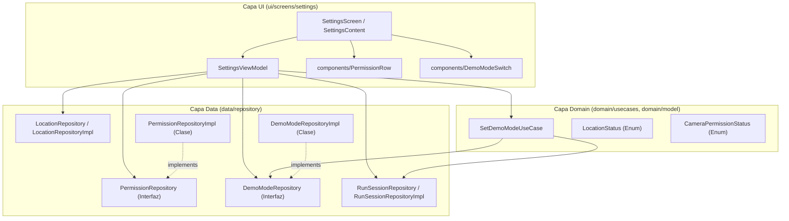

# Technical Design Document — Configuración

> **Revisión 2026-11-23 · nueva UI de Configuración.** Esta nota manda sobre lo que se contradiga más
> abajo (ver también la revisión de `requirements.md`).
>
> - `SettingsContent` recibe un solo `onOpenSystemSettingsClick` (antes uno por permiso; los dos abrían
>   `appDetailsSettingsIntent`). La pantalla no tiene lógica: pasa valores de `SettingsUiState`.
> - `SettingsUiState` suma `arePermissionsGranted`. `showLocationSettingsButton` y
>   `showCameraSettingsButton` indican que falta el permiso y solo alimentan `arePermissionsGranted`.
> - Componentes en `ui/screens/settings/components/`:
>   - `SettingsGroup.kt`: `SettingsSectionHeader`, `SettingsGroup` (card) y `SettingsRow` (ícono,
>     título, subtítulo y contenido a la derecha).
>   - `PermissionRow`: ícono, subtítulo, estado y flecha; siempre tocable (conceder o revocar).
>   - `PermissionNotice` (nuevo): «Acceso restringido» o el mensaje de permisos completos (ícono de
>     check, colores de éxito); en los dos casos, debajo, el botón «Ir a configuración».
>   - `DemoModeSwitch`: fila con ícono y subtítulo dentro de una card, en la sección «Avanzado».

## Executive Summary

La pantalla "Configuración" permite a los corredores consultar el estado real de los permisos de ubicación y cámara, acceder a los ajustes del sistema Android cuando faltan permisos, y gestionar el interruptor de "Modo demo" para simular carreras sin salir a la calle, asegurando mediante un caso de uso de dominio (`SetDemoModeUseCase`) que no se pueda modificar mientras un recorrido está en curso.

Sigue la arquitectura por capas del proyecto (`ui → domain → data`) con interfaz e implementación de repositorios agrupadas en `data/repository/`, reutilización directa de `LocationRepository.readLocationStatus()` para el estado de ubicación, y navegación de 2 pestañas principales (`ACTIVITY` y `PROFILE`).

---

## Architectural Overview & Layer Breakdown



---

## Package Structure & Component Inventory

### 1. Archivos

#### Capa `domain`
* `domain/usecases/SetDemoModeUseCase.kt`
  * Paquete: `com.trazo.app.domain.usecases`
  * Propósito: Caso de uso que encapsula la regla de negocio del modo demo: si `runSessionRepository.isRunInProgress.value` es `true`, ignora la solicitud; si es `false`, delega la persistencia en `demoModeRepository.setDemoModeEnabled(enabled)`.

#### Capa `data`
* `data/repository/PermissionRepository.kt` & `PermissionRepositoryImpl.kt`
  * Paquete: `com.trazo.app.data.repository`
  * Propósito: Interfaz e implementación exclusiva para consultar el estado del permiso de cámara (`readCameraPermissionStatus(): CameraPermissionStatus`). Lee `ContextCompat.checkSelfPermission` directamente sin capas intermedias.
* `data/repository/DemoModeRepository.kt` & `DemoModeRepositoryImpl.kt`
  * Paquete: `com.trazo.app.data.repository`
  * Propósito: Interfaz e implementación que expone `val isDemoModeEnabled: Flow<Boolean>` y `suspend fun setDemoModeEnabled(enabled: Boolean)`. Implementado directamente con `SharedPreferences` usando `by lazy` tanto para las preferencias como para el flujo inicial, evitando lecturas a disco en el constructor (`init`).
* `data/di/PermissionModule.kt` & `data/di/DemoModeModule.kt`
  * Paquete: `com.trazo.app.data.di`
  * Propósito: Módulos Hilt (`@Module`, `@InstallIn(SingletonComponent::class)`) con un único `@Binds` por módulo para vincular cada repositorio con su implementación.

#### Capa `ui`
* `ui/screens/settings/SettingsScreen.kt`
  * Paquete: `com.trazo.app.ui.screens.settings`
  * Propósito: Composable principal que conecta `SettingsViewModel` y expone `SettingsContent` (stateless).
* `ui/screens/settings/SettingsViewModel.kt`
  * Paquete: `com.trazo.app.ui.screens.settings`
  * Propósito: ViewModel `@HiltViewModel` que expone `SettingsUiState`, consulta `locationRepository.readLocationStatus()`, `permissionRepository.readCameraPermissionStatus()`, y delega `onDemoModeToggled` directamente a `SetDemoModeUseCase`.
* `ui/screens/settings/components/PermissionRow.kt`
  * Paquete: `com.trazo.app.ui.screens.settings.components`
  * Propósito: Componente para cada permiso (Ubicación / Cámara) con etiqueta de estado traducida mediante `stringResource` y botón "Ir a configuración".
* `ui/screens/settings/components/DemoModeSwitch.kt`
  * Paquete: `com.trazo.app.ui.screens.settings.components`
  * Propósito: Componente del interruptor de Modo Demo con avisos de estado y bloqueo visual cuando hay carrera activa.

---

## Reused vs. New Components

| Componente | Origen | Estado | Uso en Configuración |
|---|---|---|---|
| `TrazoDestination.PROFILE` | `ui/navigation/TrazoDestination.kt` | Reutilizado | Pestaña Perfil que aloja la barra superior con el botón de engranaje. |
| `ProfileScreen.kt` | `ui/screens/profile/ProfileScreen.kt` | Reutilizado / Conectado | Pasa la acción `onSettingsClick` al NavController. |
| `RunSessionRepository.isRunInProgress` | `data/repository/RunSessionRepository.kt` | Reutilizado | Estado reactivo `StateFlow<Boolean>` para determinar si hay un recorrido en curso. |
| `LocationSettingsIntent.kt` | `ui/navigation/LocationSettingsIntent.kt` | Reutilizado / Extendida | `appDetailsSettingsIntent(context)` abre los ajustes de la app (`ACTION_APPLICATION_DETAILS_SETTINGS`). |
| `LocationStatus.kt` | `domain/model/LocationStatus.kt` | Reutilizado | Enum del estado de ubicación (`READY`, `DEVICE_LOCATION_OFF`, `APPROXIMATE_ONLY`, `PERMISSION_DENIED`). |
| `LocationRepository.readLocationStatus()` | `data/repository/LocationRepository.kt` | **Reutilizado Directamente** | Reutilizado tanto para la pantalla de Configuración como para el inicio de recorrido, sin modificar su implementación. |
| `CameraPermissionStatus.kt` | `domain/model/CameraPermissionStatus.kt` | Reutilizado | Enum del estado del permiso de cámara (`GRANTED`, `DENIED`, `UNKNOWN`). |
| `SetDemoModeUseCase.kt` | `domain/usecases/SetDemoModeUseCase.kt` | Nuevo | Caso de uso que protege el cambio de modo demo cuando hay un recorrido activo. |

---

## Requirement Mapping

| Requisito | Componente / Clase Encargada | Detalles de Implementación |
|---|---|---|
| **Requirement 1: Abrir Configuración** | `ProfileScreen.kt` $\rightarrow$ `TrazoApp.kt` $\rightarrow$ `SettingsScreen.kt` | El engranaje invoca `onSettingsClick()`. `TrazoApp` ejecuta `navController.navigate("settings")`. `SettingsScreen` renderiza secciones "Permisos" y "Modo demo". |
| **Requirement 2: Estado de los permisos** | `LocationRepository.readLocationStatus()` y `PermissionRepository.readCameraPermissionStatus()` $\rightarrow$ `SettingsViewModel` $\rightarrow$ `PermissionRow.kt` | `SettingsViewModel` consulta directamente `LocationRepository.readLocationStatus()` y `PermissionRepository.readCameraPermissionStatus()`. `SettingsUiState` guarda `LocationStatus` y `CameraPermissionStatus`. La UI mapea: `READY` y `DEVICE_LOCATION_OFF` $\rightarrow$ "Precisa"; `APPROXIMATE_ONLY` $\rightarrow$ "Aproximada"; `PERMISSION_DENIED` $\rightarrow$ "Denegada". |
| **Requirement 3: Ir a la configuración del sistema** | `PermissionRow.kt` $\rightarrow$ `LocationSettingsIntent.kt` | Reutiliza `appDetailsSettingsIntent(context)` que abre los ajustes de la aplicación cuando Ubicación es `APPROXIMATE_ONLY` o `PERMISSION_DENIED`, o cuando Cámara no es `GRANTED`. |
| **Requirement 4: Actualizar al volver de los ajustes** | `SettingsScreen.kt` (`DisposableEffect` / `ON_RESUME`) | Escucha el evento `ON_RESUME` del ciclo de vida en `SettingsScreen` para ejecutar `viewModel.onRefreshPermissions()`, reevaluando el estado inmediatamente. |
| **Requirement 5: Activar y desactivar el modo demo** | `SetDemoModeUseCase` $\rightarrow$ `DemoModeRepository` $\rightarrow$ `DemoModeSwitch.kt` | Cuando no hay recorrido en curso, `SetDemoModeUseCase` permite el cambio, `DemoModeRepositoryImpl` persiste en `SharedPreferences` y la UI muestra `"Modo demo activado: los recorridos son simulados"` vía `R.string.settings_demo_mode_active_notice`. |
| **Requirement 6: Modo demo con recorrido en curso** | `RunSessionRepository.isRunInProgress` $\rightarrow$ `SetDemoModeUseCase` $\rightarrow$ `SettingsViewModel` | `SettingsUiState` expone `isRunInProgress` e `isDemoModeSwitchEnabled`. En la UI el Switch se deshabilita y muestra `"Finalizá el recorrido para cambiar el modo demo"`. `SettingsViewModel.onDemoModeToggled` delega ciegamente a `SetDemoModeUseCase`, que no hace nada si `isRunInProgress.value == true`. |

---

## Design Specifics

### 1. Reutilización de `LocationRepository.readLocationStatus()` y `LocationStatus`
En lugar de crear un enum o lector duplicado, se aprovecha `LocationRepository.readLocationStatus()`, cuya evaluación en `LocationStatusChecks.kt` garantiza el orden:
1. `ACCESS_FINE_LOCATION` concedido $\rightarrow$ `READY` (si ubicación del dispositivo activada) o `DEVICE_LOCATION_OFF` (si está desactivada).
2. Solo `ACCESS_COARSE_LOCATION` concedido $\rightarrow$ `APPROXIMATE_ONLY`.
3. Ninguno concedido $\rightarrow$ `PERMISSION_DENIED`.

En la UI:
* `READY` y `DEVICE_LOCATION_OFF` se muestran como **"Precisa"** (`R.string.settings_permission_exact`).
* `APPROXIMATE_ONLY` se muestra como **"Aproximada"** (`R.string.settings_permission_approximate`).
* `PERMISSION_DENIED` se muestra como **"Denegada"** (`R.string.settings_permission_denied`).
* `showLocationSettingsButton` es `true` solo para `APPROXIMATE_ONLY` o `PERMISSION_DENIED`.

### 2. `PermissionRepository` Simplificado
`PermissionRepository` queda dedicado exclusivamente a permisos fuera de ubicación:
```kotlin
interface PermissionRepository {
    fun readCameraPermissionStatus(): CameraPermissionStatus
}
```
Su implementación `PermissionRepositoryImpl` verifica `ContextCompat.checkSelfPermission` directamente con `@ApplicationContext private val context: Context`, eliminando la interfaz `PermissionReader`.

### 3. `DemoModeRepositoryImpl` Directo con Inicialización Perezosa
`DemoModeRepositoryImpl` utiliza `SharedPreferences` sin intermediarios:
* El acceso a `SharedPreferences` y a `MutableStateFlow` es `by lazy`.
* No se realiza lectura a disco en el constructor (`init`), difiriendo el I/O hasta el primer consumo de `isDemoModeEnabled` o llamada a `setDemoModeEnabled`.

### 4. Regla del Modo Demo en Domain (`SetDemoModeUseCase`)
La validación de no alterar el modo demo durante una carrera se extrae del ViewModel a la capa de dominio:
```kotlin
class SetDemoModeUseCase @Inject constructor(
    private val demoModeRepository: DemoModeRepository,
    private val runSessionRepository: RunSessionRepository,
) {
    suspend operator fun invoke(enabled: Boolean) {
        if (runSessionRepository.isRunInProgress.value) return
        demoModeRepository.setDemoModeEnabled(enabled)
    }
}
```
`SettingsViewModel.onDemoModeToggled` solo delega en el caso de uso sin bifurcaciones condicionales (`if`).

---

## Testing Strategy & Hand-Written Fakes

* `FakeLocationRepository`: Fake JVM existente para controlar `readLocationStatus()`.
* `FakePermissionRepository`: Controla `cameraStatus` y registra llamadas a `readCameraPermissionStatus()`.
* `FakeDemoModeRepository`: Registra llamadas en `setDemoModeCalls` y emite `isDemoModeEnabled`.
* `FakeRunSessionRepository`: Permite alternar `isRunInProgress`.

### Pruebas Unitarias
1. `SetDemoModeUseCaseTest`:
   * Con recorrido en curso, no persiste.
   * Sin recorrido en curso, persiste `true` y `false`.
2. `SettingsViewModelTest`:
   * Reflejo del estado inicial y visibilidad de botones.
   * Botón de configuración de ubicación visible solo con `APPROXIMATE_ONLY` y `PERMISSION_DENIED`.
   * Botón de configuración de cámara visible cuando no es `GRANTED`.
   * Refresco de permisos en `onRefreshPermissions()`.
   * Delegación en `onDemoModeToggled` y respeto del bloqueo con carrera activa.
3. `SettingsContentTest`:
   * Renderizado de textos ("Precisa", "Aproximada", "Denegada", "Permitida").
   * Botones de ajuste según el estado de cada permiso.
   * Comportamiento y avisos del switch de modo demo.
4. `PermissionRepositoryImplTest` (Robolectric):
   * Verificación de `readCameraPermissionStatus()` con permisos concedidos y denegados.
5. `DemoModeRepositoryImplTest` (Robolectric):
   * Valor por defecto (`false`), lectura previa (`true`), y actualización/persistencia reactiva.
