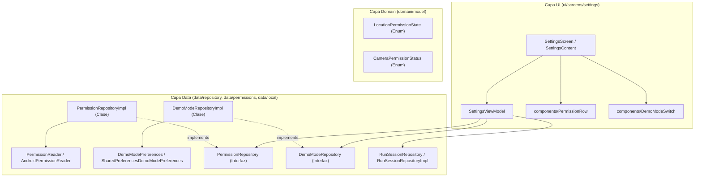

# Technical Design Document — Configuración

## Executive Summary

La pantalla "Configuración" permite a los corredores consultar el estado real de los permisos de ubicación y cámara, acceder a los ajustes del sistema Android cuando faltan permisos, y gestionar el interruptor de "Modo demo" para simular carreras sin salir a la calle, asegurando que no se pueda modificar mientras un recorrido está en curso.

Sigue la arquitectura por capas del proyecto (`ui → domain → data`) con interfaz e implementación de repositorios agrupadas en `data/repository/`, y la navegación de 2 pestañas principales (`ACTIVITY` y `PROFILE`).

---

## Architectural Overview & Layer Breakdown



---

## Package Structure & Component Inventory

### 1. Archivos Nuevos

#### Capa `domain`
* `domain/model/LocationPermissionState.kt`
  * Paquete: `com.trazo.app.domain.model`
  * Propósito: Enum de dominio con los estados puros del permiso de ubicación (`EXACT`, `APPROXIMATE`, `DENIED`).

#### Capa `data`
* `data/permissions/PermissionReader.kt` & `AndroidPermissionReader.kt`
  * Paquete: `com.trazo.app.data.permissions`
  * Propósito: Lector que evalúa los permisos Android de ubicación (`ACCESS_FINE_LOCATION`, `ACCESS_COARSE_LOCATION`) y cámara (`CAMERA`).
* `data/local/DemoModePreferences.kt` & `SharedPreferencesDemoModePreferences.kt`
  * Paquete: `com.trazo.app.data.local`
  * Propósito: Fuente de persistencia local `@Singleton` del valor del modo demo mediante `SharedPreferences`, actualizando un `MutableStateFlow` al escribir.
  * **Justificación de tecnología**: La biblioteca `DataStore` no está incluida en el catálogo de dependencias del proyecto (`gradle/libs.versions.toml`). Se utiliza `SharedPreferences` en `data/local/` para mantener las dependencias livianas, 100 % locales y sin agregar librerías externas.
* `data/repository/PermissionRepository.kt` & `PermissionRepositoryImpl.kt`
  * Paquete: `com.trazo.app.data.repository`
  * Propósito: Interfaz e implementación unificada para consultar los estados reales de permisos de ubicación y cámara.
* `data/repository/DemoModeRepository.kt` & `DemoModeRepositoryImpl.kt`
  * Paquete: `com.trazo.app.data.repository`
  * Propósito: Interfaz e implementación que expone `val isDemoModeEnabled: Flow<Boolean>` y la función `suspend fun setDemoModeEnabled(enabled: Boolean)`.
* `data/di/PermissionModule.kt` & `data/di/DemoModeModule.kt`
  * Paquete: `com.trazo.app.data.di`
  * Propósito: Módulos Hilt (`@Module`, `@InstallIn(SingletonComponent::class)`) con anotaciones `@Binds` para vincular repositorios con sus implementaciones.

#### Capa `ui`
* `ui/screens/settings/SettingsScreen.kt`
  * Paquete: `com.trazo.app.ui.screens.settings`
  * Propósito: Composable principal que conecta `SettingsViewModel` y expone `SettingsContent` (stateless).
* `ui/screens/settings/SettingsViewModel.kt`
  * Paquete: `com.trazo.app.ui.screens.settings`
  * Propósito: ViewModel `@HiltViewModel` que gestiona `SettingsUiState` y responde a eventos del usuario.
* `ui/screens/settings/components/PermissionRow.kt`
  * Paquete: `com.trazo.app.ui.screens.settings.components`
  * Propósito: Componente para cada permiso (Ubicación / Cámara) con etiqueta de estado y botón "Ir a configuración".
* `ui/screens/settings/components/DemoModeSwitch.kt`
  * Paquete: `com.trazo.app.ui.screens.settings.components`
  * Propósito: Componente del interruptor de Modo Demo con avisos de estado y bloqueo cuando hay carrera activa.

### 2. Archivos Modificados

* `app/src/main/res/values/strings.xml`
  * Agregar claves de texto con prefijo `settings_` en español rioplatense (voseo).
* `app/src/main/java/com/trazo/app/ui/navigation/LocationSettingsIntent.kt`
  * Agregar la función auxiliar `appDetailsSettingsIntent(context)` para abrir los ajustes de la app.
* `app/src/main/java/com/trazo/app/ui/navigation/TrazoScaffold.kt`
  * Registrar la constante `SETTINGS_ROUTE = "settings"`, el slot `settingsScreen` y ocultar la barra inferior en dicha ruta.
* `app/src/main/java/com/trazo/app/ui/navigation/TrazoApp.kt`
  * Conectar el parámetro `onSettingsClick` de `ProfileScreen` y proveer `SettingsScreen` al slot `settingsScreen`.
* `app/src/test/java/com/trazo/app/ui/navigation/TrazoScaffoldTest.kt`
  * Agregar prueba de navegación para `SETTINGS_ROUTE` y verificación del ocultamiento de la barra inferior.

---

## Reused vs. New Components

| Componente | Origen | Estado | Uso en Configuración |
|---|---|---|---|
| `TrazoDestination.PROFILE` | `ui/navigation/TrazoDestination.kt` | Reutilizado | Pestaña Perfil que aloja la barra superior con el botón de engranaje. |
| `ProfileScreen.kt` | `ui/screens/profile/ProfileScreen.kt` | Reutilizado / Conectado | Pasa la acción `onSettingsClick` al NavController. |
| `RunSessionRepository.isRunInProgress` | `data/repository/RunSessionRepository.kt` | Reutilizado | Estado reactivo `StateFlow<Boolean>` para determinar si hay un recorrido en curso. |
| `LocationSettingsIntent.kt` | `ui/navigation/LocationSettingsIntent.kt` | Reutilizado / Extendida | `appDetailsSettingsIntent(context)` abre los ajustes de la app (`ACTION_APPLICATION_DETAILS_SETTINGS`). |
| `CameraPermissionStatus.kt` | `domain/model/CameraPermissionStatus.kt` | Reutilizado | Enum del estado del permiso de cámara (`GRANTED`, `DENIED`, `UNKNOWN`). |
| `TrazoTopBar.kt` | `ui/components/layout/TrazoTopBar.kt` | Reutilizado | Barra superior con título "Configuración" y botón de retorno. |
| `PrimaryButton.kt` / `TrazoTheme` | `ui/components/common/` / `ui/theme/` | Reutilizados | Estilos, colores y botones del sistema de diseño Trazo. |
| `LocationRepository.readLocationStatus()` | `data/repository/LocationRepository.kt` | **Intacto (Sin Cambios)** | Preservado exclusivamente para la verificación del estado del GPS en el inicio de recorrido. |

---

## Requirement Mapping

| Requisito | Componente / Clase Encargada | Detalles de Implementación |
|---|---|---|
| **Requirement 1: Abrir Configuración** | `ProfileScreen.kt` $\rightarrow$ `TrazoApp.kt` $\rightarrow$ `SettingsScreen.kt` | El engranaje invoca `onSettingsClick()`. `TrazoApp` ejecuta `navController.navigate("settings")`. `SettingsScreen` renderiza secciones "Permisos" y "Modo demo". |
| **Requirement 2: Estado de los permisos** | `PermissionRepository` $\rightarrow$ `SettingsViewModel` $\rightarrow$ `PermissionRow.kt` | `SettingsViewModel` consulta `PermissionRepository` y almacena en `SettingsUiState` los enums `LocationPermissionState` y `CameraPermissionStatus` puros. La UI traduce con `stringResource`. |
| **Requirement 3: Ir a la configuración del sistema** | `PermissionRow.kt` $\rightarrow$ `LocationSettingsIntent.kt` | Reutiliza `appDetailsSettingsIntent(context)` que abre los ajustes de la aplicación (`Settings.ACTION_APPLICATION_DETAILS_SETTINGS`) cuando Ubicación no es `EXACT` o Cámara no es `GRANTED`. |
| **Requirement 4: Actualizar al volver de los ajustes** | `SettingsScreen.kt` (`DisposableEffect` / `ON_RESUME`) | Escucha el evento `ON_RESUME` del ciclo de vida en `SettingsScreen` para ejecutar `viewModel.onRefreshPermissions()`, reevaluando el estado inmediatamente. |
| **Requirement 5: Activar y desactivar el modo demo** | `DemoModeRepository` $\rightarrow$ `SettingsViewModel` $\rightarrow$ `DemoModeSwitch.kt` | Cuando no hay recorrido en curso, permite cambiar el interruptor, persiste el valor en `DemoModePreferences` y la UI muestra `"Modo demo activado: los recorridos son simulados"` vía `R.string.settings_demo_mode_active_notice`. |
| **Requirement 6: Modo demo con recorrido en curso** | `RunSessionRepository.isRunInProgress` $\rightarrow$ `SettingsViewModel` | `SettingsViewModel` expone `isRunInProgress` en `SettingsUiState`, deshabilita el Switch en la UI e **ignora programáticamente** cualquier llamada a `onDemoModeToggled` cuando `isRunInProgress == true`. La UI muestra `"Finalizá el recorrido para cambiar el modo demo"` vía `R.string.settings_demo_mode_running_notice`. |

---

## Design Specifics

### 1. Manejo Unificado e Independiente de Permisos
Para respetar el requisito explícito de **no modificar `LocationRepository.readLocationStatus()`** (utilizado para advertir si la ubicación del dispositivo está desactivada al iniciar), se unifican las lecturas de permisos en un único repositorio en `data/repository/`:

```kotlin
// domain/model/LocationPermissionState.kt
enum class LocationPermissionState { EXACT, APPROXIMATE, DENIED }

// data/repository/PermissionRepository.kt
interface PermissionRepository {
    fun readLocationPermissionState(): LocationPermissionState
    fun readCameraPermissionStatus(): CameraPermissionStatus
}
```

En `AndroidPermissionReader.kt` (ubicado en `data/permissions/`):
* Si `ACCESS_FINE_LOCATION` está concedido $\rightarrow$ `LocationPermissionState.EXACT` ("Precisa").
* Si únicamente `ACCESS_COARSE_LOCATION` está concedido $\rightarrow$ `LocationPermissionState.APPROXIMATE` ("Aproximada").
* Si ninguno está concedido $\rightarrow$ `LocationPermissionState.DENIED` ("Denegada").
* Si `CAMERA` está concedido $\rightarrow$ `CameraPermissionStatus.GRANTED` ("Permitida"); si no es concedido o es `UNKNOWN` $\rightarrow$ se trata como no concedido (`showCameraSettingsButton = true`).
* **Resultado:** El estado del permiso refleja estrictamente el otorgamiento del permiso Android, sin marcar "Denegada" cuando la ubicación del dispositivo está desactivada pero el permiso sí fue concedido.

### 2. ViewModel Desacoplado de Android
`SettingsViewModel` inyecta `PermissionRepository`, `DemoModeRepository` y `RunSessionRepository`. En ningún momento el ViewModel utiliza `Context`, `ContextCompat` ni fuentes de datos directas.

### 3. `SettingsUiState` Puro y Mapeo en UI
`SettingsUiState` almacena únicamente modelos y enums de dominio:
```kotlin
data class SettingsUiState(
    val locationPermissionState: LocationPermissionState = LocationPermissionState.DENIED,
    val cameraPermissionStatus: CameraPermissionStatus = CameraPermissionStatus.DENIED,
    val isDemoModeEnabled: Boolean = false,
    val isRunInProgress: Boolean = false,
) {
    val showLocationSettingsButton: Boolean
        get() = locationPermissionState != LocationPermissionState.EXACT

    val showCameraSettingsButton: Boolean
        get() = cameraPermissionStatus != CameraPermissionStatus.GRANTED

    val isDemoModeSwitchEnabled: Boolean
        get() = !isRunInProgress
}
```
En la UI Compose (`DemoModeSwitch.kt`), el mensaje de aviso se resuelve con `stringResource`:
```kotlin
val noticeText = when {
    state.isRunInProgress -> stringResource(R.string.settings_demo_mode_running_notice)
    state.isDemoModeEnabled -> stringResource(R.string.settings_demo_mode_active_notice)
    else -> null
}
```

### 4. Persistencia del Modo Demo y Protección en Curso
* **Persistencia en `data/local/`**: `SharedPreferencesDemoModePreferences.kt` es una clase `@Singleton` que almacena la preferencia en `SharedPreferences` y actualiza un `MutableStateFlow<Boolean>` directamente al escribir.
* **Protección Programática en ViewModel**:
  ```kotlin
  fun onDemoModeToggled(enabled: Boolean) {
      if (runSessionRepository.isRunInProgress.value) {
          // Ignora la solicitud si hay un recorrido en curso
          return
      }
      viewModelScope.launch {
          demoModeRepository.setDemoModeEnabled(enabled)
      }
  }
  ```
* **Continuidad del Recorrido Activo**: Entrar a Configuración y volver mientras un recorrido está en curso **no interrumpe ni altera la carrera**. La sesión vive en `RunSessionRepositoryImpl` (componente `@Singleton` administrado en el scope de la aplicación), por lo que navegar fuera del Mapa no cancela los coroutine jobs de tracking.

### 5. Refresco Automático de Permisos (`ON_RESUME`)
En `SettingsScreen.kt`:
```kotlin
val lifecycleOwner = LocalLifecycleOwner.current
DisposableEffect(lifecycleOwner) {
    val observer = LifecycleEventObserver { _, event ->
        if (event == Lifecycle.Event.ON_RESUME) {
            viewModel.onRefreshPermissions()
        }
    }
    lifecycleOwner.lifecycle.addObserver(observer)
    onDispose {
        lifecycleOwner.lifecycle.removeObserver(observer)
    }
}
```

### 6. Apertura de Ajustes del Sistema Android
Al presionar "Ir a configuración", `SettingsScreen` invoca `appDetailsSettingsIntent(context)` de `LocationSettingsIntent.kt` (que abre `Settings.ACTION_APPLICATION_DETAILS_SETTINGS` de la aplicación).

### 7. Centralización de Textos
Todos los textos visibles se cargan mediante `stringResource(R.string.settings_*)` desde `res/values/strings.xml` en español de Argentina con voseo:
* `settings_title`: "Configuración"
* `settings_back`: "Volver"
* `settings_permissions_section`: "Permisos"
* `settings_location_label`: "Ubicación"
* `settings_camera_label`: "Cámara"
* `settings_permission_exact`: "Precisa"
* `settings_permission_approximate`: "Aproximada"
* `settings_permission_denied`: "Denegada"
* `settings_permission_granted`: "Permitida"
* `settings_go_to_settings`: "Ir a configuración"
* `settings_demo_mode_section`: "Modo demo"
* `settings_demo_mode_label`: "Modo demo"
* `settings_demo_mode_active_notice`: "Modo demo activado: los recorridos son simulados"
* `settings_demo_mode_running_notice`: "Finalizá el recorrido para cambiar el modo demo"

---

## Navigation & Screen Integration

* **Destinos Principales:** `TrazoDestination` mantiene únicamente las 2 pestañas principales (`ACTIVITY` y `PROFILE`).
* **Ruta Apilada:** La pantalla Configuración se registra en `NavHost` como la ruta apilada `SETTINGS_ROUTE = "settings"` (fuera del enum de pestañas).
* **Conexión de Engranaje:** En `ProfileScreen.kt`, la barra superior invoca `onSettingsClick()`. En `TrazoApp.kt`, `onSettingsClick` ejecuta:
  ```kotlin
  navController.navigate(SETTINGS_ROUTE) { launchSingleTop = true }
  ```
* **Ocultamiento de Barra Inferior:** En `TrazoApp.kt`, `BottomNavBar` se oculta cuando `currentRoute == SETTINGS_ROUTE` (siguiendo el mismo patrón existente con `RESULT_ROUTE`).
* **Botón de Volver:** La barra superior de `SettingsScreen` incluye el botón de retroceso con `contentDescription = stringResource(R.string.settings_back)` que invoca `onBackClick()`, ejecutando `navController.popBackStack()`.

---

## Testing Strategy & Hand-Written Fakes

Se crearán fakes escritos a mano en `app/src/test/java/com/trazo/app/`:
* `FakePermissionRepository`: Permite alternar dinámicamente los estados de permisos de ubicación (`EXACT`, `APPROXIMATE`, `DENIED`) y cámara (`GRANTED`, `DENIED`, `UNKNOWN`).
* `FakeDemoModeRepository`: Permite simular cambios de `isDemoModeEnabled` y verificar las llamadas a `setDemoModeEnabled`.
* `FakeRunSessionRepository`: Permite controlar `isRunInProgress: StateFlow<Boolean>`.

### Casos de Prueba Unitarias (`SettingsViewModelTest.kt`)
1. **Valor Inicial Inmediato:** Comprobar que `uiState.value` antes de colectar ya refleja el estado retornado por los repositorios.
2. **Permisos Concedidos:** Comprobar `LocationPermissionState.EXACT` y `CameraPermissionStatus.GRANTED` sin botones "Ir a configuración".
3. **Permisos Denegados / Aproximados / Desconocidos:** Comprobar presencia del botón "Ir a configuración" cuando la ubicación es `APPROXIMATE` o `DENIED`, o cuando la cámara es `DENIED` o `UNKNOWN`.
4. **Refresco en ON_RESUME (`onRefreshPermissions`):** Verificar que la reevaluación actualice el `uiState`.
5. **Modo Demo Habilitado (Sin Carrera Activa):** Verificar activación del interruptor, llamada al repositorio y estado `isDemoModeEnabled == true`.
6. **Modo Demo Inhabilitado (Carrera en Curso):** Cuando `isRunInProgress == true`, comprobar que `isDemoModeSwitchEnabled == false` y que la función `onDemoModeToggled` **ignore** cualquier solicitud sin persistir ni cambiar el estado.

---

## Preview Strategy

Se proporcionará **exactamente UN `@Preview`** en `SettingsScreen.kt` envolviendo `SettingsContent` en `TrazoTheme`:

```kotlin
@Preview(showBackground = true, widthDp = 360, heightDp = 640)
@Composable
private fun SettingsContentPreview() {
    TrazoTheme {
        SettingsContent(
            state = SettingsUiState(
                locationPermissionState = LocationPermissionState.EXACT,
                cameraPermissionStatus = CameraPermissionStatus.DENIED,
                isDemoModeEnabled = true,
                isRunInProgress = false,
            ),
            onBackClick = {},
            onLocationSettingsClick = {},
            onCameraSettingsClick = {},
            onDemoModeToggle = {}
        )
    }
}
```

---

Me detengo en este punto conforme a tus instrucciones. Quedo a la espera de tu revisión y aprobación de las correcciones antes de continuar.
