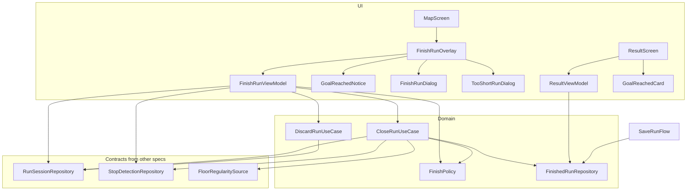
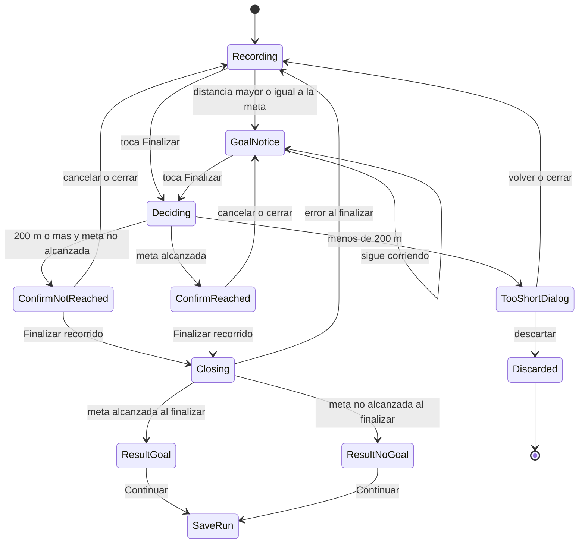
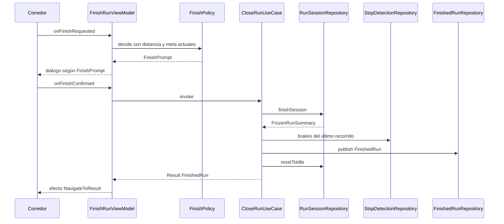

# Design Document · finish-run-result

## Overview

**Purpose**: esta funcionalidad entrega al corredor el cierre de su recorrido: el aviso de meta
alcanzada mientras sigue corriendo, la confirmación al tocar «Finalizar», el aviso de recorrido
demasiado corto y la pantalla de resultado («¡Meta cumplida!» o «Recorrido finalizado») con el paso a
«Guardar recorrido».

**Users**: corredores recreativos que registran un recorrido con meta de 3, 5 o 10 km.

**Impact**: hoy `MapScreen` es un placeholder y no existen el modelo de recorrido, la ruta `result`
ni el botón «Finalizar». Este diseño agrega, sobre el contrato de HU-04, la decisión de cierre
(pura y testeable), tres piezas de UI montadas en el Mapa, la pantalla `result` y el contenedor en
memoria que entrega el recorrido terminado a `save-run`.

### Goals

- Decidir de forma pura y testeable qué sucede al tocar «Finalizar» (confirmar con meta cumplida,
  confirmar sin meta, demasiado corto).
- Que llegar a la meta solo muestre el aviso: el registro sigue activo hasta que el corredor
  confirme (decisiones de la reunión de equipo, `team-notes/README.md`).
- Entregar a `save-run` un único `FinishedRun` completo e inmutable, sin pasar la traza por
  argumentos de navegación.
- Cumplir accesibilidad: «Quitar animaciones», fuente al 200 %, estado no solo por color.

### Non-Goals

- Formulario de guardado, destacados y fotos (`save-run`).
- Cálculo de frenadas (`stop-detection`), de regularidad (HU-05.2) y de las métricas (HU-04).
- Botón «Finalizar» y su ubicación en `RunControls` (HU-04).
- Persistencia en disco y recuperación ante muerte del proceso.
- Librería de animación (Lottie): las animaciones son nativas de Compose.

## Boundary Commitments

### This Spec Owns

- Regla de cierre `FinishPolicy`: meta alcanzada, umbral de 200 m y los tres desenlaces de
  «Finalizar».
- Casos de uso `CloseRunUseCase` (finaliza, ensambla y publica el `FinishedRun`) y
  `DiscardRunUseCase` (descarta el recorrido).
- Modelo `FinishedRun` y el contenedor `FinishedRunRepository` (contrato hacia `save-run`).
- `FinishRunViewModel` y sus piezas de UI en el Mapa: `GoalReachedNotice`, `FinishRunDialog`,
  `TooShortRunDialog` y el montaje `FinishRunOverlay`.
- Pantalla `result` completa (`ResultScreen`, `ResultViewModel`, `GoalReachedCard`) y su ruta.
- Utilidad `rememberReduceMotion()` si todavía no existe (se comparte con `stop-detection`).
- Textos de los avisos, diálogos y resultado (`finish_*`, `result_*`).

### Out of Boundary

- `RunControls`, el botón «Finalizar», `MapViewModel` y `MapUiState` (HU-04, Persona 3).
- `FinishConfirmDialog` y `GoalCelebrationOverlay` propuestos por HU-04: este diseño los **reemplaza**
  (ver Revalidation Triggers); HU-04 no debe implementarlos.
- Detección y conteo de frenadas, alerta de frenada y consulta de 20 s (`stop-detection`). Solo se
  consume su contrato y se le pide ocultar su alerta.
- Regularidad del piso y modo demo (sin dueño: HU-05.2 y Configuración). Solo se consumen.
- Pantalla «Guardar recorrido», su ruta y qué hace al guardar o descartar (`save-run`).
- Permisos, GPS, pausa y reanudación.

### Allowed Dependencies

- `domain` (Kotlin puro): `RunSessionRepository`, `FrozenRunSummary`, `RunSession`, `RunGoal`,
  `RoutePoint` (HU-04); `StopDetectionRepository`, `StopKind` (`stop-detection`).
- `ui/screens/result` y `ui/screens/map/` → `domain`, `ui/components`, `ui/theme`. Nunca `data`.
- Hilt (`@Singleton`) para `FinishedRunRepository`; Navigation Compose para la ruta `result`.
- No se agrega ninguna librería. Los tests usan `kotlinx-coroutines-test` (lo agrega
  `stop-detection`; si falta, se suma a `libs.versions.toml` avisando al equipo).

### Revalidation Triggers

- HU-04 cambia la forma de `FrozenRunSummary`, `RunSession` o `RunState`, o el contrato de
  `finishSession()` y `resetToIdle()`.
- HU-04 pasa a implementar su propio `FinishConfirmDialog` o `GoalCelebrationOverlay` (duplicaría el
  dueño de lo que se ve en el Mapa al finalizar o al llegar a la meta).
- `stop-detection` cambia `StopDetectionState.brakes`, `classifyCurrentStop` o su estabilidad
  posterior al fin del recorrido.
- `save-run` cambia la forma que espera de `FinishedRun` o quién lo limpia de
  `FinishedRunRepository`.
- Se define el dueño de la regularidad o del modo demo (cambia `FloorRegularitySource` y
  `FrozenRunSummary.isDemo`).

## Architecture

### Existing Architecture Analysis

- Una Activity, `TrazoApp` con `Scaffold` + `BottomNavBar` y `NavHost` de 3 rutas (`home`, `map`,
  `history`). `TrazoDestination` modela solo las pestañas.
- `domain/` y `data/` están casi vacíos en esta rama (solo `RunGoal`). El modelo de recorrido y el
  repositorio de HU-04 viven en `origin/HU-04-map` y todavía no están integrados.
- Precedente de diálogo: `StartRunDialog` (`AlertDialog` centrado, `PrimaryButton` + `OutlinedButton`).
- Convenciones de steering: `ui → domain ← data`; `Screen` + `Content` stateless + `ViewModel` +
  `UiState`; contratos en `domain/repository/`; tests JVM con fakes a mano.

### Architecture Pattern & Boundary Map



**Architecture Integration**

- **Selected pattern**: Opción C del análisis (`research.md`): regla pura en dominio, cambios
  mínimos en HU-04, UI propia montada por parámetro. Mismo patrón de montaje que
  `StopDetectionOverlay`.
- **Boundaries**: HU-04 mide y expone; este diseño decide y presenta el cierre; `save-run` consume
  `FinishedRun`. Ninguna capa de UI importa `data`.
- **Existing patterns preserved**: Screen/Content/ViewModel/UiState, state hoisting, ViewModel que
  solo observa repositorios `@Singleton`, textos en `strings.xml`, tokens de `ui/theme`.
- **New components rationale**: `FinishPolicy` aísla la regla de 200 m y de meta (testeable sin
  Android); `FinishedRunRepository` evita pasar la traza por navegación; `FinishRunViewModel`
  concentra el flujo para que HU-04 no lo duplique.
- **Steering compliance**: dirección `ui → domain ← data`; sin hex ni medidas sueltas; voseo
  rioplatense.

### Technology Stack

| Layer | Choice / Version | Role in Feature | Notes |
|-------|------------------|-----------------|-------|
| UI | Jetpack Compose (BOM 2025.04.01) + Material 3 | Aviso, diálogos y pantalla de resultado | `AlertDialog`, `AnimatedVisibility`, `Animatable` |
| Navegación | Navigation Compose | Ruta `result`, `BackHandler` | Sin argumentos con la traza |
| Estado | Coroutines / `StateFlow` | `FinishRunUiState`, `FinishedRunRepository` | `collectAsStateWithLifecycle` |
| DI | Hilt (Dagger 2.60) | Binding `@Singleton` del contenedor y de la fuente de regularidad | |
| Tests | JUnit 4 + fakes + `kotlinx-coroutines-test`; Compose UI Test | Dominio, ViewModels y `Content` | Sin MockK |

## File Structure Plan

### Directory Structure

```
app/src/main/java/com/trazo/app/
├── domain/
│   ├── model/result/
│   │   ├── FinishedRun.kt            # Recorrido terminado: contrato hacia save-run
│   │   ├── FinishPrompt.kt           # enum: TOO_SHORT, CONFIRM_GOAL_NOT_REACHED, CONFIRM_GOAL_REACHED
│   │   └── FinishError.kt            # sealed: TooShort, Failed (error de CloseRunUseCase)
│   ├── repository/
│   │   ├── FinishedRunRepository.kt  # Contenedor en memoria del FinishedRun (puerto)
│   │   └── FloorRegularitySource.kt  # Puerto: regularidad del recorrido (null = sin dato)
│   └── usecases/
│       ├── FinishPolicy.kt           # Regla pura: meta alcanzada, 200 m, decide()
│       ├── CloseRunUseCase.kt        # Finaliza, ensambla FinishedRun, publica y reinicia
│       └── DiscardRunUseCase.kt      # Detiene y reinicia la sesión sin guardar
├── data/
│   ├── repository/InMemoryFinishedRunRepository.kt   # @Singleton, StateFlow<FinishedRun?>
│   └── sensors/NoRegularitySource.kt                 # Binding provisorio: siempre null
├── di/FinishRunModule.kt             # @Binds de los dos puertos
└── ui/
    ├── theme/ReduceMotion.kt         # rememberReduceMotion() (compartida; si no existe se crea)
    ├── navigation/                   # ver Modified Files
    └── screens/
        ├── map/
        │   ├── FinishRunViewModel.kt         # FinishRunUiState + ViewModel + FinishRunEffect
        │   └── components/
        │       ├── FinishRunOverlay.kt       # Conecta el ViewModel y monta aviso + diálogos
        │       ├── GoalReachedNotice.kt      # Aviso animado con «Finalizar»
        │       ├── FinishRunDialog.kt        # Confirmación con un mensaje parametrizable
        │       └── TooShortRunDialog.kt      # Aviso de recorrido demasiado corto
        └── result/
            ├── ResultScreen.kt               # ResultScreen + ResultContent stateless
            ├── ResultViewModel.kt            # ResultUiState + ViewModel + ResultEffect
            ├── ResultFormatter.kt            # Distancia, tiempo y regularidad como texto
            └── components/GoalReachedCard.kt # Tarjeta con check, título y métricas
app/src/main/res/
├── values/strings_finish_run.xml             # finish_* y result_*
└── drawable/ic_goal_check.xml                # Check de la celebración (Material Symbols)
app/src/test/java/com/trazo/app/              # replica el paquete de lo probado
app/src/androidTest/java/com/trazo/app/ui/screens/{map/components,result}/
```

> `GoalReachedNotice` y los diálogos nacen en `screens/map/components/` (solo los usa el Mapa). Si
> otra pantalla los necesita, se mueven a `ui/components/common/` (regla de `ui-components.md`).

### Modified Files

- `ui/screens/map/MapScreen.kt` — **archivo de Persona 3**. Se suma por parámetro: monta
  `FinishRunOverlay(onNavigateToResult)` sobre el contenido, conecta `onFinishClick` de
  `RunControls` a `FinishRunViewModel.onFinishRequested` y pasa `isClosureVisible` a
  `StopDetectionOverlay`. Se hace en la tarea de integración, tras HU-04.
- `ui/navigation/TrazoApp.kt` — agrega la ruta `result` (`ResultScreen`), oculta la barra inferior
  en esa ruta y navega a `saverun` con «Continuar». La ruta `saverun` es de Persona 1.
- `ui/navigation/TrazoDestination.kt` — sin cambios: `result` no es pestaña. La ruta se define como
  constante en `TrazoApp.kt`.
- `ui/screens/startrun` y `stop-detection` — sin cambios; `StopDetectionOverlay` recibe el parámetro
  `hideAlerts: Boolean` (lo agrega `stop-detection`, ver Interfaces).
- `res/values/strings.xml` — sin cambios; los textos van en `strings_finish_run.xml`.
- `gradle/libs.versions.toml` / `app/build.gradle.kts` — solo si falta `kotlinx-coroutines-test`.

## System Flows





**Decisiones de flujo**

- **Se decide al tocar, se resuelve al confirmar.** El `FinishPrompt` se calcula con la distancia al
  tocar «Finalizar». El título del resultado («¡Meta cumplida!» o «Recorrido finalizado») y el
  indicador `goalReached` se calculan con la distancia **congelada** por `finishSession()`. Si el
  corredor cruza la meta con el diálogo «Todavía no llegaste…» abierto (el registro sigue, 3.2),
  igual ve «¡Meta cumplida!»; el mensaje del diálogo puede quedar desactualizado, y es aceptable.
- **El aviso de meta es derivado, no un estado guardado.** `goalReached = distancia ≥ meta` sobre
  `activeSession`. La distancia no decrece, así que no hace falta recordar que se alcanzó. El aviso
  se ve mientras la sesión esté `ACTIVE` o `PAUSED`.
- **«Finalizar» desde pausa** aplica la misma lógica (`finishSession()` acepta `ACTIVE` y `PAUSED`).
  El modo demo y la regla de 200 m: aplica igual (decisión del análisis de brechas).
- **Tras publicar el `FinishedRun` se llama a `resetToIdle()`** para no dejar una sesión `FINISHED`
  sin dueño. Los datos del recorrido viven en `FinishedRunRepository` hasta que `save-run` los limpie.
- **Descartar** usa `finishSession()` (detiene GPS y temporizador, ignora el resumen) y luego
  `resetToIdle()`. No depende de que `resetToIdle()` detenga el seguimiento.
- **«Atrás» en el resultado no hace nada** (`BackHandler` activo sin acción) y la pantalla no tiene
  flecha de volver: el recorrido no está guardado y se perdería. La barra inferior se oculta. El
  descarte posterior lo ofrece «Guardar recorrido» (diálogo «¿Descartar el recorrido?»).

## Requirements Traceability

| Requirement | Summary | Components | Interfaces | Flows |
|-------------|---------|------------|------------|-------|
| 1.1 | Aviso animado con «Finalizar» al llegar a la meta | `GoalReachedNotice`, `FinishRunViewModel` | `FinishRunUiState.isGoalNoticeVisible`, `FinishPolicy.isGoalReached` | GoalNotice |
| 1.2 | Se puede seguir corriendo; el registro sigue | `FinishRunViewModel` (no detiene nada) | No llama a `finishSession()` al llegar a la meta | GoalNotice → GoalNotice |
| 1.3 | «Finalizar» disponible mientras el aviso está visible | `GoalReachedNotice` | `onFinishClick` | GoalNotice |
| 1.4 | Sin aviso si no se llegó a la meta | `FinishRunViewModel` | `isGoalNoticeVisible = false` | Recording |
| 1.5 | Aviso sin animación con «Quitar animaciones» | `GoalReachedNotice`, `ReduceMotion` | `rememberReduceMotion()` | — |
| 2.1 | Confirmación «¿Estás seguro de que deseás finalizar?» con la meta cumplida | `FinishRunDialog`, `FinishPolicy` | `FinishPrompt.CONFIRM_GOAL_REACHED` | ConfirmReached |
| 2.2 | Sigue registrando con el diálogo abierto | `FinishRunViewModel` | Sin cambios sobre la sesión | ConfirmReached |
| 2.3 | Confirmar detiene y muestra «¡Meta cumplida!» | `CloseRunUseCase`, `ResultScreen` | `onFinishConfirmed`, `FinishedRun.goalReached` | Closing → ResultGoal |
| 2.4 | Cancelar o cerrar conserva el recorrido | `FinishRunViewModel` | `onFinishDismissed` | ConfirmReached → GoalNotice |
| 3.1 | Confirmación «Todavía no llegaste a tu meta. …» (≥ 200 m) | `FinishRunDialog`, `FinishPolicy` | `FinishPrompt.CONFIRM_GOAL_NOT_REACHED` | ConfirmNotReached |
| 3.2 | Sigue registrando con el diálogo abierto | `FinishRunViewModel` | — | ConfirmNotReached |
| 3.3 | Confirmar detiene y muestra «Recorrido finalizado» | `CloseRunUseCase`, `ResultScreen` | `onFinishConfirmed` | Closing → ResultNoGoal |
| 3.4 | Cancelar o cerrar conserva el recorrido | `FinishRunViewModel` | `onFinishDismissed` | ConfirmNotReached → Recording |
| 4.1 | Aviso < 200 m con descartar o volver | `TooShortRunDialog`, `FinishPolicy` | `FinishPrompt.TOO_SHORT` | TooShortDialog |
| 4.2 | El aviso corto reemplaza a las dos confirmaciones | `FinishPolicy.decide` | `TOO_SHORT` tiene prioridad sobre las otras dos | Deciding |
| 4.3 | Sigue registrando con el aviso abierto | `FinishRunViewModel` | — | TooShortDialog |
| 4.4 | Volver o cerrar conserva el recorrido | `FinishRunViewModel` | `onTooShortDismissed` | TooShortDialog → Recording |
| 4.5 | Descartar detiene, elimina y vuelve al Mapa en cero | `DiscardRunUseCase` | `onDiscardConfirmed` | Discarded |
| 4.6 | Sin paso a «Guardar recorrido» si < 200 m | `CloseRunUseCase` | `FinishError.TooShort` | Closing |
| 5.1 | Distancia, tiempo, regularidad y «Continuar» (o «No disponible») | `ResultContent`, `ResultFormatter` | `ResultUiState` | ResultGoal / ResultNoGoal |
| 5.2 | Título «¡Meta cumplida!» con animación | `GoalReachedCard` | `FinishedRun.goalReached = true` | ResultGoal |
| 5.3 | Título «Recorrido finalizado» sin animación | `GoalReachedCard` | `goalReached = false` | ResultNoGoal |
| 5.4 | «¡Meta cumplida!» estática con «Quitar animaciones» | `GoalReachedCard`, `ReduceMotion` | `rememberReduceMotion()` | — |
| 5.5 | Valores tal como los entrega el registro | `ResultFormatter`, `CloseRunUseCase` | Solo formatea; no recalcula | — |
| 5.6 | No registra mientras se ve el resultado | `CloseRunUseCase` | `finishSession()` ya detuvo el registro | Closing |
| 6.1 | «Continuar» abre «Guardar recorrido» | `ResultScreen`, `TrazoApp` | `onContinue` → ruta `saverun` | SaveRun |
| 6.2 | Conserva distancia, tiempo, velocidad, frenadas, regularidad y meta | `FinishedRun`, `FinishedRunRepository` | `FinishedRun` (`regularityPercent = null` = «sin dato») | SaveRun |
| 6.3 | Conserva fecha y hora de inicio, demo y traza | `FinishedRun`, `CloseRunUseCase` | `startedAtEpochMillis`, `isDemo`, `routePoints` | SaveRun |
| 6.4 | Indica meta alcanzada o no | `FinishedRun` | `goalReached` | SaveRun |
| 6.5 | Título, destacados y fotos son de `save-run` | — (límite de la spec) | Boundary Commitments | — |
| 7.1 | Sin alerta de frenada ni consulta de 20 s con un aviso de cierre visible | `FinishRunViewModel`, `StopDetectionOverlay` | `FinishRunUiState.isClosureVisible` → `hideAlerts` | Todos los estados de aviso |
| 7.2 | La frenada se registra igual | `StopDetectionRepository` (sin cambios) | Ocultar no pausa la detección | — |
| 7.3 | Consulta pendiente al aparecer el cierre → frenada | `FinishRunViewModel` | `classifyCurrentStop(StopKind.BRAKE)` | GoalNotice / diálogos |

## Components and Interfaces

| Component | Domain/Layer | Intent | Req Coverage | Key Dependencies (P0/P1) | Contracts |
|-----------|--------------|--------|--------------|--------------------------|-----------|
| `FinishPolicy` | Domain | Regla pura de meta y de 200 m | 1.1, 1.4, 2.1, 3.1, 4.1, 4.2 | `RunGoal` (P0) | Service |
| `FinishedRun` | Domain model | Recorrido terminado para `save-run` | 5.5, 6.2, 6.3, 6.4 | `RunGoal`, `RoutePoint` (P0) | State |
| `FinishedRunRepository` | Domain port | Contenedor en memoria | 6.1–6.4 | — | Service, State |
| `FloorRegularitySource` | Domain port | Regularidad del recorrido | 5.1, 6.2 | HU-05.2 (P2, sin dueño) | Service |
| `CloseRunUseCase` | Domain | Finaliza, ensambla y publica | 2.3, 3.3, 4.6, 5.5, 5.6, 6.2, 6.3, 6.4 | `RunSessionRepository` (P0), `StopDetectionRepository` (P0), `FinishedRunRepository` (P0), `FloorRegularitySource` (P1) | Service |
| `DiscardRunUseCase` | Domain | Descarta sin guardar | 4.5 | `RunSessionRepository` (P0) | Service |
| `FinishRunViewModel` | UI | Estado del aviso y diálogos; efectos | 1.1–1.4, 2.1–2.4, 3.1–3.4, 4.1–4.5, 7.1, 7.3 | `RunSessionRepository` (P0), casos de uso (P0), `StopDetectionRepository` (P1) | State |
| `FinishRunOverlay` | UI | Monta aviso y diálogos | 1.1–1.5, 2.1–2.4, 3.1–3.4, 4.1–4.5 | `FinishRunViewModel` (P0) | — |
| `GoalReachedNotice`, `FinishRunDialog`, `TooShortRunDialog` | UI | Presentación | 1.1, 1.3, 1.5, 2.1, 3.1, 4.1 | `ui/theme` (P0), `ReduceMotion` (P1) | — |
| `ResultViewModel` | UI | Estado de la pantalla de resultado | 5.1–5.5, 6.1 | `FinishedRunRepository` (P0) | State |
| `ResultScreen`, `ResultContent`, `GoalReachedCard`, `ResultFormatter` | UI | Presentación del resultado | 5.1–5.4, 6.1 | `ui/theme` (P0), `ReduceMotion` (P1) | — |

### Domain

#### FinishPolicy

| Field | Detail |
|-------|--------|
| Intent | Fuente única de la regla de meta alcanzada y del umbral de 200 m |
| Requirements | 1.1, 1.4, 2.1, 3.1, 4.1, 4.2 |

**Responsibilities & Constraints**
- Funciones puras, sin estado ni Android. La distancia entra en metros; el adaptador convierte desde
  `RunMetrics.distanceKilometers` (Float, km) con `distanceKilometers * 1000.0`.
- Un solo lugar define «meta alcanzada»: lo usan el aviso, el diálogo y `goalReached` del
  `FinishedRun` (evita tres cálculos distintos).

**Contracts**: Service [x]

```kotlin
enum class FinishPrompt { TOO_SHORT, CONFIRM_GOAL_NOT_REACHED, CONFIRM_GOAL_REACHED }

object FinishPolicy {
    const val MIN_SAVEABLE_DISTANCE_METERS: Double = 200.0

    fun isGoalReached(distanceMeters: Double, goal: RunGoal): Boolean

    fun decide(distanceMeters: Double, goal: RunGoal): FinishPrompt
}
```

- Preconditions: `distanceMeters >= 0`.
- Postconditions: `isGoalReached` ⇔ `distanceMeters >= goal.kilometers * 1000`. `decide` devuelve
  `TOO_SHORT` si `distanceMeters < 200`; si no, `CONFIRM_GOAL_REACHED` cuando `isGoalReached`, y
  `CONFIRM_GOAL_NOT_REACHED` en el resto. `TOO_SHORT` tiene prioridad (4.2).
- Invariantes: 199,9 m → `TOO_SHORT`; 200,0 m → confirmación; igual a la meta cuenta como alcanzada.

> `RunGoal` en esta rama tiene `kilometers: Int`; la rama de HU-04 usa `distanceKm: Float`. Se usa
> `kilometers`; si HU-04 cambia el enum al integrarse, se ajusta solo `FinishPolicy` (revalidación).

#### FinishedRun y FinishedRunRepository

| Field | Detail |
|-------|--------|
| Intent | Entregar a `save-run` el recorrido terminado sin pasar la traza por navegación |
| Requirements | 6.1, 6.2, 6.3, 6.4 |

**Contracts**: Service [x] / State [x]

```kotlin
data class FinishedRun(
    val sessionId: String,
    val startedAtEpochMillis: Long,        // fecha y hora reales de inicio (las guarda HU-04)
    val goal: RunGoal,
    val goalReached: Boolean,              // distancia congelada >= meta
    val isDemo: Boolean,
    val distanceKm: Float,
    val elapsedSeconds: Long,
    val averageSpeedKmh: Float,
    val brakeCount: Int,                   // frenadas válidas (sin pausas personales)
    val regularityPercent: Int?,           // null = «sin dato»; nunca 0 % por falta de sensor
    val routePoints: List<RoutePoint>,     // copia inmutable
)

interface FinishedRunRepository {
    val finishedRun: StateFlow<FinishedRun?>
    fun publish(run: FinishedRun)
    fun clear()
}
```

- Preconditions: `publish` solo desde `CloseRunUseCase`.
- Postconditions: `finishedRun.value` es el último recorrido terminado hasta `clear()` o hasta que
  se publique otro. `save-run` lo lee y llama a `clear()` al guardar o descartar.
- Invariantes: `goal` nunca es nulo; `regularityPercent` solo es `null` o está en 0..100;
  `routePoints` no se modifica después de `publish`.
- Implementación: `InMemoryFinishedRunRepository` (`@Singleton`, `MutableStateFlow`), sin disco.

#### FloorRegularitySource

**Contracts**: Service [x]

```kotlin
interface FloorRegularitySource {
    suspend fun regularityPercent(sessionId: String): Int?   // null = sin acelerómetro o sin dato
}
```

- Existe porque el dueño de la regularidad (HU-05.2) no está definido. Hasta entonces se enlaza
  `NoRegularitySource`, que devuelve `null`: la app funciona y muestra «No disponible» (5.1, 6.2).
  Cuando haya dueño, solo cambia el binding.

#### CloseRunUseCase

| Field | Detail |
|-------|--------|
| Intent | Detener el recorrido, ensamblar el `FinishedRun` y publicarlo |
| Requirements | 2.3, 3.3, 4.6, 5.5, 5.6, 6.2, 6.3, 6.4 |

**Contracts**: Service [x]

```kotlin
sealed interface FinishError {
    data object TooShort : FinishError
    data class Failed(val cause: Throwable) : FinishError
}

class CloseRunUseCase @Inject constructor(
    private val runSessions: RunSessionRepository,
    private val stopDetection: StopDetectionRepository,
    private val regularity: FloorRegularitySource,
    private val finishedRuns: FinishedRunRepository,
) {
    suspend operator fun invoke(): Result<FinishedRun>   // failure lleva un FinishError
}
```

- Orden: (1) `runSessions.finishSession()`; si falla → `FinishError.Failed`. (2) Si
  `totalDistanceKm * 1000 < 200` → publica nada y devuelve `FinishError.TooShort` (guarda de 4.6; el
  registro ya se detuvo, caso imposible desde la UI pero invariante del dominio). (3) Arma el
  `FinishedRun` con el resumen, `goalReached = FinishPolicy.isGoalReached(...)`,
  `brakeCount = stopDetection.state.value.brakes.size` y la regularidad. (4) `finishedRuns.publish`.
  (5) `runSessions.resetToIdle()`.
- Precondiciones: sesión `ACTIVE` o `PAUSED`. Postcondición: el registro está detenido y
  `finishedRuns.finishedRun` contiene el recorrido.
- Los valores se copian tal como los entrega el registro: no se recalcula distancia, tiempo ni
  velocidad (5.5).

#### DiscardRunUseCase

```kotlin
class DiscardRunUseCase @Inject constructor(private val runSessions: RunSessionRepository) {
    suspend operator fun invoke(): Result<Unit>   // finishSession() ignorando el resumen + resetToIdle()
}
```

- Postcondición: sin sesión en curso (`IDLE`) y ningún `FinishedRun` publicado por esta operación.

### UI (Mapa)

#### FinishRunViewModel

| Field | Detail |
|-------|--------|
| Intent | Estado del aviso de meta y de los diálogos de cierre; ejecuta cierre y descarte |
| Requirements | 1.1–1.4, 2.1–2.4, 3.1–3.4, 4.1–4.5, 7.1, 7.3 |

**Contracts**: State [x]

```kotlin
data class FinishRunUiState(
    val isGoalNoticeVisible: Boolean = false,
    val prompt: FinishPrompt? = null,          // diálogo abierto, o null
    val isFinishing: Boolean = false,          // evita doble toque mientras cierra
) {
    val isClosureVisible: Boolean get() = isGoalNoticeVisible || prompt != null
}

sealed interface FinishRunEffect {
    data object NavigateToResult : FinishRunEffect
    data object ShowFinishError : FinishRunEffect   // snackbar «No pudimos finalizar…»
}

@HiltViewModel
class FinishRunViewModel @Inject constructor(
    runSessions: RunSessionRepository,
    private val closeRun: CloseRunUseCase,
    private val discardRun: DiscardRunUseCase,
    private val stopDetection: StopDetectionRepository,
) : ViewModel() {
    val uiState: StateFlow<FinishRunUiState>
    val effects: Flow<FinishRunEffect>
    fun onFinishRequested()        // botón «Finalizar» (de RunControls o del aviso)
    fun onFinishConfirmed()        // «Finalizar recorrido»
    fun onFinishDismissed()        // «Cancelar», atrás o tocar afuera
    fun onTooShortDismissed()      // volver al recorrido, atrás o tocar afuera
    fun onDiscardConfirmed()       // «Descartar»
}
```

- `isGoalNoticeVisible` se deriva de `activeSession`: sesión `ACTIVE` o `PAUSED` con
  `FinishPolicy.isGoalReached(...)`. No hay estado propio que sincronizar.
- `onFinishRequested` ignora el toque si ya hay un diálogo o `isFinishing`; si no, fija
  `prompt = FinishPolicy.decide(distancia actual, meta)`. Si no hay sesión en curso, no hace nada.
- **Prioridad de cierre (7.3)**: cuando `isClosureVisible` pasa de `false` a `true`, llama a
  `stopDetection.classifyCurrentStop(StopKind.BRAKE)` (no-op si no hay consulta pendiente). Solo en
  esa transición, no en cada cambio.
- Nada de este ViewModel pausa ni detiene el registro hasta `onFinishConfirmed` o
  `onDiscardConfirmed` (1.2, 2.2, 3.2, 4.3).
- Errores: si `closeRun` falla (`Failed`), cierra el diálogo, emite `ShowFinishError` y el recorrido
  sigue. `TooShort` se trata igual (no debería ocurrir).

#### FinishRunOverlay y piezas de presentación

- `FinishRunOverlay(onNavigateToResult, modifier)`: `hiltViewModel()` + colecta `uiState` y `effects`;
  expone `isClosureVisible` hacia arriba con un callback `onClosureVisibleChange` para que `MapScreen`
  se lo pase a `StopDetectionOverlay(hideAlerts = …)` (7.1).
- `GoalReachedNotice(onFinishClick, modifier)`: tarjeta `surfaceContainerLowest`, forma `medium`,
  elevación `level2`, ícono `ic_goal_check` en Success700 sobre Success200, texto «¡Llegaste a tu
  meta!» y botón «Finalizar» (56 dp). Entrada `slideInVertically + fadeIn` una vez; con
  `rememberReduceMotion()` usa `EnterTransition.None` (1.5). Texto + ícono: el estado no depende
  del color. `liveRegion = Polite` en el texto.
- `FinishRunDialog(message, onConfirm, onDismiss)`: `AlertDialog` como `StartRunDialog`;
  `confirmButton` = `PrimaryButton` «Finalizar recorrido», `dismissButton` = `OutlinedButton`
  «Cancelar». `message` es el texto de 2.1 o de 3.1. `onDismissRequest = onDismiss`.
- `TooShortRunDialog(onDiscard, onBack)`: título «Recorrido demasiado corto», texto «Necesitás al
  menos 200 metros para guardar un recorrido.». «Descartar» es el botón destructivo (Error600) y
  «Volver al recorrido» es outlined. Cerrar o atrás equivale a volver (4.4). El texto no dice
  cuánto falta para no recalcular valores en la UI.
- Los objetivos táctiles miden 48 dp; los botones envuelven en varias líneas a fuente 200 %.

### UI (Resultado)

#### ResultViewModel

**Contracts**: State [x]

```kotlin
data class ResultUiState(
    val isGoalReached: Boolean = false,
    val goalKm: Int = 0,
    val distanceText: String = "",
    val timeText: String = "",
    val regularityText: String? = null,    // null = mostrar «No disponible»
    val isLoaded: Boolean = false,
)

sealed interface ResultEffect { data object LeaveToMap : ResultEffect }

@HiltViewModel
class ResultViewModel @Inject constructor(
    finishedRuns: FinishedRunRepository,
    formatter: ResultFormatter,
) : ViewModel() {
    val uiState: StateFlow<ResultUiState>
    val effects: Flow<ResultEffect>
}
```

- Mapea `FinishedRun` → `ResultUiState` vía `ResultFormatter`; no recalcula (5.5). Si
  `finishedRun` es `null` (por ejemplo, la app se recreó sin datos) emite `LeaveToMap`.
- `ResultFormatter` (puro, `es-AR`): distancia con coma decimal y «km» (`5,2 km`), tiempo
  `HH:MM:SS`, regularidad `80 %` (espacio, sin decimales). Candidato a unificarse con
  `MetricFormatter` de HU-04 cuando ambos estén integrados.

#### ResultScreen / ResultContent / GoalReachedCard

- `ResultScreen(onContinue, onLeave)`: conecta el ViewModel, consume `LeaveToMap` y registra
  `BackHandler(enabled = true) {}` (la atrás no hace nada).
- `ResultContent(state, onContinue)`: fondo `primary` a pantalla completa y `GoalReachedCard`
  centrada, según la guía visual 6.13. Botón filled «Continuar» a todo el ancho (único filled).
- `GoalReachedCard`: tarjeta blanca `extraLarge`. Con meta cumplida: check Primary950 de 76 dp en
  halo Secondary100 de 104 dp, título «¡Meta cumplida!» (`headlineMedium`) y «Completaste tu meta de
  5 km.»; el check entra con `scale` (spring) + `fadeIn` y un halo que pulsa una vez (5.2). Sin
  meta cumplida: mismo layout sin check ni animación, título «Recorrido finalizado» y marca
  «Incompleto» (5.3). Con `rememberReduceMotion()` el check se dibuja estático y el contenido es el
  mismo (5.4).
- Recuadros de métricas (fondo Neutral100, forma `medium`, `headlineMedium.tabular()`): Distancia,
  Tiempo y Regularidad. Sin acelerómetro, el recuadro de regularidad muestra «No disponible» en
  texto (5.1). **Frenadas no se muestra**: el requisito 5.1 no la incluye aunque la guía visual 6.13
  tenga una grilla 2 × 2; se conserva en `FinishedRun` para `save-run` (6.2).
- El título lleva `heading()` y la celebración no se lee dos veces con TalkBack.

### Navegación

- `TrazoApp` define `const val RESULT_ROUTE = "result"`. `MapScreen` recibe
  `onNavigateToResult = { navController.navigate(RESULT_ROUTE) { launchSingleTop = true } }`.
- La barra inferior se oculta cuando `currentRoute == RESULT_ROUTE`.
- `onContinue` navega a la ruta de `save-run` (6.1). Mientras esa ruta no exista, el botón queda
  conectado a un callback vacío y la tarea de integración lo cierra (ver Open Questions).

### Contrato pedido a otras specs

| Spec | Lo que este diseño necesita |
|------|-----------------------------|
| HU-04 (Persona 3) | `FrozenRunSummary` con `startedAtEpochMillis` e `isDemo` (hoy solo marcas monotónicas). `finishSession()` y `resetToIdle()` como en su diseño. No implementar `FinishConfirmDialog` ni `GoalCelebrationOverlay`. `RunControls` llama a `onFinishRequested`. |
| `stop-detection` (Persona 4) | `StopDetectionOverlay(hideAlerts: Boolean)`: oculta alerta y consulta sin pausar la detección. `RunningRunSource` pasa a `RunState.ACTIVE` (hoy usa `RUNNING`). |
| `save-run` (Persona 1) | Lee `FinishedRunRepository.finishedRun`, llama a `clear()` al terminar y define la ruta `saverun`. |

## Data Models

### Domain Model

- `FinishedRun` es un objeto de valor inmutable, único por recorrido terminado. No hay agregados ni
  transacciones.
- Regla de negocio: un recorrido de menos de 200 m nunca produce un `FinishedRun` (4.6).
- `goalReached` se calcula una sola vez, sobre la distancia congelada, y es la única fuente del
  título del resultado y del indicador «meta cumplida / incompleto» de `save-run`.

### Data Contracts & Integration

- Intercambio con `save-run`: en memoria, por `StateFlow<FinishedRun?>`. Sin serialización ni
  argumentos de navegación (la traza es grande).
- Ciclo de vida: `publish` → (resultado, «Continuar», guardado) → `clear`. Se pierde si el proceso
  muere (fuera de alcance, igual que HU-04).

## Error Handling

### Error Strategy

El recorrido en curso tiene prioridad: ante cualquier error al cerrar, el corredor vuelve al
recorrido sin perder datos.

### Error Categories and Responses

| Escenario | Respuesta | UI |
|-----------|-----------|----|
| `finishSession()` falla (por ejemplo, la sesión ya terminó) | `FinishError.Failed`; no se publica nada | Cierra el diálogo, snackbar «No pudimos finalizar el recorrido. Intentá de nuevo.» |
| Doble toque en «Finalizar recorrido» | `isFinishing` ignora el segundo toque | Botón sin efecto repetido |
| Sin sesión al tocar «Finalizar» (`IDLE`) | `onFinishRequested` no hace nada | Los controles ya están deshabilitados en `IDLE` (HU-04) |
| Resultado sin datos (`finishedRun == null`) | `LeaveToMap` | Vuelve al Mapa |
| Distancia cruza la meta con el diálogo abierto | El título final sale de la distancia congelada | Resultado «¡Meta cumplida!» aunque el mensaje decía otra cosa |
| Sin acelerómetro | `regularityPercent = null` | «No disponible», y «sin dato» hacia `save-run` |

## Testing Strategy

### Unit Tests (JVM, `app/src/test`)

- `FinishPolicyTest`: 199,9 m → `TOO_SHORT`; 200,0 m con meta no alcanzada →
  `CONFIRM_GOAL_NOT_REACHED`; distancia igual a la meta (3000 m con 3 km) →
  `CONFIRM_GOAL_REACHED`; `TOO_SHORT` gana aunque el celular reporte meta alcanzada (1.1, 1.4, 2.1,
  3.1, 4.1, 4.2).
- `CloseRunUseCaseTest` con fakes de los puertos: publica `FinishedRun` con valores tal cual los
  entrega el resumen, `brakeCount` de `StopDetectionState.brakes`, `regularityPercent = null` sin
  fuente, `goalReached` sobre la distancia congelada, y llama a `resetToIdle()` al final; falla de
  `finishSession()` → `Failed` sin publicar; distancia < 200 m → `TooShort` (2.3, 3.3, 4.6, 5.5, 6.2,
  6.3, 6.4).
- `DiscardRunUseCaseTest`: detiene la sesión y deja `IDLE`; no publica `FinishedRun` (4.5).
- `FinishRunViewModelTest` (tiempo virtual): el aviso aparece al llegar a la meta y **no** llama a
  `finishSession()` (1.1, 1.2, 1.4); `onFinishRequested` abre cada diálogo según la distancia
  (2.1, 3.1, 4.1); cancelar o cerrar conserva la sesión (2.4, 3.4, 4.4); confirmar emite
  `NavigateToResult`; fallo emite `ShowFinishError`; `isClosureVisible` y una sola llamada a
  `classifyCurrentStop(BRAKE)` en la transición (7.1, 7.3); desde `PAUSED` funciona igual.
- `ResultViewModelTest` y `ResultFormatterTest`: `FinishedRun` → texto (`5,2 km`, `00:32:10`,
  `80 %`); regularidad `null` → «No disponible»; `null` en el repositorio → `LeaveToMap` (5.1, 5.5).

### Integration Tests

- `InMemoryFinishedRunRepositoryTest`: `publish` y `clear`; la traza no se modifica desde afuera
  (6.3).
- Flujo `FinishRunViewModel` + `CloseRunUseCase` + `ResultViewModel` con fakes: finalizar con meta →
  `goalReached = true`; sin meta → `false`; el resultado lee lo publicado (2.3, 3.3, 6.2, 6.4).

### UI Tests (`app/src/androidTest`, `createComposeRule` + `TrazoTheme`)

- `GoalReachedNotice`: muestra el texto y «Finalizar»; con `isReduceMotion` fijo no anima (1.1, 1.3,
  1.5).
- `FinishRunDialog` y `TooShortRunDialog`: textos exactos de 2.1, 3.1 y 4.1; «Cancelar» y cerrar
  invocan `onDismiss`; «Descartar» invoca `onDiscard`.
- `ResultContent`: «¡Meta cumplida!» y «Recorrido finalizado» con sus métricas y «Continuar»;
  «No disponible» sin regularidad; el título «Recorrido finalizado» no tiene check (5.1–5.4).
- Accesibilidad: fuente al 200 % sin recortes; estado comunicado con texto e ícono.

## Security Considerations

Sin cuentas ni red. El recorrido y la traza solo existen en memoria; `FinishedRunRepository` se
limpia al guardar o descartar. No se registra la ubicación en logs.

## Performance & Scalability

- La traza (miles de puntos) no se copia por navegación: se comparte por referencia inmutable y se
  copia una sola vez en `finishSession()` (HU-04).
- `FinishRunViewModel` deriva el aviso con `map` + `distinctUntilChanged` sobre `activeSession`
  para no recomponer en cada punto GPS.

## Open Questions / Risks

- **El aviso de meta no se descarta** (1.3: «hasta que el corredor lo toque») y 7.1 oculta las
  alertas de frenada mientras esté visible. Efecto: tras llegar a la meta y seguir corriendo, no
  aparecen más alertas ni consultas de 20 s; las frenadas se registran igual (7.2) pero quedan
  clasificadas como frenada. A confirmar con el equipo; si molesta, la salida es que el aviso se
  achique a un botón «Finalizar» después de unos segundos (requiere cambiar 1.3).
- **Dueño del diálogo de «Finalizar»**: este diseño asume que lo implementa esta spec y que HU-04
  no implementa `FinishConfirmDialog` (decisión pendiente entre Personas 3 y 4).
- **`FrozenRunSummary` sin fecha de inicio ni modo demo**: la fecha la guarda HU-04 (decisión 5); el
  modo demo sigue sin dueño. Hasta que existan, los campos bloquean la integración con HU-04.
- **Regularidad (HU-05.2) sin dueño**: `NoRegularitySource` mantiene la app funcional.
- **«Atrás» sin acción en el resultado** y barra inferior oculta: decisión de UX para no perder el
  recorrido; validar con el equipo de diseño.
- **La ruta `saverun` no existe todavía**: «Continuar» queda conectado a un callback vacío hasta que
  `save-run` la defina.
- **Orden de integración**: si HU-04 no entra a `develop` antes, las tareas de dominio y de UI
  stateless avanzan contra fakes; la integración con `MapScreen` espera a HU-04.
- **`rememberReduceMotion()`** la usan esta spec y `stop-detection`: la crea quien llegue primero.
- **Variación con la guía visual**: la grilla de 6.13 incluye «Frenadas»; los requisitos no.
