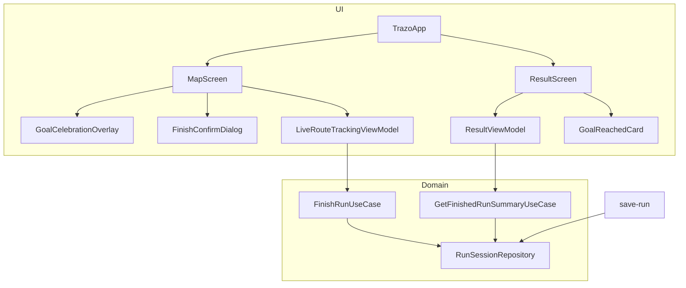
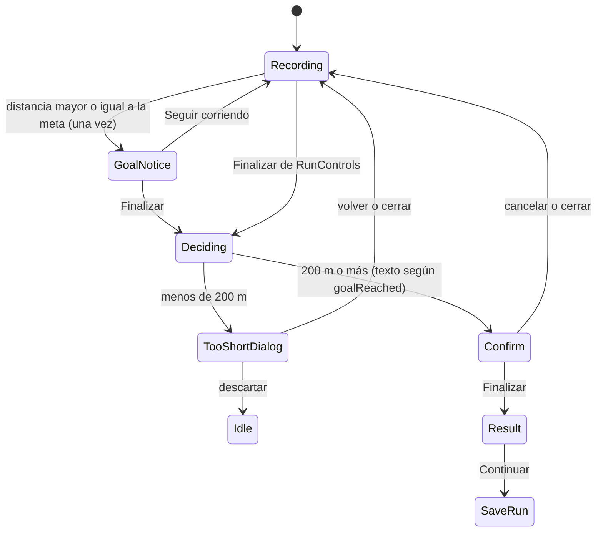
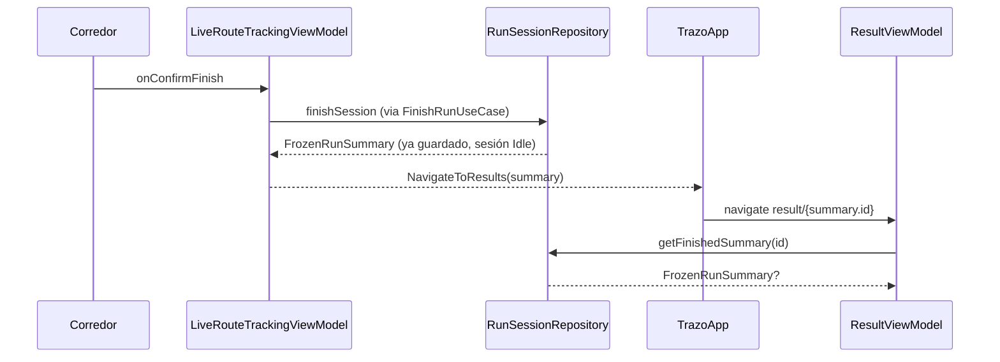

# Design Document · finish-run-result

> Revisado contra el código real de `feat/hu-06-resultado` (con HU-04 ya mergeada desde `develop`).
> Los requisitos no cambian. Varias piezas que este diseño pensaba crear **ya existen** en HU-04
> (Persona 3); lo que queda para esta spec es la pantalla de resultado, su ruta y un ajuste mínimo
> al aviso de meta existente.

## Overview

**Purpose**: entregar al corredor el cierre de su recorrido: aviso de meta alcanzada mientras corre,
aviso de recorrido demasiado corto y pantalla de resultado («¡Meta cumplida!» o «Recorrido
finalizado») con el paso a «Guardar recorrido».

**Users**: corredores recreativos que registran un recorrido con meta de 3, 5 o 10 km.

**Impact**: HU-04 ya implementa la decisión de cierre y casi todo el Mapa (ver «Existing
Architecture Analysis»). Esta spec agrega: (1) el botón «Finalizar» al aviso de meta existente
(`GoalCelebrationOverlay`); (2) la ruta `result/{runId}` y la pantalla de resultado, que lee el
`FrozenRunSummary` con `RunSessionRepository.getFinishedSummary(id)`; (3) el paso a «Guardar
recorrido» por id.

### Goals

- Que llegar a la meta solo muestre el aviso: el registro sigue activo hasta que el corredor
  confirme.
- Que por navegación viaje solo el id del recorrido; la traza completa se lee del repositorio.
- Mostrar el resultado sin recalcular valores (5.5).
- Cumplir accesibilidad: «Quitar animaciones», fuente al 200 %, estado no solo por color.

### Non-Goals

- Formulario de guardado, destacados y fotos (`save-run`).
- Cálculo de frenadas (`stop-detection`), de regularidad (HU-05.2) y de las métricas (HU-04).
- **Modo demo: fuera de alcance.** `FrozenRunSummary.isDemoMode` existe (por defecto `false`), pero la
  pantalla de resultado lo ignora.
- Reescribir `LiveRouteTrackingViewModel`, `FinishConfirmDialog`, el diálogo de recorrido corto o
  `RunSessionRepositoryImpl` (HU-04, Persona 3).
- Persistencia en disco y recuperación ante muerte del proceso.
- Librería de animación (Lottie): las animaciones son nativas de Compose.

## Existing Architecture Analysis (código real)

Qué hace hoy HU-04 y qué parte de esta spec ya cubre:

| Pieza real | Dónde | Qué hace | Req. cubiertos |
|-----------|-------|----------|----------------|
| `LiveRouteTrackingViewModel.onFinishRequested()` | `ui/screens/map/` | Si no hay sesión, nada. Si `rawDistanceMeters < 200.0` → `showShortRunDialog`; si no → `showFinishConfirmDialog`. El 200 está escrito a mano en el ViewModel. | 2.1, 3.1, 4.1, 4.2, 4.6 (la guarda vive acá) |
| `FinishConfirmDialog` | `ui/components/layout/` | `AlertDialog` con texto según `goalReached` (`map_finish_confirm_goal_reached` / `_not_reached`), «Finalizar» (`map_finish`, rojo) y «Cancelar». Se invoca directo desde `MapScreen`; no hay parámetro `confirmDialog` ni `FinishPrompt`. | 2.1, 2.4, 3.1, 3.4 |
| Aviso de recorrido corto | `MapScreen` | `AlertDialog` por defecto (`map_short_run_title`, `map_short_run_text`, «Descartar» / «Volver al recorrido»), con un slot opcional `shortRunNotice`. Cerrar = volver. | 4.1, 4.4 |
| `onDiscardShortRun()` | ViewModel | `resetToIdle()` (detiene jobs y deja `Idle`) + efecto `ReturnToIdleMap`. No llama a `finishSession()`, así que no queda resumen guardado. | 4.5 |
| `GoalCelebrationOverlay` | `ui/components/layout/` | Aviso de meta a pantalla completa (scrim, «¡Felicitaciones!», «Alcanzaste tu meta de X», «Seguir corriendo»), con `fadeIn`/`fadeOut` y sin animación si `rememberReduceMotion()`. El ViewModel lo muestra una vez al cruzar la meta (`previousGoalReached`). **No tiene botón «Finalizar».** | 1.1 (parcial), 1.2, 1.4, 1.5 |
| `LiveRouteTrackingUiState.suppressed` | `ui/screens/map/` | `showGoalCelebration \|\| showFinishConfirmDialog \|\| showShortRunDialog`. Ya está expuesto y testeado. | 7.1 (lado productor) |
| `RunSessionRepositoryImpl.finishSession()` | `data/repository/` | Detiene jobs, congela métricas, arma el `FrozenRunSummary`, lo guarda en `finishedSummaries` (interno), deja `Idle` y devuelve `Result<FrozenRunSummary>`. | 2.3, 3.3, 5.6 |
| `RunSessionRepository.getFinishedSummary(id)` | `domain/repository/` | `FrozenRunSummary?` por id. **No existe `remove`.** | lectura para 5.x y 6.x |
| `FinishRunUseCase` | `domain/usecases/` | Delega en `finishSession()`. | 2.3, 3.3 |
| `LiveRouteTrackingUiEffect.NavigateToResults(summary)` | ViewModel / `MapScreen` | Tras `finishSession()` exitoso emite el **`FrozenRunSummary` completo** (no el id). | — |
| `TrazoApp` | `ui/navigation/` | `onNavigateToResults = { _ -> /* TODO (Persona 4) */ }`. No hay ruta de resultado ni de guardado. | — |
| `rememberReduceMotion()` | `GoalCelebrationOverlay.kt` (paquete `ui.components.layout`) | Versión **provisoria** (lee `ANIMATOR_DURATION_SCALE`), marcada hasta que Persona 4 publique la suya. | 1.5, 5.4 |

**Modelo real**

- `FrozenRunSummary(id, goal: map.RunGoal, routePoints, metrics: RunMetrics, startedAt,
  startedAtMonotonicTimestamp, finishedAtMonotonicTimestamp, goalReached, isDemoMode = false)`.
- `RunMetrics(elapsedTimeSeconds: Long, distanceMeters: Double, currentSpeedKmh, averageSpeedKmh)`.
  La distancia está en **metros (Double)**, no en km.
- Hay **dos** `RunGoal`: `domain.model.RunGoal` (`kilometers: Int`, lo usa Iniciar recorrido) y
  `domain.model.map.RunGoal` (`distanceKm: Double`, lo usa el recorrido y el resumen). Esta spec usa
  el de `map`, porque es el del `FrozenRunSummary`.
- El resumen **no trae frenadas ni regularidad**.
- `finishSession()` ya deja la sesión en `Idle`: llamar a `resetToIdle()` después es redundante.

**Convenciones**: `ui → domain ← data`; `Screen` + `Content` stateless + `ViewModel`; use cases finos
en `domain/usecases/` (por ejemplo `FinishRunUseCase`); los componentes compartidos del Mapa viven
en `ui/components/layout/`; tests JVM en `app/src/test` (con `kotlinx-coroutines-test` ya incluido)
y de UI en `app/src/androidTest`.

## Qué queda realmente para esta spec

| Tema | Estado | Decisión |
|------|--------|----------|
| Aviso de meta con animación (1.1) | **Cubierto** por `GoalCelebrationOverlay` (texto distinto al del diseño viejo, pero los requisitos no fijan el texto) | Reutilizar |
| Botón «Finalizar» en el aviso (1.1, 1.3) | **Falta** | Agregar un parámetro opcional al overlay (ver abajo). No se crea un componente nuevo. |
| Sin animación con «Quitar animaciones» (1.5) | Cubierto | Reutilizar |
| Aviso de recorrido demasiado corto (4.1–4.5) | **Cubierto** por el `AlertDialog` de `MapScreen` | No se crea `TooShortRunDialog` ni `DiscardRunUseCase` |
| Decisión y confirmaciones de «Finalizar» (2.x, 3.x, 4.2) | **Cubierto** por el ViewModel y `FinishConfirmDialog` | No se crean `FinishPolicy`, `FinishRunViewModel`, `FinishRunOverlay` ni `CloseRunUseCase` |
| Guarda de 200 m (4.6) | Cubierta en `onFinishRequested()` (la distancia no decrece) | Sin cambios |
| Prioridad del cierre, lado productor (7.1) | `suppressed` ya existe | Sin cambios |
| Prioridad del cierre, lado consumidor (7.1–7.3) | No hay código de `stop-detection` en `main` | **Bloqueado** por `stop-detection` |
| Pantalla de resultado (5.x) | **Falta** | Esta spec |
| Ruta del resultado y paso a «Guardar» con id (6.1) | **Falta** (stub con `TODO`) | Esta spec |
| Conservar datos al guardar (6.2–6.4) | Los datos están en el resumen, salvo frenadas y regularidad | `save-run` los lee por id; ver Open Questions |

## Boundary Commitments

### This Spec Owns

- Pantalla `result` completa: `ResultScreen`, `ResultContent`, `ResultViewModel`, `GoalReachedCard`,
  `ResultFormatter` y su ruta `result/{runId}`.
- `GetFinishedRunSummaryUseCase` (fino, sobre `getFinishedSummary(id)`).
- El botón «Finalizar» del aviso de meta (cambio aditivo en `GoalCelebrationOverlay`, acordado con
  Persona 3) y su conexión en `MapScreen`.
- Conectar `onNavigateToResults` de `TrazoApp` a la ruta con el id.
- Textos `result_*` del resultado.

### Out of Boundary

- `LiveRouteTrackingViewModel`, `LiveRouteTrackingUiState`, `FinishConfirmDialog`, el diálogo de
  recorrido corto, `RunControls`, `RunSessionRepositoryImpl` y sus textos `map_*` (HU-04, Persona 3).
- **Quién limpia el resumen** (`finishedSummaries` crece y la interfaz no tiene `remove`): pregunta
  abierta a Persona 3 (ver Open Questions). Esta spec solo lee.
- Detección de frenadas, alerta y consulta de 20 s (`stop-detection`).
- Regularidad (HU-05.2, sin dueño) y modo demo (la pantalla lo ignora).
- Pantalla «Guardar recorrido», su ruta y qué hace al guardar o descartar (`save-run`).
- Permisos, GPS, pausa y reanudación.

### Allowed Dependencies

- `domain`: `RunSessionRepository`, `FrozenRunSummary`, `RunMetrics`, `map.RunGoal`.
- `ui/screens/result` → `domain`, `ui/components`, `ui/theme`. Nunca `data`.
- Navigation Compose para `result/{runId}`.
- No se agrega ninguna librería (`kotlinx-coroutines-test` y `ui-test-junit4` ya están en
  `app/build.gradle.kts`).

### Revalidation Triggers

- HU-04 cambia `FrozenRunSummary`, `RunMetrics`, la firma de `getFinishedSummary` o de
  `finishSession()`, o agrega `remove`.
- HU-04 cambia el efecto `NavigateToResults` (hoy lleva el resumen; se usa `summary.id`).
- Persona 3 no acepta el parámetro `onFinish` en `GoalCelebrationOverlay`.
- Persona 4 publica su `rememberReduceMotion()` definitiva.
- `stop-detection` define cómo consume `suppressed` o cómo aporta las frenadas.
- `save-run` define su ruta y cómo lee el recorrido.

## Architecture



- **Pattern**: reutilizar lo de HU-04 y sumar solo lo que falta. Misma estructura
  Screen/Content/ViewModel.
- **Frontera**: el Mapa mide, decide y confirma (HU-04); el resultado lee el resumen congelado por id;
  `save-run` lo consume con el mismo id.
- **Steering**: dirección `ui → domain ← data`; sin hex ni medidas sueltas; voseo rioplatense.

### Technology Stack

| Layer | Choice | Role |
|-------|--------|------|
| UI | Jetpack Compose + Material 3 | Pantalla de resultado, botón del aviso |
| Navegación | Navigation Compose | Ruta `result/{runId}`, `BackHandler` |
| Estado | `StateFlow` | `ResultUiState` |
| DI | Hilt | `@HiltViewModel`, use case con `@Inject` |
| Tests | JUnit 4 + fakes a mano + `kotlinx-coroutines-test`; Compose UI Test | ViewModel, formateo y `Content` |

## File Structure Plan

```
app/src/main/java/com/trazo/app/
├── domain/usecases/
│   └── GetFinishedRunSummaryUseCase.kt   # NUEVO: getFinishedSummary(id)
└── ui/
    ├── components/layout/
    │   └── GoalCelebrationOverlay.kt     # EXISTENTE: se suma onFinish opcional
    ├── navigation/
    │   └── TrazoApp.kt                   # EXISTENTE: ruta result/{runId}, barra oculta, Continuar
    └── screens/
        ├── map/MapScreen.kt              # EXISTENTE: pasa onFinish al overlay
        └── result/
            ├── ResultScreen.kt           # NUEVO: ResultScreen + ResultContent stateless
            ├── ResultViewModel.kt        # NUEVO: ResultUiState + ViewModel + ResultEffect
            ├── ResultFormatter.kt        # NUEVO: distancia, tiempo y regularidad como texto
            └── components/GoalReachedCard.kt
app/src/main/res/
├── values/strings_finish_run.xml         # NUEVO: result_* (el aviso y el diálogo ya tienen map_*)
└── drawable/ic_goal_check.xml            # NUEVO: check de la tarjeta de resultado
app/src/test/java/com/trazo/app/ui/screens/result/        # ResultViewModelTest, ResultFormatterTest
app/src/androidTest/java/com/trazo/app/ui/screens/result/ # ResultContentTest
```

No hay `ui/theme/ReduceMotion.kt`: se reutiliza `rememberReduceMotion()` de
`ui/components/layout/GoalCelebrationOverlay.kt`. No hay `domain/model/result/`, `FinishPolicy`,
`CloseRunUseCase`, `DiscardRunUseCase`, `FinishRunViewModel`, `FinishRunOverlay`,
`GoalReachedNotice` ni `TooShortRunDialog`.

### Modified Files

- `ui/components/layout/GoalCelebrationOverlay.kt` — **archivo de Persona 3**. Parámetro opcional
  `onFinish: (() -> Unit)? = null`. Si no es `null`, muestra «Finalizar» (`map_finish`) junto a
  «Seguir corriendo». Aditivo: los llamadores actuales no cambian.
- `ui/screens/map/MapScreen.kt` — **archivo de Persona 3**. Pasa
  `onFinish = { viewModel.onCelebrationDismissed(); viewModel.onFinishRequested() }` al overlay, así
  se descarta el aviso y se abre la confirmación que corresponde.
- `ui/navigation/TrazoApp.kt` — reemplaza el `TODO` de `onNavigateToResults` por
  `navController.navigate("$RESULT_ROUTE/${summary.id}") { launchSingleTop = true }`, agrega
  `composable("$RESULT_ROUTE/{runId}")`, oculta la barra inferior en esa ruta y conecta «Continuar».
  `TrazoDestination` no cambia (`result` no es pestaña).
- `res/values/strings.xml` — sin cambios; los textos nuevos van en `strings_finish_run.xml`.

## System Flows





**Decisiones de flujo**

- **Se decide al tocar, se resuelve al confirmar.** El diálogo se elige con la distancia al tocar
  «Finalizar». El título del resultado sale de `goalReached` del resumen congelado. Si el corredor
  cruza la meta con el diálogo «Todavía no llegaste…» abierto, ve «¡Meta cumplida!» igual; aceptable.
- **El aviso de meta se muestra una vez al cruzar la meta** (el ViewModel recuerda
  `previousGoalReached`) y se descarta con «Seguir corriendo» o «Finalizar». Mientras sigue visible
  `suppressed` es `true`; al descartarlo, vuelve a `false`. Esto resuelve la pregunta abierta del
  diseño anterior (el aviso no bloquea las alertas para siempre). «Finalizar» de `RunControls` está
  siempre disponible, así que 1.3 se cumple.
- **«Finalizar» desde cualquier estado**: `canFinish` ya lo permite en `ACTIVE`, `PAUSED`,
  `PERSONAL_PAUSED` y `STOPPED`, y `finishSession()` usa `requireActiveSession()` sin validar el
  estado.
- **`finishSession()` ya deja `Idle`**: no hay `resetToIdle()` posterior.
- **Por navegación viaja solo el id** (`summary.id`). Hoy el efecto lleva el resumen completo; `TrazoApp`
  usa solo su `id` y descarta el resto.
- **Descartar** (recorrido corto) usa `resetToIdle()` sin `finishSession()`: no queda resumen.
- **«Atrás» en el resultado no hace nada** (`BackHandler` sin acción), sin flecha de volver y con la
  barra inferior oculta: el recorrido no está guardado y se perdería.

## Requirements Traceability

| Req | Resumen | Cubierto por | Qué agrega esta spec |
|-----|---------|--------------|----------------------|
| 1.1 | Aviso animado con «Finalizar» | `GoalCelebrationOverlay` + ViewModel | Botón «Finalizar» (`onFinish`) |
| 1.2 | Sigue corriendo y registrando | ViewModel (no detiene nada) | — |
| 1.3 | «Finalizar» disponible | `RunControls` + botón del aviso | Botón «Finalizar» del aviso |
| 1.4 | Sin aviso si no hay meta | ViewModel (`goalReached`) | — |
| 1.5 | Sin animación con «Quitar animaciones» | `rememberReduceMotion()` | — |
| 2.1–2.4 | Confirmación con meta | `FinishConfirmDialog`, ViewModel | Resultado «¡Meta cumplida!» (5.2) |
| 3.1–3.4 | Confirmación sin meta | `FinishConfirmDialog`, ViewModel | Resultado «Recorrido finalizado» (5.3) |
| 4.1–4.5 | Recorrido corto | `AlertDialog` de `MapScreen`, `onDiscardShortRun` | — |
| 4.6 | Sin «Guardar» si < 200 m | `onFinishRequested()` (guarda) | Test de regresión del resultado (ver tareas) |
| 5.1 | Distancia, tiempo, regularidad, «Continuar» | — | `ResultContent`, `ResultFormatter` |
| 5.2–5.4 | Título con/sin animación | — | `GoalReachedCard` |
| 5.5 | Valores sin recalcular | — | `ResultFormatter` solo formatea `metrics` |
| 5.6 | No registra en el resultado | `finishSession()` ya detuvo | — |
| 6.1 | «Continuar» abre «Guardar» | — | `TrazoApp` navega con el id |
| 6.2 | Conserva métricas y meta | `FrozenRunSummary` por id | Frenadas y regularidad: Open Questions |
| 6.3 | Inicio, demo, traza | `FrozenRunSummary` (`startedAt`, `isDemoMode`, `routePoints`) | — |
| 6.4 | Meta alcanzada o no | `goalReached` | — |
| 6.5 | Título, destacados y fotos | `save-run` | — |
| 7.1 | Sin alerta de frenada con cierre visible | `suppressed` (productor) | Consumidor: bloqueado por `stop-detection` |
| 7.2 | La frenada se registra igual | `stop-detection` | — |
| 7.3 | Consulta pendiente → frenada | — | Bloqueado por `stop-detection` |

## Components and Interfaces

### Domain

#### GetFinishedRunSummaryUseCase

```kotlin
class GetFinishedRunSummaryUseCase @Inject constructor(
    private val repository: RunSessionRepository,
) {
    operator fun invoke(id: String): FrozenRunSummary? = repository.getFinishedSummary(id)
}
```

Sigue el patrón de `FinishRunUseCase`. Solo lee: **nunca limpia** el resumen (no hay `remove`).

### UI (Mapa): cambio mínimo

`GoalCelebrationOverlay(showCelebration, goal, onDismiss, modifier, onFinish: (() -> Unit)? = null)`.
Con `onFinish != null` agrega un botón «Finalizar» (`R.string.map_finish`) bajo «Seguir corriendo».
Mantiene objetivo táctil de 48 dp y que el texto envuelva a fuente 200 %. No cambia el resto del
componente.

### UI (Resultado)

```kotlin
data class ResultUiState(
    val isLoaded: Boolean = false,
    val isGoalReached: Boolean = false,
    val goal: RunGoal? = null,              // domain.model.map.RunGoal
    val distanceText: String = "",
    val timeText: String = "",
    val regularityText: String? = null,     // null = mostrar «No disponible»
)

sealed interface ResultEffect { data object LeaveToMap : ResultEffect }

@HiltViewModel
class ResultViewModel @Inject constructor(
    savedStateHandle: SavedStateHandle,     // runId de result/{runId}
    getFinishedRunSummary: GetFinishedRunSummaryUseCase,
    formatter: ResultFormatter,
) : ViewModel()
```

- Lee `runId`, llama a `getFinishedRunSummary(runId)` y mapea a `ResultUiState` con
  `summary.metrics.distanceMeters` y `summary.metrics.elapsedTimeSeconds`. No recalcula (5.5).
  `regularityText` queda en `null` (el resumen no tiene regularidad) y la pantalla muestra «No
  disponible».
- Si devuelve `null` (por ejemplo, la app se recreó) emite `LeaveToMap`.
- Ignora `isDemoMode`.
- `ResultFormatter` (puro, `es-AR`): distancia con coma decimal y «km» a partir de **metros**
  (`5200.0 m → 5,2 km`), tiempo `HH:MM:SS` desde segundos, regularidad `80 %`. El ViewModel del
  Mapa tiene formateadores privados (`formatDistance` con 2 decimales, `formatElapsedTime`); no se
  tocan.

`ResultScreen(onContinue: (runId: String) -> Unit, onLeave)`: conecta el ViewModel, consume
`LeaveToMap` y registra `BackHandler(enabled = true) {}`. `ResultContent(state, onContinue)`: fondo
`primary` y `GoalReachedCard` centrada; botón «Continuar» filled a todo el ancho.

`GoalReachedCard`: con meta cumplida, check de `ic_goal_check` con `scale` (spring) + `fadeIn` una
vez, título «¡Meta cumplida!» y «Completaste tu meta de X.» con `goalLabel(goal)`; sin meta, mismo
layout sin check ni animación, título «Recorrido finalizado» y marca «Incompleto». Con
`rememberReduceMotion()` el check se dibuja estático. Recuadros: Distancia, Tiempo y Regularidad
(«No disponible» sin dato). Frenadas no se muestra (5.1 no la incluye). Título con `heading()`.

### Navegación

- `TrazoApp`: `const val RESULT_ROUTE = "result"` y `composable("$RESULT_ROUTE/{runId}")` con
  `navArgument("runId") { type = NavType.StringType }`.
- `onNavigateToResults = { summary -> navController.navigate("$RESULT_ROUTE/${summary.id}") { launchSingleTop = true } }`.
- Barra inferior oculta cuando `currentRoute` empieza con `RESULT_ROUTE`.
- `onContinue(runId)` navega a `saverun/$runId`. La ruta `saverun` todavía **no existe** y `save-run`
  solo tiene `requirements.md`: hasta que exista, «Continuar» queda conectado a un callback vacío.

### Contrato pedido a otras specs

| Spec | Lo que este diseño necesita |
|------|-----------------------------|
| HU-04 (Persona 3) | Aceptar `onFinish` opcional en `GoalCelebrationOverlay` y su conexión en `MapScreen`. Definir quién limpia `finishedSummaries` (no hay `remove`). Mantener `NavigateToResults` con un resumen que tenga `id`. |
| `stop-detection` | Consumir `suppressed` y resolver la consulta pendiente como frenada (7.3). Sin código en `main` todavía. Aportar las frenadas a `save-run`. |
| `save-run` | Definir la ruta (recibe el id), leer con `getFinishedSummary(id)` y decidir cuándo se limpia el resumen. |
| Persona 4 | Si publica otra `rememberReduceMotion()`, migrar los usos (hoy está en `GoalCelebrationOverlay.kt`). |

## Data Models

- Esta spec no define modelos nuevos: usa `FrozenRunSummary` y `RunMetrics`.
- `goalReached` del resumen es la única fuente del título del resultado y del indicador de `save-run`.
- Por navegación viaja solo `runId`; la traza (`routePoints`) no se pasa por argumentos.

## Error Handling

| Escenario | Respuesta | UI |
|-----------|-----------|----|
| `finishSession()` falla | Hoy `onConfirmFinish()` **no maneja el fallo**: el diálogo ya se cerró y no hay efecto de error | Sin cambios; ver Open Questions |
| Resultado sin datos (`getFinishedSummary` devuelve `null`) | `LeaveToMap` | Vuelve al Mapa |
| Doble toque en «Finalizar recorrido» | No hay `isFinishing`; el segundo `finishSession()` falla con «no hay sesión» | Sin efecto visible |
| Regularidad ausente | `regularityText = null` | «No disponible» |
| `saverun` sin ruta | Callback vacío | «Continuar» sin efecto hasta que exista |

## Testing Strategy

### Unit Tests (JVM)

- `ResultFormatterTest`: `5200.0 m → 5,2 km`, `1930 s → 00:32:10`, `80 → 80 %`.
- `ResultViewModelTest` con un fake de `RunSessionRepository`: con meta, sin meta, regularidad
  ausente, id desconocido → `LeaveToMap`; usa `metrics.distanceMeters` sin recalcular; ignora
  `isDemoMode`.
- Ya cubierto en `LiveRouteTrackingViewModelTest` (sin cambios): diálogos por distancia y `suppressed`.
  Agregar solo si falta: `onConfirmFinish` emite `NavigateToResults` con el resumen del repositorio.

### UI Tests (`androidTest`)

- `ResultContent`: ambos títulos, métricas, «No disponible», sin check en «Recorrido finalizado»,
  «Continuar» invoca el callback con el id.
- `GoalCelebrationOverlay` con `onFinish`: muestra «Finalizar», invoca el callback y sin `onFinish`
  no aparece el botón.
- Accesibilidad: fuente al 200 % sin recortes; estado comunicado con texto e ícono.

## Security Considerations

Sin cuentas ni red. Por navegación viaja solo el id; la traza queda en el repositorio en memoria. No
se registra la ubicación en logs.

## Performance & Scalability

- La traza no viaja por navegación; el resumen se lee por id.
- `finishedSummaries` crece mientras nadie llame a un `remove` inexistente (ver Open Questions).

## Open Questions / Risks

- **Para Persona 3: ¿quién limpia el resumen?** `RunSessionRepository` no tiene `remove` y
  `finishedSummaries` guarda cada recorrido finalizado hasta que muere el proceso. Opciones: que
  `save-run` lo limpie al guardar o descartar (hace falta `remove` en la interfaz) o aceptar la
  retención. Esta spec solo lee.
- **Cambio en archivos de Persona 3** (`GoalCelebrationOverlay`, `MapScreen`): el botón «Finalizar»
  del aviso requiere su acuerdo. Si no lo acepta, 1.1 y 1.3 quedan cubiertos solo por el «Finalizar»
  de `RunControls`.
- **Frenadas y regularidad (6.2) no están en `FrozenRunSummary`.** Dependen de `stop-detection` y
  HU-05.2. El resultado muestra «No disponible» en regularidad y no muestra frenadas; `save-run`
  necesita otra fuente.
- **Prioridad del cierre (7.1–7.3)**: `suppressed` ya está, pero `stop-detection` no tiene código en
  `main`. Queda bloqueado hasta que exista su overlay.
- **Fallo de `finishSession()` sin feedback**: `onConfirmFinish()` no usa `onFailure`. No lo piden los
  requisitos; proponerlo a Persona 3 si se quiere un aviso.
- **Formato de distancia**: el panel del Mapa muestra 2 decimales; el resultado usa 1 (`5,2 km`).
  Alinear con el equipo de diseño.
- **`TODO (Persona 4)` en `TrazoApp`** asigna la navegación al resultado a Persona 4: confirmar que
  esta spec es la dueña.
- **Dos `RunGoal`** (`domain.model` con `kilometers: Int` y `domain.model.map` con `distanceKm:
  Double`): se usa el de `map`. Riesgo de confusión al importar.
- **`rememberReduceMotion()` provisoria** en `GoalCelebrationOverlay.kt`; si Persona 4 publica otra, se
  migra.
- **Ruta `saverun` inexistente** y `save-run` sin `design.md`: «Continuar» queda con callback vacío.
