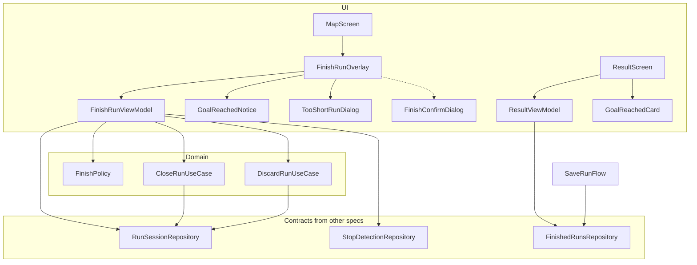
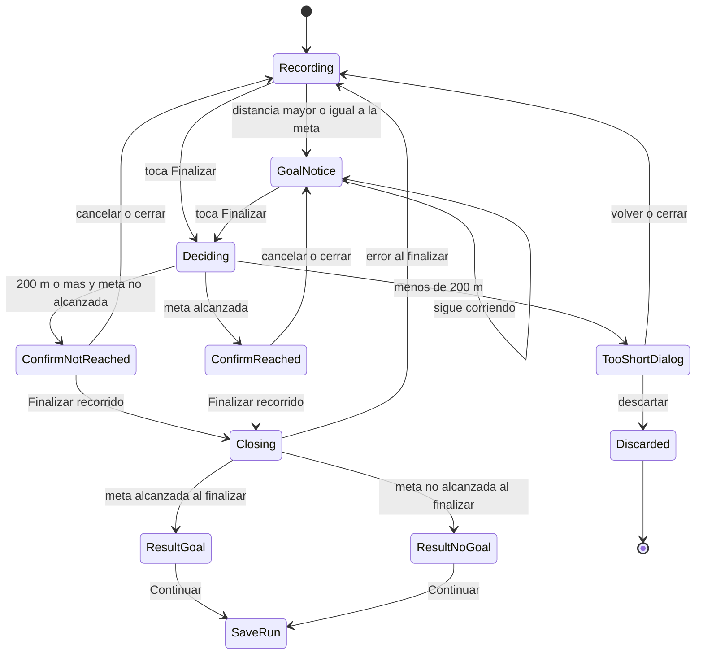
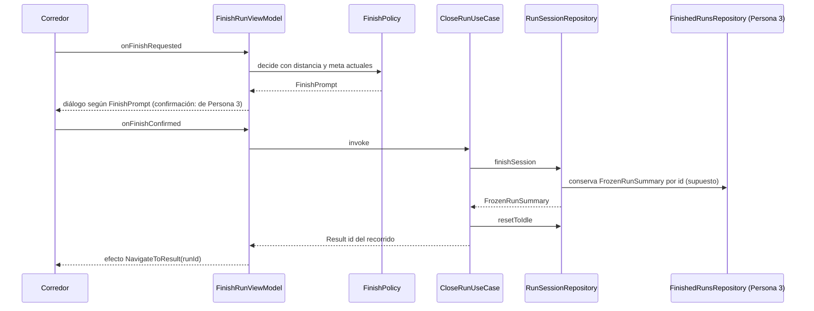

# Design Document · finish-run-result

## Overview

**Purpose**: esta funcionalidad entrega al corredor el cierre de su recorrido: el aviso de meta
alcanzada mientras sigue corriendo, el aviso de recorrido demasiado corto y la pantalla de resultado
(«¡Meta cumplida!» o «Recorrido finalizado») con el paso a «Guardar recorrido». La confirmación al
tocar «Finalizar» (`FinishConfirmDialog`) la implementa Persona 3 (HU-04); esta spec solo le da la
decisión que necesita.

**Users**: corredores recreativos que registran un recorrido con meta de 3, 5 o 10 km.

**Impact**: hoy `MapScreen` es un placeholder y no existen el modelo de recorrido, la ruta `result`
ni el botón «Finalizar». Este diseño agrega, sobre el contrato de HU-04, la decisión de cierre
(pura y testeable), dos piezas de UI sueltas para el Mapa (aviso de meta y aviso de recorrido
demasiado corto) y la pantalla `result`. El recorrido terminado viaja por id: la pantalla de resultado
y `save-run` leen el `FrozenRunSummary` del repositorio de recorridos finalizados de Persona 3.

### Goals

- Decidir de forma pura y testeable qué sucede al tocar «Finalizar» (confirmar con meta cumplida,
  confirmar sin meta, demasiado corto).
- Que llegar a la meta solo muestre el aviso: el registro sigue activo hasta que el corredor
  confirme (decisiones de la reunión de equipo, `team-notes/README.md`).
- Que por navegación viaje solo el id del recorrido; el `FrozenRunSummary` completo (con la traza) se
  lee del repositorio de recorridos finalizados, sin pasarlo por argumentos.
- Cumplir accesibilidad: «Quitar animaciones», fuente al 200 %, estado no solo por color.

### Non-Goals

- Formulario de guardado, destacados y fotos (`save-run`).
- Cálculo de frenadas (`stop-detection`), de regularidad (HU-05.2) y de las métricas (HU-04).
- Botón «Finalizar» y su ubicación en `RunControls` (HU-04).
- `FinishConfirmDialog`, sus textos y su elección según `goalReached` (Persona 3, HU-04).
- Repositorio de recorridos finalizados (Persona 3, HU-04).
- Persistencia en disco y recuperación ante muerte del proceso.
- Librería de animación (Lottie): las animaciones son nativas de Compose.

## Boundary Commitments

### This Spec Owns

- Regla de cierre `FinishPolicy`: meta alcanzada, umbral de 200 m y los tres desenlaces de
  «Finalizar».
- Regla de cierre `FinishPolicy`: meta alcanzada, umbral de 200 m y los tres desenlaces de
  «Finalizar».
- Casos de uso `CloseRunUseCase` (finaliza el recorrido y devuelve su id) y `DiscardRunUseCase`
  (descarta el recorrido).
- `FinishRunViewModel` y sus piezas de UI sueltas en `map/components/`: `GoalReachedNotice` (aviso de
  meta alcanzada), `TooShortRunDialog` (aviso de recorrido demasiado corto) y el montaje
  `FinishRunOverlay`.
- Pantalla `result` completa (`ResultScreen`, `ResultViewModel`, `GoalReachedCard`) y su ruta
  `result/{runId}`.
- Utilidad `rememberReduceMotion()` si todavía no existe (se comparte con `stop-detection`).
- Textos del aviso de meta, del aviso de recorrido corto y del resultado (`finish_*`, `result_*`).

### Out of Boundary

- `RunControls`, el botón «Finalizar», `MapViewModel` y `MapUiState` (HU-04, Persona 3).
- `FinishConfirmDialog` (HU-04, Persona 3): ella elige el texto según `goalReached` y agrega sus
  textos a `strings.xml` con prefijo `map_`, incluidos «Finalizar recorrido» y «Cancelar». Esta spec
  **no** lo implementa ni define esos textos. Los requisitos 2.1 y 3.1 describen su contenido.
- Repositorio de recorridos finalizados (Persona 3): conserva el `FrozenRunSummary` por id, separado
  del repositorio de la sesión activa. Esta spec solo lo lee.
- Detección y conteo de frenadas, alerta de frenada y consulta de 20 s (`stop-detection`). Solo se
  consume su contrato; Persona 3 le pasa `suppressed = true` (ver Interfaces).
- Regularidad del piso (sin dueño: HU-05.2) y modo demo (a definir entre Persona 2 y Persona 3, desde
  HU-03). Esta spec no los calcula ni los define.
- Pantalla «Guardar recorrido», su ruta y qué hace al guardar o descartar (`save-run`).
- Permisos, GPS, pausa y reanudación.

### Allowed Dependencies

- `domain` (Kotlin puro): `RunSessionRepository`, `FrozenRunSummary`, `RunSession`, `RunGoal`,
  `RoutePoint` y el repositorio de recorridos finalizados (HU-04, Persona 3); `StopDetectionRepository`,
  `StopKind` (`stop-detection`).
- `ui/screens/result` y `ui/screens/map/` → `domain`, `ui/components`, `ui/theme`. Nunca `data`.
- Navigation Compose para la ruta `result/{runId}`.
- No se agrega ninguna librería. Los tests usan `kotlinx-coroutines-test` (lo agrega
  `stop-detection`; si falta, se suma a `libs.versions.toml` avisando al equipo).

### Revalidation Triggers

- HU-04 cambia la forma de `FrozenRunSummary`, `RunSession` o `RunState`, o el contrato de
  `finishSession()` y `resetToIdle()`.
- HU-04 cambia el nombre o la firma del repositorio de recorridos finalizados, o quién lo escribe.
- HU-04 cambia cómo `FinishConfirmDialog` recibe la decisión de `FinishPolicy` (ver Interfaces).
- `stop-detection` cambia `classifyCurrentStop`, el parámetro `suppressed` o la forma en que aporta
  las frenadas.
- `save-run` cambia cómo lee el recorrido del repositorio de recorridos finalizados.
- Se define el dueño de la regularidad o del modo demo, o se agregan al `FrozenRunSummary`
  (ver Open Questions).

## Architecture

### Existing Architecture Analysis

- Una Activity, `TrazoApp` con `Scaffold` + `BottomNavBar` y `NavHost` de 3 rutas (`home`, `map`,
  `history`). `TrazoDestination` modela solo las pestañas.
- `domain/` y `data/` están casi vacíos en esta rama (solo `RunGoal`). El modelo de recorrido y el
  repositorio de HU-04 viven en `origin/HU-04-map` y todavía no están integrados.
- Precedente de diálogo: `StartRunDialog` (`AlertDialog` centrado, `PrimaryButton` + `OutlinedButton`).
- Convenciones de steering: `ui → domain ← data`; `Screen` + `Content` stateless + `ViewModel` +
  `UiState`; contratos en `domain/repository/`; tests JVM con fakes a mano.

### Architecture Pattern & Boundary Map



> `FinishConfirmDialog` y `FinishedRunsRepository` son de Persona 3. La línea punteada indica que el
> diálogo se inyecta desde `MapScreen` (ver Interfaces); esta spec no lo implementa.

**Architecture Integration**

- **Selected pattern**: Opción C del análisis (`research.md`): regla pura en dominio, cambios
  mínimos en HU-04, UI propia montada por parámetro. Mismo patrón de montaje que
  `StopDetectionOverlay`.
- **Boundaries**: HU-04 mide y expone; este diseño decide y presenta el cierre; `save-run` consume
  el recorrido terminado. Ninguna capa de UI importa `data`.
- **Existing patterns preserved**: Screen/Content/ViewModel/UiState, state hoisting, ViewModel que
  solo observa repositorios `@Singleton`, textos en `strings.xml`, tokens de `ui/theme`.
- **New components rationale**: `FinishPolicy` aísla la regla de 200 m y de meta (testeable sin
  Android); el repositorio de recorridos finalizados (de Persona 3) evita pasar la traza por
  navegación; `FinishRunViewModel` concentra el estado del aviso y de los diálogos de cierre.
- **Steering compliance**: dirección `ui → domain ← data`; sin hex ni medidas sueltas; voseo
  rioplatense.

### Technology Stack

| Layer | Choice / Version | Role in Feature | Notes |
|-------|------------------|-----------------|-------|
| UI | Jetpack Compose (BOM 2025.04.01) + Material 3 | Aviso, diálogos y pantalla de resultado | `AlertDialog`, `AnimatedVisibility`, `Animatable` |
| Navegación | Navigation Compose | Ruta `result/{runId}`, `BackHandler` | Solo viaja el id del recorrido |
| Estado | Coroutines / `StateFlow` | `FinishRunUiState`, `ResultUiState` | `collectAsStateWithLifecycle` |
| DI | Hilt (Dagger 2.60) | `@HiltViewModel` y casos de uso | Sin módulos nuevos en esta spec |
| Tests | JUnit 4 + fakes + `kotlinx-coroutines-test`; Compose UI Test | Dominio, ViewModels y `Content` | Sin MockK |

## File Structure Plan

### Directory Structure

```
app/src/main/java/com/trazo/app/
├── domain/
│   ├── model/result/
│   │   ├── FinishPrompt.kt           # enum: TOO_SHORT, CONFIRM_GOAL_NOT_REACHED, CONFIRM_GOAL_REACHED
│   │   └── FinishError.kt            # sealed: TooShort, Failed (error de CloseRunUseCase)
│   └── usecases/
│       ├── FinishPolicy.kt           # Regla pura: meta alcanzada, 200 m, decide()
│       ├── CloseRunUseCase.kt        # Finaliza el recorrido y devuelve su id
│       └── DiscardRunUseCase.kt      # Detiene y reinicia la sesión sin guardar
└── ui/
    ├── theme/ReduceMotion.kt         # rememberReduceMotion() (compartida; si no existe se crea)
    ├── navigation/                   # ver Modified Files
    └── screens/
        ├── map/
        │   ├── FinishRunViewModel.kt         # FinishRunUiState + ViewModel + FinishRunEffect
        │   └── components/
        │       ├── FinishRunOverlay.kt       # Conecta el ViewModel; monta aviso y diálogos
        │       ├── GoalReachedNotice.kt      # Aviso de meta alcanzada, componente suelto
        │       └── TooShortRunDialog.kt      # Aviso de recorrido corto, componente suelto
        └── result/
            ├── ResultScreen.kt               # ResultScreen + ResultContent stateless
            ├── ResultViewModel.kt            # ResultUiState + ViewModel + ResultEffect
            ├── ResultFormatter.kt            # Distancia, tiempo y regularidad como texto
            └── components/GoalReachedCard.kt # Tarjeta con check, título y métricas
app/src/main/res/
├── values/strings_finish_run.xml             # finish_* y result_* (sin los textos map_ de Persona 3)
└── drawable/ic_goal_check.xml                # Check de la celebración (Material Symbols)
app/src/test/java/com/trazo/app/              # replica el paquete de lo probado
app/src/androidTest/java/com/trazo/app/ui/screens/{map/components,result}/
```

> No hay `data/` ni `di/` en esta spec: el repositorio de recorridos finalizados es de Persona 3.
> `GoalReachedNotice` y `TooShortRunDialog` nacen en `screens/map/components/` como componentes
> sueltos (solo los usa el Mapa). Si otra pantalla los necesita, se mueven a
> `ui/components/common/` (regla de `ui-components.md`).

### Modified Files

- `ui/screens/map/MapScreen.kt` — **archivo de Persona 3**. Se suma por parámetro: monta
  `FinishRunOverlay(onNavigateToResult, confirmDialog)` sobre el contenido, donde `confirmDialog` es
  su `FinishConfirmDialog`; conecta `onFinishClick` de `RunControls` a
  `FinishRunViewModel.onFinishRequested` y pasa `suppressed = true` a la alerta de frenada mientras
  haya celebración de meta, diálogo de confirmación o aviso de recorrido corto. Se hace en la tarea
  de integración, tras HU-04.
- `ui/navigation/TrazoApp.kt` — agrega la ruta `result/{runId}` (`ResultScreen`), oculta la barra
  inferior en esa ruta y navega a `saverun` con «Continuar». La ruta `saverun` es de Persona 1.
- `ui/navigation/TrazoDestination.kt` — sin cambios: `result` no es pestaña. La ruta se define como
  constante en `TrazoApp.kt`.
- `ui/screens/startrun` y `stop-detection` — sin cambios; la alerta de frenada recibe el parámetro
  `suppressed: Boolean` (ver Interfaces).
- `res/values/strings.xml` — sin cambios; los textos de esta spec van en `strings_finish_run.xml`.
  Los textos del diálogo de confirmación los agrega Persona 3 con prefijo `map_`.
- `gradle/libs.versions.toml` / `app/build.gradle.kts` — solo si falta `kotlinx-coroutines-test`.

## System Flows





**Decisiones de flujo**

- **Se decide al tocar, se resuelve al confirmar.** El `FinishPrompt` se calcula con la distancia al
  tocar «Finalizar». El título del resultado («¡Meta cumplida!» o «Recorrido finalizado») y el
  indicador `goalReached` se calculan con la distancia **congelada** por `finishSession()`. Si el
  corredor cruza la meta con el diálogo «Todavía no llegaste…» abierto (el registro sigue, 3.2),
  igual ve «¡Meta cumplida!»; el mensaje del diálogo puede quedar desactualizado, y es aceptable.
- **El aviso de meta es derivado, no un estado guardado.** `goalReached = distancia ≥ meta` sobre
  `activeSession`. La distancia no decrece, así que no hace falta recordar que se alcanzó. El aviso
  se ve mientras la sesión esté `ACTIVE` o `PAUSED`.
- **«Finalizar» desde pausa** aplica la misma lógica (`finishSession()` acepta `ACTIVE` y `PAUSED`).
  El modo demo y la regla de 200 m: aplica igual (decisión del análisis de brechas).
- **Tras `finishSession()` se llama a `resetToIdle()`** para no dejar una sesión `FINISHED` sin
  dueño. Los datos del recorrido viven en el repositorio de recorridos finalizados de Persona 3,
  separado del de la sesión activa, y se leen por id (pantalla de resultado y `save-run`).
- **Por navegación viaja solo el id** (`result/{runId}`); `CloseRunUseCase` lo toma del
  `FrozenRunSummary` que devuelve `finishSession()`.
- **Descartar** usa `finishSession()` (detiene GPS y temporizador, ignora el resumen) y luego
  `resetToIdle()`. No depende de que `resetToIdle()` detenga el seguimiento.
- **«Atrás» en el resultado no hace nada** (`BackHandler` activo sin acción) y la pantalla no tiene
  flecha de volver: el recorrido no está guardado y se perdería. La barra inferior se oculta. El
  descarte posterior lo ofrece «Guardar recorrido» (diálogo «¿Descartar el recorrido?»).

## Requirements Traceability

| Requirement | Summary | Components | Interfaces | Flows |
|-------------|---------|------------|------------|-------|
| 1.1 | Aviso animado con «Finalizar» al llegar a la meta | `GoalReachedNotice`, `FinishRunViewModel` | `FinishRunUiState.isGoalNoticeVisible`, `FinishPolicy.isGoalReached` | GoalNotice |
| 1.2 | Se puede seguir corriendo; el registro sigue | `FinishRunViewModel` (no detiene nada) | No llama a `finishSession()` al llegar a la meta | GoalNotice → GoalNotice |
| 1.3 | «Finalizar» disponible mientras el aviso está visible | `GoalReachedNotice` | `onFinishClick` | GoalNotice |
| 1.4 | Sin aviso si no se llegó a la meta | `FinishRunViewModel` | `isGoalNoticeVisible = false` | Recording |
| 1.5 | Aviso sin animación con «Quitar animaciones» | `GoalReachedNotice`, `ReduceMotion` | `rememberReduceMotion()` | — |
| 2.1 | Confirmación «¿Estás seguro de que deseás finalizar?» con la meta cumplida | `FinishConfirmDialog` (**Persona 3**), `FinishPolicy` | `FinishPrompt.CONFIRM_GOAL_REACHED` | ConfirmReached |
| 2.2 | Sigue registrando con el diálogo abierto | `FinishRunViewModel` | Sin cambios sobre la sesión | ConfirmReached |
| 2.3 | Confirmar detiene y muestra «¡Meta cumplida!» | `CloseRunUseCase`, `ResultScreen` | `onFinishConfirmed`, `FrozenRunSummary.goalReached` | Closing → ResultGoal |
| 2.4 | Cancelar o cerrar conserva el recorrido | `FinishRunViewModel` | `onFinishDismissed` | ConfirmReached → GoalNotice |
| 3.1 | Confirmación «Todavía no llegaste a tu meta. …» (≥ 200 m) | `FinishConfirmDialog` (**Persona 3**), `FinishPolicy` | `FinishPrompt.CONFIRM_GOAL_NOT_REACHED` | ConfirmNotReached |
| 3.2 | Sigue registrando con el diálogo abierto | `FinishRunViewModel` | — | ConfirmNotReached |
| 3.3 | Confirmar detiene y muestra «Recorrido finalizado» | `CloseRunUseCase`, `ResultScreen` | `onFinishConfirmed` | Closing → ResultNoGoal |
| 3.4 | Cancelar o cerrar conserva el recorrido | `FinishRunViewModel` | `onFinishDismissed` | ConfirmNotReached → Recording |
| 4.1 | Aviso < 200 m con descartar o volver | `TooShortRunDialog`, `FinishPolicy` | `FinishPrompt.TOO_SHORT` | TooShortDialog |
| 4.2 | El aviso corto reemplaza a las dos confirmaciones | `FinishPolicy.decide` | `TOO_SHORT` tiene prioridad sobre las otras dos | Deciding |
| 4.3 | Sigue registrando con el aviso abierto | `FinishRunViewModel` | — | TooShortDialog |
| 4.4 | Volver o cerrar conserva el recorrido | `FinishRunViewModel` | `onTooShortDismissed` | TooShortDialog → Recording |
| 4.5 | Descartar detiene, elimina y vuelve al Mapa en cero | `DiscardRunUseCase` | `onDiscardConfirmed` | Discarded |
| 4.6 | Sin paso a «Guardar recorrido» si < 200 m | `CloseRunUseCase` | `FinishError.TooShort` | Closing |
| 5.1 | Distancia, tiempo, regularidad y «Continuar» (o «No disponible») | `ResultContent`, `ResultFormatter` | `ResultUiState` | ResultGoal / ResultNoGoal |
| 5.2 | Título «¡Meta cumplida!» con animación | `GoalReachedCard` | `FrozenRunSummary.goalReached = true` | ResultGoal |
| 5.3 | Título «Recorrido finalizado» sin animación | `GoalReachedCard` | `goalReached = false` | ResultNoGoal |
| 5.4 | «¡Meta cumplida!» estática con «Quitar animaciones» | `GoalReachedCard`, `ReduceMotion` | `rememberReduceMotion()` | — |
| 5.5 | Valores tal como los entrega el registro | `ResultFormatter`, `ResultViewModel` | Solo formatea; no recalcula | — |
| 5.6 | No registra mientras se ve el resultado | `CloseRunUseCase` | `finishSession()` ya detuvo el registro | Closing |
| 6.1 | «Continuar» abre «Guardar recorrido» | `ResultScreen`, `TrazoApp` | `onContinue(runId)` → ruta `saverun` | SaveRun |
| 6.2 | Conserva distancia, tiempo, velocidad, frenadas, regularidad y meta | Repositorio de recorridos finalizados (**Persona 3**) | `FrozenRunSummary` por id. Frenadas: supuesto a confirmar. Regularidad: «sin dato» | SaveRun |
| 6.3 | Conserva fecha y hora de inicio, demo y traza | Repositorio de recorridos finalizados (**Persona 3**) | `startedAt` y traza ya están; modo demo: supuesto a confirmar | SaveRun |
| 6.4 | Indica meta alcanzada o no | `FrozenRunSummary` | `goalReached` | SaveRun |
| 6.5 | Título, destacados y fotos son de `save-run` | — (límite de la spec) | Boundary Commitments | — |
| 7.1 | Sin alerta de frenada ni consulta de 20 s con un aviso de cierre visible | `FinishRunViewModel`, `MapScreen` (**Persona 3**) | `isClosureVisible` → `suppressed = true` | Todos los estados de aviso |
| 7.2 | La frenada se registra igual | `StopDetectionRepository` (sin cambios) | `suppressed` no pausa la detección | — |
| 7.3 | Consulta pendiente al aparecer el cierre → frenada | `FinishRunViewModel` | `classifyCurrentStop(StopKind.BRAKE)` | GoalNotice / diálogos |

## Components and Interfaces

| Component | Domain/Layer | Intent | Req Coverage | Key Dependencies (P0/P1) | Contracts |
|-----------|--------------|--------|--------------|--------------------------|-----------|
| `FinishPolicy` | Domain | Regla pura de meta y de 200 m | 1.1, 1.4, 2.1, 3.1, 4.1, 4.2 | `RunGoal` (P0) | Service |
| `CloseRunUseCase` | Domain | Finaliza el recorrido y devuelve su id | 2.3, 3.3, 4.6, 5.6 | `RunSessionRepository` (P0) | Service |
| `DiscardRunUseCase` | Domain | Descarta sin guardar | 4.5 | `RunSessionRepository` (P0) | Service |
| `FinishRunViewModel` | UI | Estado del aviso y diálogos; efectos | 1.1–1.4, 2.1–2.4, 3.1–3.4, 4.1–4.5, 7.1, 7.3 | `RunSessionRepository` (P0), casos de uso (P0), `StopDetectionRepository` (P1) | State |
| `FinishRunOverlay` | UI | Monta aviso y diálogos; recibe el diálogo de confirmación de Persona 3 | 1.1–1.5, 2.1–2.4, 3.1–3.4, 4.1–4.5 | `FinishRunViewModel` (P0), `FinishConfirmDialog` (P0, Persona 3) | — |
| `GoalReachedNotice`, `TooShortRunDialog` | UI | Presentación (componentes sueltos) | 1.1, 1.3, 1.5, 4.1 | `ui/theme` (P0), `ReduceMotion` (P1) | — |
| `ResultViewModel` | UI | Estado de la pantalla de resultado | 5.1–5.5, 6.1 | Repositorio de recorridos finalizados (P0, Persona 3) | State |
| `ResultScreen`, `ResultContent`, `GoalReachedCard`, `ResultFormatter` | UI | Presentación del resultado | 5.1–5.4, 6.1 | `ui/theme` (P0), `ReduceMotion` (P1) | — |

### Domain

#### FinishPolicy

| Field | Detail |
|-------|--------|
| Intent | Fuente única de la regla de meta alcanzada y del umbral de 200 m |
| Requirements | 1.1, 1.4, 2.1, 3.1, 4.1, 4.2 |

**Responsibilities & Constraints**
- Funciones puras, sin estado ni Android. La distancia entra en metros; el adaptador convierte desde
  `RunMetrics.distanceKilometers` (Float, km) con `distanceKilometers * 1000.0`.
- Un solo lugar define «meta alcanzada»: lo usan el aviso, el diálogo y `goalReached` del
  el aviso de recorrido corto (evita cálculos distintos).

**Contracts**: Service [x]

```kotlin
enum class FinishPrompt { TOO_SHORT, CONFIRM_GOAL_NOT_REACHED, CONFIRM_GOAL_REACHED }

object FinishPolicy {
    const val MIN_SAVEABLE_DISTANCE_METERS: Double = 200.0

    fun isGoalReached(distanceMeters: Double, goal: RunGoal): Boolean

    fun decide(distanceMeters: Double, goal: RunGoal): FinishPrompt
}
```

- Preconditions: `distanceMeters >= 0`.
- Postconditions: `isGoalReached` ⇔ `distanceMeters >= goal.kilometers * 1000`. `decide` devuelve
  `TOO_SHORT` si `distanceMeters < 200`; si no, `CONFIRM_GOAL_REACHED` cuando `isGoalReached`, y
  `CONFIRM_GOAL_NOT_REACHED` en el resto. `TOO_SHORT` tiene prioridad (4.2).
- Invariantes: 199,9 m → `TOO_SHORT`; 200,0 m → confirmación; igual a la meta cuenta como alcanzada.

> `RunGoal` en esta rama tiene `kilometers: Int`; la rama de HU-04 usa `distanceKm: Float`. Se usa
> `kilometers`; si HU-04 cambia el enum al integrarse, se ajusta solo `FinishPolicy` (revalidación).

#### Repositorio de recorridos finalizados (de Persona 3, no se implementa aquí)

| Field | Detail |
|-------|--------|
| Intent | Conservar el `FrozenRunSummary` por id, separado del repositorio de la sesión activa |
| Requirements | 5.1–5.5, 6.1–6.4 (lectura) |

- Persona 3 lo crea en HU-04. La pantalla de resultado y `save-run` leen el `FrozenRunSummary` de ahí
  por id; esta spec **reemplaza** el antiguo contenedor en memoria (`FinishedRun`,
  `FinishedRunRepository`, `publish`/`clear`) y ya no define ni escribe ese modelo.
- Contrato asumido (nombre y firma **a confirmar** con Persona 3):

```kotlin
interface FinishedRunsRepository {
    suspend fun get(runId: String): FrozenRunSummary?   // null = id desconocido
}
```

- `FrozenRunSummary` ya trae distancia, tiempo, velocidad promedio, meta, `goalReached` y
  `startedAt` (y la traza). Esta spec solo los lee y los formatea: no recalcula (5.5).
- Quién limpia un recorrido del repositorio (al guardar o descartar) lo define Persona 3 con
  `save-run`; esta spec no lo hace.
- Faltan dos datos en `FrozenRunSummary`, que esta spec **supone** y no define:
  - **Modo demo**: lo definen Persona 2 y Persona 3 desde HU-03. *Supuesto a confirmar.*
  - **Frenadas**: las aporta `stop-detection`; falta confirmar cómo llegan a `save-run` (en el
    `FrozenRunSummary` o por consulta a `stop-detection` por id). *Supuesto a confirmar.* La pantalla
    de resultado no las muestra (5.1), así que no bloquea esta spec.
- **Regularidad**: queda como «sin dato» hasta que HU-05.2 tenga responsable. No hay puerto ni
  fuente: `ResultViewModel` deja `regularityText = null` y la pantalla muestra «No disponible»
  (5.1, 6.2). Cuando exista el dato, se suma al `FrozenRunSummary` y al formateo.

#### CloseRunUseCase

| Field | Detail |
|-------|--------|
| Intent | Detener el recorrido y devolver el id con el que se lee el resultado |
| Requirements | 2.3, 3.3, 4.6, 5.6 |

**Contracts**: Service [x]

```kotlin
sealed interface FinishError {
    data object TooShort : FinishError
    data class Failed(val cause: Throwable) : FinishError
}

class CloseRunUseCase @Inject constructor(
    private val runSessions: RunSessionRepository,
) {
    suspend operator fun invoke(): Result<String>   // id del recorrido; failure lleva un FinishError
}
```

- Orden: (1) `runSessions.finishSession()`; si falla → `FinishError.Failed`. (2) Si
  `totalDistanceKm * 1000 < 200` → devuelve `FinishError.TooShort` (guarda de 4.6; el registro ya se
  detuvo, caso imposible desde la UI pero invariante del dominio). (3) `runSessions.resetToIdle()`.
  (4) Devuelve el id del `FrozenRunSummary`.
- Precondiciones: sesión `ACTIVE` o `PAUSED`. Postcondición: el registro está detenido y el
  `FrozenRunSummary` queda en el repositorio de recorridos finalizados (lo escribe HU-04, supuesto).
- No arma ni copia valores del recorrido: el título del resultado sale de `goalReached` del
  `FrozenRunSummary`, calculado por HU-04 sobre la distancia congelada.

#### DiscardRunUseCase

```kotlin
class DiscardRunUseCase @Inject constructor(private val runSessions: RunSessionRepository) {
    suspend operator fun invoke(): Result<Unit>   // finishSession() ignorando el resumen + resetToIdle()
}
```

- Postcondición: sin sesión en curso (`IDLE`). El descarte no entrega nada a la pantalla de resultado
  ni a `save-run`; si `finishSession()` deja el resumen en el repositorio de recorridos finalizados,
  su limpieza queda a cargo de Persona 3 (a confirmar).

### UI (Mapa)

#### FinishRunViewModel

| Field | Detail |
|-------|--------|
| Intent | Estado del aviso de meta y de los diálogos de cierre; ejecuta cierre y descarte |
| Requirements | 1.1–1.4, 2.1–2.4, 3.1–3.4, 4.1–4.5, 7.1, 7.3 |

**Contracts**: State [x]

```kotlin
data class FinishRunUiState(
    val isGoalNoticeVisible: Boolean = false,
    val prompt: FinishPrompt? = null,          // diálogo abierto, o null
    val isFinishing: Boolean = false,          // evita doble toque mientras cierra
) {
    val isClosureVisible: Boolean get() = isGoalNoticeVisible || prompt != null
}

sealed interface FinishRunEffect {
    data class NavigateToResult(val runId: String) : FinishRunEffect   // solo viaja el id
    data object ShowFinishError : FinishRunEffect   // snackbar «No pudimos finalizar…»
}

@HiltViewModel
class FinishRunViewModel @Inject constructor(
    runSessions: RunSessionRepository,
    private val closeRun: CloseRunUseCase,
    private val discardRun: DiscardRunUseCase,
    private val stopDetection: StopDetectionRepository,
) : ViewModel() {
    val uiState: StateFlow<FinishRunUiState>
    val effects: Flow<FinishRunEffect>
    fun onFinishRequested()        // botón «Finalizar» (de RunControls o del aviso)
    fun onFinishConfirmed()        // «Finalizar recorrido»
    fun onFinishDismissed()        // «Cancelar», atrás o tocar afuera
    fun onTooShortDismissed()      // volver al recorrido, atrás o tocar afuera
    fun onDiscardConfirmed()       // «Descartar»
}
```

- `isGoalNoticeVisible` se deriva de `activeSession`: sesión `ACTIVE` o `PAUSED` con
  `FinishPolicy.isGoalReached(...)`. No hay estado propio que sincronizar.
- `onFinishRequested` ignora el toque si ya hay un diálogo o `isFinishing`; si no, fija
  `prompt = FinishPolicy.decide(distancia actual, meta)`. Si no hay sesión en curso, no hace nada.
- **Prioridad de cierre (7.3)**: cuando `isClosureVisible` pasa de `false` a `true`, llama a
  `stopDetection.classifyCurrentStop(StopKind.BRAKE)` (no-op si no hay consulta pendiente). Solo en
  esa transición, no en cada cambio.
- Nada de este ViewModel pausa ni detiene el registro hasta `onFinishConfirmed` o
  `onDiscardConfirmed` (1.2, 2.2, 3.2, 4.3).
- Errores: si `closeRun` falla (`Failed`), cierra el diálogo, emite `ShowFinishError` y el recorrido
  sigue. `TooShort` se trata igual (no debería ocurrir).

#### FinishRunOverlay y piezas de presentación

- `FinishRunOverlay(onNavigateToResult: (runId: String) -> Unit, confirmDialog: @Composable
  (prompt: FinishPrompt, onConfirm: () -> Unit, onDismiss: () -> Unit) -> Unit,
  onClosureVisibleChange: (Boolean) -> Unit, modifier)`: `hiltViewModel()` + colecta `uiState` y
  `effects`. Para `TOO_SHORT` monta `TooShortRunDialog`; para las dos confirmaciones delega en
  `confirmDialog`, que es el `FinishConfirmDialog` de Persona 3 (ella elige el texto según
  `goalReached` y lo guarda con prefijo `map_`; esta spec no lo implementa). *Mecanismo de inyección
  (parámetro composable) y entrada del diálogo: supuesto a confirmar con Persona 3.*
- `onClosureVisibleChange` expone `isClosureVisible` hacia arriba: `MapScreen` (Persona 3) pasa
  `suppressed = true` a la alerta de frenada mientras esté visible la celebración de meta, el
  diálogo de confirmación o el aviso de recorrido demasiado corto (7.1).
- `GoalReachedNotice(onFinishClick, modifier)`: tarjeta `surfaceContainerLowest`, forma `medium`,
  elevación `level2`, ícono `ic_goal_check` en Success700 sobre Success200, texto «¡Llegaste a tu
  meta!» y botón «Finalizar» (56 dp). Entrada `slideInVertically + fadeIn` una vez; con
  `rememberReduceMotion()` usa `EnterTransition.None` (1.5). Texto + ícono: el estado no depende
  del color. `liveRegion = Polite` en el texto.
- `TooShortRunDialog(onDiscard, onBack)`: título «Recorrido demasiado corto», texto «Necesitás al
  menos 200 metros para guardar un recorrido.». «Descartar» es el botón destructivo (Error600) y
  «Volver al recorrido» es outlined. Cerrar o atrás equivale a volver (4.4). El texto no dice
  cuánto falta para no recalcular valores en la UI.
- Los objetivos táctiles miden 48 dp; los botones envuelven en varias líneas a fuente 200 %.

### UI (Resultado)

#### ResultViewModel

**Contracts**: State [x]

```kotlin
data class ResultUiState(
    val isGoalReached: Boolean = false,
    val goalKm: Int = 0,
    val distanceText: String = "",
    val timeText: String = "",
    val regularityText: String? = null,    // null = mostrar «No disponible»
    val isLoaded: Boolean = false,
)

sealed interface ResultEffect { data object LeaveToMap : ResultEffect }

@HiltViewModel
class ResultViewModel @Inject constructor(
    savedStateHandle: SavedStateHandle,          // runId de la ruta result/{runId}
    finishedRuns: FinishedRunsRepository,        // de Persona 3
    formatter: ResultFormatter,
) : ViewModel() {
    val uiState: StateFlow<ResultUiState>
    val effects: Flow<ResultEffect>
}
```

- Lee el `runId` de la ruta, obtiene el `FrozenRunSummary` del repositorio de recorridos finalizados
  y lo mapea a `ResultUiState` vía `ResultFormatter`; no recalcula (5.5). `regularityText` queda en
  `null` («sin dato») hasta que HU-05.2 tenga responsable. Si el repositorio devuelve `null` para ese
  id (por ejemplo, la app se recreó sin datos) emite `LeaveToMap`.
- `ResultFormatter` (puro, `es-AR`): distancia con coma decimal y «km» (`5,2 km`), tiempo
  `HH:MM:SS`, regularidad `80 %` (espacio, sin decimales). Candidato a unificarse con
  `MetricFormatter` de HU-04 cuando ambos estén integrados.

#### ResultScreen / ResultContent / GoalReachedCard

- `ResultScreen(onContinue: (runId: String) -> Unit, onLeave)`: conecta el ViewModel, consume `LeaveToMap` y registra
  `BackHandler(enabled = true) {}` (la atrás no hace nada).
- `ResultContent(state, onContinue)`: fondo `primary` a pantalla completa y `GoalReachedCard`
  centrada, según la guía visual 6.13. Botón filled «Continuar» a todo el ancho (único filled).
- `GoalReachedCard`: tarjeta blanca `extraLarge`. Con meta cumplida: check Primary950 de 76 dp en
  halo Secondary100 de 104 dp, título «¡Meta cumplida!» (`headlineMedium`) y «Completaste tu meta de
  5 km.»; el check entra con `scale` (spring) + `fadeIn` y un halo que pulsa una vez (5.2). Sin
  meta cumplida: mismo layout sin check ni animación, título «Recorrido finalizado» y marca
  «Incompleto» (5.3). Con `rememberReduceMotion()` el check se dibuja estático y el contenido es el
  mismo (5.4).
- Recuadros de métricas (fondo Neutral100, forma `medium`, `headlineMedium.tabular()`): Distancia,
  Tiempo y Regularidad. Sin acelerómetro, el recuadro de regularidad muestra «No disponible» en
  texto (5.1). **Frenadas no se muestra**: el requisito 5.1 no la incluye aunque la guía visual 6.13
  tenga una grilla 2 × 2; `save-run` la obtiene por su lado (supuesto a confirmar, ver Repositorio de
  recorridos finalizados) (6.2).
- El título lleva `heading()` y la celebración no se lee dos veces con TalkBack.

### Navegación

- `TrazoApp` define `const val RESULT_ROUTE = "result"` y la ruta con argumento
  `"$RESULT_ROUTE/{runId}"` (un único argumento `String`). `MapScreen` recibe
  `onNavigateToResult = { runId -> navController.navigate("$RESULT_ROUTE/$runId") { launchSingleTop = true } }`.
- La barra inferior se oculta cuando la ruta actual es `result/{runId}`.
- `onContinue(runId)` navega a la ruta de `save-run` con el mismo id (6.1). Mientras esa ruta no
  exista, el botón queda conectado a un callback vacío y la tarea de integración lo cierra (ver Open
  Questions).

### Contrato pedido a otras specs

| Spec | Lo que este diseño necesita |
|------|-----------------------------|
| HU-04 (Persona 3) | Repositorio de recorridos finalizados que conserva el `FrozenRunSummary` por id, separado del de la sesión activa. `FrozenRunSummary` con id, distancia, tiempo, velocidad promedio, meta, `goalReached`, `startedAt` y traza (ya los tiene). `finishSession()` y `resetToIdle()` como en su diseño. Implementa `FinishConfirmDialog` (elige el texto según `goalReached`, textos `map_` en `strings.xml`, incluidos «Finalizar recorrido» y «Cancelar»). `RunControls` llama a `onFinishRequested`. Pasa `suppressed = true` a la alerta de frenada (ver abajo). |
| HU-03 (Persona 2 y Persona 3) | Definir el modo demo y cómo se refleja en el recorrido finalizado. *Supuesto a confirmar.* |
| `stop-detection` (Persona 4) | Alerta de frenada con parámetro `suppressed: Boolean`: con `true` oculta alerta y consulta de 20 s sin pausar la detección. Aportar las frenadas del recorrido (forma a confirmar). `RunningRunSource` pasa a `RunState.ACTIVE` (hoy usa `RUNNING`). |
| `save-run` (Persona 1) | Lee el recorrido por id del repositorio de recorridos finalizados y define la ruta `saverun`. |

## Data Models

### Domain Model

- Esta spec no define modelos de recorrido: usa el `FrozenRunSummary` de HU-04, leído por id.
- Regla de negocio: un recorrido de menos de 200 m nunca llega a la pantalla de resultado (4.6).
- `goalReached` lo trae el `FrozenRunSummary` (calculado sobre la distancia congelada) y es la única
  fuente del título del resultado y del indicador «meta cumplida / incompleto» de `save-run`.

### Data Contracts & Integration

- Intercambio con `save-run` y con la pantalla de resultado: por id. Por navegación viaja solo el
  `runId`; el `FrozenRunSummary` se lee del repositorio de recorridos finalizados de Persona 3 (la
  traza es grande y no va por argumentos).
- Ciclo de vida del dato: lo define Persona 3 (repositorio de recorridos finalizados). Esta spec no
  escribe ni limpia.

## Error Handling

### Error Strategy

El recorrido en curso tiene prioridad: ante cualquier error al cerrar, el corredor vuelve al
recorrido sin perder datos.

### Error Categories and Responses

| Escenario | Respuesta | UI |
|-----------|-----------|----|
| `finishSession()` falla (por ejemplo, la sesión ya terminó) | `FinishError.Failed`; no se publica nada | Cierra el diálogo, snackbar «No pudimos finalizar el recorrido. Intentá de nuevo.» |
| Doble toque en «Finalizar recorrido» | `isFinishing` ignora el segundo toque | Botón sin efecto repetido |
| Sin sesión al tocar «Finalizar» (`IDLE`) | `onFinishRequested` no hace nada | Los controles ya están deshabilitados en `IDLE` (HU-04) |
| Resultado sin datos (el repositorio no tiene ese `runId`) | `LeaveToMap` | Vuelve al Mapa |
| Distancia cruza la meta con el diálogo abierto | El título final sale de `goalReached` del `FrozenRunSummary` | Resultado «¡Meta cumplida!» aunque el mensaje decía otra cosa |
| Regularidad sin responsable (HU-05.2) | `regularityText = null` | «No disponible» |

## Testing Strategy

### Unit Tests (JVM, `app/src/test`)

- `FinishPolicyTest`: 199,9 m → `TOO_SHORT`; 200,0 m con meta no alcanzada →
  `CONFIRM_GOAL_NOT_REACHED`; distancia igual a la meta (3000 m con 3 km) →
  `CONFIRM_GOAL_REACHED`; `TOO_SHORT` gana aunque el celular reporte meta alcanzada (1.1, 1.4, 2.1,
  3.1, 4.1, 4.2).
- `CloseRunUseCaseTest` con fake de `RunSessionRepository`: llama a `finishSession()` y luego a
  `resetToIdle()`, y devuelve el id del resumen; falla de `finishSession()` → `Failed` sin llamar a
  `resetToIdle()`; distancia < 200 m → `TooShort` (2.3, 3.3, 4.6, 5.6).
- `DiscardRunUseCaseTest`: detiene la sesión y deja `IDLE` (4.5).
- `FinishRunViewModelTest` (tiempo virtual): el aviso aparece al llegar a la meta y **no** llama a
  `finishSession()` (1.1, 1.2, 1.4); `onFinishRequested` abre cada diálogo según la distancia
  (2.1, 3.1, 4.1); cancelar o cerrar conserva la sesión (2.4, 3.4, 4.4); confirmar emite
  `NavigateToResult(runId)`; fallo emite `ShowFinishError`; `isClosureVisible` y una sola llamada a
  `classifyCurrentStop(BRAKE)` en la transición (7.1, 7.3); desde `PAUSED` funciona igual.
- `ResultViewModelTest` y `ResultFormatterTest` con un fake de `FinishedRunsRepository`:
  `FrozenRunSummary` → texto (`5,2 km`, `00:32:10`); regularidad siempre «No disponible»; id
  desconocido (`null`) → `LeaveToMap` (5.1, 5.5).

### Integration Tests

- Flujo `FinishRunViewModel` + `CloseRunUseCase` + `ResultViewModel` con fakes: finalizar con meta →
  el resultado lee el resumen por id y muestra «¡Meta cumplida!»; sin meta → «Recorrido finalizado»
  (2.3, 3.3, 6.4).
- El test del repositorio de recorridos finalizados es de Persona 3.

### UI Tests (`app/src/androidTest`, `createComposeRule` + `TrazoTheme`)

- `GoalReachedNotice`: muestra el texto y «Finalizar»; con `isReduceMotion` fijo no anima (1.1, 1.3,
  1.5).
- `TooShortRunDialog`: textos exactos de 4.1; cerrar invoca `onBack`; «Descartar» invoca `onDiscard`.
- `ResultContent`: «¡Meta cumplida!» y «Recorrido finalizado» con sus métricas y «Continuar»;
  «No disponible» sin regularidad; el título «Recorrido finalizado» no tiene check (5.1–5.4).
- Accesibilidad: fuente al 200 % sin recortes; estado comunicado con texto e ícono.

## Security Considerations

Sin cuentas ni red. Por navegación viaja solo el id del recorrido; la traza vive en el repositorio de
recorridos finalizados (Persona 3). No se registra la ubicación en logs.

## Performance & Scalability

- La traza (miles de puntos) no viaja por navegación: por argumento va solo el id y el resumen se
  lee del repositorio de recorridos finalizados.
- `FinishRunViewModel` deriva el aviso con `map` + `distinctUntilChanged` sobre `activeSession`
  para no recomponer en cada punto GPS.

## Open Questions / Risks

- **El aviso de meta no se descarta** (1.3: «hasta que el corredor lo toque») y 7.1 oculta las
  alertas de frenada mientras esté visible. Efecto: tras llegar a la meta y seguir corriendo, no
  aparecen más alertas ni consultas de 20 s; las frenadas se registran igual (7.2) pero quedan
  clasificadas como frenada. A confirmar con el equipo; si molesta, la salida es que el aviso se
  achique a un botón «Finalizar» después de unos segundos (requiere cambiar 1.3).
- **Resuelto: dueño del diálogo de «Finalizar»**: `FinishConfirmDialog` es de Persona 3. Queda por
  confirmar con ella cómo se inyecta (parámetro composable `confirmDialog` en `FinishRunOverlay`) y
  que use `FinishPolicy.decide` para saber qué diálogo abrir.
- **Supuesto a confirmar: modo demo.** `FrozenRunSummary` no lo tiene; se define entre Persona 2 y
  Persona 3 desde HU-03. Esta spec no lo usa en pantalla.
- **Supuesto a confirmar: frenadas.** `FrozenRunSummary` no las tiene; las aporta `stop-detection`.
  Falta definir cómo llegan a `save-run`. No bloquea esta spec (el resultado no las muestra).
- **Supuesto a confirmar: repositorio de recorridos finalizados.** Se asume `get(runId):
  FrozenRunSummary?` y que `finishSession()` deja el resumen ahí. Nombre y firma son de Persona 3.
- **Regularidad (HU-05.2) sin responsable**: queda como «sin dato» y la pantalla muestra «No
  disponible». Sin puerto ni fuente en esta spec.
- **«Atrás» sin acción en el resultado** y barra inferior oculta: decisión de UX para no perder el
  recorrido; validar con el equipo de diseño.
- **La ruta `saverun` no existe todavía**: «Continuar» queda conectado a un callback vacío hasta que
  `save-run` la defina.
- **Orden de integración**: si HU-04 no entra a `develop` antes, las tareas de dominio y de UI
  stateless avanzan contra fakes; la integración con `MapScreen` espera a HU-04.
- **`rememberReduceMotion()`** la usan esta spec y `stop-detection`: la crea quien llegue primero.
- **Variación con la guía visual**: la grilla de 6.13 incluye «Frenadas»; los requisitos no.
