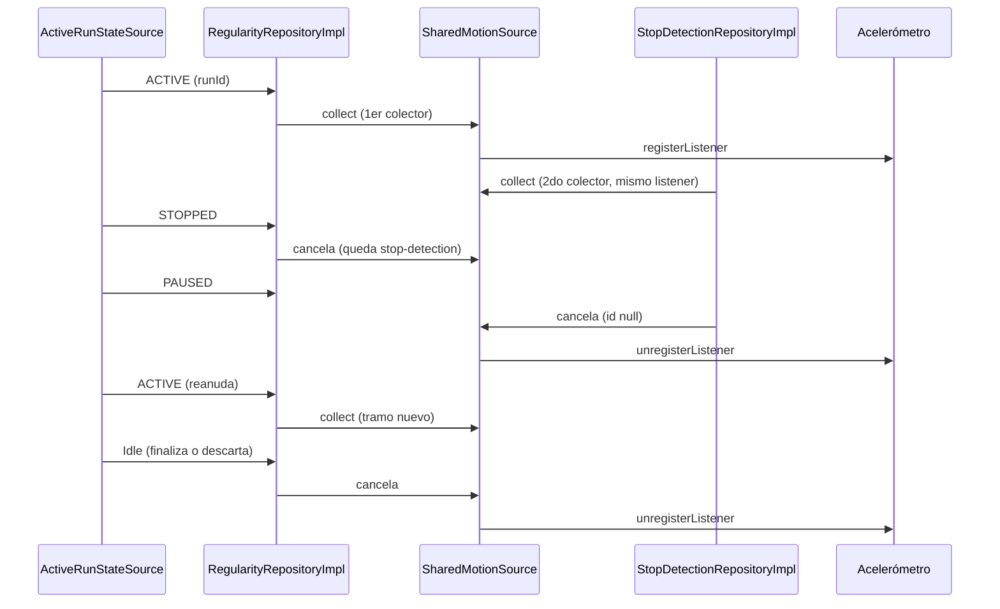

# Documento de diseño · floor-regularity (HU-05.2 · Regularidad del piso)

## Overview

**Propósito**: esta funcionalidad entrega al corredor la métrica «Regularidad»: el porcentaje de
tramos de 10 s en que el piso fue parejo (vibración baja), medido con el acelerómetro mientras corre.
**Usuarios**: el corredor recreativo urbano. Ve el valor en el resultado, el guardado y el historial
(presentación de otras personas); si su teléfono no tiene acelerómetro, ve un aviso y «sin dato».
**Impacto**: hoy `stop-detection` lee el acelerómetro con un flujo frío (un listener por colector).
El diseño agrega un decorador que comparte esa lectura entre la detección de frenadas y la
regularidad, un medidor de dominio puro con tiempo inyectado y un repositorio que publica el
resultado. No cambia el dominio de `stop-detection` ni reimplementa la pausa manual.
**Supuesto de ejecución (decisión C8)**: no hay servicio en segundo plano; se mide con la pantalla
encendida y la app visible.

### Goals

- Medir la regularidad por tramos de 10 s contando solo los tramos en que el corredor corre (3.1–3.9).
- Tener el valor disponible al finalizar y mantenerlo hasta el siguiente recorrido (4.1–4.6).
- Avisar cuando no hay acelerómetro y entregar «sin dato», nunca 0 % (5.1–5.7).
- Un único listener del sensor, activo solo mientras hace falta (6.1–6.7).
- Verificar que la pausa manual no cuenta como frenada y que al reanudar el movimiento se evalúa de
  cero, sin cambiar `stop-detection` (1.1–2.3).

### Non-Goals

- Detectar o clasificar frenadas (`stop-detection`).
- Implementar pausar o reanudar (HU-04, ya existe).
- Armar `FrozenRunSummary` y sus campos nuevos (Persona 3).
- Mostrar la regularidad o ubicar el aviso en pantallas del Mapa, resultado, guardado e historial.
- Persistir la regularidad (`save-run`).
- Medición con la pantalla apagada (decisión C8).

## Boundary Commitments

### This Spec Owns

- La regla de regularidad: tramos de 10 s, clasificación por vibración, porcentaje, descarte de
  tramos incompletos y qué estados cuentan.
- El valor `RegularityState` del recorrido y su disponibilidad (autoridad única hasta el siguiente
  recorrido).
- La señal de disponibilidad del acelerómetro y el texto del aviso de E11 (componente de aviso sin
  cablear en el Mapa).
- La gestión del ciclo de vida del acelerómetro compartido: `SharedMotionSource` es el único
  responsable de registrar y dar de baja el listener.
- Los puertos `MotionSensorAvailability` y `ActiveRunStateSource` y el contrato `RegularityRepository`.
- Las pruebas que verifican E8 y E9 sobre `stop-detection` (sin cambiarlo).

### Out of Boundary

- Reglas, estados y fases de `stop-detection` (`StopDetector`, `StillnessEstimator`,
  `StopDetectionRepositoryImpl`): no se modifican.
- `RunSessionRepository`, `RunState`, `pauseSession()` / `resumeSession()`, `finishSession()` y
  `resetToIdle()` (HU-04).
- `FrozenRunSummary` y `FinishRunUseCase` (Persona 3): esta spec no los toca.
- Presentación de la regularidad y ubicación del aviso (HU-06, `save-run`, Historial, Mapa).
- Frenadas «sin dato» en el resumen: se entrega la señal; el valor lo decide Persona 3 / `save-run`.
- Proveer `@ApplicationScope`: ya existe. `MonotonicClock` sí lo provee esta spec, vía
  `MotionSensorModule` (ver Allowed Dependencies).

### Allowed Dependencies

- `domain` no importa Android, `data` ni `ui`. `data` implementa puertos de `domain`.
  `ui/screens` depende de `domain`, nunca de `data`; `ui/components` solo de `ui/theme`.
- `MotionSource`, `MotionSample` y `AccelerometerMotionSource` de `stop-detection` (se reutilizan sin
  cambios; `AccelerometerMotionSource` pasa a ser el origen del decorador).
- `MonotonicClock` (puerto existente). Su único binding Hilt lo provee `MotionSensorModule`
  (decisión de la tarea 4.2); `stop-detection` no lo bindea en su módulo.
- `RunSessionRepository.activeSession` y `RunState` (HU-04) solo desde el adaptador
  `RunSessionActiveRunStateSource`.
- `@ApplicationScope` (`di/ApplicationScope.kt`), ya existente.
- Sin dependencias de producción nuevas. `kotlinx-coroutines-test` ya está en el catálogo.

### Revalidation Triggers

- Que `stop-detection` cree su propio binding de `MotionSource` (rompería el sensor compartido).
- Que cambie la forma de `MotionSource` / `MotionSample`, o que `AccelerometerMotionSource` deje de
  ser un flujo frío.
- Que `StopDetectionRepositoryImpl` deje de dejar de leer en pausa manual (el id pasa a `null`).
- Que cambie la forma de `RegularityState` (la leen Persona 3 y `save-run`).
- Que Persona 3 cambie cuándo se arma el resumen en `finishSession()` respecto de la lectura de la
  regularidad, o que `save-run` lea después de iniciar el siguiente recorrido.
- Que cambie `RunState` (nuevos estados, o que `STOPPED` / `PERSONAL_PAUSED` dejen de excluirse).
- Que se pida medición con la pantalla apagada.

## Architecture

### Existing Architecture Analysis

- Arquitectura por capas `ui → domain ← data` con Hilt; núcleo de dominio con tiempo inyectado
  (`StopDetector`, `StillnessEstimator`) y un repositorio que orquesta sensor, reloj y recorrido
  (`StopDetectionRepositoryImpl`). Esta spec repite ese patrón.
- `StopDetectionRepositoryImpl` colecta `motionSource.samples()` solo mientras el id del recorrido
  en curso no es `null`; en pausa manual el id pasa a `null`, se cancela la colección y las frenadas
  ya registradas se conservan.
- El módulo Hilt de `stop-detection` todavía no existe: esta spec coordina el binding de
  `MotionSource` antes de que exista.

### Architecture Pattern & Boundary Map

```mermaid
graph TB
    subgraph UI
        Notice[MotionSensorMissingNotice]
    end
    subgraph Domain
        RegularityRepository
        RegularityMeter
        ActiveRunStateSource
        MotionSensorAvailability
        MotionSource
        MonotonicClock
    end
    subgraph Data
        RegularityRepositoryImpl
        SharedMotionSource
        AccelerometerMotionSource
        AndroidMotionSensorAvailability
        RunSessionActiveRunStateSource
        StopDetectionRepositoryImpl
    end
    RegularityRepositoryImpl -. implements .-> RegularityRepository
    RegularityRepositoryImpl --> RegularityMeter
    RegularityRepositoryImpl --> ActiveRunStateSource
    RegularityRepositoryImpl --> MotionSensorAvailability
    RegularityRepositoryImpl --> MotionSource
    RegularityRepositoryImpl --> MonotonicClock
    StopDetectionRepositoryImpl --> MotionSource
    SharedMotionSource -. implements .-> MotionSource
    SharedMotionSource --> AccelerometerMotionSource
    AndroidMotionSensorAvailability -. implements .-> MotionSensorAvailability
    RunSessionActiveRunStateSource -. implements .-> ActiveRunStateSource
    RunSessionActiveRunStateSource --> HU04[RunSessionRepository HU-04]
    Notice --> RegularityRepository
```



**Architecture Integration**:

- Patrón: núcleo de dominio puro + decorador de sensor compartido (opción B de `research.md`).
- Límites: `RegularityMeter` no tiene reloj ni E/S (recibe `nowMillis`); solo
  `RegularityRepositoryImpl` cruza sensor, reloj y estado del recorrido.
- **Gestor único del sensor**: `SharedMotionSource`. Cada consumidor decide cuándo colectar; el
  listener existe si y solo si hay al menos un colector.
- Patrones preservados: Hilt, `StateFlow`, componentes con `@Preview`, textos en `strings.xml`.
- Sin casos de uso intermedios: el repositorio publica un `StateFlow` que se lee directo.
- Steering: aviso accesible según `design-system.md` (texto + ícono, 48 dp, `liveRegion`).

### Technology Stack

| Capa           | Elección                                         | Rol                                          | Notas                                   |
|----------------|--------------------------------------------------|----------------------------------------------|-----------------------------------------|
| UI             | Jetpack Compose + Material 3                     | `MotionSensorMissingNotice`                  | Sin dependencias nuevas                 |
| Dominio        | Kotlin puro + corrutinas                         | `RegularityMeter`, modelos y puertos         | Sin Android                             |
| Datos / Sensor | `SensorManager` + `shareIn(WhileSubscribed)`     | `SharedMotionSource`, disponibilidad         | Sin permiso                             |
| Pruebas        | JUnit 4 + `kotlinx-coroutines-test` (solo test)  | Tiempo virtual para tramos de 10 s           | Fakes a mano, sin MockK                 |

## File Structure Plan

### Directory Structure

```
app/src/main/java/com/trazo/app/
├── domain/
│   ├── model/regularity/
│   │   ├── RegularityConfig.kt        # tramo 10 s, umbral de vibración (provisional), hueco máximo
│   │   ├── RegularityState.kt         # runId, tramos totales y de vibración baja, sensorAvailable, percentage
│   │   ├── SegmentClass.kt            # enum LOW_VIBRATION, HIGH_VIBRATION
│   │   └── ActiveRunSnapshot.kt       # runId + RunState del recorrido (null si no hay)
│   ├── repository/
│   │   ├── RegularityRepository.kt        # contrato de salida (state)
│   │   ├── ActiveRunStateSource.kt        # puerto: recorrido en curso con su RunState
│   │   └── MotionSensorAvailability.kt    # puerto: ¿hay acelerómetro?
│   └── usecases/
│       └── RegularityMeter.kt         # reductor puro: muestras -> tramo cerrado
├── data/
│   ├── sensors/
│   │   ├── SharedMotionSource.kt              # decorador shareIn: un listener, baja automática
│   │   └── AndroidMotionSensorAvailability.kt # SensorManager.getDefaultSensor != null
│   ├── repository/
│   │   ├── RegularityRepositoryImpl.kt        # orquesta medidor, reloj, sensor y estado
│   │   └── RunSessionActiveRunStateSource.kt  # adapta activeSession de HU-04
│   └── di/MotionSensorModule.kt               # MotionSource compartido + binds
└── ui/screens/map/components/
    └── MotionSensorMissingNotice.kt   # aviso E11 (texto + ícono), sin cablear en MapScreen
app/src/main/res/drawable/ic_sensor_off.xml
app/src/test/java/com/trazo/app/... (ver Testing Strategy)
app/src/androidTest/java/com/trazo/app/ui/screens/map/components/MotionSensorMissingNoticeTest.kt
```

### Modified Files

- `res/values/strings.xml` — texto del aviso y accesibilidad (prefijo `map_`).
- Ningún archivo de `stop-detection`, `FrozenRunSummary` ni `MapScreen`.

## System Flows



**Decisiones de flujo**

- **Cuándo colecta la regularidad**: solo con `RunState.ACTIVE`. Cualquier otro estado cancela la
  colección y descarta el tramo abierto; al volver a `ACTIVE` empieza un tramo nuevo (3.5, 3.6, 2.2).
- **Cuándo está encendido el sensor**: ver tabla de `research.md`. `STOPPED` y `PERSONAL_PAUSED` lo
  mantienen encendido solo por `stop-detection`.
- **Cierre del recorrido**: `finishSession()` y `resetToIdle()` dejan la sesión en `Idle`; el
  snapshot pasa a `null`, se cancela la colección y no quedan colectores (6.2, 6.3, 6.6, 6.7).
  `RegularityState` se conserva (4.4).
- **Recorrido nuevo**: si el id del snapshot cambia, el estado se reinicia en cero (4.5). Si es el
  mismo id (reanudación), se conservan los tramos (2.3).
- **Cierre de tramo**: un tramo se cierra cuando pasaron 10 s del reloj desde su primera muestra. Si
  entre dos muestras pasa más de `maxSampleGapMillis`, el tramo abierto se descarta y empieza otro
  (3.8). Un tramo abierto al finalizar no se cuenta (3.7).

## Requirements Traceability

| Req | Resumen                                             | Componentes                                                    | Interfaces / Verificación                                  | Flujos                    |
|-----|-----------------------------------------------------|----------------------------------------------------------------|-------------------------------------------------------------|---------------------------|
| 1.1 | Pausa manual: sin frenadas                          | StopDetectionRepositoryImpl (sin cambios)                      | Prueba `StopDetectionManualPauseTest`                      | `PAUSED`                  |
| 1.2 | Pausa no es frenada ni pausa personal               | StopDetectionRepositoryImpl                                    | Prueba: pausar durante `Still` no registra frenada         | `PAUSED`                  |
| 1.3 | Se conservan las frenadas previas                   | StopDetectionRepositoryImpl                                    | Prueba: la lista sobrevive a pausar y reanudar             | `PAUSED`                  |
| 1.4 | Pausa no entra en tramos                            | RegularityRepositoryImpl, RegularityMeter                      | `ActiveRunStateSource`, colecta solo con `ACTIVE`          | Cuándo colecta            |
| 2.1 | Reanudar evalúa movimiento de cero                  | StopDetectionRepositoryImpl                                    | Prueba: tras reanudar la fase es «movimiento»              | Reanudar                  |
| 2.2 | Tramo nuevo al reanudar                             | RegularityRepositoryImpl, RegularityMeter                      | `RegularityMeter.reset()`                                  | Reanudar                  |
| 2.3 | Se conservan los tramos previos                     | RegularityRepositoryImpl                                       | Mismo `runId` conserva el estado                           | Recorrido nuevo           |
| 3.1 | Tramos consecutivos de 10 s                         | RegularityMeter, RegularityConfig                              | `accept`, `segmentMillis`                                  | Cierre de tramo           |
| 3.2 | Clasificar el tramo                                 | RegularityMeter                                                | `SegmentClass`                                             | Cierre de tramo           |
| 3.3 | Proporción de tramos de vibración baja              | RegularityState                                                | `percentage`                                               | —                         |
| 3.4 | 8 de 10 tramos = 80 %                               | RegularityState                                                | `percentage`                                               | —                         |
| 3.5 | No cuentan pausa, frenada ni pausa personal         | RegularityRepositoryImpl                                       | Colecta solo con `ACTIVE`                                  | Cuándo colecta            |
| 3.6 | Tramo incompleto se descarta                        | RegularityRepositoryImpl, RegularityMeter                      | `reset()` al salir de `ACTIVE`                             | Cuándo colecta            |
| 3.7 | Último tramo corto no cuenta                        | RegularityMeter                                                | Tramo abierto no genera resultado                          | Cierre de tramo           |
| 3.8 | Sensor sin lecturas: tramo descartado               | RegularityMeter                                                | `maxSampleGapMillis`                                       | Cierre de tramo           |
| 3.9 | Umbral ajustable y calibrado                        | RegularityConfig                                               | `lowVibrationStdDevThreshold`                              | —                         |
| 4.1 | Valor disponible al finalizar                       | RegularityRepository, RegularityRepositoryImpl                 | `state` actualizado en cada tramo cerrado                  | Cierre del recorrido      |
| 4.2 | Porcentaje entero 0–100                             | RegularityState                                                | `percentage` con redondeo al entero más cercano            | —                         |
| 4.3 | Sin tramos: «sin dato»                              | RegularityState                                                | `percentage == null` si no hay tramos                      | —                         |
| 4.4 | Disponible hasta el siguiente recorrido             | RegularityRepositoryImpl                                       | El estado no se limpia al pasar a `Idle`                   | Cierre del recorrido      |
| 4.5 | Recorrido nuevo parte de cero                       | RegularityRepositoryImpl                                       | Reinicio al cambiar `runId`                                | Recorrido nuevo           |
| 4.6 | «sin dato» con texto, no solo color                 | Contrato (`null`) + texto de las pantallas que lo muestran     | Responsabilidad de la presentación; se documenta           | —                         |
| 5.1 | Aviso al iniciar sin acelerómetro                   | MotionSensorMissingNotice, RegularityState.sensorAvailable     | Señal + texto                                              | —                         |
| 5.2 | Aviso con texto e ícono, 200 %, TalkBack            | MotionSensorMissingNotice                                      | `liveRegion`, `ic_sensor_off.xml`, 48 dp                   | —                         |
| 5.3 | Solo distancia, tiempo y velocidad                  | RegularityRepositoryImpl, SharedMotionSource                   | Flujo vacío: no hay muestras ni tramos                     | —                         |
| 5.4 | Regularidad «sin dato», nunca 0 %                   | RegularityState                                                | `percentage == null`                                       | —                         |
| 5.5 | Frenadas «sin dato»                                 | RegularityState.sensorAvailable                                | Señal para Persona 3 / `save-run` (a acordar)              | —                         |
| 5.6 | Exponer disponibilidad y texto                      | RegularityRepository, strings.xml                              | `state.sensorAvailable`, `map_motion_sensor_missing_*`     | —                         |
| 5.7 | No falla sin sensor                                 | SharedMotionSource, AndroidMotionSensorAvailability            | Flujo vacío, sin excepciones                               | —                         |
| 6.1 | Una sola lectura                                    | SharedMotionSource                                             | `shareIn(WhileSubscribed)`                                 | Secuencia                 |
| 6.2 | Fin: deja de leer                                   | RegularityRepositoryImpl, SharedMotionSource                   | Snapshot `null` cancela                                    | Cierre del recorrido      |
| 6.3 | Descarte: deja de leer                              | ídem                                                           | `resetToIdle()` → `Idle`                                   | Cierre del recorrido      |
| 6.4 | Pausa manual: no lee                                | StopDetectionRepositoryImpl, RegularityRepositoryImpl          | Ambos cancelan                                             | Secuencia                 |
| 6.5 | Reanudar: vuelve a leer                             | ídem                                                           | Ambos vuelven a colectar                                   | Secuencia                 |
| 6.6 | Sin recorrido: no lee                               | ídem                                                           | Snapshot `null`                                            | Cierre del recorrido      |
| 6.7 | Sin consumidores: se da de baja                     | SharedMotionSource                                             | `WhileSubscribed`                                          | Secuencia                 |
| 7.1 | Cobertura mayor a 80 %                              | Todas                                                          | Kover sobre los archivos de esta spec                      | —                         |
| 7.2 | Tiempo simulado                                     | RegularityMeter, RegularityRepositoryImpl                      | `MonotonicClock` inyectado, `kotlinx-coroutines-test`      | —                         |
| 7.3 | Prueba por escenario E8–E12 y casos límite         | Ver Testing Strategy                                           | —                                                          | —                         |
| 7.4 | No alterar `stop-detection`                         | Límite de la spec                                              | Sus pruebas siguen pasando                                 | —                         |

## Components and Interfaces

| Componente                         | Capa   | Intención                                                    | Req                          | Dependencias (criticidad)                                         | Contratos      |
|------------------------------------|--------|--------------------------------------------------------------|------------------------------|-------------------------------------------------------------------|----------------|
| RegularityMeter                    | Domain | Reductor puro: agrupa muestras en tramos y los clasifica      | 3.1, 3.2, 3.7–3.9            | RegularityConfig (P0)                                             | Service        |
| RegularityState                    | Domain | Valor publicado: tramos, disponibilidad y porcentaje          | 3.3, 3.4, 4.2–4.4, 5.4, 5.5  | —                                                                 | State          |
| RegularityRepository               | Domain | Contrato de salida                                            | 4.1, 5.6                     | —                                                                 | State          |
| ActiveRunStateSource               | Domain | Puerto: recorrido en curso y su `RunState`                    | 1.4, 3.5, 6.x                | —                                                                 | Service        |
| MotionSensorAvailability           | Domain | Puerto: ¿hay acelerómetro?                                    | 5.1, 5.6                     | —                                                                 | Service        |
| RegularityRepositoryImpl           | Data   | Orquesta estado, sensor, reloj y medidor                      | 1.4, 2.2, 2.3, 3.5, 3.6, 4.x, 6.x | MotionSource, ActiveRunStateSource, MotionSensorAvailability, MonotonicClock (P0) | Service, State |
| SharedMotionSource                 | Data   | Un solo listener; baja automática                             | 5.3, 5.7, 6.1, 6.7           | AccelerometerMotionSource, `@ApplicationScope` (P0)               | Service        |
| AndroidMotionSensorAvailability    | Data   | Consulta `SensorManager`                                      | 5.1, 5.7                     | SensorManager (P0)                                                | Service        |
| RunSessionActiveRunStateSource     | Data   | Adapta `activeSession` de HU-04                               | 1.4, 3.5                     | `RunSessionRepository` (P0)                                       | Service        |
| MotionSensorMissingNotice          | UI     | Aviso de E11, sin cablear                                     | 5.1, 5.2                     | `ui/theme` (P0)                                                   | —              |

### Domain

#### RegularityMeter

| Campo      | Detalle                                                                  |
|------------|--------------------------------------------------------------------------|
| Intención  | Cerrar tramos de 10 s y clasificarlos por vibración                       |
| Requisitos | 3.1, 3.2, 3.7, 3.8, 3.9                                                   |

**Responsabilidades y restricciones**

- Sin reloj, sin E/S, sin corrutinas. Recibe `nowMillis` en cada muestra.
- El tramo empieza en la primera muestra posterior a un `reset()` o a un descarte. Acumula media y
  varianza en una pasada (no guarda las muestras).
- Se cierra cuando `nowMillis - inicio >= segmentMillis`. Clasifica `LOW_VIBRATION` si el desvío
  estándar de la magnitud es menor que el umbral.
- Si entre dos muestras pasa más de `maxSampleGapMillis`, descarta el tramo abierto y arranca uno
  nuevo con la muestra actual. No hay resultado parcial.

**Contratos**: Service [x]

##### Service Interface

```kotlin
data class RegularityConfig(
    val segmentMillis: Long = 10_000,
    val lowVibrationStdDevThreshold: Float = 2.0f, // provisional, sin respaldo: calibrar (tarea 5.1)
    val maxSampleGapMillis: Long = 2_000,
)

enum class SegmentClass { LOW_VIBRATION, HIGH_VIBRATION }

class RegularityMeter(private val config: RegularityConfig) {
    /** Devuelve la clase del tramo si esta muestra lo cierra; null si sigue abierto. */
    fun accept(nowMillis: Long, magnitude: Float): SegmentClass?

    /** Descarta el tramo abierto. */
    fun reset()
}
```

- Precondiciones: `nowMillis` no decrece entre llamadas.
- Postcondiciones: un tramo cerrado nunca se reporta dos veces; un tramo descartado no se reporta.
- Invariantes: a lo sumo un tramo abierto.

#### RegularityState / RegularityRepository

```kotlin
data class RegularityState(
    val runId: String? = null,
    val completedSegments: Int = 0,
    val lowVibrationSegments: Int = 0,
    val sensorAvailable: Boolean = true,
) {
    /** Porcentaje entero 0..100, redondeado al más cercano; null si no hay tramos o no hay sensor. */
    val percentage: Int?
}

interface RegularityRepository {
    val state: StateFlow<RegularityState>
}
```

- `percentage`: `null` si `completedSegments == 0` (cubre «sin sensor» y «recorrido corto»);
  si no, `(low * 100 + total / 2) / total` con enteros (8 de 10 → 80).
- `state` se actualiza cada vez que se cierra un tramo, por lo que **ya está listo al finalizar** (4.1).
- `runId` permite a quien lee confirmar que el valor es del recorrido que está cerrando.
- El redondeo es un supuesto a validar en revisión (requisito 4.2).

#### Puertos

```kotlin
data class ActiveRunSnapshot(val runId: String, val state: RunState)

interface ActiveRunStateSource {
    /** Recorrido en curso con su estado; null si no hay (sesión `Idle`). */
    val activeRun: Flow<ActiveRunSnapshot?>
}

fun interface MotionSensorAvailability {
    fun isAvailable(): Boolean
}
```

### Data

#### RegularityRepositoryImpl

| Campo      | Detalle                                                                                                  |
|------------|----------------------------------------------------------------------------------------------------------|
| Intención  | Mantener `RegularityState` según el estado del recorrido y las muestras                                  |
| Requisitos | 1.4, 2.2, 2.3, 3.5, 3.6, 4.1, 4.4, 4.5, 5.3, 6.2–6.6                                                       |

**Responsabilidades y restricciones**

- Constructor con puertos, `MonotonicClock`, `CoroutineScope` y `RegularityConfig`.
- Al iniciar: `state = RegularityState(sensorAvailable = availability.isAvailable())`.
- En el scope: `activeRun.distinctUntilChanged().collectLatest { snapshot -> ... }`:
  - `null`: `meter.reset()`; no toca `state` (se conserva, 4.4).
  - Con `runId` distinto del último: reinicia `state` conservando `sensorAvailable`.
  - Con `state == ACTIVE`: `meter.reset()` y colecta `motionSource.samples()`; por cada muestra
    llama a `meter.accept(clock.nowMillis(), magnitude)` y, si cierra un tramo, actualiza los
    contadores.
  - Con cualquier otro estado: no colecta (se cancela la colección anterior por `collectLatest`).
- Con flujo de muestras vacío o sin sensor: la colección no emite, no hay tramos, `percentage` es `null`.

**Contratos**: Service [x] / State [x]

#### SharedMotionSource

- Implementa `MotionSource` envolviendo un `MotionSource` origen:
  `upstream.samples().shareIn(scope, SharingStarted.WhileSubscribed(), replay = 0)`.
- Se arma una sola vez (propiedad), de modo que `samples()` devuelve siempre el mismo flujo
  compartido. Mientras haya al menos un colector hay un único listener; con el último que se va, el
  origen se cancela y `callbackFlow` ejecuta `unregisterListener`.
- Sin acelerómetro el origen devuelve un flujo vacío: los colectores esperan sin muestras y no fallan.
- Es el **único gestor del ciclo de vida del sensor**.

#### AndroidMotionSensorAvailability / RunSessionActiveRunStateSource

- Disponibilidad: `SensorManager.getDefaultSensor(TYPE_ACCELEROMETER) != null`; sin
  `SensorManager`, `false`.
- Adaptador de HU-04: mapea `activeSession` a `ActiveRunSnapshot(id, state)` para `ActiveSession` y a
  `null` para `Idle`. No emite `ACTIVE` por su cuenta.

#### MotionSensorModule

- `@Provides @Singleton MotionSource` = `SharedMotionSource(AccelerometerMotionSource, @ApplicationScope)`.
- `@Provides @Singleton MonotonicClock { SystemClock.elapsedRealtime() }`: único proveedor.
- `@Binds` de `MotionSensorAvailability`, `ActiveRunStateSource` y `RegularityRepository`.
- `stop-detection` **no bindea** `MotionSource` ni `MonotonicClock` en su módulo (decidido en la 4.2).

### UI

#### MotionSensorMissingNotice

- Componente stateless con `@Preview` y `TrazoTheme`: ícono `ic_sensor_off` + texto. Anunciado como
  región viva educada, objetivo táctil de 48 dp si es descartable, legible al 200 %. El estado nunca
  se comunica solo con color.
- Textos en `strings.xml` (prefijo `map_`), español rioplatense: título «Sin acelerómetro» y detalle
  «No vamos a poder medir frenadas ni regularidad. Vas a ver distancia, tiempo y velocidad.»
- No se cablea en `MapScreen`: lo monta quien corresponda con `state.sensorAvailable`.

## Data Models

`RegularityState` (ver arriba) es el único modelo nuevo. Se conserva en memoria; la persistencia es
de `save-run`. Invariantes: `lowVibrationSegments <= completedSegments`; `percentage` en 0..100 o `null`.

## Error Handling

- **Sin acelerómetro**: flujo vacío, aviso y `percentage == null` (5.x). No es un error.
- **Sensor que se detiene a mitad de recorrido**: el tramo abierto se descarta por hueco máximo (3.8);
  el siguiente empieza con la próxima muestra.
- **Cancelación**: la cancelación de la colección es el mecanismo normal de baja; no se captura ni se
  reintenta.
- **Registro**: se loguea solo la ausencia de acelerómetro (ya lo hace `AccelerometerMotionSource`).

## Testing Strategy

### Unit Tests (JVM, `app/src/test`)

- `RegularityMeterTest`: 10 tramos con 8 de vibración baja → 8/10 (E10); tramo de 9,9 s no se cierra
  (3.7); hueco mayor a `maxSampleGapMillis` descarta el tramo (3.8); `reset()` descarta el abierto
  (3.6); el umbral clasifica a ambos lados (3.2, 3.9).
- `RegularityStateTest`: 8 de 10 → 80; 0 tramos → `null` (4.3); redondeo; `sensorAvailable = false`
  → `null` (5.4).
- `RegularityRepositoryImplTest` (fakes + tiempo virtual): solo cuenta en `ACTIVE` (3.5); pausa
  manual descarta el tramo abierto y conserva los cerrados (2.2, 2.3); `STOPPED` y `PERSONAL_PAUSED`
  no suman (3.5); id nuevo reinicia (4.5); el valor sigue disponible tras pasar a `Idle` (4.1, 4.4);
  sin sensor, `percentage` es `null` y no falla (5.3, 5.4, 5.7).
- `SharedMotionSourceTest`: dos colectores registran **una** sola vez; al irse el último se da de
  baja; volver a colectar registra de nuevo (6.1, 6.7).
- `StopDetectionManualPauseTest` (sobre `StopDetectionRepositoryImpl` sin cambiarlo, E8 y E9): pausar
  manualmente durante una detención de menos de 8 s no registra frenada (1.1, 1.2); las frenadas
  previas se conservan (1.3); al reanudar la fase es «movimiento» y arranca con estimador nuevo (2.1).

### Integration Tests (JVM)

- `SensorLifecycleTest`: con `SharedMotionSource` real sobre un origen falso, `StopDetectionRepositoryImpl` y
  `RegularityRepositoryImpl` activos: `ACTIVE` → un listener; `PAUSED` → cero; reanudar → uno;
  finalizar y descartar (`Idle`) → cero (E12; 6.2–6.7).

### UI Tests (instrumentados)

- `MotionSensorMissingNoticeTest`: muestra título y detalle; tiene ícono; se anuncia como región viva;
  legible con fuente al 200 % (5.1, 5.2).

### Cobertura

- Kover mayor a 80 % sobre `RegularityMeter`, `RegularityState`, `RegularityRepositoryImpl`,
  `SharedMotionSource` y los adaptadores (7.1). La carga de Kover en CI tiene la deuda conocida de
  `koverXmlReportRelease`: se mide con el informe de debug.

## Riesgos y preguntas abiertas

- **Umbral de vibración baja** (2,0 m/s² provisional): calibrar en un teléfono real (tarea 5.1).
- **Quietud en `Still` (primeros 8 s de una detención)** cuenta como `ACTIVE`: puede inflar el
  porcentaje; se mide en calibración. Resolverlo exigiría exponer la fase de `stop-detection`, fuera
  de esta spec.
- **Redondeo** al entero más cercano: supuesto a validar.
- **Frenadas sin acelerómetro** («sin dato» o 0): a acordar con `save-run` y Persona 3.
- **Doble binding Hilt** de `MotionSource` y `MonotonicClock` con el módulo de `stop-detection`:
  resuelto en la 4.2 (proveedor único: `MotionSensorModule`); verificar que no reaparezca.
- **Cómo llega el valor al resumen en `finishSession()`** (Persona 3) y **cuándo lo lee `save-run`**:
  abiertos; el diseño garantiza que el valor está disponible antes de armar el resumen y hasta el
  siguiente recorrido.
- **Ubicación del aviso de E11 en pantalla**: de otras personas.
