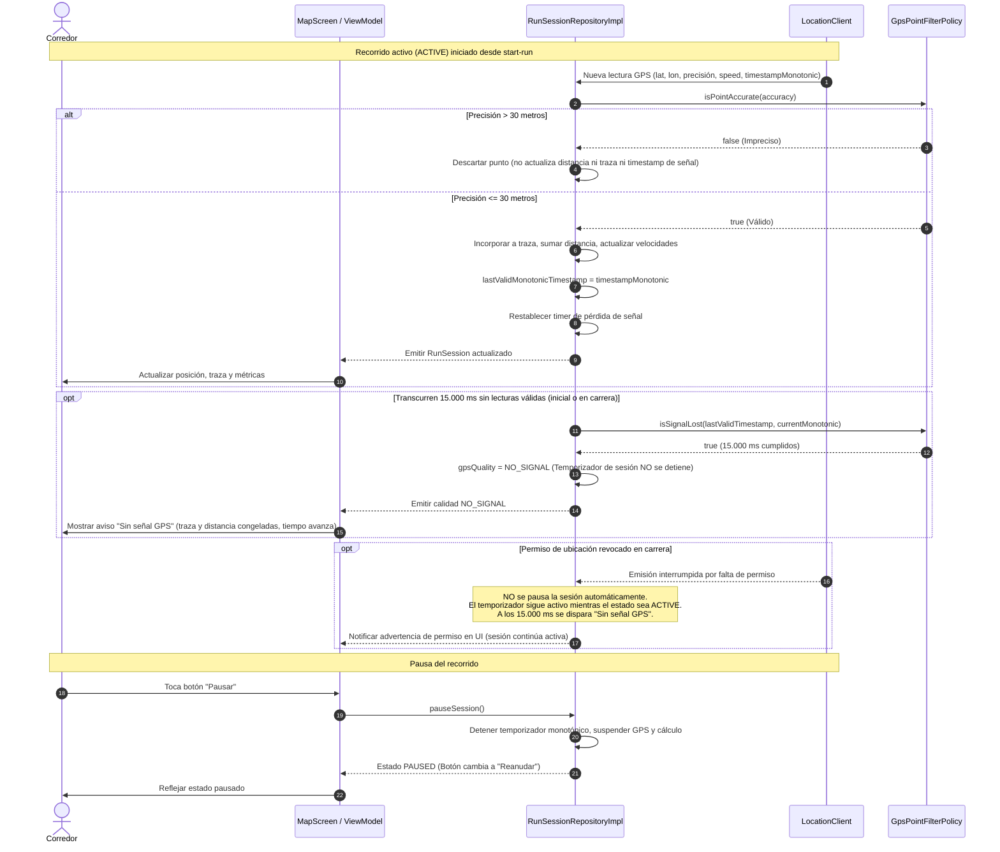
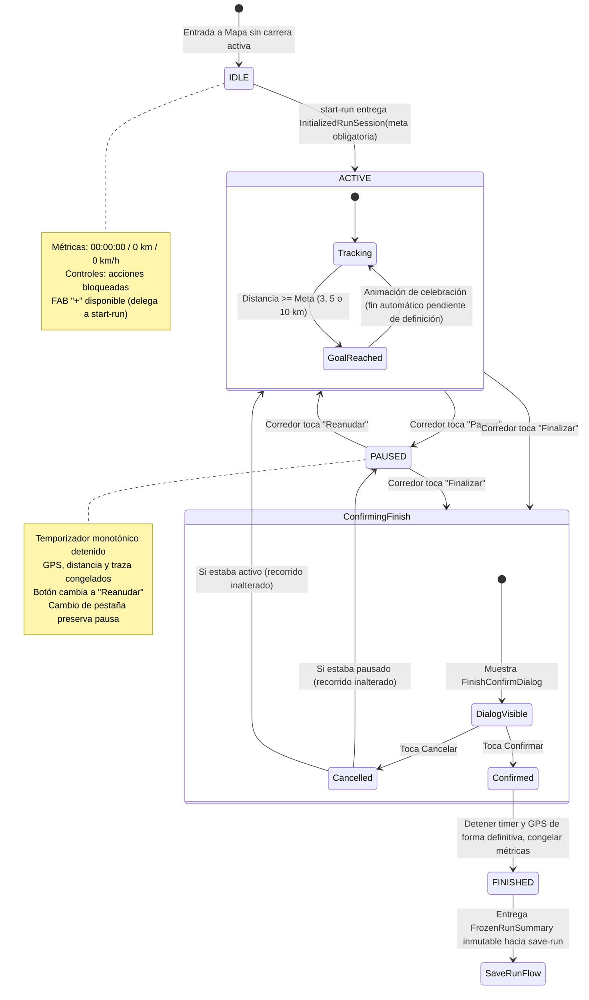
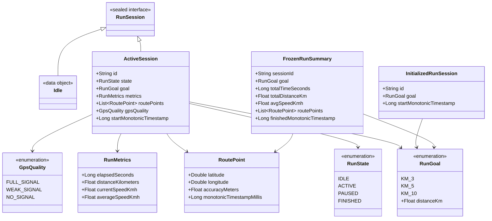

# Documento de Diseño Técnico: live-route-tracking (HU-04)

## Overview

Este documento especifica la arquitectura técnica y el diseño detallado para la funcionalidad de **Seguimiento del Recorrido en Vivo** (`HU-04`), correspondiente a Trazo v0.6. Permite a los corredores visualizar su posición en tiempo real sobre la pestaña "Mapa", registrar la ruta recorrida, visualizar métricas en vivo (tiempo transcurrido, distancia, velocidad actual y velocidad promedio), controlar la sesión mediante pausa/reanudación y finalizar el recorrido con confirmación para proceder al flujo de guardado.

La solución se inserta dentro de la arquitectura hexagonal de la aplicación Android, garantizando la independencia del dominio respecto de los frameworks de plataforma, el uso de Jetpack Compose con Material 3 para la UI, inyección de dependencias con Hilt, y un desacoplamiento estricto con las funcionalidades adyacentes de inicio (`start-run`) y guardado (`save-run`).

### Goals
- Proveer un estado inicial del mapa centrado en la ubicación actual con métricas en cero (`00:00:00`, `0 km`, `0 km/h`) y controles Reanudar y Finalizar deshabilitados visualmente y bloqueados funcionalmente cuando no hay una carrera activa.
- Recibir una sesión iniciada desde `start-run` con una meta fija obligatoria (3, 5 o 10 km) mediante un contrato de entrada explícito, sin implementar la lógica de inicio en HU-04.
- Realizar el seguimiento continuo de la posición del corredor y el trazado de la ruta sobre el mapa mientras la sesión permanezca en estado activo.
- Filtrar lecturas GPS imprecisas (> 30 metros) impidiendo su incorporación a la traza y al cálculo de distancia.
- Detectar la pérdida de señal GPS tras 15.000 ms sin lecturas válidas (contados desde el inicio de la sesión si aún no se recibió ningún punto, o desde el último punto válido), mostrando el aviso visual "Sin señal GPS" sin detener el temporizador de la sesión activa y manteniendo el indicador visual de barras independiente.
- Mantener el temporizador activo en carrera aun si se revoca el permiso de ubicación, sin asumir pausas automáticas no definidas en los requisitos.
- Proveer controles de pausa y reanudación con detención y reactivación integral de temporizador, distancia y traza.
- Preservar el estado en memoria de la sesión (activo o pausado) al cambiar de pestaña dentro de la app ("Mapa", "Historial", "Inicio") mientras el proceso de la app permanezca vivo, entendiendo que el avance fuera de Mapa ocurre exclusivamente al dejar de estar visible dicha pestaña en la navegación interna y no como seguimiento en segundo plano con la app minimizada a nivel de sistema operativo.
- Mostrar una animación de celebración al alcanzar la meta predefinida (3 km, 5 km o 10 km).
- Ofrecer un flujo de finalización seguro con diálogo de confirmación, detención definitiva de temporizador y GPS, congelamiento de métricas y entrega de una instantánea inmutable (`FrozenRunSummary`) hacia el flujo de guardado local (`save-run`).

### Non-Goals
- Gestión del modal de inicio, selección de meta e inicio de carrera (responsabilidad exclusiva de `start-run`).
- Formulario de guardado, validación de título, selección de destacados, captura de fotos y persistencia en Room (responsabilidad exclusiva de `save-run`).
- Implementación de la pantalla de resultados intermedia («¡Meta cumplida!» / «Recorrido finalizado»), sujeta a la decisión pendiente del equipo sobre el flujo de navegación.
- Persistencia intermedia en disco o recuperación de sesión ante la muerte del proceso de la aplicación (process death).
- Autenticación, perfiles de usuario, rankings, comunidad o sincronización con servidores/APIs remotas.
- Metas personalizadas (únicamente se admiten metas fijas de 3, 5 y 10 km).
- Integración con wearables, pulsómetros, conteo de calorías o planes de entrenamiento.
- Soporte para grabación de videos (solo fotos en `save-run`).
- Soporte multidioma o internacionalización (exclusivamente español rioplatense).

---

## Boundary Commitments

### This Spec Owns
- Lógica de negocio y modelos del dominio del recorrido en curso (`RunSession`, `RunState`, `RunMetrics`, `RoutePoint`, `RunGoal`).
- Contrato de recepción de una sesión iniciada (`attachActiveSession(session: InitializedRunSession)`).
- Casos de uso de control del ciclo de vida del seguimiento: `GetActiveRunSessionUseCase`, `PauseRunUseCase`, `ResumeRunUseCase`, `FinishRunUseCase`.
- Política de filtrado de calidad GPS y detección de pérdida de señal a los 15.000 ms (`GpsPointFilterPolicy`).
- Orquestación del estado de la pantalla "Mapa" (`MapViewModel`, `MapUiState`).
- Componentes UI de la pestaña "Mapa": `MapScreen`, `RunPanel`, `RunControls`, `GpsIndicator`, `MapLayer`, `FinishConfirmDialog`, `GoalCelebrationOverlay`.
- Generación y entrega de la instantánea inmutable no modificable (`FrozenRunSummary`) al finalizar.

### Out of Boundary
- Modal "Iniciar nuevo recorrido", chips de selección de meta y validación previa al inicio (pertenecen a `start-run`).
- Pantalla "Guardar recorrido", componentes `HighlightChip`, `PhotoPicker`, validación de título, DAOs y entidades Room (pertenecen a `save-run`).
- Pantalla de resultados (`GoalReachedCard`) (pertenece al módulo de resultados).
- Recuperación ante la muerte del proceso del sistema operativo (no contemplada en Trazo v0.6).
- Detección de frenadas bruscas o irregularidades del suelo mediante acelerómetro (pertenecen a historias de sensores).

### Allowed Dependencies
- `domain` depende únicamente de Kotlin estándar y corrutinas; no depende de Android SDK, Room ni Compose.
- `data/location` implementa los puertos de dominio utilizando Android LocationManager o Fused Location APIs.
- `ui` depende de `domain` (modelos y casos de uso), Jetpack Compose, Material 3 y `ui/theme`. La UI nunca importa paquetes de `data/`.
- Hilt `@Singleton` para la retención en memoria de `RunSessionRepository` mientras el proceso esté vivo.

### Revalidation Triggers
- Alteraciones en la firma del contrato `FrozenRunSummary` compartido con `save-run`.
- Modificación en el contrato `InitializedRunSession` provisto por `start-run`.
- Decisión de equipo que defina navegación obligatoria a través de una pantalla de resultados previa a `save-run`.
- Decisión de equipo sobre finalización automática o manual al alcanzar la meta.
- Cambio en la política de retención ante process death o adopción de un Foreground Service.

---

## Architecture

### Existing Architecture Analysis
La aplicación Trazo cuenta con una estructura de paquete base `com.trazo.app` dividida en tres capas: `domain`, `data` y `ui`. La navegación utiliza Jetpack Compose Navigation con una barra inferior de tres destinos (`Home`, `Map`, `History`). La pantalla actual `MapScreen` es un placeholder que debe sustituirse por la pantalla interactiva de seguimiento.

### Architecture Pattern & Boundary Map
Se implementa una **Arquitectura Hexagonal (Ports & Adapters)**. El núcleo de dominio encapsula el estado de la sesión, la acumulación métrica y las reglas de filtrado GPS mediante interfaces (puertos). Los adaptadores de datos obtienen las coordenadas del sensor de ubicación, y la capa UI reacciona al estado expuesto mediante `StateFlow`.

```mermaid
graph TD
    subgraph UI ["Capa UI (ui/)"]
        MapScreen["MapScreen (Composable)"]
        MapViewModel["MapViewModel"]
        RunPanelComp["RunPanel / RunControls"]
        GpsIndicatorComp["GpsIndicator"]
        FinishDialogComp["FinishConfirmDialog"]
        CelebrationComp["GoalCelebrationOverlay"]
    end

    subgraph Domain ["Capa Domain (domain/)"]
        GetSessionUC["GetActiveRunSessionUseCase"]
        PauseUC["PauseRunUseCase"]
        ResumeUC["ResumeRunUseCase"]
        FinishUC["FinishRunUseCase"]
        GpsFilter["GpsPointFilterPolicy"]
        RunSessionRepoPort["RunSessionRepository (Port)"]
        LocationPort["LocationClient (Port)"]
        DomainModels["RunSession / RunMetrics / RoutePoint / RunGoal"]
    end

    subgraph Data ["Capa Data (data/)"]
        RunSessionRepoImpl["RunSessionRepositoryImpl (@Singleton In-Memory)"]
        LocationClientImpl["AndroidLocationClient (Location APIs)"]
    end

    subgraph ExternalInteractions ["Integraciones Adyacentes"]
        StartRunFlow["start-run (Entrega InitializedRunSession)"]
        SaveRunFlow["save-run (Recibe FrozenRunSummary inmutable)"]
    end

    MapScreen --> MapViewModel
    MapViewModel --> RunPanelComp
    MapViewModel --> GpsIndicatorComp
    MapViewModel --> FinishDialogComp
    MapViewModel --> CelebrationComp

    MapViewModel --> GetSessionUC
    MapViewModel --> PauseUC
    MapViewModel --> ResumeUC
    MapViewModel --> FinishUC

    GetSessionUC --> RunSessionRepoPort
    PauseUC --> RunSessionRepoPort
    ResumeUC --> RunSessionRepoPort
    FinishUC --> RunSessionRepoPort

    RunSessionRepoImpl -.->|implements| RunSessionRepoPort
    LocationClientImpl -.->|implements| LocationPort

    RunSessionRepoImpl --> LocationPort
    RunSessionRepoImpl --> GpsFilter

    StartRunFlow -.->|attachActiveSession| RunSessionRepoPort
    MapViewModel -.->|Disparo FAB '+'| StartRunFlow
    MapViewModel -.->|Entrega resumen| SaveRunFlow
```



### Dependency Direction
`domain` (puro) ← `data` (implementa puertos de dominio)
`domain` (puro) ← `ui` (consume casos de uso y modelos de dominio)
**Regla estricta:** La capa `ui` **nunca** importa ni accede a clases de la capa `data`.

### Technology Stack
Las dependencias y versiones corresponden estrictamente a las declaradas en `gradle/libs.versions.toml`:

| Capa | Elección / Librería | Versión | Rol en la Funcionalidad | Notas |
|---|---|---|---|---|
| **Lenguaje y runtime** | Kotlin | `2.3.21` | Base del sistema, tipos inmutables y corrutinas | Bytecode JVM 17 |
| **UI** | Jetpack Compose / Material 3 | BOM `2025.04.01` | Composición declarativa de pantalla, controles y paneles | Tema definido en `ui/theme/` |
| **Navegación UI** | Navigation Compose | `2.8.9` | Navegación entre pestañas y transiciones | Gestión de back stack |
| **Arquitectura UI** | AndroidX Lifecycle & ViewModel | `2.8.7` | Gestión de estado reactivo con `StateFlow` | ViewModel inyectado con Hilt |
| **Inyección de Dependencias** | Dagger Hilt Android | `2.60.1` | Inyección de dependencias y singleton en memoria | `@Singleton`, `@HiltViewModel` |
| **Integración Hilt Navigation** | AndroidX Hilt Navigation Compose | `1.2.0` | Obtención de ViewModels con scope de navegación | `hiltViewModel()` |
| **Ubicación / Hardware** | Android Core KTX | `1.16.0` | Acceso a LocationManager / APIs de sistema | Permiso `ACCESS_FINE_LOCATION` |
| **Pruebas Unitarias** | JUnit 4 | `4.13.2` | Ejecución de pruebas unitarias en JVM | Pruebas de lógica y contratos |
| **Pruebas de Instrumentación** | AndroidX JUnit / Espresso | `1.2.1` / `3.6.1` | Pruebas de integración y componentes Compose | Verificación en dispositivo |

---

## File Structure Plan

### Directory Structure
```
app/src/main/java/com/trazo/app/
├── domain/
│   ├── model/
│   │   ├── RoutePoint.kt                 # Entidad de punto geográfico inmutable con timestamp monotónico
│   │   ├── RunGoal.kt                    # Enum de meta fija obligatoria (KM_3, KM_5, KM_10)
│   │   ├── RunMetrics.kt                 # Métricas en vivo (tiempo monotónico, distancia, velocidades)
│   │   ├── RunSession.kt                 # Sealed interface: Idle vs ActiveSession
│   │   ├── RunState.kt                   # Enum del estado: IDLE, ACTIVE, PAUSED, FINISHED
│   │   ├── GpsQuality.kt                 # Calidad de señal visual: FULL_SIGNAL, WEAK_SIGNAL, NO_SIGNAL
│   │   ├── InitializedRunSession.kt      # Contrato de entrada provisto por start-run
│   │   └── FrozenRunSummary.kt           # Instantánea inmutable exportada al finalizar para save-run
│   ├── repository/
│   │   ├── LocationClient.kt             # Puerto de entrada para el flujo de ubicaciones
│   │   └── RunSessionRepository.kt       # Puerto para control y observación del seguimiento activo
│   └── usecases/
│       ├── GetActiveRunSessionUseCase.kt # Observa el StateFlow de la sesión y métricas
│       ├── PauseRunUseCase.kt            # Pausa temporizador y registro de distancia/traza
│       ├── ResumeRunUseCase.kt           # Reanuda temporizador y registro de distancia/traza
│       ├── FinishRunUseCase.kt           # Detiene definitivamente y genera FrozenRunSummary
│       └── GpsPointFilterPolicy.kt       # Reglas de negocio: umbral 30m y timeout 15.000 ms
├── data/
│   ├── di/
│   │   └── LocationModule.kt             # Módulo Hilt que vincula LocationClient y RunSessionRepository
│   ├── location/
│   │   └── AndroidLocationClient.kt      # Adaptador de hardware que emite Flow<RawLocationPoint>
│   └── repository/
│       └── RunSessionRepositoryImpl.kt   # Implementación en memoria (@Singleton) del seguimiento
└── ui/
    └── screens/
        └── map/
            ├── MapScreen.kt              # Pantalla principal (observa ViewModel, gestiona permisos y KeepScreenOn)
            ├── MapViewModel.kt           # Orquestador UI (UiState, UiEvent, UiEffect)
            ├── MapUiState.kt             # Estado inmutable de la pantalla de mapa
            └── components/
                ├── RunPanel.kt           # Panel flotante con métricas tabulares y controles
                ├── RunControls.kt        # Botones Pausar, Reanudar y Finalizar (56x56 dp, deshabilitados visual y funcionalmente en IDLE)
                ├── GpsIndicator.kt       # Indicador visual independiente (barras de señal)
                ├── FinishConfirmDialog.kt# Diálogo modal de confirmación antes de finalizar
                ├── GoalCelebrationOverlay.kt # Animación de celebración al alcanzar la meta
                └── MapLayer.kt           # Renderizado de mapa, marcador y traza en vivo
```

### Modified Files
- `app/src/main/java/com/trazo/app/ui/screens/map/MapScreen.kt`: Sustitución del placeholder simple por la pantalla completa que acopla `MapViewModel`, `MapLayer`, `RunPanel` y diálogos.
- `app/src/main/java/com/trazo/app/ui/navigation/TrazoApp.kt`: Integración del efecto de navegación desacoplado al finalizar el recorrido hacia el flujo de guardado (`save-run`).

---

## System Flows

### Sequence Flow: Seguimiento GPS, Filtrado, Pérdida de Señal y Permisos



### State Lifecycle Flow: Ciclo de Vida de la Sesión de Recorrido



---

## Requirements Traceability

Se clasifican rigurosamente los requisitos entre:
- **[Acordado]**: Respaldado directamente por `requirements.md`.
- **[Pendiente de definición con el equipo]**: Puntos identificados explícitamente en el spec para decisión conjunta.
- **[Propuesta pendiente de aprobación]**: Propuestas técnicas planteadas en el spec a la espera de aprobación formal.

| Requirement | Tipo | Resumen del Requisito | Componentes Asociados | Interfaces / Contratos | Flujo Asociado |
|---|---|---|---|---|---|
| **1.1** | [Acordado] | Centrar mapa en posición inicial si hay permiso y ubicación | `MapScreen`, `MapViewModel` | `MapUiState.userLocation` | Lifecycle inicial |
| **1.2** | [Acordado] | Métricas iniciales 00:00:00, 0 km, 0 km/h | `RunPanel`, `MapViewModel` | `RunMetrics.ZERO` | Estado IDLE |
| **1.3** | [Acordado] | Iniciar carrera desde botón flotante (FAB "+") vía `start-run` | `MapScreen`, `MapViewModel` | `MapUiEffect.OpenStartRunModal` | Integración `start-run` |
| **1.4** | [Acordado] | Controles Pausar/Reanudar/Finalizar no permiten acciones en IDLE | `RunControls`, `MapViewModel` | `areControlActionsAllowed = false` | Estado IDLE |
| **1.5** | [Acordado] | Controles Reanudar y Finalizar deshabilitados visualmente en IDLE | `RunControls` | `areControlsEnabled = false` | Estado IDLE |
| **2.1** | [Acordado] | Mostrar posición actual del corredor en el mapa | `MapLayer`, `MapScreen` | `MapUiState.runnerPosition` | Sequence paso 8 |
| **2.2** | [Acordado] | Dibujar y extender traza continua del recorrido | `MapLayer` | `MapUiState.routePoints` | Sequence paso 8 |
| **2.3** | [Acordado] | Actualizar continuamente tiempo transcurrido (monotónico) | `RunPanel`, `RunSessionRepositoryImpl` | `RunMetrics.elapsedSeconds` | Sequence paso 8 |
| **2.4** | [Acordado] | Actualizar continuamente distancia acumulada con puntos válidos | `RunPanel`, `RunSessionRepositoryImpl` | `RunMetrics.distanceKilometers` | Sequence paso 8 |
| **2.5** | [Acordado] | Actualizar continuamente velocidad del corredor | `RunPanel`, `RunSessionRepositoryImpl` | `RunMetrics.currentSpeedKmh` | Sequence paso 8 |
| **3.1** | [Acordado] | Indicador "GPS" con barras completas en buena señal | `GpsIndicator` | `GpsQuality.FULL_SIGNAL` | State tracking |
| **3.2** | [Acordado] | Indicador visual de barras independiente del filtro de 30 m | `GpsIndicator`, `LocationClient` | `LocationClient.getSignalQualityUpdates` | Autonomía de señal |
| **3.3** | [Acordado] | Aviso "Sin señal GPS" tras 15.000 ms sin lecturas válidas | `GpsIndicator`, `GpsPointFilterPolicy` | `GpsQuality.NO_SIGNAL` | Sequence pasos 9-11 |
| **3.4** | [Acordado] | Exclusión de puntos inválidos y distancia durante "Sin señal" | `RunSessionRepositoryImpl` | `GpsPointFilterPolicy` | Sequence paso 4 |
| **3.5** | [Acordado] | Ocultar aviso y continuar registro al recibir punto válido | `GpsIndicator`, `RunSessionRepositoryImpl` | `GpsQuality` recovery | Sequence paso 7 |
| **4.1** | [Acordado] | Descartar lecturas GPS con precisión > 30 metros | `GpsPointFilterPolicy` | `isPointAccurate(accuracy)` | Sequence paso 3 |
| **4.2** | [Acordado] | No incorporar a la traza puntos con precisión > 30 metros | `RunSessionRepositoryImpl` | `RunSession.routePoints` | Sequence paso 4 |
| **4.3** | [Acordado] | No sumar distancia a partir de puntos imprecisos | `RunSessionRepositoryImpl` | `RunMetrics.distanceKilometers` | Sequence paso 4 |
| **5.1** | [Acordado] | Detener temporizador, distancia y traza al pausar | `PauseRunUseCase`, `RunSessionRepositoryImpl` | `RunSessionRepository.pauseSession` | Sequence paso 14 |
| **5.2** | [Acordado] | Cambiar control de "Pausar" a "Reanudar" | `RunControls`, `MapUiState` | `RunState.PAUSED` | Sequence paso 15 |
| **5.3** | [Acordado] | Continuar temporizador, distancia y traza al reanudar | `ResumeRunUseCase`, `RunSessionRepositoryImpl` | `RunSessionRepository.resumeSession` | State PAUSED -> ACTIVE |
| **5.4** | [Acordado] | Cambiar control de "Reanudar" a "Pausar" | `RunControls`, `MapUiState` | `RunState.ACTIVE` | State PAUSED -> ACTIVE |
| **6.1** | [Acordado] | Recentrar mapa en posición actual al tocar botón de ubicación | `MapLayer`, `MapViewModel` | `MapUiEvent.OnCenterMapClicked` | Acción UI |
| **6.2** | [Acordado] | Mantener visible la traza completa tras recentrado | `MapLayer` | `MapUiState.routePoints` | Acción UI |
| **7.1** | [Acordado] | Conservar recorrido en curso al navegar entre pestañas dentro de la app (en proceso vivo) | `RunSessionRepositoryImpl` (@Singleton) | `RunSessionRepository` | State lifecycle |
| **7.2** | [Acordado] | Continuar avance de tiempo y GPS en activo mientras la pestaña Mapa no está visible | `RunSessionRepositoryImpl` | CoroutineScope (@ApplicationScope) | Pestaña inactiva |
| **7.3** | [Acordado] | Mantener detenidos tiempo activo, distancia y traza en pausado al cambiar de pestaña | `RunSessionRepositoryImpl` | `RunState.PAUSED` | Pestaña inactiva |
| **7.4** | [Acordado] | Restaurar estado y métricas consolidadas al regresar a la pestaña Mapa | `MapViewModel`, `GetActiveRunSessionUseCase` | `StateFlow<RunSession>` | NavHost restoreState |
| **8.1** | [Acordado] | Mostrar animación de celebración al alcanzar la meta | `GoalCelebrationOverlay` | `MapUiState.showGoalCelebration` | State ACTIVE |
| **8.2** | [Pendiente de definición] | Fin automático vs. manual al alcanzar la meta | `GoalCelebrationOverlay`, `MapViewModel` | `MapUiState` flag de celebración | State ACTIVE |
| **9.1** | [Propuesta pendiente] | Solicitar confirmación con diálogo al tocar "Finalizar" | `FinishConfirmDialog`, `MapViewModel` | `MapUiState.showFinishConfirmDialog` | State Confirming |
| **9.2** | [Propuesta pendiente] | Cancelar finalización conserva estado previo sin alteración | `FinishConfirmDialog`, `MapViewModel` | `MapUiEvent.OnCancelFinish` | State Cancelled |
| **9.3** | [Propuesta pendiente] | Confirmar detiene definitivo, congela métricas y pasa a guardado | `FinishRunUseCase`, `MapViewModel` | `MapUiEffect.NavigateToFinalizationFlow` | State Confirmed |
| **9.4** | [Pendiente de definición] | Navegación directa a `save-run` vs. pantalla previa de resultados | `MapViewModel`, `TrazoApp` | `MapUiEffect.NavigateToFinalizationFlow` | Seam de navegación |
| **10.1** | [Propuesta pendiente] | Título obligatorio para guardar (`save-run`) | `FrozenRunSummary` (contrato hacia `save-run`) | `FrozenRunSummary` | Integración guardado |
| **10.2** | [Propuesta pendiente] | Destacados opcionales (`save-run`) | Delegado a `save-run` | Delegado a `save-run` | Integración guardado |
| **10.3** | [Propuesta pendiente] | Hasta 2 fotos opcionales de cámara; sin videos (`save-run`) | Delegado a `save-run` | Delegado a `save-run` | Integración guardado |
| **10.4** | [Propuesta pendiente] | Persistencia estrictamente local en Room sin cuentas ni servidor | Delegado a `save-run` | Delegado a `save-run` | Integración guardado |
| **10.5** | [Propuesta pendiente] | Disponibilidad en Historial y traza visible en mapa | `HistoryScreen`, `MapLayer` | Modelo Room vía `save-run` | Integración guardado |
| **11.1** | [Acordado] | Textos en español rioplatense con voseo sin i18n | Todo el módulo UI | `strings.xml` | Ubiquitous UI |
| **11.2** | [Acordado] | Metas fijas obligatorias (3, 5, 10 km); sin metas personalizadas ni calorías | `RunGoal`, `RunMetrics` | Enum `RunGoal` | Restricción producto |
| **11.3** | [Acordado] | Pantalla activa (`FLAG_KEEP_SCREEN_ON`) sin garantía background | `MapScreen` (DisposableEffect) | Window flag | Configuración UI |
| **11.4** | [Acordado] | Separador decimal con coma para distancia y velocidad | `MetricFormatter` | Función pura con Locale `es-AR` | Formato UI |
| **11.5** | [Acordado] | Área táctil mínima de 48 dp (56 dp para controles de carrera) | `RunControls`, `MapScreen` | Modifiers `size(56.dp)` / `defaultMinSize` | Accesibilidad UI |
| **11.6** | [Acordado] | Descripciones accesibles para lectores de pantalla | `RunControls`, `GpsIndicator` | `Modifier.semantics { contentDescription = ... }` | Accesibilidad UI |

### Mapeo de Cobertura de los 8 Escenarios de Aceptación (Trazo v0.6)

A continuación se detalla la correspondencia exacta de cada uno de los 8 escenarios de la funcionalidad con los componentes, estados y comportamientos técnicos diseñados:

1. **Escenario 1 — Mapa sin recorrido en curso:**
   - **Centrado:** Cuando no hay carrera activa, si el permiso y la ubicación están disponibles, `MapScreen` y `MapViewModel` centran la vista en la posición actual del corredor (`MapUiState.userLocation`).
   - **Métricas en cero:** La UI refleja el temporizador en `00:00:00`, la distancia en `0 km` y la velocidad en `0 km/h` (`formattedTime = "00:00:00"`, `formattedDistance = "0"`, `distanceUnit = "km"`, `formattedSpeed = "0"`, `speedUnit = "km/h"`).
   - **Inicio de carrera:** El botón flotante (FAB "+") se encuentra disponible para iniciar el flujo de carrera mediante `start-run` (`MapUiEffect.OpenStartRunModal`).
   - **Bloqueo funcional y visual de controles:** Conforme al requisito original de HU-04, cuando no hay un recorrido en curso, los botones Reanudar y Finalizar están deshabilitados tanto visualmente (con el estilo disabled de Material 3, `areControlsEnabled = false`) como funcionalmente (bloqueados ante cualquier toque, `areControlActionsAllowed = false`). Este comportamiento queda definido como acordado y no como decisión pendiente.

2. **Escenario 2 — Visualizar el recorrido en vivo:**
   - **Posición del corredor:** `MapLayer` actualiza continuamente el marcador de posición actual del corredor sobre el mapa (`MapUiState.runnerPosition`).
   - **Traza en vivo:** La polilínea de la ruta se extiende continuamente con cada coordenada válida recibida (`MapUiState.routePoints`).
   - **Métricas en tiempo real:** `RunPanel` actualiza concurrentemente el tiempo transcurrido en formato tabular (`RunMetrics.elapsedSeconds`), la distancia acumulada en kilómetros (`RunMetrics.distanceKilometers`) y la velocidad actual en km/h (`RunMetrics.currentSpeedKmh`).

3. **Escenario 3 — Mostrar buena señal GPS:**
   - **Indicador visual:** `GpsIndicator` muestra la píldora "GPS" con barras completas (`GpsQuality.FULL_SIGNAL`) cuando la señal tiene calidad suficiente.
   - **Continuidad:** El registro de coordenadas y acumulación de métricas opera normalmente.
   - **Independencia técnica:** El cálculo visual de las barras de señal se desacopla del filtro de 30 metros de precisión (la precisión métrica no impone directamente las barras de señal).

4. **Escenario 4 — Pérdida de señal GPS:**
   - **Detección tras 15.000 ms:** Si transcurren 15.000 ms consecutivos sin recibir ubicaciones válidas (contados desde la última ubicación válida recibida, o desde el inicio del recorrido si aún no se recibió ninguna), `GpsPointFilterPolicy` detecta la pérdida de señal.
   - **Aviso visual:** `GpsIndicator` transiciona a `GpsQuality.NO_SIGNAL` mostrando el aviso "Sin señal GPS".
   - **Exclusión de datos:** Durante la pérdida de señal, no se agregan puntos inválidos ni estimados a la traza, ni se suma distancia.
   - **Temporizador activo:** El temporizador de la sesión en curso **no se detiene** mientras el estado sea `ACTIVE`.
   - **Recuperación:** Al recibir nuevamente una lectura GPS válida, se oculta el aviso "Sin señal GPS" y se reanuda de inmediato la acumulación métrica y el trazado.

5. **Escenario 5 — Descartar un punto GPS impreciso:**
   - **Umbral de 30 metros:** Toda lectura GPS con `accuracyMeters > 30.0f` es descartada por `GpsPointFilterPolicy.isPointAccurate()`.
   - **Aislamiento:** El punto impreciso no se incorpora a `routePoints`, no suma distancia en `RunMetrics.distanceKilometers`, y no actualiza la marca de tiempo de última lectura válida (`lastValidLocationMonotonicTimestamp`).

6. **Escenario 6 — Pausar y reanudar el recorrido:**
   - **6.1 Pausar:** Al tocar "Pausar", `PauseRunUseCase` suspende el conteo del temporizador monotónico, congela la acumulación de distancia y detiene el registro de nuevos puntos GPS. El botón "Pausar" conmuta a "Reanudar" (`RunState.PAUSED`).
   - **6.2 Reanudar:** Al tocar "Reanudar", `ResumeRunUseCase` reactiva el temporizador monotónico, reanuda la acumulación de distancia y continúa incorporando nuevos puntos GPS a la traza. El botón "Reanudar" conmuta a "Pausar" (`RunState.ACTIVE`).

7. **Escenario 7 — Centrar el mapa en mi posición actual:**
   - **Recentrado:** Cuando el corredor desplaza manualmente el mapa y presiona el botón de ubicación actual, `MapViewModel` y `MapLayer` vuelven a enfocar la vista en la coordenada actual del corredor (`MapUiEvent.OnCenterMapClicked`).
   - **Persistencia visual:** La traza completa acumulada de la ruta permanece visible en todo momento tras el recentrado.

8. **Escenario 8 — Cambiar de pestaña sin perder el recorrido:**
   - **Alcance del segundo plano:** Se aclara expresamente que la expresión «en segundo plano» se refiere de forma exclusiva a que la pestaña Mapa deja de estar visible mientras el usuario navega internamente entre pestañas de la aplicación (hacia Historial o Inicio). No implica ni requiere seguimiento con la aplicación minimizada ni ejecución prolongada en segundo plano a nivel de sistema operativo Android.
   - **Persistencia de sesión:** La sesión en curso continúa activa o pausada en memoria mediante `RunSessionRepositoryImpl` (@Singleton) mientras el proceso de la aplicación permanezca vivo.
   - **Comportamiento en activo (ACTIVE):** El temporizador monotónico y el registro GPS continúan avanzando normalmente mientras la pestaña Mapa no está visible, acumulando tiempo y distancia.
   - **Comportamiento en pausa (PAUSED):** Si el recorrido está pausado, no avanzan el tiempo activo, la distancia acumulada ni la traza.
   - **Restauración integral:** Al regresar a la pestaña Mapa, `GetActiveRunSessionUseCase` y `MapViewModel` recuperan el estado actualizado y consolidado de la sesión.

---

## Components and Interfaces

### Component Summary Table

| Component | Layer | Intent | Req Coverage | Dependencies (P0/P1) | Contracts |
|---|---|---|---|---|---|
| `RunSessionRepository` | Domain (Port) | Contrato para observar y controlar el seguimiento de la sesión | 1.2, 5.1, 5.3, 7.1, 9.3 | Domain Models (P0) | State, Service |
| `LocationClient` | Domain (Port) | Emisión reactiva de coordenadas GPS y calidad visual | 2.1, 3.2, 4.1 | Coroutines Flow (P0) | Event |
| `GpsPointFilterPolicy` | Domain (Logic) | Filtrado a ≤ 30 m y timeout de 15.000 ms | 3.3, 3.4, 4.1, 4.2, 4.3 | Domain Models (P0) | Service |
| `GetActiveRunSessionUseCase` | Domain (Use Case) | Observa la sesión activa y expone flujo de datos | 1.2, 2.1-2.5, 7.4 | `RunSessionRepository` (P0) | Service |
| `PauseRunUseCase` | Domain (Use Case) | Detiene temporizador y registro de distancia/traza | 5.1, 5.2 | `RunSessionRepository` (P0) | Service |
| `ResumeRunUseCase` | Domain (Use Case) | Reanuda temporizador y registro de distancia/traza | 5.3, 5.4 | `RunSessionRepository` (P0) | Service |
| `FinishRunUseCase` | Domain (Use Case) | Detiene de forma definitiva y emite `FrozenRunSummary` | 9.3 | `RunSessionRepository` (P0) | Service |
| `AndroidLocationClient` | Data (Location) | Obtiene coordenadas del sensor Android | 2.1, 3.1, 4.1 | Location APIs de Android (P0) | Event |
| `RunSessionRepositoryImpl` | Data (Repository) | Implementación singleton en memoria del seguimiento | 5.1, 5.3, 7.1, 7.2, 7.3 | `LocationClient` (P0), `GpsPointFilterPolicy` (P0) | State, Service |
| `MapViewModel` | UI (ViewModel) | Mapea dominio a UiState y despacha intenciones de usuario | Todos los reqs de UI | Casos de uso de Domain (P0) | State |
| `MapScreen` | UI (Screen) | Composable principal, gestión de lifecycle, permisos y KeepScreenOn | 1.1, 1.3, 11.3 | `MapViewModel` (P0) | State |
| `RunPanel` | UI (Component) | Card flotante con temporizador, barra y métricas tabulares | 1.2, 2.3, 2.4, 2.5, 11.4 | `MapUiState` (P0) | UI Props |
| `RunControls` | UI (Component) | Botones Pausar/Reanudar/Finalizar (56 dp) | 1.4, 1.5, 5.2, 5.4, 9.1, 11.5 | `MapUiState` (P0) | UI Props |
| `GpsIndicator` | UI (Component) | Píldora de 28 dp con barras de señal y aviso "Sin señal GPS" | 3.1, 3.2, 3.3, 3.5, 11.6 | `GpsQuality` (P0) | UI Props |
| `FinishConfirmDialog` | UI (Component) | Diálogo de confirmación para evitar cierre accidental | 9.1, 9.2, 9.3 | `MapUiState` (P0) | UI Props |
| `GoalCelebrationOverlay`| UI (Component) | Animación de celebración al cumplir la meta | 8.1, 8.2 | `MapUiState` (P0) | UI Props |
| `MapLayer` | UI (Component) | Capa de renderizado de traza viva y pin del corredor | 1.1, 2.1, 2.2, 6.1, 6.2 | `MapUiState` (P0) | UI Props |

---

### Domain Layer Components

#implement`RunSessionRepository` (Interface)

| Field | Detail |
|---|---|
| Intent | Puerto del dominio que expone el flujo reactivo del seguimiento y operaciones de control de ciclo de vida |
| Requirements | 1.2, 5.1, 5.3, 7.1, 7.2, 7.3, 9.3 |

**Contracts**: Service [x] / State [x]

```kotlin
interface RunSessionRepository {
    val activeSession: StateFlow<RunSession>

    fun attachActiveSession(session: InitializedRunSession)
    suspend fun pauseSession(): Result<Unit>
    suspend fun resumeSession(): Result<Unit>
    suspend fun finishSession(): Result<FrozenRunSummary>
    fun resetToIdle()
}

data class InitializedRunSession(
    val id: String,
    val goal: RunGoal,
    val startMonotonicTimestamp: Long
)
```

- Preconditions:
  - `attachActiveSession`: La sesión debe estar en estado `IDLE`. La meta `goal` es obligatoria (3, 5 o 10 km).
  - `pauseSession`: La sesión debe estar en estado `ACTIVE`.
  - `resumeSession`: La sesión debe estar en estado `PAUSED`.
  - `finishSession`: La sesión debe estar en estado `ACTIVE` o `PAUSED`.
- Postconditions:
  - `attachActiveSession`: Inicia la recepción de coordenadas GPS y el temporizador monotónico.
  - `pauseSession`: Se detiene el avance del temporizador, cálculo de distancia y traza; estado transiciona a `PAUSED`.
  - `resumeSession`: Se reanuda el avance del temporizador y registro GPS; estado transiciona a `ACTIVE`.
  - `finishSession`: Se detiene de manera definitiva el tracking, se liberan recursos de GPS y se emite un `FrozenRunSummary` con copia inmutable defensiva de puntos.

---

#### Component: `GpsPointFilterPolicy`

| Field | Detail |
|---|---|
| Intent | Encapsula las reglas de descarte de puntos por imprecisión (> 30 m) y el timeout unificado de 15.000 ms sin señal |
| Requirements | 3.3, 3.4, 4.1, 4.2, 4.3 |

**Contracts**: Service [x]

```kotlin
class GpsPointFilterPolicy(
    private val maxAllowedAccuracyMeters: Float = 30.0f,
    private val signalLossTimeoutMillis: Long = 15_000L
) {
    fun isPointAccurate(accuracyMeters: Float): Boolean {
        return accuracyMeters <= maxAllowedAccuracyMeters
    }

    fun isSignalLost(lastValidLocationMonotonicTimestamp: Long, currentMonotonicTimestamp: Long): Boolean {
        if (lastValidLocationMonotonicTimestamp <= 0L) return false
        return (currentMonotonicTimestamp - lastValidLocationMonotonicTimestamp) >= signalLossTimeoutMillis
    }
}
```

- Invariants:
  - Un punto con precisión `> 30.0f` metros se evalúa como inválido y nunca actualiza `lastValidLocationMonotonicTimestamp`.
  - El umbral de timeout es unificado exactamente en `15_000L` ms.

---

### Data Layer Components

#### Component: `AndroidLocationClient`

| Field | Detail |
|---|---|
| Intent | Adaptador de infraestructura que consulta el hardware de ubicación y emite flujos reactivos de coordenadas y calidad visual |
| Requirements | 2.1, 3.1, 3.2, 4.1 |

**Contracts**: Event [x]

```kotlin
interface LocationClient {
    fun getLocationUpdates(intervalMillis: Long): Flow<RawLocationPoint>
    fun getSignalQualityUpdates(): Flow<GpsQuality>
}

data class RawLocationPoint(
    val latitude: Double,
    val longitude: Double,
    val accuracyMeters: Float,
    val speedMps: Float,
    val monotonicTimestampMillis: Long
)
```

- Implementation Notes:
  - El flujo de `getSignalQualityUpdates()` evalúa independientemente el estado provisto por el sistema (número de satélites / proveedor) y emite `FULL_SIGNAL` o `WEAK_SIGNAL`.
  - La emisión de `NO_SIGNAL` se gestiona por la falta de lecturas válidas en el repositorio según `GpsPointFilterPolicy`.

---

#### Component: `RunSessionRepositoryImpl`

| Field | Detail |
|---|---|
| Intent | Implementación singleton en memoria que mantiene el seguimiento, acumula métricas y gestiona el ciclo de vida en proceso |
| Requirements | 1.2, 5.1, 5.3, 7.1, 7.2, 7.3, 9.3 |

**Contracts**: State [x] / Service [x]

```kotlin
@Singleton
class RunSessionRepositoryImpl @Inject constructor(
    private val locationClient: LocationClient,
    private val filterPolicy: GpsPointFilterPolicy,
    @ApplicationScope private val externalScope: CoroutineScope
) : RunSessionRepository {

    private val _activeSession = MutableStateFlow<RunSession>(RunSession.Idle)
    override val activeSession: StateFlow<RunSession> = _activeSession.asStateFlow()

    private var activeStartMonotonicTime: Long = 0L
    private var accumulatedActiveTimeMillis: Long = 0L

    private var lastValidLocationMonotonicTimestamp: Long? = null
    private var signalTimeoutReferenceMonotonicTimestamp: Long? = null

    private var trackingJob: Job? = null
    private var signalCheckJob: Job? = null

    // Other session state and implementation details...
}
```

**State Management & In-Process Lifecycle:**

- `@Singleton` y `@ApplicationScope` retienen el estado en memoria mientras el proceso de la aplicación permanezca vivo. No se provee persistencia intermedia ante la muerte del proceso (*process death*).
- Al recibir una sesión mediante `attachActiveSession(session)`:
    - `activeStartMonotonicTime = SystemClock.elapsedRealtime()`.
    - `accumulatedActiveTimeMillis = 0L`.
    - `lastValidLocationMonotonicTimestamp = null`, porque todavía no se recibió ningún punto GPS válido.
    - `signalTimeoutReferenceMonotonicTimestamp = activeStartMonotonicTime`, para medir los primeros 15.000 ms desde el inicio del seguimiento.
    - Se inicia la recolección de ubicaciones y la comprobación periódica del timeout en `externalScope`.
- Al recibir un punto válido (`isPointAccurate == true`):
    - Se agrega a la lista de puntos.
    - Se suma la distancia geodésica cuando corresponde.
    - `lastValidLocationMonotonicTimestamp = point.monotonicTimestampMillis`.
    - `signalTimeoutReferenceMonotonicTimestamp = point.monotonicTimestampMillis`.
    - Se actualiza `currentSpeedKmh = point.speedMps * 3.6f`.
    - Se actualiza `averageSpeedKmh = distanceKilometers / (elapsedSeconds / 3600.0f)`, siempre que `elapsedSeconds > 0`.
    - Si la calidad estaba en `NO_SIGNAL`, se restablece al estado correspondiente a la señal recuperada.
- Al pausar (`pauseSession()`):
    - `accumulatedActiveTimeMillis += SystemClock.elapsedRealtime() - activeStartMonotonicTime`.
    - Se detiene el avance del temporizador.
    - Se cancela la recolección de ubicaciones y el job de comprobación del timeout.
    - No se acumula distancia ni se incorporan puntos durante la pausa.
- Al reanudar (`resumeSession()`):
    - `activeStartMonotonicTime = SystemClock.elapsedRealtime()`.
    - `signalTimeoutReferenceMonotonicTimestamp = activeStartMonotonicTime`.
    - Se reinician la recolección de ubicaciones y la comprobación del timeout.
    - El período transcurrido durante la pausa no se considera para determinar la pérdida de señal GPS.
    - Si no se recibe un punto válido durante los siguientes 15.000 ms, se emite `NO_SIGNAL`.
    - Se conserva `lastValidLocationMonotonicTimestamp` como referencia histórica del último punto válido, sin utilizarlo para contabilizar el tiempo de pérdida de señal inmediatamente después de reanudar.
- Al revocarse el permiso de ubicación durante la carrera:
    - La recolección de coordenadas se interrumpe, pero el temporizador continúa activo mientras el estado sea `ACTIVE`. No se realiza una pausa automática.
    - Al cumplirse 15.000 ms desde la última referencia válida de timeout, se emite `NO_SIGNAL`.
- Al finalizar (`finishSession()`):
    - Se cancelan los jobs de tracking y timeout.
    - Se genera una instantánea `FrozenRunSummary` con una copia defensiva de los puntos de la ruta, independiente de la lista interna del repositorio.

### UI Layer Components

#### Component: `MapViewModel`

| Field | Detail |
|---|---|
| Intent | Orquestador de la UI que transforma la sesión de dominio en `MapUiState`, procesa eventos del usuario y emite efectos de navegación |
| Requirements | Todos los requisitos de UI |

**Contracts**: State [x]

```kotlin
@HiltViewModel
class MapViewModel @Inject constructor(
    private val getActiveRunSessionUseCase: GetActiveRunSessionUseCase,
    private val pauseRunUseCase: PauseRunUseCase,
    private val resumeRunUseCase: ResumeRunUseCase,
    private val finishRunUseCase: FinishRunUseCase
) : ViewModel() {

    private val _uiState = MutableStateFlow(MapUiState())
    val uiState: StateFlow<MapUiState> = _uiState.asStateFlow()

    private val _uiEffect = Channel<MapUiEffect>(Channel.BUFFERED)
    val uiEffect: Flow<MapUiEffect> = _uiEffect.receiveAsFlow()

    fun onPauseClicked() { ... }
    fun onResumeClicked() { ... }
    fun onFinishRequested() { ... }
    fun onConfirmFinish() { ... }
    fun onCancelFinish() { ... }
    fun onCenterMapClicked() { ... }
    fun onStartRunClicked() { ... }
}
```

```kotlin
data class MapUiState(
    val runState: RunState = RunState.IDLE,
    val formattedTime: String = "00:00:00",
    val formattedDistance: String = "0",
    val distanceUnit: String = "km",
    val formattedSpeed: String = "0",
    val speedUnit: String = "km/h",
    val goal: RunGoal? = null,
    val goalProgressFraction: Float = 0.0f,
    val goalProgressText: String = "",
    val routePoints: List<RoutePoint> = emptyList(),
    val runnerPosition: RoutePoint? = null,
    val isMapCenteredOnRunner: Boolean = true,
    val gpsQuality: GpsQuality = GpsQuality.FULL_SIGNAL,
    val showFinishConfirmDialog: Boolean = false,
    val showGoalCelebration: Boolean = false,
    val areControlActionsAllowed: Boolean = false,
    val areControlsEnabled: Boolean = false
)

sealed interface MapUiEffect {
    data class NavigateToFinalizationFlow(val summary: FrozenRunSummary) : MapUiEffect
    data object OpenStartRunModal : MapUiEffect
}
```

- Implementation Notes:
  - En estado `IDLE`: `formattedTime = "00:00:00"`, `formattedDistance = "0"`, `distanceUnit = "km"`, `formattedSpeed = "0"`, `speedUnit = "km/h"`. La interfaz muestra exactamente `00:00:00`, `0 km` y `0 km/h`.
  - En estado `IDLE`: Conforme al requisito original de HU-04, los botones Reanudar y Finalizar se encuentran deshabilitados tanto visualmente (`areControlsEnabled = false`, aplicando el estilo disabled de Material 3) como funcionalmente (`areControlActionsAllowed = false`, bloqueando cualquier acción ante toques). Este comportamiento queda establecido sin quedar pendiente de definición.
  - El botón flotante (FAB "+") de inicio permanece plenamente habilitado y funcional en estado `IDLE`.
  - Durante el seguimiento (`ACTIVE`): la distancia y la velocidad se formatean utilizando la coma como separador decimal mediante `MetricFormatter` (ej. `"1,2"` y `"5,4"`).

---

## Data Models

### Domain Model



#### Invariants & Business Rules
- **Metas Obligatorias:** Todo recorrido iniciado posee una meta fija obligatoria (`RunGoal.KM_3`, `RunGoal.KM_5` o `RunGoal.KM_10`). No se permiten valores nulos en una sesión iniciada ni en `FrozenRunSummary`.
- **Referencias Temporales Monotónicas:** Los cálculos de tiempo transcurrido y la evaluación de timeouts se realizan exclusivamente con marcas monotónicas (`SystemClock.elapsedRealtime()`), inmunes a ajustes de reloj del sistema.
- **Métricas Definidas:**
  - `elapsedSeconds`: Segundos acumulados de actividad en estado `ACTIVE`.
  - `distanceKilometers`: Distancia acumulada entre puntos válidos consecutivos (`accuracy <= 30.0f`).
  - `currentSpeedKmh`: Velocidad instantánea (`speedMps * 3.6f`) provista por lecturas válidas. En pausa es `0.0f`.
  - `averageSpeedKmh`: `distanceKilometers / (elapsedSeconds / 3600.0f)`. Si `elapsedSeconds == 0L`, es `0.0f`.
- **Inmutabilidad Estricta de `FrozenRunSummary`:** Al generarse en `finishSession()`, la lista de puntos se clona de forma defensiva (`List.copyOf(...)` / `toList()`), garantizando que ninguna operación posterior en el repositorio pueda alterar la instantánea final.

---

## Error Handling

### Error Strategy
Se prioriza la continuidad atlética y la degradación elegante: la falta transitoria de señal o la revocación de permisos no corrompen la sesión ni detienen el tiempo activo del corredor.

### Error Categories and Responses

| Escenario de Error | Causa Raíz | Respuesta del Sistema | Comportamiento en UI |
|---|---|---|---|
| **Pérdida de señal GPS (15.000 ms)** | Falta de cobertura satelital o túnel | Suspender distancia y traza; **el temporizador continúa corriendo** si la sesión está en `ACTIVE` | Mostrar aviso "Sin señal GPS" en color Error |
| **Pérdida de señal inicial (15.000 ms sin puntos)** | Sin señal al arrancar la carrera | Contar 15.000 ms desde `startMonotonicTimestamp`; el temporizador continúa activo | Mostrar aviso "Sin señal GPS" tras los primeros 15 s |
| **Punto GPS impreciso (> 30 m)** | Baja precisión satelital | Descartar punto sin actualizar traza, distancia ni marca de señal | Ningún cambio visual en la traza; el usuario no percibe saltos |
| **Permiso de ubicación revocado en carrera** | Usuario revoca permiso desde Ajustes | Interrupción de lecturas GPS; **NO se pausa automáticamente**; el tiempo sigue corriendo en `ACTIVE` | Mostrar advertencia de permiso en UI; a los 15.000 ms se muestra "Sin señal GPS" |
| **Toque accidental de Finalizar** | Movimiento involuntario | Interceptar acción mediante `FinishConfirmDialog` | La sesión no se detiene; se requiere confirmación explícita |

---

## Testing Strategy

### Unit Tests (JVM - JUnit 4)
- **`GpsPointFilterPolicyTest`**:
  - `isPointAccurate_withAccuracyLessThan30Meters_returnsTrue`: lectura con 15 m de precisión es válida.
  - `isPointAccurate_withAccuracyGreaterThan30Meters_returnsFalse`: lectura con 35 m de precisión es descartada.
  - `isSignalLost_when15000msElapsedWithoutValidPoint_returnsTrue`: exactamente a los 15.000 ms se detecta pérdida de señal.
  - `isSignalLost_whenLessThan15000msElapsed_returnsFalse`: dentro de los 15.000 ms se conserva la señal.
- **`RunSessionRepositoryImplTest`**:
  - `attachActiveSession_initializesStateToActive_andTimerStarts`: inicio de sesión con meta obligatoria.
  - `initialSignalLoss_triggersAfter15000msFromStart_whenNoGpsReceived`: pérdida de señal inicial si no hay puntos en los primeros 15 s.
  - `pauseSession_freezesTimerAndStopsDistanceAccumulation`: verificar detención estricta en pausa.
  - `resumeSession_continuesTimerAndResumesGpsRecording`: reanudación correcta tras pausa.
  - `finishSession_producesImmutableFrozenRunSummary_withDefensiveCopyOfPoints`: comprobar que la lista de puntos de `FrozenRunSummary` no puede ser modificada indirectamente.
  - `locationPermissionRevoked_doesNotAutoPauseSession`: verificar que la revocación de permisos no cambia el estado a `PAUSED`.
- **`MetricFormatterTest`**:
  - Formateo con coma decimal en Locale `es-AR` (ej. `5.2` -> `"5,2"`).

### Integration Tests (JUnit 4 con Coroutines Test)
- **`MapViewModelTest`**:
  - `whenSessionStarts_uiStateReflectsActiveAndCoordinates`: emisión reactiva del `StateFlow`.
  - `whenFinishRequested_showConfirmDialogIsTrue`: apertura del diálogo de confirmación.
  - `whenFinishCancelled_dialogClosesAndSessionStateIsPreserved`: cancelación conserva el estado previo.
  - `whenFinishConfirmed_emitsNavigateToFinalizationFlow`: emisión del efecto de navegación con `FrozenRunSummary`.
  - `whenGoalReached_triggersCelebrationOverlay`: cumplimiento de meta activa animación de festejo.

### UI / Compose Tests (AndroidX Compose Test con JUnit 4)
- **`MapScreenTest`**:
  - `idleState_showsZeroMetrics_andControlsDoNotTriggerActions`: `00:00:00`, `0 km`, `0 km/h` y botones sin respuesta.
  - `activeState_displaysPauseAndFinishControls`: botones de 56 dp con íconos correspondientes.
  - `pausedState_displaysResumeButton`: alternancia correcta a "Reanudar".
  - `finishDialog_rendersButtonsCorrectly`: diálogo con "Cancelar" y "Finalizar".

---

## Security & Platform Considerations
- **Privacidad de Coordenadas:** Las coordenadas GPS se procesan estrictamente en memoria dentro del dispositivo y se entregan a `save-run` para persistencia local en Room al finalizar. No existe envío telemático ni telemetría remota.
- **Pantalla Activa (`FLAG_KEEP_SCREEN_ON`):** Durante la permanencia en la pantalla "Mapa" con un recorrido en curso, se activa la bandera de ventana para evitar el bloqueo del dispositivo durante la actividad física, respetando la pauta de no prometer seguimiento prolongado en segundo plano.
- **Área Táctil Accesible:** Todos los controles táctiles cumplen con la pauta de accesibilidad mínima de 48 × 48 dp, asignando 56 × 56 dp para los controles críticos de Pausar, Reanudar y Finalizar (`Sizes.runControl`).
