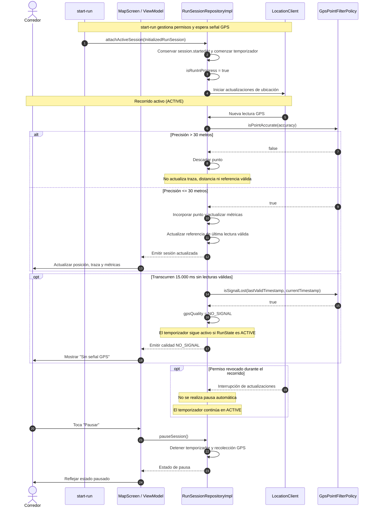
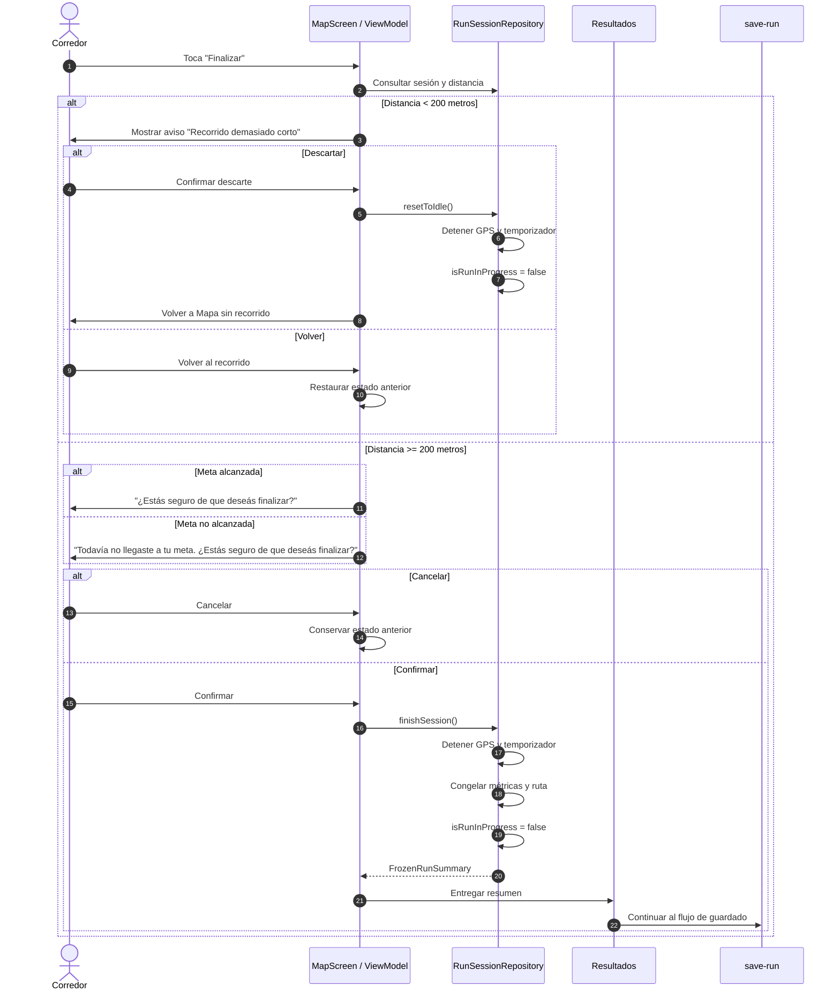
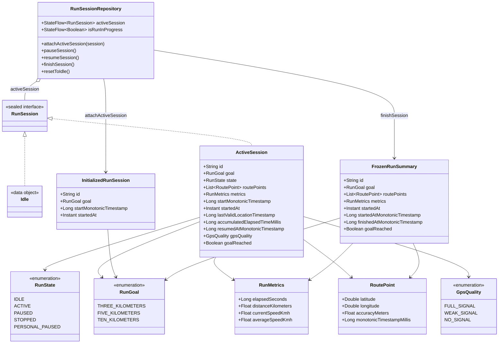

# Documento de Diseño Técnico: live-route-tracking (HU-04)

## Overview

Este documento especifica la arquitectura técnica y el diseño detallado para la funcionalidad de **Seguimiento del Recorrido en Vivo** (`HU-04`), correspondiente a Trazo v0.6.

Permite a los corredores visualizar su posición en tiempo real sobre la pestaña "Mapa", registrar la ruta recorrida, consultar métricas en vivo (tiempo transcurrido, distancia, velocidad actual y velocidad promedio), controlar la sesión mediante pausa y reanudación, y finalizar el recorrido mediante un flujo de confirmación.

La solución se inserta dentro de la arquitectura hexagonal de la aplicación Android, garantizando la independencia del dominio respecto de los frameworks de plataforma, el uso de Jetpack Compose con Material 3 para la UI, inyección de dependencias con Hilt y desacoplamiento con las funcionalidades adyacentes de inicio (`start-run`), resultados y guardado (`save-run`).

El flujo de finalización contempla los siguientes pasos:

1. El corredor solicita finalizar el recorrido.
2. Si la distancia recorrida es inferior a 200 metros, se informa que el recorrido es demasiado corto y se permite descartarlo o volver al recorrido. No se genera un resumen para guardar.
3. Si la distancia es igual o superior a 200 metros, se solicita confirmación.
4. El mensaje de confirmación depende de si se alcanzó la meta.
5. Una vez confirmada la finalización, se detienen el seguimiento y el temporizador, y se genera un `FrozenRunSummary`.
6. El resumen se entrega a la pantalla de resultados.
7. Desde resultados se continúa hacia el flujo de guardado `save-run`.

Al alcanzar la meta seleccionada, se muestra la celebración correspondiente, pero **el recorrido permanece activo**. El corredor puede continuar corriendo y decidir cuándo finalizarlo.

Durante el recorrido se mantiene un indicador `isRunInProgress` (nombre a confirmar con Personas 1 y 2), que permite a otros componentes, como el botón "+", conocer si existe un recorrido en curso, independientemente de que esté activo, en pausa manual, en pausa personal, con frenada detectada o temporalmente sin señal GPS. Solo vuelve a `false` al finalizar o al descartar un recorrido demasiado corto.

### Goals

- Proveer un estado inicial del mapa con métricas en cero (`00:00:00`, `0 km`, `0 km/h`).
- Recibir una sesión iniciada desde `start-run` con una meta fija obligatoria (3, 5 o 10 km), mediante el contrato `InitializedRunSession`.
- Recibir la sesión únicamente cuando el flujo de inicio haya obtenido señal GPS y esté listo para comenzar el seguimiento.
- Comenzar el temporizador y el seguimiento al asociar la sesión mediante `attachActiveSession`.
- Realizar el seguimiento continuo de la posición del corredor y el trazado de la ruta mientras la sesión permanezca activa.
- Filtrar lecturas GPS imprecisas (`accuracyMeters > 30.0f`), impidiendo su incorporación a la traza y al cálculo de distancia.
- Detectar la pérdida de señal GPS tras 15.000 ms sin lecturas válidas, contados desde la última referencia válida de seguimiento, sin detener el temporizador de una sesión activa.
- Mantener el temporizador activo si se revoca el permiso de ubicación, sin asumir pausas automáticas no definidas en los requisitos.
- Proveer controles de pausa y reanudación que detengan y reactiven el temporizador, la acumulación de distancia y el registro de puntos GPS.
- Diferenciar los estados de seguimiento activo (ACTIVE), pausa manual (PAUSED), pausa personal (PERSONAL_PAUSED) y frenada detectada automáticamente (STOPPED), según el contrato aprobado por el equipo.
- Preservar el estado de la sesión en memoria al cambiar de pestaña dentro de la aplicación mientras el proceso permanezca vivo.
- Exponer `isRunInProgress` para que las funcionalidades que necesiten conocer si existe un recorrido en curso puedan consultar ese estado sin depender de la pestaña visible.
- Mostrar una animación de celebración al alcanzar la meta seleccionada, respetando la configuración de accesibilidad para reducir animaciones.
- Mantener el recorrido activo después de alcanzar la meta. La celebración no finaliza automáticamente la sesión.
- Conservar durante toda la sesión la fecha y hora real de inicio (`startedAt`) recibida mediante `InitializedRunSession`.
- Registrar si se alcanzó la meta (`goalReached`) y conservar ese dato en el resumen final.
- Implementar la validación de distancia mínima de 200 metros antes de permitir la finalización y el guardado.
- Solicitar confirmación para finalizar recorridos de 200 metros o más, con un mensaje diferente según se haya alcanzado la meta.
- Generar y entregar una instantánea inmutable (`FrozenRunSummary`) a la pantalla de resultados, que posteriormente continuará hacia `save-run`.
- Mantener la responsabilidad de permisos y del inicio del recorrido fuera de `MapScreen`.

### Non-Goals

- Gestión del modal de inicio, selección de meta, solicitud de permisos e inicio de carrera (responsabilidad de `start-run`).
- Formulario de guardado, validación de título, selección de destacados, captura de fotos y persistencia en Room (responsabilidad de `save-run`).
- Implementación interna de la pantalla de resultados y de sus componentes visuales (responsabilidad del módulo de resultados).
- Implementación de detección de frenadas bruscas o irregularidades del suelo mediante sensores (responsabilidad de las historias de sensores).
- Persistencia intermedia en disco o recuperación de sesión ante la muerte del proceso de la aplicación (*process death*).
- Autenticación, perfiles de usuario, rankings, comunidad o sincronización con servidores/APIs remotas.
- Metas personalizadas (únicamente se admiten metas fijas de 3, 5 y 10 km).
- Integración con wearables, pulsómetros, conteo de calorías o planes de entrenamiento.
- Grabación de videos (el flujo de guardado contempla fotos).
- Soporte multidioma o internacionalización (exclusivamente español rioplatense).

---

## Boundary Commitments

### This Spec Owns

- Lógica de negocio y modelos del dominio del recorrido en curso (`RunSession`, `RunState`, `RunMetrics`, `RoutePoint`, `RunGoal`).
- Contrato de recepción de una sesión iniciada (`attachActiveSession(session: InitializedRunSession)`).
- Conservación de la fecha y hora real de inicio de la sesión (`startedAt`) recibida desde `start-run`.
- Exposición del estado `isRunInProgress`, que indica si existe un recorrido en curso.
- Casos de uso de control del ciclo de vida del seguimiento: `GetActiveRunSessionUseCase`, `AttachActiveRunSessionUseCase`, `PauseRunUseCase`, `ResumeRunUseCase` y `FinishRunUseCase`.
- Política de filtrado de calidad GPS y detección de pérdida de señal a los 15.000 ms (`GpsPointFilterPolicy`).
- Actualización de métricas y determinación de si se alcanzó la meta (`goalReached`).
- Orquestación del estado de la pantalla "Mapa" (`LiveRouteTrackingViewModel`, `LiveRouteTrackingUiState`).
- Componentes UI de la pestaña "Mapa": `MapScreen`, `RunPanel`, `RunControls`, `GpsIndicator`, `MapLayer`, `FinishConfirmDialog` y `GoalCelebrationOverlay`.
- Validación del umbral mínimo de distancia para finalizar el recorrido.
- Generación y entrega de la instantánea inmutable `FrozenRunSummary` a la pantalla de resultados.
- Liberación de recursos de seguimiento al finalizar o descartar el recorrido.

### Out of Boundary

- Modal "Iniciar nuevo recorrido", selección de meta, solicitud de permisos y validación previa al inicio (pertenecen a `start-run`).
- Pantalla "Guardar recorrido", componentes `HighlightChip`, `PhotoPicker`, validación de título, DAOs y entidades Room (pertenecen a `save-run`).
- Implementación visual e interna de la pantalla de resultados (pertenece al módulo de resultados).
- Implementación de la detección automática de frenadas y de irregularidades del suelo (pertenece a las historias de sensores).
- Recuperación ante la muerte del proceso del sistema operativo (no contemplada en Trazo v0.6).
- Persistencia remota, autenticación o sincronización con servidores.

### Allowed Dependencies

- `domain` depende únicamente de Kotlin estándar y corrutinas; no depende de Android SDK, Room ni Compose.
- `data/location` implementa los puertos de dominio utilizando Android LocationManager o Fused Location APIs.
- `ui` depende de `domain` (modelos y casos de uso), Jetpack Compose, Material 3 y `ui/theme`. La UI nunca importa paquetes de `data/`.
- Hilt `@Singleton` para la retención en memoria de `RunSessionRepository` mientras el proceso esté vivo.
- El flujo `start-run` entrega la sesión inicializada a través del contrato compartido.
- El flujo `save-run` recibe el resumen desde resultados y se encarga de su propio formulario y persistencia.
- El módulo de resultados recibe `FrozenRunSummary` después de la finalización confirmada.

### Revalidation Triggers

- Alteraciones en la firma del contrato `FrozenRunSummary` compartido con resultados y `save-run`.
- Modificación en el contrato `InitializedRunSession` provisto por `start-run`.
- Cambios en el contrato de `RunSessionRepository`, especialmente en `isRunInProgress`. 
- `RunState` define `IDLE`, `ACTIVE`, `PAUSED`, `PERSONAL_PAUSED` y `STOPPED`, según el contrato aprobado por el equipo. Cambios en estos estados o en sus transiciones requieren revalidar el diseño.
- Modificación del umbral mínimo de 200 metros.
- Cambios en la política de retención ante *process death* o adopción de un Foreground Service.
- Cambio del nombre del booleano `isRunInProgress` acordado con Personas 1 y 2.
- Decisión sobre cómo se entrega `FrozenRunSummary` a resultados (navegación o contenedor compartido).
- Elección final de las librerías de mapa y de ubicación.

---

## Architecture

### Existing Architecture Analysis

La aplicación Trazo cuenta con una estructura de paquete base `com.trazo.app` dividida en tres capas: `domain`, `data` y `ui`.

La navegación utiliza Jetpack Compose Navigation con una barra inferior de tres destinos (`Home`, `Map`, `History`). La pantalla actual `MapScreen` se utiliza como punto de integración para la funcionalidad de seguimiento.

El inicio del recorrido es responsabilidad de `start-run`. Cuando ese flujo obtiene señal GPS y completa el inicio, entrega una instancia de `InitializedRunSession` al repositorio de seguimiento.

La pantalla Mapa observa el estado de la sesión y permite controlar su ciclo de vida. La finalización confirmada produce un resumen congelado que se entrega a resultados. La navegación posterior hacia `save-run` se realiza desde el flujo de resultados.

### Architecture Pattern & Boundary Map

Se implementa una **Arquitectura Hexagonal (Ports & Adapters)**. El núcleo de dominio encapsula el estado de la sesión, la acumulación métrica y las reglas de filtrado GPS mediante interfaces (puertos). Los adaptadores de datos obtienen las coordenadas del sensor de ubicación, y la capa UI reacciona al estado expuesto mediante `StateFlow`.

```mermaid
graph TD
    subgraph UI ["Capa UI (ui/)"]
        MapScreen["MapScreen (Composable)"]
        MapViewModel["LiveRouteTrackingViewModel"]
        RunPanelComp["RunPanel / RunControls"]
        GpsIndicatorComp["GpsIndicator"]
        FinishDialogComp["FinishConfirmDialog"]
        CelebrationComp["GoalCelebrationOverlay"]
    end

    subgraph Domain ["Capa Domain (domain/)"]
        GetSessionUC["GetActiveRunSessionUseCase"]
        PauseUC["PauseRunUseCase"]
        ResumeUC["ResumeRunUseCase"]
        FinishUC["FinishRunUseCase"]
        GpsFilter["GpsPointFilterPolicy"]
        RunSessionRepoPort["RunSessionRepository (Port)"]
        LocationPort["LocationClient (Port)"]
        DomainModels["RunSession / RunMetrics / RoutePoint / RunGoal"]
    end

    subgraph Data ["Capa Data (data/)"]
        RunSessionRepoImpl["RunSessionRepositoryImpl (@Singleton In-Memory)"]
        LocationClientImpl["AndroidLocationClient (Location APIs)"]
    end

    subgraph ExternalInteractions ["Integraciones Adyacentes"]
        StartRunFlow["start-run (Entrega InitializedRunSession)"]
        ResultsFlow["Pantalla de resultados (Recibe FrozenRunSummary)"]
        SaveRunFlow["save-run (Recibe resumen desde resultados)"]
    end

    MapScreen --> MapViewModel
    MapViewModel --> RunPanelComp
    MapViewModel --> GpsIndicatorComp
    MapViewModel --> FinishDialogComp
    MapViewModel --> CelebrationComp

    MapViewModel --> GetSessionUC
    MapViewModel --> PauseUC
    MapViewModel --> ResumeUC
    MapViewModel --> FinishUC

    GetSessionUC --> RunSessionRepoPort
    PauseUC --> RunSessionRepoPort
    ResumeUC --> RunSessionRepoPort
    FinishUC --> RunSessionRepoPort

    RunSessionRepoImpl -.->|implements| RunSessionRepoPort
    LocationClientImpl -.->|implements| LocationPort

    RunSessionRepoImpl --> LocationPort
    RunSessionRepoImpl --> GpsFilter

    StartRunFlow -.->|attachActiveSession| RunSessionRepoPort
    RunSessionRepoPort -.->|isRunInProgress| StartRunFlow
    MapViewModel -.->|FrozenRunSummary| ResultsFlow
    ResultsFlow -.->|Continuar al guardado| SaveRunFlow
```



### Dependency Direction

`domain` (puro) ← `data` (implementa puertos de dominio)

`domain` (puro) ← `ui` (consume casos de uso y modelos de dominio)

**Regla estricta:** La capa `ui` nunca importa ni accede a clases de la capa `data`.

### Technology Stack

Las dependencias y versiones deben corresponder estrictamente a las declaradas en `gradle/libs.versions.toml`. Las versiones que no estén presentes en el catálogo no deben incorporarse como dependencias nuevas sin una decisión explícita.

| Capa                            | Elección / Librería              | Versión          | Rol en la Funcionalidad                                                    | Notas                                   |
|---------------------------------|----------------------------------|------------------|----------------------------------------------------------------------------|-----------------------------------------|
| **Lenguaje y runtime**          | Kotlin                           | `2.3.21`         | Base del sistema, tipos inmutables y corrutinas                            | Bytecode JVM 17                         |
| **UI**                          | Jetpack Compose / Material 3     | BOM `2025.04.01` | Composición declarativa de pantalla, controles y paneles                   | Tema definido en `ui/theme/`            |
| **Navegación UI**               | Navigation Compose               | `2.8.9`          | Navegación entre pestañas                                                  | Gestión de back stack                   |
| **Arquitectura UI**             | AndroidX Lifecycle & ViewModel   | `2.8.7`          | Gestión de estado reactivo con `StateFlow`                                 | ViewModel inyectado con Hilt            |
| **Inyección de Dependencias**   | Dagger Hilt Android              | `2.60.1`         | Inyección de dependencias y singleton en memoria                           | `@Singleton`, `@HiltViewModel`          |
| **Integración Hilt Navigation** | AndroidX Hilt Navigation Compose | `1.2.0`          | Obtención de ViewModels con scope de navegación                            | `hiltViewModel()`                       |
| **Ubicación / Hardware**        | Android Core KTX                 | `1.16.0`         | Acceso a APIs de sistema                                                   | Permiso gestionado por `start-run`      |
| **Mapa**                        | Maps Compose                     | Según catálogo   | Renderizado del mapa y traza                                               | No gestionar permisos desde `MapScreen` |
| **Ubicación**                   | Play Services Location           | Según catálogo   | Proveedor de actualizaciones de ubicación, si está incorporado al proyecto | Implementación en `data/location`       |
| **Pruebas Unitarias**           | JUnit 4                          | `4.13.2`         | Ejecución de pruebas unitarias en JVM                                      | Pruebas de lógica y contratos           |
| **Pruebas de Instrumentación**  | AndroidX JUnit / Espresso        | Según catálogo   | Pruebas de integración y componentes Compose                               | Verificación en dispositivo             |

---

## File Structure Plan

### Directory Structure

```text
app/src/main/java/com/trazo/app/
├── domain/
│   ├── model/
│   │   └── map/
│   │       ├── RoutePoint.kt
│   │       ├── RunGoal.kt
│   │       ├── RunMetrics.kt
│   │       ├── RunSession.kt
│   │       ├── RunState.kt
│   │       ├── GpsQuality.kt
│   │       ├── InitializedRunSession.kt
│   │       └── FrozenRunSummary.kt
│   ├── repository/
│   │   ├── LocationClient.kt
│   │   └── RunSessionRepository.kt
│   └── usecases/
│       ├── GetActiveRunSessionUseCase.kt
│       ├── AttachActiveRunSessionUseCase.kt
│       ├── PauseRunUseCase.kt
│       ├── ResumeRunUseCase.kt
│       ├── FinishRunUseCase.kt
│       └── GpsPointFilterPolicy.kt
├── data/
│   ├── di/
│   │   └── LocationModule.kt
│   ├── location/
│   │   └── AndroidLocationClient.kt
│   └── repository/
│       └── RunSessionRepositoryImpl.kt
└── ui/
    └── screens/
        └── map/
            ├── MapScreen.kt
            ├── LiveRouteTrackingViewModel.kt
            ├── LiveRouteTrackingUiState.kt
            └── components/
                ├── RunPanel.kt
                ├── RunControls.kt
                ├── GpsIndicator.kt
                ├── FinishConfirmDialog.kt
                ├── GoalCelebrationOverlay.kt
                └── MapLayer.kt
```

**Notas sobre los modelos:**

- `RunSession` es una interfaz sellada (no nula) con dos variantes: `RunSession.Idle` (sin recorrido) y `RunSession.ActiveSession` (recorrido en curso, con meta, estado, traza, métricas, referencias temporales, calidad GPS y `goalReached`). La ausencia de recorrido ya no se representa con `null`.
- `RunState` define `IDLE` (sin recorrido, usado en el estado de UI), `ACTIVE`, `PAUSED` (pausa manual), `PERSONAL_PAUSED` (pausa personal) y `STOPPED` (frenada detectada automáticamente). Una `ActiveSession` nunca tiene estado `IDLE`: la ausencia de recorrido en el dominio la representa `RunSession.Idle`.
- `InitializedRunSession` incluye la fecha y hora real de inicio.
- `FrozenRunSummary` conserva la fecha y hora real de inicio y el indicador de meta alcanzada.
- `RunGoal` utiliza los nombres definidos en el contrato compartido del proyecto. No se deben renombrar sus valores por motivos de este diseño.

### Modified Files

- `app/src/main/java/com/trazo/app/ui/screens/map/MapScreen.kt`: Sustitución del placeholder por la pantalla completa que integra `LiveRouteTrackingViewModel`, `MapLayer`, `RunPanel` y los diálogos. No solicita permisos de ubicación. Gestiona la bandera `FLAG_KEEP_SCREEN_ON` únicamente mientras la pestaña Mapa está visible y corresponde mantener la pantalla activa. Expone parámetros para integrar el botón "+" de `start-run` (Persona 2) y el aviso de recorrido demasiado corto (Persona 4).
- `app/src/main/java/com/trazo/app/ui/screens/map/LiveRouteTrackingViewModel.kt`: Orquestación del estado de UI, eventos del usuario y efectos de finalización.
- `app/src/main/java/com/trazo/app/domain/repository/RunSessionRepository.kt`: Contrato compartido de sesión, estado de recorrido en curso y operaciones de ciclo de vida.
- `app/src/main/java/com/trazo/app/data/repository/RunSessionRepositoryImpl.kt`: Implementación en memoria del seguimiento, temporizador, GPS, métricas y finalización.
- `app/src/main/java/com/trazo/app/ui/navigation/TrazoApp.kt`: Integración de la navegación hacia el flujo de resultados después de finalizar. La navegación desde resultados hacia `save-run` corresponde al módulo de resultados.

---

## System Flows

### Sequence Flow: Inicio recibido, Seguimiento GPS, Filtrado y Pérdida de Señal



**Reglas del flujo GPS:**

- La solicitud de permisos y la espera de señal inicial pertenecen a `start-run`.
- `attachActiveSession` se invoca cuando el flujo de inicio ya está listo para entregar la sesión.
- El temporizador comienza al asociar la sesión.
- No se implementa una espera inicial de 15 segundos para obtener la primera señal antes de iniciar. Esa responsabilidad ya fue resuelta por `start-run`.
- Durante el seguimiento, la pérdida de señal se determina por la ausencia de lecturas válidas durante 15.000 ms.
- Al reanudar, se inicia una nueva referencia temporal para evaluar la pérdida de señal. El tiempo que transcurrió durante la pausa no se contabiliza.
- Las lecturas imprecisas no actualizan la referencia de última lectura válida.

### State Lifecycle Flow: Ciclo de Vida de la Sesión

```mermaid
stateDiagram-v2
    [*] --> IDLE : Entrada a Mapa sin recorrido

    note right of IDLE
        Métricas en cero
        Controles sin acciones disponibles
        FAB "+" disponible
        isRunInProgress = false
    end note

    IDLE --> ACTIVE : start-run entrega InitializedRunSession

    note right of ACTIVE
        Temporizador y GPS activos
        isRunInProgress = true
    end note

    state ACTIVE {
        [*] --> Tracking
        Tracking --> GoalReached : Distancia >= meta
        GoalReached --> Tracking : Celebración sin finalizar
    }

    ACTIVE --> PAUSED : Pausa manual
    PAUSED --> ACTIVE : Reanudar

    ACTIVE --> STOPPED : HU-05.1 detecta frenada
    ACTIVE --> PERSONAL_PAUSED : Corredor elige pausa personal en aviso de 20 s

    ACTIVE --> ConfirmingFinish : Finalizar
    PAUSED --> ConfirmingFinish : Finalizar

    state ConfirmingFinish {
        [*] --> CheckMinimumDistance
        CheckMinimumDistance --> TooShort : Distancia < 200 m
        CheckMinimumDistance --> DialogVisible : Distancia >= 200 m

        TooShort --> Discarded : Descartar
        TooShort --> ReturnToRun : Volver

        DialogVisible --> Cancelled : Cancelar
        DialogVisible --> Confirmed : Confirmar
    }

    ReturnToRun --> ACTIVE : Retomar seguimiento
    ReturnToRun --> PAUSED : Si estaba pausado

    Cancelled --> ACTIVE : Si estaba activo
    Cancelled --> PAUSED : Si estaba pausado

    Confirmed --> IDLE : Detener GPS y temporizador; sesión a RunSession.Idle
    Discarded --> IDLE : resetToIdle()

    IDLE --> [*]
```



**Reglas de transición:**

- `isRunInProgress` pasa a `true` al asociar una sesión.
- Se mantiene en `true` durante estados activos, pausa manual, pausa personal, frenada detectada y pérdida de señal.
- Pasa a `false` únicamente al finalizar o descartar el recorrido y restablecer el repositorio.
- Alcanzar la meta no finaliza el recorrido.
- Una sesión de menos de 200 metros no se guarda.
- Una sesión de 200 metros o más requiere confirmación explícita antes de finalizar.
- Cancelar la confirmación conserva el estado anterior.
- Confirmar finalización detiene el seguimiento y entrega el resumen a resultados.

### Sequence Flow: Finalización y Entrega del Resumen



---

## Requirements Traceability

Se clasifican los requisitos entre:

- **[Acordado]**: Respaldado por los requisitos actualizados y los acuerdos del equipo.
- **[Pendiente de definición con el equipo]**: Requiere coordinación adicional, sin fijar decisiones no confirmadas.

| Requirement | Tipo                                    | Resumen del Requisito                                                                                                                                                     | Componentes Asociados                                | Interfaces / Contratos                  | Flujo Asociado             |
|-------------|-----------------------------------------|---------------------------------------------------------------------------------------------------------------------------------------------------------------------------|------------------------------------------------------|-----------------------------------------|----------------------------|
| **1.1**     | [Acordado]                              | Centrar mapa en posición inicial cuando la ubicación esté disponible                                                                                                      | `MapScreen`, `LiveRouteTrackingViewModel`            | `LiveRouteTrackingUiState.userLocation` | Lifecycle inicial          |
| **1.2**     | [Acordado]                              | Métricas iniciales en cero                                                                                                                                                | `RunPanel`, ViewModel                                | `RunMetrics.ZERO`                       | Estado IDLE                |
| **1.3**     | [Acordado]                              | Iniciar carrera desde FAB mediante `start-run`                                                                                                                            | `MapScreen`, ViewModel                               | `MapUiEffect.OpenStartRunModal`         | Integración `start-run`    |
| **1.4**     | [Acordado]                              | Bloquear acciones de controles cuando no hay recorrido                                                                                                                    | `RunControls`, ViewModel                             | Estado de controles                     | Estado IDLE                |
| **1.5**     | [Pendiente de definición con el equipo] | Representación visual de habilitación o deshabilitación de Pausar, Reanudar y Finalizar sin recorrido.                                                                    | `RunControls`                                        | Estado de habilitación                  | Estado IDLE                |
| **2.1**     | [Acordado]                              | Mostrar posición actual del corredor                                                                                                                                      | `MapLayer`                                           | `runnerPosition`                        | Seguimiento                |
| **2.2**     | [Acordado]                              | Dibujar y extender traza continua                                                                                                                                         | `MapLayer`                                           | `routePoints`                           | Seguimiento                |
| **2.3**     | [Acordado]                              | Actualizar tiempo transcurrido                                                                                                                                            | Repositorio, `RunPanel`                              | `elapsedTimeSeconds`                    | Seguimiento                |
| **2.4**     | [Acordado]                              | Actualizar distancia acumulada con puntos válidos                                                                                                                         | Repositorio, `RunPanel`                              | `distanceMeters`                        | Seguimiento                |
| **2.5**     | [Acordado]                              | Actualizar velocidad del corredor                                                                                                                                         | Repositorio, `RunPanel`                              | `currentSpeedKmh`                       | Seguimiento                |
| **3.1**     | [Acordado]                              | Mostrar indicador visual de buena señal GPS                                                                                                                               | `GpsIndicator`                                       | `GpsQuality`                            | Seguimiento                |
| **3.2**     | [Acordado]                              | Mantener indicador independiente del filtro de precisión                                                                                                                  | `GpsIndicator`, `LocationClient`                     | `getSignalQualityUpdates()`             | Señal                      |
| **3.3**     | [Acordado]                              | Avisar pérdida de señal tras 15.000 ms sin lecturas válidas                                                                                                               | `GpsIndicator`, `GpsPointFilterPolicy`               | `GpsQuality.NO_SIGNAL`                  | Pérdida GPS                |
| **3.4**     | [Acordado]                              | No agregar puntos inválidos ni distancia durante pérdida de señal                                                                                                         | Repositorio                                          | `GpsPointFilterPolicy`                  | Pérdida GPS                |
| **3.5**     | [Acordado]                              | Recuperar el registro al recibir un punto válido                                                                                                                          | Repositorio, `GpsIndicator`                          | `GpsQuality`                            | Recuperación GPS           |
| **4.1**     | [Acordado]                              | Descartar lecturas con precisión mayor a 30 metros                                                                                                                        | `GpsPointFilterPolicy`                               | `isPointAccurate()`                     | Filtrado                   |
| **4.2**     | [Acordado]                              | No incorporar puntos imprecisos a la traza                                                                                                                                | Repositorio                                          | `routePoints`                           | Filtrado                   |
| **4.3**     | [Acordado]                              | No sumar distancia a partir de puntos imprecisos                                                                                                                          | Repositorio                                          | `distanceMeters`                        | Filtrado                   |
| **5.1**     | [Acordado]                              | Detener temporizador, distancia y traza al pausar                                                                                                                         | `PauseRunUseCase`                                    | `pauseSession()`                        | Pausa                      |
| **5.2**     | [Acordado]                              | Cambiar control de Pausar a Reanudar                                                                                                                                      | `RunControls`                                        | Estado de sesión                        | Pausa                      |
| **5.3**     | [Acordado]                              | Continuar seguimiento al reanudar                                                                                                                                         | `ResumeRunUseCase`                                   | `resumeSession()`                       | Reanudación                |
| **5.4**     | [Acordado]                              | Cambiar control de Reanudar a Pausar                                                                                                                                      | `RunControls`                                        | Estado de sesión                        | Reanudación                |
| **5.5**     | [Acordado]                              | Diferenciar pausa manual, pausa personal y frenada automática                                                                                                             | Dominio, ViewModel                                   | Estados de sesión                       | Estados de pausa           |
| **5.6**     | [Pendiente de definición con el equipo] | Transiciones de pausa personal y frenada detectada (los nombres ya están aprobados)                                                                                       | Dominio                                              | `RunState`                              | Coordinación con Persona 4 |
| **6.1**     | [Acordado]                              | Recentrar mapa en ubicación actual                                                                                                                                        | `MapLayer`, ViewModel                                | `OnCenterMapClicked`                    | Acción UI                  |
| **6.2**     | [Acordado]                              | Mantener visible la traza completa tras recentrado                                                                                                                        | `MapLayer`                                           | `routePoints`                           | Acción UI                  |
| **7.1**     | [Acordado]                              | Conservar recorrido al cambiar de pestaña mientras el proceso esté vivo                                                                                                   | Repositorio singleton                                | `RunSessionRepository`                  | Navegación                 |
| **7.2**     | [Acordado]                              | Continuar tiempo y GPS en ACTIVE aunque Mapa no esté visible                                                                                                              | Repositorio                                          | `@ApplicationScope`                     | Pestaña inactiva           |
| **7.3**     | [Acordado]                              | Mantener tiempo, distancia y traza detenidos en pausa                                                                                                                     | Repositorio                                          | Estado de sesión                        | Pestaña inactiva           |
| **7.4**     | [Acordado]                              | Restaurar estado y métricas al volver a Mapa                                                                                                                              | ViewModel                                            | `StateFlow<RunSession>`                 | Restauración               |
| **8.1**     | [Acordado]                              | Mostrar celebración al alcanzar la meta                                                                                                                                   | `GoalCelebrationOverlay`                             | `goalReached`                           | Meta alcanzada             |
| **8.2**     | [Acordado]                              | Continuar el recorrido después de alcanzar la meta                                                                                                                        | Repositorio, ViewModel                               | `goalReached`, estado ACTIVE            | Meta alcanzada             |
| **8.3**     | [Acordado]                              | Respetar configuración de reducción de animaciones                                                                                                                        | `GoalCelebrationOverlay`                             | `rememberReduceMotion()`                | Accesibilidad              |
| **9.1**     | [Acordado]                              | Verificar el umbral de 200 metros y mostrar el aviso de recorrido demasiado corto o el diálogo de confirmación con el mensaje correspondiente según si se alcanzó la meta | ViewModel, UI de finalización, `FinishConfirmDialog` | `distanceMeters`, `goalReached`         | Finalización               |
| **9.2**     | [Acordado]                              | Cancelar la confirmación conserva el estado previo del recorrido                                                                                                          | ViewModel                                            | Evento de cancelación                   | Confirmación               |
| **9.3**     | [Acordado]                              | Confirmar detiene definitivamente el seguimiento y congela las métricas y la traza                                                                                        | `FinishRunUseCase`                                   | `FrozenRunSummary`                      | Finalización               |
| **9.4**     | [Acordado]                              | Mostrar primero la pantalla de resultados y después continuar a `save-run`                                                                                                | ViewModel, navegación, pantalla de resultados        | `FrozenRunSummary`                      | Integración resultados     |
| **9.5**     | [Acordado]                              | Incluir en el resumen la fecha y hora real de inicio y el indicador de meta alcanzada                                                                                     | `FrozenRunSummary`                                   | `startedAt`, `goalReached`              | Resumen final              |
| **9.6**     | [Acordado]                              | Descartar recorridos inferiores a 200 metros sin guardarlos y limpiar la sesión activa                                                                                    | UI de finalización, repositorio                      | `resetToIdle()`                         | Descarte                   |
| **9.7**     | [Acordado]                              | Volver al recorrido demasiado corto conservando su estado, métricas y traza                                                                                               | UI de finalización, ViewModel                        | Estado de sesión                        | Finalización corta         |
| **10.1**    | [Acordado]                              | Exigir un título obligatorio para guardar el recorrido                                                                                                                    | Módulo `save-run`                                    | Datos del formulario                    | Guardado                   |
| **10.2**    | [Acordado]                              | Permitir seleccionar destacados opcionales                                                                                                                                | Módulo `save-run`                                    | Datos del formulario                    | Guardado                   |
| **10.3**    | [Acordado]                              | Permitir hasta dos fotos opcionales tomadas con la cámara, sin admitir videos                                                                                             | Módulo `save-run`                                    | Fotos del recorrido                     | Guardado                   |
| **10.4**    | [Acordado]                              | Guardar localmente en Room el recorrido con sus métricas, traza y datos asociados                                                                                         | Módulo `save-run`, Room                              | Datos del recorrido                     | Persistencia               |
| **10.5**    | [Acordado]                              | Dejar disponible el recorrido guardado en Historial y mostrar su traza en el mapa                                                                                         | Historial, mapa                                      | Recorrido persistido                    | Consulta local             |
| **10.6**    | [Acordado]                              | Entregar el resumen congelado a `save-run` sin implementar el formulario ni la persistencia desde HU-04                                                                   | HU-04, módulo `save-run`                             | `FrozenRunSummary`                      | Integración guardado       |
| **11.1**    | [Acordado]                              | Textos en español rioplatense con voseo                                                                                                                                   | UI                                                   | Recursos de texto                       | UI                         |
| **11.2**    | [Acordado]                              | Metas fijas de 3, 5 y 10 km                                                                                                                                               | `RunGoal`                                            | Enum                                    | Restricción de producto    |
| **11.3**    | [Acordado]                              | Mantener pantalla activa mientras Mapa está visible                                                                                                                       | `MapScreen`                                          | `FLAG_KEEP_SCREEN_ON`                   | Lifecycle UI               |
| **11.4**    | [Acordado]                              | Usar coma decimal en distancia y velocidad                                                                                                                                | Formateadores                                        | Locale `es-AR`                          | Formato UI                 |
| **11.5**    | [Acordado]                              | Área táctil mínima de 48 dp y 56 dp para controles de carrera                                                                                                             | `RunControls`                                        | Modifiers                               | Accesibilidad              |
| **11.6**    | [Acordado]                              | Descripciones accesibles para lectores de pantalla                                                                                                                        | Componentes UI                                       | `semantics`                             | Accesibilidad              |

**Nota:** en `requirements.md` el requisito 1.5 mantiene pendiente de definición con el equipo la representación visual de Pausar, Reanudar y Finalizar sin recorrido. El diseño solo fija que esos controles no permiten acciones (R1.4).

### Mapeo de Cobertura de los Escenarios de Aceptación

1. **Escenario 1 — Mapa sin recorrido en curso**
    - El mapa puede mostrar la ubicación disponible del usuario.
    - La gestión de permisos corresponde a `start-run`; `MapScreen` no solicita permisos.
    - Las métricas iniciales son `00:00:00`, `0 km` y `0 km/h`.
    - El FAB "+" permite iniciar el flujo `start-run`.
    - Los controles de Pausar, Reanudar y Finalizar no ejecutan acciones cuando no hay recorrido. Su presentación visual queda pendiente de definición (R1.5).

2. **Escenario 2 — Visualizar el recorrido en vivo**
    - `MapLayer` actualiza el marcador de posición del corredor.
    - La polilínea se extiende con cada coordenada válida.
    - `RunPanel` actualiza tiempo, distancia, velocidad actual y velocidad promedio.
    - El temporizador comienza cuando se asocia la sesión inicializada.

3. **Escenario 3 — Mostrar buena señal GPS**
    - `GpsIndicator` representa la calidad de señal.
    - El indicador visual se mantiene independiente del filtro de precisión de 30 metros.
    - Las lecturas válidas actualizan la ruta y las métricas.

4. **Escenario 4 — Pérdida de señal GPS**
    - La pérdida se detecta tras 15.000 ms sin lecturas válidas durante un seguimiento iniciado.
    - No se cuenta un período de espera previo al inicio: `start-run` entrega la sesión cuando ya obtuvo señal.
    - `GpsIndicator` muestra "Sin señal GPS".
    - No se agregan puntos inválidos ni se suma distancia a partir de ellos.
    - El temporizador continúa si la sesión permanece en estado activo.
    - Al recibir una nueva lectura válida se recupera el registro.

5. **Escenario 5 — Descartar un punto GPS impreciso**
    - Toda lectura con `accuracyMeters > 30.0f` se descarta.
    - El punto no se incorpora a la traza.
    - No suma distancia.
    - No actualiza la referencia de última lectura válida.

6. **Escenario 6 — Pausar y reanudar el recorrido**
    - Al pausar, se detienen el temporizador activo, la acumulación de distancia y el registro GPS.
    - Al reanudar, se restablecen las actualizaciones.
    - El período pausado no se suma al tiempo activo.
    - La diferenciación entre pausa manual, pausa personal y frenada automática debe respetar los estados acordados con Persona 4.

7. **Escenario 7 — Centrar el mapa en mi posición actual**
    - El botón de ubicación actual recentra el mapa.
    - La traza completa permanece visible después del recentrado.

8. **Escenario 8 — Cambiar de pestaña sin perder el recorrido**
    - La sesión permanece en memoria mientras el proceso de la aplicación esté vivo.
    - En estado activo, el temporizador y el registro GPS continúan aunque Mapa no esté visible.
    - En estado pausado, el tiempo activo, la distancia y la traza permanecen detenidos.
    - Al volver a Mapa, se restaura el estado actualizado.
    - La bandera `FLAG_KEEP_SCREEN_ON` solo se mantiene mientras Mapa está visible. Que la pantalla pueda apagarse al cambiar de pestaña no implica detener el seguimiento.

9. **Escenario 9 — Meta alcanzada**
    - `GoalCelebrationOverlay` muestra la celebración al alcanzar la meta (3, 5 o 10 km).
    - El recorrido continúa activo; el corredor decide cuándo tocar "Finalizar".
    - Se registra `goalReached` para el resumen final.
    - La celebración respeta la configuración de reducir o quitar animaciones.

10. **Escenario 10 — Finalizar y continuar al flujo de resultados y guardado**
    - Menos de 200 m: aviso de recorrido demasiado corto (descartar o volver). Descartar ejecuta `resetToIdle()`.
    - 200 m o más: diálogo de confirmación con el mensaje según `goalReached`.
    - Al confirmar se detienen temporizador y GPS, se congelan métricas y traza, y se genera el resumen con `startedAt` y `goalReached`.
    - Se muestra primero la pantalla de resultados (Persona 4) y luego se continúa a `save-run`.
    - Cancelar o volver conserva el estado previo sin modificar métricas ni traza.

11. **Escenario 11 — Guardar el recorrido finalizado**
    - Responsabilidad de `save-run` (Persona 1): título obligatorio, destacados opcionales, hasta 2 fotos de cámara (sin video) y persistencia local en Room.
    - HU-04 solo entrega el resumen congelado.

---

## Components and Interfaces

### Component Summary Table

| Component                       | Layer             | Intent                                              | Req Coverage | Dependencies                 | Contracts      |
|---------------------------------|-------------------|-----------------------------------------------------|--------------|------------------------------|----------------|
| `RunSessionRepository`          | Domain (Port)     | Observar y controlar el seguimiento de la sesión    | 1.2, 5, 7, 9 | Domain Models                | State, Service |
| `LocationClient`                | Domain (Port)     | Emitir coordenadas GPS y calidad visual             | 2, 3, 4      | Coroutines Flow              | Event          |
| `GpsPointFilterPolicy`          | Domain (Logic)    | Filtrar precisión y detectar pérdida de señal       | 3, 4         | Domain Models                | Service        |
| `GetActiveRunSessionUseCase`    | Domain (Use Case) | Observar la sesión y sus métricas                   | 1, 2, 7      | Repository                   | Service        |
| `AttachActiveRunSessionUseCase` | Domain (Use Case) | Asociar sesión iniciada por `start-run`             | 1, 2         | Repository                   | Service        |
| `PauseRunUseCase`               | Domain (Use Case) | Pausar el seguimiento                               | 5            | Repository                   | Service        |
| `ResumeRunUseCase`              | Domain (Use Case) | Reanudar el seguimiento                             | 5            | Repository                   | Service        |
| `FinishRunUseCase`              | Domain (Use Case) | Finalizar y emitir resumen congelado                | 9            | Repository                   | Service        |
| `AndroidLocationClient`         | Data (Location)   | Obtener coordenadas del dispositivo                 | 2, 3, 4      | Location APIs                | Event          |
| `RunSessionRepositoryImpl`      | Data (Repository) | Implementar el seguimiento en memoria               | 5, 7, 8, 9   | LocationClient, FilterPolicy | State, Service |
| `LiveRouteTrackingViewModel`    | UI (ViewModel)    | Transformar dominio en estado UI y procesar eventos | UI           | Use Cases                    | State          |
| `MapScreen`                     | UI (Screen)       | Composable principal de la pestaña Mapa             | 1, 11        | ViewModel                    | State          |
| `RunPanel`                      | UI (Component)    | Mostrar temporizador y métricas                     | 1, 2, 11     | UiState                      | UI Props       |
| `RunControls`                   | UI (Component)    | Mostrar controles del recorrido                     | 5, 9, 11     | UiState                      | UI Props       |
| `GpsIndicator`                  | UI (Component)    | Mostrar calidad y pérdida de señal                  | 3, 4         | GpsQuality                   | UI Props       |
| `FinishConfirmDialog`           | UI (Component)    | Mostrar confirmación de finalización                | 9            | UiState                      | UI Props       |
| `GoalCelebrationOverlay`        | UI (Component)    | Mostrar celebración de meta                         | 8            | UiState                      | UI Props       |
| `MapLayer`                      | UI (Component)    | Renderizar mapa, posición y traza                   | 1, 2, 6      | UiState                      | UI Props       |

### Domain Layer Components

#### `RunSessionRepository` (Interface)

| Field        | Detail                                                                                                                              |
|--------------|-------------------------------------------------------------------------------------------------------------------------------------|
| Intent       | Puerto del dominio que expone el flujo reactivo del seguimiento, el estado de recorrido en curso y las operaciones de ciclo de vida |
| Requirements | 1.2, 5, 7, 8, 9                                                                                                                     |

**Contracts**: Service [x] / State [x]

```kotlin
interface RunSessionRepository {
    val activeSession: StateFlow<RunSession>
    val isRunInProgress: StateFlow<Boolean>

    fun attachActiveSession(session: InitializedRunSession)

    suspend fun pauseSession(): Result<Unit>
    suspend fun resumeSession(): Result<Unit>
    suspend fun finishSession(): Result<FrozenRunSummary>

    fun resetToIdle()
}
```

El contrato utiliza `RunSession` sellada y no nula mediante `StateFlow`. Cuando no existe un recorrido en curso, el valor es `RunSession.Idle`. El indicador `isRunInProgress` permite conocer si hay un recorrido en curso sin depender de la sesión visible en pantalla.

El estado `isRunInProgress` permite a otros flujos de la aplicación conocer si existe un recorrido en curso sin depender de la visibilidad de la pantalla Mapa.

```kotlin
sealed interface RunSession { 
    data object Idle : RunSession
    data class ActiveSession(
        val id: String,
        val goal: RunGoal,
        val state: RunState,
        val routePoints: List<RoutePoint>,
        val metrics: RunMetrics,
        val startMonotonicTimestamp: Long,
        val startedAt: Instant,
        val lastValidLocationTimestamp: Long?,
        val accumulatedElapsedTimeMillis: Long,
        val resumedAtMonotonicTimestamp: Long?,
        val gpsQuality: GpsQuality,
        val goalReached: Boolean
    ) : RunSession
}
```
**Contrato de entrada:**

```kotlin
data class InitializedRunSession(
    val id: String,
    val goal: RunGoal,
    val startMonotonicTimestamp: Long,
    val startedAt: Instant
)
```

`startedAt` representa la fecha y hora real de inicio del recorrido y debe conservar el valor proporcionado por `InitializedRunSession` al asociar la sesión.
**Preconditions:**

- `attachActiveSession`: no debe existir otro recorrido en curso. La meta es obligatoria y debe ser una de las metas admitidas.
- `pauseSession`: debe existir una sesión en estado activo.
- `resumeSession`: debe existir una sesión en estado pausado.
- `finishSession`: debe existir una sesión activa o pausada. La posibilidad de finalizar desde `STOPPED` o `PERSONAL_PAUSED` queda pendiente de coordinación con Persona 4.
**Postconditions:**

- `attachActiveSession`:
    - Conserva el valor de `startedAt` recibido en `InitializedRunSession`, que representa la fecha y hora real de inicio del recorrido.
    - Inicializa las métricas.
    - Inicia el temporizador y la recepción de ubicaciones.
    - Establece `isRunInProgress = true`.
- `pauseSession`:
    - Detiene el avance del temporizador activo.
    - Detiene la recolección de ubicaciones.
    - Congela distancia y traza.
    - Conserva `isRunInProgress = true`.
- `resumeSession`:
    - Reanuda temporizador y recepción GPS.
    - Restablece la referencia temporal de pérdida de señal.
    - Conserva `isRunInProgress = true`.
- `finishSession`:
    - Detiene definitivamente el seguimiento.
    - Libera los recursos de GPS.
    - Genera y emite `FrozenRunSummary` con los datos finales del recorrido.
    - Después de generar el resumen, restablece la sesión mediante `_activeSession.value = RunSession.Idle`.
    - Establece `isRunInProgress = false`.
- `resetToIdle`:
    - Detiene cualquier job activo.
    - Descarta la sesión en memoria estableciendo `_activeSession.value = RunSession.Idle`.
    - Permite que la UI represente el estado `IDLE`.
    - Establece `isRunInProgress = false`.

---

#### Component: `GpsPointFilterPolicy`

| Field        | Detail                                                                                      |
|--------------|---------------------------------------------------------------------------------------------|
| Intent       | Encapsula las reglas de descarte de puntos por imprecisión y el timeout de pérdida de señal |
| Requirements | 3, 4                                                                                        |

**Contracts**: Service [x]

```kotlin
class GpsPointFilterPolicy(
    private val maxAllowedAccuracyMeters: Float = 30.0f,
    private val signalLossTimeoutMillis: Long = 15_000L
) {
    fun isPointAccurate(accuracyMeters: Float): Boolean {
        return accuracyMeters <= maxAllowedAccuracyMeters
    }

    fun isSignalLost(
        lastValidLocationMonotonicTimestamp: Long,
        currentMonotonicTimestamp: Long
    ): Boolean {
        if (lastValidLocationMonotonicTimestamp <= 0L) return false

        return currentMonotonicTimestamp -
            lastValidLocationMonotonicTimestamp >= signalLossTimeoutMillis
    }
}
```

**Invariants:**

- Una lectura con precisión mayor a 30 metros se considera inválida.
- Un punto inválido nunca actualiza la referencia de última lectura válida.
- El timeout de pérdida de señal es de 15.000 ms.
- El timeout no debe contar el período en que la sesión permanece pausada.
- La ausencia de una primera lectura válida antes de iniciar no se gestiona en este componente: `start-run` entrega la sesión cuando ya obtuvo señal.

---

### Data Layer Components

#### Component: `AndroidLocationClient`

| Field        | Detail                                                                                                                      |
|--------------|-----------------------------------------------------------------------------------------------------------------------------|
| Intent       | Adaptador de infraestructura que consulta el hardware de ubicación y emite flujos reactivos de coordenadas y calidad visual |
| Requirements | 2, 3, 4                                                                                                                     |

**Contracts**: Event [x]

```kotlin
interface LocationClient {
    fun getLocationUpdates(intervalMillis: Long): Flow<RawLocationPoint>
    fun getSignalQualityUpdates(): Flow<GpsQuality>
}

data class RawLocationPoint(
    val latitude: Double,
    val longitude: Double,
    val accuracyMeters: Float,
    val speedMetersPerSecond: Float,
    val monotonicTimestampMillis: Long
)
```

**Implementation Notes:**

- `getLocationUpdates()` emite lecturas GPS.
- `getSignalQualityUpdates()` informa la calidad visual de señal de forma independiente de la precisión de cada punto.
- La calidad `NO_SIGNAL` puede determinarse por la ausencia de lecturas válidas durante el timeout definido.
- La solicitud de permisos no pertenece a este componente ni a `MapScreen`; el flujo de inicio gestiona los permisos antes de entregar la sesión.
- La implementación concreta debe manejar las restricciones de permisos de Android sin provocar una pausa automática no definida.

---

#### Component: `RunSessionRepositoryImpl`

| Field        | Detail                                                                                                                     |
|--------------|----------------------------------------------------------------------------------------------------------------------------|
| Intent       | Implementación singleton en memoria que mantiene el seguimiento, acumula métricas y gestiona el ciclo de vida de la sesión |
| Requirements | 1, 2, 3, 4, 5, 7, 8, 9                                                                                                     |

**Contracts**: State [x] / Service [x]

```kotlin
@Singleton
class RunSessionRepositoryImpl @Inject constructor(
    private val locationClient: LocationClient,
    private val filterPolicy: GpsPointFilterPolicy,
    @ApplicationScope private val externalScope: CoroutineScope
) : RunSessionRepository {

    private val _activeSession =
        MutableStateFlow<RunSession>(RunSession.Idle)

    override val activeSession: StateFlow<RunSession> =
        _activeSession.asStateFlow()

    private val _isRunInProgress = MutableStateFlow(false)

    override val isRunInProgress: StateFlow<Boolean> =
        _isRunInProgress.asStateFlow()

    private var activeStartMonotonicTime: Long = 0L
    private var accumulatedActiveTimeMillis: Long = 0L

    private var lastValidLocationMonotonicTimestamp: Long? = null
    private var signalTimeoutReferenceMonotonicTimestamp: Long? = null

    private var trackingJob: Job? = null
    private var signalCheckJob: Job? = null

    // Resto del estado y detalles de implementación.
}
```

**State Management & In-Process Lifecycle:**

- `@Singleton` y `@ApplicationScope` retienen el estado en memoria mientras el proceso de la aplicación permanezca vivo.
- No se provee persistencia intermedia ante *process death*.
- El repositorio es el propietario del estado de la sesión, del temporizador y de los jobs de seguimiento.
- La implementación debe mantener `isRunInProgress` sincronizado con las transiciones del recorrido.

**Al recibir una sesión mediante `attachActiveSession(session)`:**

- Se conserva `session.startedAt` como fecha y hora real de inicio del recorrido, sin generar un nuevo valor al adjuntar la sesión.
- Se inicializan las métricas en cero.
- Se inicializa el acumulado de tiempo activo.
- Se inicializa la referencia de seguimiento GPS.
- Se establece `isRunInProgress = true`.
- Se inicia el temporizador monotónico.
- Se inicia la recolección de ubicaciones.
- No se solicita permiso ni se espera la primera señal desde este método: `start-run` entrega la sesión después de obtener señal GPS.

**Al recibir un punto válido:**

- Se verifica la precisión con `isPointAccurate`.
- Se incorpora el punto a la ruta.
- Se suma la distancia geodésica cuando corresponde.
- Se actualiza la referencia de última lectura válida.
- Se actualiza la velocidad actual con `speedMetersPerSecond * 3.6f`.
- Se calcula la velocidad promedio cuando el tiempo activo es mayor a cero.
- Se actualiza `goalReached` cuando la distancia alcanza o supera la meta.
- Si la calidad estaba en `NO_SIGNAL`, se refleja la recuperación.

**Al alcanzar la meta:**

- Se establece `goalReached = true`.
- Se notifica el cambio a la UI para mostrar la celebración.
- El estado del recorrido permanece activo.
- No se detiene el temporizador.
- No se detiene la recolección GPS.
- No se genera `FrozenRunSummary`.
- El corredor puede continuar el recorrido y finalizarlo manualmente.

**Al pausar:**

- Se acumula el tiempo activo transcurrido.
- Se detiene el avance del temporizador.
- Se cancela la recolección de ubicaciones.
- Se detiene la comprobación del timeout mientras la sesión esté pausada.
- No se acumula distancia ni se incorporan puntos.
- `isRunInProgress` permanece en `true`.

**Al reanudar:**

- Se registra una nueva referencia monotónica de inicio activo.
- Se restablece la referencia de timeout GPS.
- Se reinician la recolección de ubicaciones y la comprobación de pérdida de señal.
- El tiempo transcurrido durante la pausa no se suma al tiempo activo.
- `isRunInProgress` permanece en `true`.

**Al revocarse el permiso de ubicación durante la carrera:**

- La recolección de coordenadas puede interrumpirse.
- No se realiza una pausa automática.
- El temporizador continúa activo mientras la sesión esté en estado activo.
- La ausencia de lecturas válidas permite detectar la pérdida de señal según el timeout establecido.

**Al finalizar:**

- Se cancelan los jobs de seguimiento y timeout.
- Se genera `FrozenRunSummary` con copia defensiva de los puntos de la ruta.
- Se conserva `startedAt`.
- Se conserva `goalReached`.
- Se emite `RunSession.Idle`.
- Se establece `isRunInProgress = false`.

**Al descartar un recorrido inferior a 200 metros:**

- Se detienen los jobs activos.
- Se libera la recepción de ubicaciones.
- Se descarta la sesión sin generar un resumen para guardar.
- Se restablece el estado IDLE.
- Se emite `RunSession.Idle`.
- Se establece `isRunInProgress = false`.

---

### UI Layer Components

#### Component: `LiveRouteTrackingViewModel`

| Field        | Detail                                                                                                                                 |
|--------------|----------------------------------------------------------------------------------------------------------------------------------------|
| Intent       | Orquestador de UI que transforma la sesión de dominio en estado de pantalla, procesa eventos del usuario y emite efectos de navegación |
| Requirements | Requisitos de UI y ciclo de vida                                                                                                       |

**Contracts**: State [x]

```kotlin
@HiltViewModel
class LiveRouteTrackingViewModel @Inject constructor(
    private val getActiveRunSessionUseCase: GetActiveRunSessionUseCase,
    private val pauseRunUseCase: PauseRunUseCase,
    private val resumeRunUseCase: ResumeRunUseCase,
    private val finishRunUseCase: FinishRunUseCase
) : ViewModel() {

    private val _uiState =
        MutableStateFlow(LiveRouteTrackingUiState())

    val uiState: StateFlow<LiveRouteTrackingUiState> =
        _uiState.asStateFlow()

    private val _uiEffect =
        Channel<LiveRouteTrackingUiEffect>(Channel.BUFFERED)

    val uiEffect: Flow<LiveRouteTrackingUiEffect> =
        _uiEffect.receiveAsFlow()

    fun onPauseClicked() { ... }
    fun onResumeClicked() { ... }
    fun onFinishRequested() { ... }
    fun onConfirmFinish() { ... }
    fun onCancelFinish() { ... }
    fun onDiscardShortRun() { ... }
    fun onReturnFromShortRun() { ... }
    fun onCenterMapClicked() { ... }
    fun onStartRunClicked() { ... }
}
```

**Estado de UI:**

```kotlin
data class LiveRouteTrackingUiState(
    val hasActiveRun: Boolean = false,
    val isRunInProgress: Boolean = false,
    val runState: RunState = RunState.IDLE,
    val goal: RunGoal? = null,
    val formattedTime: String = "00:00:00",
    val formattedDistance: String = "0",
    val distanceUnit: String = "km",
    val formattedSpeed: String = "0",
    val speedUnit: String = "km/h",
    val formattedAverageSpeed: String = "0",
    val routePoints: List<RoutePoint> = emptyList(),
    val runnerPosition: RoutePoint? = null,
    val isMapCenteredOnRunner: Boolean = true,
    val gpsQuality: GpsQuality = GpsQuality.NO_SIGNAL,
    val goalReached: Boolean = false,
    val showFinishConfirmDialog: Boolean = false,
    val showShortRunDialog: Boolean = false,
    val showGoalCelebration: Boolean = false,
    val areControlActionsAllowed: Boolean = false
)
```

**Efectos de UI:**

```kotlin
sealed interface LiveRouteTrackingUiEffect {
    data class NavigateToResults(
        val summary: FrozenRunSummary
    ) : LiveRouteTrackingUiEffect

    data object OpenStartRunModal : LiveRouteTrackingUiEffect

    data object ReturnToIdleMap : LiveRouteTrackingUiEffect
}
```

**Implementation Notes:**

- En estado `IDLE`, las métricas se muestran en cero.
- La disponibilidad funcional de los controles se determina a partir del estado de la sesión.
- HU-04 expone el indicador `isRunInProgress` mediante `RunSessionRepository`. Persona 2 utiliza este indicador para controlar la disponibilidad del FAB "+" e impedir que se inicie otro recorrido mientras exista uno en curso.
- Durante `ACTIVE`, las métricas se actualizan reactivamente.
- La distancia y la velocidad se formatean utilizando coma decimal para español rioplatense.
- Al alcanzar la meta, `goalReached` activa la celebración, pero no finaliza la sesión.
- La confirmación de finalización utiliza `goalReached` para determinar el mensaje correspondiente.
- Si la distancia es inferior a 200 metros, se muestra el aviso de recorrido demasiado corto en lugar del diálogo de confirmación.
- Al confirmar la finalización, el efecto de navegación entrega el resumen a resultados, no directamente a `save-run`.
- La lógica de permisos no se implementa en este ViewModel ni en `MapScreen`.

`MapScreen` no solicita permisos de ubicación y deja parámetros para integrarse con el botón "+" (Persona 2) y con el aviso de Persona 4. La firma es una propuesta a confirmar con las personas involucradas:

```kotlin
@Composable
fun MapScreen(
    onStartRunClick: () -> Unit,                       // botón "+" de start-run (Persona 2)
    onNavigateToResults: (FrozenRunSummary) -> Unit,   // transporte del resumen: a acordar con Persona 4
    shortRunNotice: (@Composable (onDiscard: () -> Unit, onReturn: () -> Unit) -> Unit)? = null, // aviso < 200 m: dueño a definir
    viewModel: LiveRouteTrackingViewModel = hiltViewModel()
)
```

#### Component: `FinishConfirmDialog`

El diálogo se muestra únicamente cuando la distancia recorrida es igual o superior a 200 metros.

Los mensajes son:

- Si `goalReached == true`: **«¿Estás seguro de que deseás finalizar?»**
- Si `goalReached == false`: **«Todavía no llegaste a tu meta. ¿Estás seguro de que deseás finalizar?»**

Acciones:

- **Cancelar:** cierra el diálogo y conserva el estado previo del recorrido.
- **Finalizar:** ejecuta la finalización definitiva y genera el resumen.

Para distancias inferiores a 200 metros se utiliza el aviso de recorrido demasiado corto, no este diálogo.

#### Component: Aviso de recorrido demasiado corto

Cuando el corredor solicita finalizar un recorrido inferior a 200 metros:

- Se informa que el recorrido es demasiado corto.
- Se permite descartar el recorrido.
- Se permite volver al recorrido.
- No se genera `FrozenRunSummary`.
- No se inicia el flujo de resultados.
- No se guarda el recorrido.

La responsabilidad visual y el punto de integración de este aviso deben coordinarse con Persona 4. La lógica del repositorio debe permitir descartar y restablecer el estado mediante `resetToIdle()`.

#### Component: `GoalCelebrationOverlay`

- Se activa cuando `goalReached` cambia a `true`.
- Muestra la celebración correspondiente a la meta alcanzada.
- No finaliza automáticamente el recorrido.
- Respeta la configuración de accesibilidad para reducir animaciones mediante el mecanismo `rememberReduceMotion()` definido por el módulo de UI correspondiente.
- La sesión y el seguimiento permanecen activos mientras el corredor no pause o finalice.

---

## Data Models

### Domain Model


**RunSession:** representa el tipo de sesión de recorrido y define dos variantes: `Idle`, que indica que no hay un recorrido en curso, y `ActiveSession`, que contiene la meta seleccionada, el estado actual, los puntos de la ruta, las métricas acumuladas, las referencias temporales, la calidad GPS y el indicador de meta alcanzada.

El repositorio expone `StateFlow<RunSession>`, cuyo valor es `RunSession.Idle` cuando no hay recorrido y `RunSession.ActiveSession` cuando existe uno en curso.

### Invariants & Business Rules

- **Metas obligatorias:** Todo recorrido iniciado posee una meta fija obligatoria de 3, 5 o 10 km. No se permiten metas nulas en una sesión iniciada ni en `FrozenRunSummary`.
- **Fecha y hora real:** `startedAt` representa la fecha y hora real de inicio recibida desde el flujo de inicio y se conserva durante toda la sesión.
- **Referencias temporales monotónicas:** Los cálculos de tiempo transcurrido y evaluación de timeouts utilizan marcas monotónicas, no el reloj de pared.
- **Métricas definidas:**
    - `elapsedSeconds`: segundos acumulados de actividad.
    - `distanceKilometers`: distancia acumulada entre puntos válidos consecutivos.
    - `currentSpeedKmh`: velocidad actual calculada a partir de lecturas válidas.
    - `averageSpeedKmh`: distancia acumulada dividida por el tiempo activo expresado en horas.
- **Meta alcanzada:** `goalReached` pasa a `true` cuando la distancia acumulada alcanza la meta. No vuelve a `false` durante esa sesión y no implica finalización automática.
- **Finalización mínima:** No se permite generar un resumen para guardar cuando la distancia es inferior a 200 metros.
- **Inmutabilidad estricta:** `FrozenRunSummary` representa una instantánea de la sesión al momento de finalizar. La lista de puntos debe copiarse defensivamente para evitar modificaciones posteriores.
- **Estado de recorrido en curso:** `isRunInProgress` es `true` desde `attachActiveSession` hasta `finishSession` o el descarte mediante `resetToIdle`.
- **Separación de responsabilidades:** El resumen contiene información del recorrido. No contiene datos del formulario de guardado, destacados ni fotografías.

### `FrozenRunSummary`

El contrato del resumen debe incluir, como mínimo:

```kotlin
data class FrozenRunSummary(
    val id: String,
    val goal: RunGoal,
    val routePoints: List<RoutePoint>,
    val metrics: RunMetrics,
    val startedAt: Instant,
    val startedAtMonotonicTimestamp: Long,
    val finishedAtMonotonicTimestamp: Long,
    val goalReached: Boolean
)
```

Este resumen se entrega a resultados después de la finalización confirmada. La pantalla de resultados es responsable de continuar el flujo hacia `save-run`.

Los datos adicionales relacionados con modo demo, frenadas detectadas o regularidad del suelo deben incorporarse al contrato únicamente después de acordar su responsabilidad y disponibilidad con Persona 4.

---

## Error Handling

### Error Strategy

Se prioriza la continuidad del recorrido y la degradación controlada ante problemas de señal GPS.

La falta transitoria de señal o la revocación de permisos no deben provocar una pausa automática si el recorrido permanece en estado activo.

La finalización se protege mediante la validación de distancia mínima y la confirmación explícita para recorridos que alcanzan los 200 metros.

### Error Categories and Responses

| Escenario                                      | Causa                                             | Respuesta del Sistema                                                     | Comportamiento en UI                                                                                                |
|------------------------------------------------|---------------------------------------------------|---------------------------------------------------------------------------|---------------------------------------------------------------------------------------------------------------------|
| **Pérdida de señal GPS**                       | Falta de cobertura o ausencia de lecturas válidas | No agregar puntos ni distancia. Mantener el temporizador activo en ACTIVE | Mostrar "Sin señal GPS"                                                                                             |
| **Punto GPS impreciso**                        | Precisión superior a 30 m                         | Descartar el punto sin actualizar la referencia válida                    | No modificar traza ni distancia                                                                                     |
| **Permiso de ubicación revocado**              | Usuario revoca permiso desde Ajustes              | Interrumpir lecturas sin pausar automáticamente                           | Mostrar el aviso: «Se perdió el permiso de ubicación. Activalo desde Ajustes para seguir registrando tu recorrido.» |
| **Finalización accidental**                    | Toque involuntario de Finalizar                   | Solicitar confirmación si la distancia es de 200 m o más                  | Mostrar mensaje correspondiente a `goalReached`                                                                     |
| **Recorrido inferior a 200 m**                 | El corredor intenta finalizar antes del mínimo    | No generar resumen ni permitir guardado                                   | Mostrar aviso de recorrido demasiado corto                                                                          |
| **Cancelación de finalización**                | El corredor elige Cancelar                        | Conservar el estado anterior                                              | Cerrar diálogo sin alterar la sesión                                                                                |
| **Descarte de recorrido corto**                | El corredor confirma el descarte                  | Detener jobs y restablecer sesión                                         | Volver a Mapa sin recorrido                                                                                         |
| **Fallo de recepción GPS después de reanudar** | No llegan lecturas válidas luego de reanudar      | Evaluar timeout desde la nueva referencia temporal                        | Mostrar "Sin señal GPS" al cumplirse 15.000 ms                                                                      |

---

## Testing Strategy

### Unit Tests (JVM - JUnit 4)

**`GpsPointFilterPolicyTest`:**

- `isPointAccurate_withAccuracyLessThan30Meters_returnsTrue`: una lectura con 15 m de precisión es válida.
- `isPointAccurate_withAccuracyGreaterThan30Meters_returnsFalse`: una lectura con 35 m se descarta.
- `isSignalLost_when15000msElapsedWithoutValidPoint_returnsTrue`: a los 15.000 ms se detecta pérdida de señal.
- `isSignalLost_whenLessThan15000msElapsed_returnsFalse`: antes de los 15.000 ms no se detecta pérdida.

**`RunSessionRepositoryImplTest`:**

- `attachActiveSession_initializesStateToActive_andTimerStarts`: inicia la sesión con meta y fecha de inicio.
- `attachActiveSession_setsIsRunInProgressToTrue`: el indicador de recorrido en curso pasa a `true`.
- `pauseSession_freezesTimerAndStopsDistanceAccumulation`: la pausa detiene tiempo activo y acumulación.
- `resumeSession_continuesTimerAndResumesGpsRecording`: reanuda el seguimiento.
- `resumeSession_resetsSignalTimeoutReference`: el tiempo de pausa no se cuenta para la pérdida de señal.
- `finishSession_producesFrozenRunSummary`: genera el resumen congelado.
- `finishSession_preservesStartedAt`: conserva la fecha y hora real de inicio.
- `finishSession_preservesGoalReached`: conserva si se alcanzó la meta.
- `finishSession_setsIsRunInProgressToFalse`: restablece el indicador al finalizar.
- `resetToIdle_clearsSessionAndSetsIsRunInProgressToFalse`: descarta y restablece el repositorio.
- `locationPermissionRevoked_doesNotAutoPauseSession`: no realiza pausa automática ante revocación de permisos.
- `goalReached_keepsSessionActive`: alcanzar la meta no finaliza el recorrido.
- `goalReached_remainsTrueAfterAdditionalDistance`: el indicador de meta alcanzada se conserva al continuar corriendo.

**`MetricFormatterTest`:**

- Verificar el formateo con coma decimal en Locale `es-AR`.

### Integration Tests (JUnit 4 con Coroutines Test)

**`LiveRouteTrackingViewModelTest`:**

- `whenSessionStarts_uiStateReflectsActiveAndCoordinates`: el estado de UI refleja la sesión activa.
- `whenGoalReached_emitsCelebrationWithoutFinishingSession`: la celebración no finaliza el recorrido.
- `whenFinishRequested_withLessThan200Meters_showsShortRunWarning`: se muestra el aviso de recorrido corto.
- `whenShortRunIsDiscarded_resetsSession`: descartar restablece la sesión.
- `whenShortRunReturnsToRun_preservesPreviousState`: volver conserva el estado anterior.
- `whenFinishRequested_withAtLeast200Meters_showsConfirmation`: se muestra el diálogo de confirmación.
- `whenFinishRequested_afterGoalReached_showsReachedGoalMessage`: se muestra el mensaje para meta alcanzada.
- `whenFinishRequested_beforeGoalReached_showsNotReachedGoalMessage`: se muestra el mensaje para meta no alcanzada.
- `whenFinishCancelled_preservesPreviousSessionState`: cancelar conserva el estado.
- `whenFinishConfirmed_emitsNavigateToResults`: confirma y entrega el resumen a resultados.
- `whenRunIsAttached_exposesIsRunInProgress`: expone el indicador de recorrido en curso.

### UI / Compose Tests

**`MapScreenTest`:**

- `idleState_showsZeroMetrics`: muestra métricas en cero.
- `activeState_displaysPauseAndFinishControls`: muestra controles durante el recorrido.
- `pausedState_displaysResumeControl`: muestra Reanudar.
- `finishDialog_showsMessageForReachedGoal`: muestra el mensaje de meta alcanzada.
- `finishDialog_showsMessageForUnreachedGoal`: muestra el mensaje de meta no alcanzada.
- `shortRunWarning_showsDiscardAndReturnActions`: muestra las acciones para recorrido corto.
- `goalCelebration_respectsReducedMotionPreference`: respeta la configuración de reducción de animaciones.
- `mapScreen_doesNotRequestLocationPermission`: verifica que la pantalla Mapa no solicite permisos.

---

## Security & Platform Considerations

- **Privacidad de coordenadas:** Las coordenadas GPS se procesan en memoria dentro del dispositivo y se entregan mediante `FrozenRunSummary` al flujo de resultados. La persistencia local corresponde a `save-run`. No existe envío telemático ni telemetría remota.
- **Permisos de ubicación:** La solicitud y gestión inicial de permisos pertenece a `start-run`. `MapScreen` no solicita permisos ni implementa el flujo de inicio.
- **Pantalla activa (`FLAG_KEEP_SCREEN_ON`):** La bandera se mantiene mientras la pestaña Mapa está visible y corresponde mantener la pantalla activa durante el recorrido. Al cambiar de pestaña, la bandera puede liberarse. Esto no detiene el seguimiento en memoria mientras el proceso siga vivo.
- **Seguimiento al cambiar de pestaña:** El temporizador y GPS continúan en estado activo aunque Mapa no esté visible, según el alcance de navegación interna definido en los requisitos. No se garantiza seguimiento prolongado cuando la aplicación se minimiza o el proceso termina.
- **Área táctil accesible:** Los controles táctiles cumplen con un mínimo de 48 × 48 dp, asignando 56 × 56 dp para los controles críticos de Pausar, Reanudar y Finalizar.
- **Reducción de movimiento:** La celebración de meta respeta la configuración de accesibilidad para reducir animaciones mediante el mecanismo compartido por el módulo de UI.
- **Ciclo de vida:** Los recursos de GPS y las corrutinas deben cancelarse al finalizar o descartar la sesión. La pausa también detiene la recolección y evita acumular tiempo o distancia durante ese estado.

---

## Decisions Pending Coordination

Los siguientes puntos no deben cerrarse mediante decisiones unilaterales dentro de HU-04:

1. **Transiciones de estados:** los nombres `ACTIVE`, `PAUSED`, `PERSONAL_PAUSED` y `STOPPED` ya fueron aprobados. Queda pendiente coordinar con Persona 4 las transiciones de pausa personal y frenada detectada automáticamente.
2. **Aviso de recorrido inferior a 200 metros:** confirmar con Persona 4 quién es responsable de su presentación e integración visual.
3. **Datos adicionales del resumen:** confirmar con Personas 4 y 1 si el resumen debe incluir modo demo, frenadas detectadas o regularidad del suelo, y qué módulo provee esos datos.
4. **Contrato de estados:** publicar primero el contrato de modelos y `RunSessionRepository` (con `RunSession` sellada), antes de avanzar con la pantalla.
5. **R1.5:** cotejar el texto exacto del requisito antes de fijar el comportamiento visual de los controles en IDLE.
6. **Entrega del resumen a resultados:** acordar con Persona 4 si se pasa por navegación o por un contenedor compartido, considerando el tamaño de la traza.
7. **Arranque:** Persona 2 debe llamar a `attachActiveSession` solo después de obtener señal GPS.
8. **Nombre del booleano de recorrido en curso:** confirmar `isRunInProgress` con Personas 1 y 2.
9. **Librerías de mapa y de ubicación:** elegirlas y registrarlas en `libs.versions.toml`.