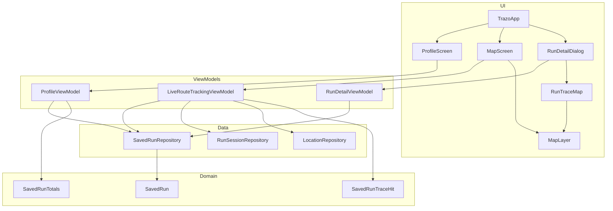
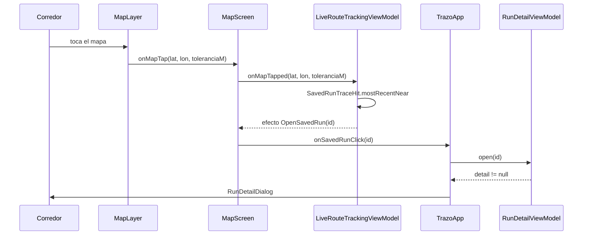
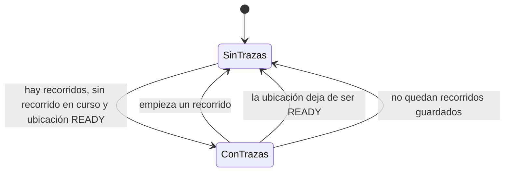

# Design Document: profile-runs

## Overview
**Purpose**: Esta funcionalidad le da al corredor un lugar para revisar lo que guardó: «Mis recorridos» y «Mis estadísticas» en Perfil, el detalle de cada recorrido guardado en un modal y las trazas guardadas sobre el mapa de Actividad.
**Users**: Corredores recreativos que ya guardaron recorridos y quieren compararlos, ver sus totales y recordar por dónde corrieron.
**Impact**: Perfil deja de mostrar solo ceros y el estado vacío: lee los recorridos guardados. El mapa de Actividad pasa a dibujar, cuando no hay recorrido en curso, las trazas guardadas. Toda la funcionalidad es de solo lectura.

### Goals
- Mostrar la lista, los totales y el detalle a partir de lo que ya entrega el almacenamiento de recorridos guardados.
- Un único modal de detalle, abierto desde Perfil o desde el mapa.
- Dibujar las trazas guardadas en Actividad bajo las condiciones del requisito 5, con el toque sobre la traza como último tramo, recortable.

### Non-Goals
- Guardar, editar, borrar o conservar recorridos, y las fotos (de `save-run`, HU-07).
- Persistencia: el criterio 1.8 depende de que `save-run` reemplace el almacenamiento en memoria por Room.
- Calcular o modificar métricas del recorrido.

## Boundary Commitments

### This Spec Owns
- La lista «Mis recorridos» (cards, orden, estado vacío) y el cálculo de «Mis estadísticas».
- El modal de detalle del recorrido guardado y su mapa.
- El dibujo de las trazas guardadas en Actividad, la regla de cuándo se dibujan y la resolución del toque sobre una traza.
- Los componentes compartidos nuevos: `StatusBadge`, `RunValueFormatter`, `RunTraceMap` y el armado común del mapa.

### Out of Boundary
- Escribir, borrar o conservar recorridos (lo hace `save-run`); la pantalla «Guardar recorrido»; agregar fotos.
- Medición del recorrido, frenadas y regularidad.
- Permisos de ubicación: la app los pide el «+» (`start-run`); aquí solo se lee su estado.
- La barra superior de Perfil y Configuración.

### Allowed Dependencies
- `SavedRunRepository` (solo `runs`; esta spec **no** llama a `save`) y el modelo `SavedRun`, tal como están hoy.
- `RunSessionRepository.isRunInProgress` y `LocationRepository.readLocationStatus()`.
- Coil (ya en el catálogo) para las fotos y MapCompose para los mapas. **No se agregan dependencias.**
- Dirección de capas del steering: `ui → domain`, `ui → data`; `domain` sin Android.

### Revalidation Triggers
- Cambia la forma de `SavedRun` (campos de la card, `photoPaths`, `regularityPercent`) o la firma de `SavedRunRepository`: revisar mapeos y tests.
- `save-run` reemplaza el almacenamiento por Room: confirmar que `runs` sigue ordenado de más reciente a más antiguo y que emite al guardar (criterios 1.7, 2.5, 4.5, 5.6).
- `save-run` cambia qué guarda en `elapsedTimeSeconds` (hoy excluye pausas): afecta 4.4.
- Cambia `LocationStatus` o el momento en que se pide el permiso: afecta 5.1 y 5.4.

## Architecture

### Existing Architecture Analysis
- Perfil ya tiene `ProfileScreen`/`ProfileContent`, `ProfileViewModel` sin dependencias, `ProfileStatRow`, `EmptyState` y `ProfileStatsFormatter` (`8,5`, `HH:MM:SS`). *Actualización:* `ProfileStatsFormatter` se eliminó; sus casos pasaron a `RunValueFormatter` (`formatTotalDistanceKm` y `formatDuration`).
- `SavedRunRepository.runs` ya entrega los recorridos del más reciente al más antiguo. `SavedRun` trae todos los datos de la card y del detalle. El tiempo viene de `elapsedAt`, que no suma las pausas.
- `MapLayer` arma el `MapState` de MapCompose y dibuja el trazo en vivo, el pin y los botones. El tema ya define `traceSaved` y `traceSavedWidth`.
- `TrazoApp` es el único que conoce todas las pantallas y ya renderiza diálogos globales (`StartRunDialog`).
- `LiveRouteTrackingViewModel` ya expone `isRunInProgress`.

### Architecture Pattern & Boundary Map


**Architecture Integration**:
- Selected pattern: extensión de MVVM existente con **un único dueño del modal**: `TrazoApp` crea un `RunDetailViewModel` (como ya hace con `StartRunViewModel`) y pasa a Perfil y Actividad un callback `onRunClick(id)`. Así hay un solo modal, ninguna pantalla importa componentes de otra y cerrar deja a la persona donde estaba (3.8, 5.7).
- Domain/feature boundaries: los totales y la búsqueda de traza son funciones puras en `domain/model/saved/` junto a `SavedRun` (regla del steering: cálculos sobre un modelo van junto a él). Los ViewModels solo componen flujos.
- Existing patterns preserved: `Screen`/`Content`/`ViewModel`, estado inmutable, strings en `strings.xml`, tema sin hex ni medidas sueltas, tests con fakes manuales.
- New components rationale: `StatusBadge` ya figura en el steering para Perfil y Resultado; `RunValueFormatter` evita repetir formato entre card y detalle; `TrazoMapState` permite que el mapa del detalle y el de Actividad compartan tiles y atribución.
- Steering compliance: `domain` sin Android; la UI no importa `data` salvo ViewModels que usan un repositorio directo; sin dependencias nuevas.

### Technology Stack

| Layer | Choice / Version | Role in Feature | Notes |
|-------|------------------|-----------------|-------|
| UI | Jetpack Compose + Material 3 (existente) | Cards, `Dialog` a pantalla completa, chips | |
| Mapa | MapCompose 3.0.0 (existente) | Trazas guardadas y mapa del detalle | Toque por geometría, ver «Decisiones» |
| Imágenes | Coil 2.7.0 (existente) | Fotos del detalle | Carga desde ruta de archivo |
| Datos | `SavedRunRepository` (en memoria hoy, Room después) | Fuente de lectura | Sin cambios |

## Decisiones clave
1. **Modal = diálogo a pantalla completa** (`Dialog` con `usePlatformDefaultWidth = false`) y no `ModalBottomSheet`: el mapa del detalle recibe gestos de arrastre que chocarían con el gesto de cierre de la hoja. El diálogo usa la animación del sistema, que respeta «Quitar animaciones» (6.8).
2. **Toque sobre una traza por geometría**: MapCompose no ofrece clic en trazados. `MapLayer` informa el toque (`latitud`, `longitud`, tolerancia en metros ≈ 24 dp al zoom actual) y el ViewModel del mapa resuelve con `SavedRunTraceHit` cuál recorrido es. Si varios coinciden gana el de mayor `startedAt` (5.9).
3. **«Ubicación precisa» = `LocationStatus.READY`** leído por `LocationRepository`. Se vuelve a leer al reanudar la pestaña y al terminar un recorrido. `APPROXIMATE_ONLY`, `PERMISSION_DENIED` y `DEVICE_LOCATION_OFF` no dibujan trazas (5.4).
4. **Totales por función pura** que ignora `isDemo` y suma incompletos. El tiempo es la suma de `elapsedTimeSeconds`, que ya excluye pausas (4.4).
5. **Regularidad sin dato** (`regularityPercent == null`, teléfono sin acelerómetro): la card y el detalle muestran «–» y la descripción accesible dice «sin datos». Los requisitos no lo definen; queda como decisión de diseño.
6. **Fotos**: el máximo de 2 (3.5) es una regla de dominio, `SavedRun.MAX_PHOTOS`. El detalle y `RunPhotos` no recortan: muestran las fotos que tenga el recorrido. Si una no carga, se muestra un recuadro neutro.
   *Antes* el `RunDetailViewModel` y `RunPhotos` tomaban las 2 primeras de `photoPaths`.
7. **Fecha de la card**: formato corto `Mar 28 oct` con `SimpleDateFormat` y `es-AR` (válido en minSdk 24, sin desugaring), primera letra en mayúscula y sin puntos de abreviatura.
8. **Perfil con `LazyColumn`** (estadísticas, título y cards como ítems) en lugar de un `Column` con scroll, para no componer todas las cards.
9. **Marcas en un solo lugar**: `SavedRun.badges()` devuelve una lista de `RunBadge` (enum de dominio): `GOAL_REACHED` o `INCOMPLETE` según `goalReached`, y `DEMO` si `isDemo`. La card y el detalle la usan y la mapean a `StatusBadgeKind` en la UI; la card filtra `GOAL_REACHED`. *Antes* cada pantalla armaba sus marcas con reglas distintas.

## File Structure Plan

### Directory Structure
```
app/src/main/java/com/trazo/app/
├── domain/model/saved/
│   ├── SavedRunTotals.kt          # Totales: cantidad, km y tiempo; excluye demo
│   └── SavedRunTraceHit.kt        # ¿Pasa la traza cerca de un punto? Más reciente entre varias
├── ui/components/common/
│   ├── StatusBadge.kt             # Píldora «Incompleto» / «Demo» / «Meta cumplida»
│   └── RunValueFormatter.kt       # Formato es-AR de km, duración, velocidad, regularidad, fecha
├── ui/components/layout/
│   ├── TrazoMapState.kt           # rememberTrazoMapState: tiles, atribución y zoom compartidos
│   └── RunTraceMap.kt             # Mapa de solo lectura con una traza encuadrada (detalle)
├── ui/screens/profile/components/
│   └── RunCard.kt                 # Card de «Mis recorridos»
└── ui/screens/rundetail/
    ├── RunDetailViewModel.kt      # RunDetailUiState + ViewModel: abre/cierra por id
    ├── RunDetailDialog.kt         # Screen (Dialog) + RunDetailContent stateless
    └── components/
        ├── HighlightChips.kt      # Destacados del recorrido
        └── RunPhotos.kt           # Fila de fotos (las del recorrido; el máximo es SavedRun.MAX_PHOTOS)
```

### Modified Files
- `domain/model/saved/SavedRun.kt` — **sin cambios** (se lee tal cual).
- `ui/screens/profile/ProfileViewModel.kt` — inyecta `SavedRunRepository`; `ProfileUiState` suma `runs: List<RunCardUi>`; `hasRecentRuns` pasa a derivarse de `runs`; incluye `RunCardUi`.
- `ui/screens/profile/ProfileScreen.kt` — `LazyColumn`, lista de `RunCard`, callback `onRunClick`.
- `ui/components/layout/MapLayer.kt` — usa `rememberTrazoMapState`; suma `savedTraces` y `onMapTap` (el toque es el tramo recortable).
- `ui/components/layout/WebMercator.kt` — suma conversión inversa a latitud/longitud, metros por pixel y encuadre de una traza.
- `ui/screens/map/LiveRouteTrackingViewModel.kt` y `LiveRouteTrackingUiState.kt` — inyectan `SavedRunRepository`; exponen `savedTraces` (vacío si no corresponde) y el efecto `OpenSavedRun(id)`.
- `ui/screens/map/MapScreen.kt` — pasa `savedTraces` a `MapLayer`, reanuda la lectura de ubicación y propaga `onSavedRunClick`.
- `ui/navigation/TrazoApp.kt` — crea `RunDetailViewModel`, muestra `RunDetailDialog` y conecta los dos callbacks.
- `app/src/main/res/values/strings.xml` — textos `profile_run_*` y `run_detail_*`.

> `RunCardUi` (id, título, fecha, km, duración, frenadas, porcentaje de regularidad y marcas) vive en `ProfileViewModel.kt`. `RunDetailUi` vive en `RunDetailViewModel.kt`. `SavedTraceUi(id, puntos)` vive en `LiveRouteTrackingUiState.kt`.

## System Flows

### Toque sobre una traza guardada (5.1, 5.2, 5.9, 3.1)

El efecto solo se emite si hay trazas dibujadas y alguna coincide. Un toque lejos de toda traza no hace nada.

### Cuándo se dibujan las trazas (5.1, 5.3, 5.4, 5.5, 5.6)

La condición se calcula en el ViewModel combinando `runs`, `isRunInProgress` y el estado de ubicación. Al terminar el recorrido y guardarse, `runs` emite y la traza nueva aparece sin acción adicional.

## Requirements Traceability

| Requirement | Summary | Components | Interfaces | Flows |
|-------------|---------|------------|------------|-------|
| 1.1, 1.2 | Cards, de más reciente a más antigua | `ProfileViewModel`, `RunCard`, `ProfileScreen` | `SavedRunRepository.runs` (ya ordenado) | — |
| 1.3 | Datos de la card | `RunCardUi`, `RunValueFormatter` | `RunValueFormatter` | — |
| 1.4 | Título con puntos suspensivos | `RunCard` | `maxLines = 1`, `TextOverflow.Ellipsis` | — |
| 1.5, 1.6 | Marcas Incompleto y Demo | `StatusBadge`, `RunCardUi` | `StatusBadgeKind` | — |
| 1.7 | El nuevo aparece primero | `ProfileViewModel` | colección de `runs` | — |
| 1.8 | Persistencia (condicionada) | Dependencia de `save-run` | — | — |
| 2.1, 2.2, 2.4 | Estado vacío con texto legible | `ProfileScreen`, `EmptyState` (existente) | `ProfileUiState.hasRecentRuns` | — |
| 2.3 | Totales en cero | `SavedRunTotals` | `SavedRunTotals.from` | — |
| 2.5 | Primer recorrido reemplaza el vacío | `ProfileViewModel` | `StateFlow` | — |
| 3.1 | Abrir el modal desde la card | `RunCard`, `TrazoApp`, `RunDetailViewModel` | `onRunClick(id)` | Toque (variante Perfil) |
| 3.2 | Mapa, título, velocidad, meta, estado | `RunDetailContent`, `RunTraceMap` | `RunDetailUi` | — |
| 3.3, 3.4 | Destacados visibles u ocultos | `HighlightChips`, `RunDetailContent` | `RunDetailUi.highlights` | — |
| 3.5, 3.6 | Hasta 2 fotos u oculto | `RunPhotos`, `SavedRun` | `SavedRun.MAX_PHOTOS`; `RunDetailUi.photoPaths` (las del recorrido, sin recorte) | — |
| 3.7 | Marca Demo | `StatusBadge` | `StatusBadgeKind.DEMO` | — |
| 3.8 | Cierre vuelve al mismo lugar | `TrazoApp`, `RunDetailDialog` | `onDismiss` | — |
| 3.9 | Falla de traza, detalle intacto | `RunTraceMap` | mensaje alternativo | — |
| 4.1, 4.5 | Totales visibles y actualizados | `ProfileViewModel`, `ProfileStatRow` | `SavedRunTotals` | — |
| 4.2, 4.3 | Suma incompletos, excluye demo | `SavedRunTotals` | `from(runs)` | — |
| 4.4 | Tiempo sin pausas personales | `SavedRunTotals` | suma de `elapsedTimeSeconds` | — |
| 4.6 | Coma decimal | `RunValueFormatter` | `formatTotalDistanceKm` | — |
| 5.1, 5.3–5.6 | Cuándo dibujar | `LiveRouteTrackingViewModel`, `MapLayer` | `savedTraces` | Cuándo se dibujan |
| 5.2, 5.9 | Toque y recorrido más reciente | `MapLayer`, `SavedRunTraceHit`, `LiveRouteTrackingViewModel` | `onMapTap`, `OpenSavedRun` | Toque sobre una traza |
| 5.7 | Volver al mapa sin perder trazas | `TrazoApp` (el mapa sigue compuesto) | — | — |
| 5.8 | Acceso desde la lista | `RunCard` | `onRunClick` | — |
| 6.1, 6.2 | Voseo y coma decimal | `strings.xml`, `RunValueFormatter` | — | — |
| 6.3 | Áreas táctiles de 48 dp | `RunCard`, botón cerrar | `Sizes.minTouchTarget` | — |
| 6.4 | Estado no solo por color | `StatusBadge` | texto de la marca | — |
| 6.5 | Descripción accesible de la card | `RunCard` | frase armada en `RunCard` a partir de `RunCardUi` | — |
| 6.6 | Descripción accesible del mapa | `RunTraceMap` | `contentDescription` | — |
| 6.7 | Fuente al 200 % | `RunCard`, `RunDetailContent` | layout flexible, scroll vertical | — |
| 6.8 | «Quitar animaciones» | `RunDetailDialog` | animación del sistema del diálogo | — |

## Components and Interfaces

| Component | Layer | Intent | Req Coverage | Key Dependencies | Contracts |
|-----------|-------|--------|--------------|------------------|-----------|
| `SavedRunTotals` | domain | Totales sin demo | 2.3, 4.1–4.5 | `SavedRun` (P0) | Service |
| `SavedRunTraceHit` | domain | Traza más reciente cerca de un punto | 5.2, 5.9 | `SavedRun`, `GeoDistance` (P0) | Service |
| `ProfileViewModel` | ViewModel | Lista y totales de Perfil | 1.x, 2.x, 4.x | `SavedRunRepository` (P0) | State |
| `RunDetailViewModel` | ViewModel | Recorrido abierto en el modal | 3.x | `SavedRunRepository` (P0) | State |
| `LiveRouteTrackingViewModel` | ViewModel | Trazas visibles y resolución del toque | 5.x | repos de recorridos, sesión y ubicación (P0) | State |
| `MapLayer` / `TrazoMapState` | UI | Mapa con trazas guardadas | 5.1–5.4, 5.7 | MapCompose (P0) | State |
| `RunTraceMap` | UI | Mapa del detalle | 3.2, 3.9, 6.6 | `TrazoMapState` (P0) | State |
| `RunCard`, `StatusBadge`, `HighlightChips`, `RunPhotos` | UI | Presentación | 1.3–1.6, 3.3–3.7, 6.x | tema, Coil (P1) | — |

### Domain

#### SavedRunTotals

| Field | Detail |
|-------|--------|
| Intent | Calcular los totales de «Mis estadísticas» |
| Requirements | 2.3, 4.1, 4.2, 4.3, 4.4 |

**Contracts**: Service [x]

```kotlin
data class SavedRunTotals(
    val runCount: Int,
    val distanceKm: Double,
    val timeSeconds: Long,
) {
    companion object {
        /** Ignora los recorridos demo; suma los completos y los incompletos. */
        fun from(runs: List<SavedRun>): SavedRunTotals
    }
}
```
- Preconditions: ninguna; la lista puede estar vacía.
- Postconditions: lista vacía o solo demo devuelve `SavedRunTotals(0, 0.0, 0L)`. `distanceKm` es la suma de `distanceMeters / 1000`; `timeSeconds` la suma de `elapsedTimeSeconds`.
- Invariants: el resultado no depende del orden de `runs`.

#### SavedRunTraceHit

| Field | Detail |
|-------|--------|
| Intent | Decidir qué recorrido se tocó |
| Requirements | 5.2, 5.9 |

**Contracts**: Service [x]

```kotlin
/** Verdadero si algún tramo de la traza queda a [toleranceMeters] o menos del punto. */
fun SavedRun.isTraceNear(latitude: Double, longitude: Double, toleranceMeters: Double): Boolean

/** El de mayor startedAt entre los que cumplen isTraceNear; null si ninguno. */
fun List<SavedRun>.mostRecentNear(latitude: Double, longitude: Double, toleranceMeters: Double): SavedRun?
```
- Preconditions: `toleranceMeters > 0`.
- Postconditions: una traza con menos de 2 puntos nunca coincide. Con empate de `startedAt` gana el primero de la lista.
- Implementación: distancia punto-segmento en un plano local equirectangular (suficiente para recorridos urbanos). Sin Android.

### ViewModels

#### ProfileViewModel

| Field | Detail |
|-------|--------|
| Intent | Exponer lista de cards y totales |
| Requirements | 1.1–1.7, 2.1–2.5, 4.1–4.5 |

**Contracts**: State [x]

```kotlin
data class RunCardUi(
    val id: String,
    val title: String,
    val dateText: String,
    val distanceText: String,
    val durationText: String,
    val brakeCount: Int,
    val regularityPercent: Int?,  // null si no hay dato
    val badges: List<StatusBadgeKind>,  // INCOMPLETE y/o DEMO; vacía si no tiene marcas
)
```
- `ProfileViewModel` no recibe `Context`: el estado lleva datos y no frases. La descripción accesible de la card, el «sin datos» de la regularidad y el texto de las marcas se arman en el Composable (`RunCard`) con `stringResource` y `pluralStringResource`.
- `ProfileUiState` guarda `totals: SavedRunTotals` (en lugar de copiar cantidad, distancia y tiempo) y suma `runs: List<RunCardUi>`.
- Un recorrido puede ser a la vez incompleto y demo, por eso la card recibe una lista de marcas. Las marcas salen de `SavedRun.badges()` (dominio); la card filtra «Meta cumplida».
- Estado derivado con `map` sobre `SavedRunRepository.runs` y `stateIn(WhileSubscribed)`.

#### RunDetailViewModel

**Contracts**: State [x]

```kotlin
data class RunDetailUi(
    val id: String,
    val title: String,
    val averageSpeedText: String,
    val goal: RunGoal,
    val badges: List<StatusBadgeKind>,  // GOAL_REACHED o INCOMPLETE, y DEMO si corresponde
    val highlights: List<String>,
    val photoPaths: List<String>,  // las fotos del recorrido; el máximo (SavedRun.MAX_PHOTOS) es regla de dominio
    val routePoints: List<RoutePoint>,
    val distanceText: String,      // "10,3 km"
    val durationText: String,      // "00:55:00"
)

fun open(runId: String)
fun close()
val detail: StateFlow<RunDetailUi?>
```
- `RunDetailViewModel` no recibe `Context`: el texto de la meta («Meta 10 km») y la descripción del mapa se arman en el Composable con `stringResource`, a partir de `goal`, `title`, `distanceText` y `durationText`.
- El recorrido abierto se guarda en un `MutableStateFlow<SavedRun?>`; `open` lo pide con `SavedRunRepository.getById` y no mantiene toda la lista.
- Preconditions: `open` con un id que no existe deja `detail` en `null` (no abre nada).
- Postconditions: `detail` refleja el recorrido abierto; `close()` lo deja en `null`. No se cierra solo si el recorrido desaparece, porque no hay forma de borrar recorridos.
- Las secciones de destacados y fotos se ocultan con listas vacías (3.4, 3.6).

#### LiveRouteTrackingViewModel (cambios)

**Contracts**: State [x]
```kotlin
data class SavedTraceUi(val id: String, val points: List<RoutePoint>)
// LiveRouteTrackingUiState.savedTraces: List<SavedTraceUi> = emptyList()
// LiveRouteTrackingUiEffect.OpenSavedRun(val runId: String)
fun onLocationStatusRefreshed()
fun onMapTapped(latitude: Double, longitude: Double, toleranceMeters: Double)
```
- `savedTraces` no está vacío solo si hay recorridos guardados **y** `isRunInProgress == false` **y** `readLocationStatus() == READY` (5.1, 5.3–5.5).
- `onMapTapped` no hace nada si `savedTraces` está vacío; si no, usa `SavedRunTraceHit` sobre los recorridos mostrados y emite `OpenSavedRun`.
- Las trazas guardadas no se mezclan con `routePoints`, que sigue siendo la traza en vivo.

### UI

#### MapLayer / TrazoMapState

- `rememberTrazoMapState()` extrae el armado de `MapState` (tiles, zoom inicial, límites, cierre con `shutdown`). `MapLayer` y `RunTraceMap` lo usan: no se duplica la atribución de OpenStreetMap y CARTO.
- `MapLayer` suma `savedTraces: List<SavedTraceUi> = emptyList()` y `onMapTap: (Double, Double, Double) -> Unit = { _, _, _ -> }`. Dibuja cada traza con `traceSaved` y `Sizes.traceSavedWidth`, con un identificador por recorrido (se agregan y quitan al cambiar la lista).
- El toque usa el callback de toque de MapCompose y convierte a latitud/longitud con la inversa de `WebMercator`; la tolerancia es 24 dp convertidos a metros al zoom actual.

#### RunTraceMap

- Mapa de solo lectura con una traza (`traceLive`, no seguir al corredor, sin botones ni pin), encuadrada con el rectángulo de la traza.
- `contentDescription` con el resumen (6.6). Con menos de 2 puntos muestra un texto alternativo y el resto del detalle sigue visible (3.9).

#### RunDetailDialog

- `Dialog` a pantalla completa con barra superior (título y botón «Cerrar» de 48 dp), contenido con scroll vertical (6.7) y secciones opcionales. Los destacados y las fotos solo se componen si sus listas no están vacías.
- Se muestra desde `TrazoApp` cuando `detail != null`; cerrar llama a `close()`. La pantalla de abajo no se recompone distinto, así que Perfil conserva su posición y el mapa sus trazas (3.8, 5.7).

## Data Models

Solo lectura sobre el modelo existente; no se agregan ni cambian datos.

| Dato mostrado | Fuente en `SavedRun` |
|---------------|----------------------|
| Título, fecha | `title`, `startedAt` |
| Km, duración | `distanceMeters`, `elapsedTimeSeconds` |
| Frenadas | `brakeCount` |
| Regularidad | `regularityPercent` (nulo = «–») |
| Marcas | `SavedRun.badges()` (a partir de `goalReached`, `isDemo`) |
| Velocidad promedio, meta | `averageSpeedKmh`, `goal` |
| Traza, destacados, fotos | `routePoints`, `highlights`, `photoPaths` (el máximo es `SavedRun.MAX_PHOTOS`) |

## Error Handling
- **Recorrido que desaparece** mientras está abierto: no se contempla, porque no hay forma de borrar recorridos. `RunDetailViewModel` no observa la lista: guarda el recorrido que pidió con `getById`.
- **Traza no dibujable** (menos de 2 puntos o falla del mapa): el detalle muestra el texto alternativo y todo lo demás (3.9).
- **Foto que no carga**: recuadro neutro; no se cierra el detalle.
- **Sin conexión**: los tiles no cargan pero las trazas se dibujan sobre fondo vacío; no se muestra error nuevo.
- **Ubicación no precisa o permiso perdido**: no hay trazas guardadas (5.4); no se muestra aviso adicional, porque los permisos los gestiona `start-run`.

## Testing Strategy

### Unit (JVM, fakes manuales)
- `SavedRunTotalsTest`: lista vacía da ceros (2.3); incompletos suman (4.2); demo no suma, completo o incompleto (4.3); el tiempo es la suma de `elapsedTimeSeconds` (4.4).
- `SavedRunTraceHitTest`: toque dentro y fuera de tolerancia; traza de 1 punto no coincide; con dos trazas cruzadas devuelve la de mayor `startedAt` (5.9).
- `SavedRunBadgesTest`: cumplida, incompleta, cumplida y demo, incompleta y demo (1.5, 1.6, 3.7); `SavedRunPhotosTest`: `MAX_PHOTOS` vale 2 (3.5).
- `ProfileViewModelTest`: orden de más reciente a más antiguo (1.2); un recorrido nuevo queda primero y actualiza los totales (1.7, 2.5, 4.5); marcas Incompleto y Demo, incluidas juntas (1.5, 1.6).
- `RunDetailViewModelTest`: `open` con id inexistente no abre; las fotos pasan tal cual, sin recorte (3.5); listas vacías ocultan secciones (3.4, 3.6).
- `LiveRouteTrackingViewModelTest` (ampliado): `savedTraces` vacío con recorrido en curso (5.3), con ubicación `APPROXIMATE_ONLY` (5.4), sin recorridos (5.5) y lleno si se cumplen las tres condiciones (5.1); al guardarse un recorrido aparece su traza (5.6); `onMapTapped` emite `OpenSavedRun` con el más reciente (5.2, 5.9).
- `RunValueFormatterTest`: `5,2 km`, `HH:MM:SS`, `80 %`, regularidad nula, fecha `Mar 28 oct` (6.2).

### UI (Compose, sobre los `Content` stateless)
- `ProfileContentTest` (actualizar `hasRecentRuns` por `runs`): estado vacío con texto y totales en cero (2.1–2.4); cards con título truncado en una línea (1.4) y marcas con texto (6.4).
- `RunCardTest`: descripción accesible con todos los datos (6.5); toque dispara `onRunClick` (3.1, 5.8); área táctil de 48 dp (6.3).
- `RunDetailContentTest`: sin destacados no hay sección (3.4); sin fotos no hay sección (3.6); marca Demo (3.7); traza no dibujable mantiene el resto (3.9); cierre llama a `onDismiss` (3.8).
- Fuente al 200 % en card y detalle (6.7).

### Integración manual / dispositivo
- Perfil → card → detalle → cerrar: Perfil conserva su posición (3.8).
- Actividad con recorridos y ubicación precisa → trazas visibles; empezar recorrido → desaparecen; terminar y guardar → vuelven con la nueva (5.1, 5.3, 5.6).
- Tocar una traza y un cruce de dos trazas (5.2, 5.9); volver al mapa sin perder trazas (5.7).
- TalkBack sobre cards y mapa del detalle (6.5, 6.6); «Quitar animaciones» al abrir y cerrar (6.8).

## Delivery order (según Prioridad de los requisitos)
1. HU-09: `StatusBadge`, `RunValueFormatter`, `ProfileViewModel`/`RunCard`, `RunDetailViewModel`/`RunDetailDialog`, `RunTraceMap` y `TrazoMapState`.
2. HU-16: `SavedRunTotals` y el cableado de los totales (los requisitos 2.3 y 4 comparten este paso con la lista).
3. HU-12, dibujo: `savedTraces` en el ViewModel del mapa y en `MapLayer`.
4. HU-12, toque (**recortable**): `SavedRunTraceHit`, `onMapTap`, `onMapTapped`, el efecto `OpenSavedRun` y la conversión inversa de `WebMercator`. Nada de los pasos 1 a 3 depende de este.

## Security & Privacy
- Los datos no salen del teléfono; las fotos se leen desde las rutas que entrega el almacenamiento y no se copian ni se comparten.
- Los tiles de mapa ya se piden hoy; el mapa del detalle solo suma pedidos del mismo proveedor.
