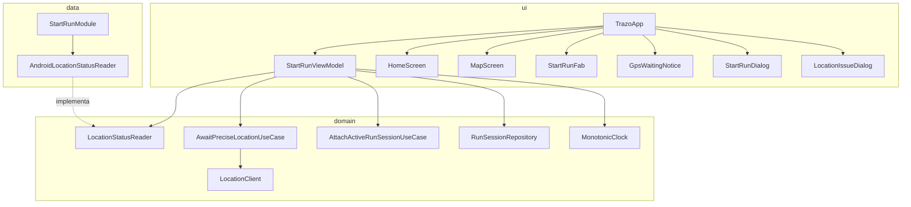

# Design Document · start-run (HU-02 y HU-03)

## Overview

**Purpose**: permitir que el corredor inicie un recorrido desde Inicio o desde Mapa con un único
botón «+», elija una meta y empiece a registrar recién cuando hay señal GPS precisa.

**Users**: corredores que abren Trazo para salir a correr.

**Impact**: hoy el modal y los permisos funcionan, pero el recorrido nunca arranca y Mapa no tiene
«+». Este diseño concentra toda la lógica de inicio en `StartRunViewModel`, mueve `StartRunFab` a
`ui/components/common/`, unifica `RunGoal` con el de HU-04 y entrega la sesión inicial a HU-04
cuando llega una ubicación de 30 m o menos.

### Goals
- Un único `StartRunFab` en Inicio y Mapa, deshabilitado mientras hay recorrido en curso o se
  espera la señal (9.1–9.7).
- Esperar señal GPS en Mapa con «Cancelar» y arrancar el registro con la sesión inicial (8.2–8.5,
  10.1–10.3).
- Un solo `RunGoal` (`domain/model/map/RunGoal`).
- Mantener los requisitos 1–8 ya implementados.

### Non-Goals
- El registro del recorrido (distancia, tiempo, traza): HU-04.
- Modo demo y Configuración.
- Reubicar `locationSettingsIntent` ni tocar `LiveRouteTrackingViewModel`.

## Boundary Commitments

### This Spec Owns
- El flujo de inicio completo: «+» → opción → permisos → ubicación → modal → espera de señal →
  entrega de la sesión.
- `StartRunViewModel` y su `StartRunUiState`, como única fuente de verdad del «+» en ambas pantallas.
- Los componentes `StartRunFab`, `StartRunDialog`, `GoalChip`, `PrimaryButton`,
  `LocationIssueDialog` y el aviso `GpsWaitingNotice`.
- El puerto `LocationStatusReader` y el caso de uso `AwaitPreciseLocationUseCase`.
- La construcción de `InitializedRunSession` (id, meta, `startedAt`, `startMonotonicTimestamp`).

### Out of Boundary
- `RunSessionRepository`, `RunGoal`, `InitializedRunSession` y el registro: HU-04 (Persona 3).
- El contenido de Inicio (lista vacía, barra superior): `home-recent-runs` (Persona 1).
- El contenido del Mapa (mapa, panel, controles, avisos de cierre): HU-04.
- `MonotonicClock` y su binding: `floor-regularity` (Persona 4).

### Allowed Dependencies
- `ui/screens/startrun` → `domain` (casos de uso, puertos, modelos de `map`).
- `ui/navigation/TrazoApp` → `ui/screens/startrun`, `ui/components/common`, `HomeScreen`, `MapScreen`.
- `HomeScreen` y `MapScreen` reciben el «+» y el aviso como slots `@Composable (Modifier) -> Unit`;
  no importan nada de `startrun`.
- `data/location` y `data/di` implementan y bindean los puertos nuevos.
- Dirección: `ui → domain ← data`. `ui/components/common` solo usa `ui/theme`, `R` y tipos simples.

### Revalidation Triggers
- `home-recent-runs`: `HomeUiState` pierde `isStartRunEnabled` e `isStartRunOptionVisible`;
  `HomeContent` recibe el slot `startRunFab` (sus tasks 3.1–3.2 deben revalidarse).
- `live-route-tracking`: `MapScreen` suma dos slots opcionales; `onStartRunClicked()` y el efecto
  `OpenStartRunModal` quedan sin uso.
- Cualquier cambio en `InitializedRunSession`, `RunGoal` o `isRunInProgress`.

## Architecture

### Existing Architecture Analysis
- `TrazoApp` crea `StartRunViewModel` fuera del `NavHost` (dueño: Activity) y hoy contiene la lógica
  de permisos y lee la ubicación con `data.location.readLocationStatus` (viola `ui → domain`).
- `HomeViewModel` tiene el estado del FAB; Mapa no tiene FAB.
- `AttachActiveRunSessionUseCase` existe pero no se usa.

### Architecture Pattern & Boundary Map



**Architecture Integration**:
- Patrón: MVVM + UDF con un ViewModel compartido a nivel Activity; slots para inyectar el «+» en
  pantallas ajenas sin acoplarlas.
- Se preservan: hexagonal (puertos en `domain/repository`), `StateFlow<UiState>` + `Channel` de
  efectos, componentes stateless en `ui/components/common`.
- Steering: `structure.md` (componentes sin lógica, pantallas sin importar otras pantallas) y
  `tech.md` (reloj monotónico para duraciones, fecha real aparte).

### Technology Stack

| Layer | Choice / Version | Role in Feature | Notes |
|-------|------------------|-----------------|-------|
| UI | Compose + Material 3 | FAB, modal, aviso de espera | Sin librerías nuevas |
| Estado | Coroutines / `StateFlow` / `Channel` | Estado y efectos del inicio | — |
| DI | Hilt | Bindear `LocationStatusReader` y `kotlin.time.Clock` | Módulo nuevo `StartRunModule` |
| Ubicación | Play Services Location vía `LocationClient` | Primera ubicación precisa | Reutiliza HU-04 |

## File Structure Plan

### Directory Structure
```
app/src/main/java/com/trazo/app/
├── domain/
│   ├── repository/LocationStatusReader.kt        # Puerto: estado de permisos y ubicación
│   └── usecases/AwaitPreciseLocationUseCase.kt   # Primera ubicación con precisión ≤ 30 m
├── data/
│   ├── location/AndroidLocationStatusReader.kt   # Adaptador: reutiliza readLocationStatus
│   └── di/StartRunModule.kt                      # Bindea LocationStatusReader y kotlin.time.Clock
└── ui/
    ├── components/common/StartRunFab.kt          # Movido desde screens/home/components (sin cambios visuales)
    └── screens/startrun/
        ├── StartRunViewModel.kt                  # Única fuente del flujo de inicio
        └── components/GpsWaitingNotice.kt        # «Esperando señal GPS» + meta + «Cancelar»
```

Tests:
```
app/src/test/java/com/trazo/app/
├── domain/usecases/AwaitPreciseLocationUseCaseTest.kt
└── ui/screens/startrun/StartRunViewModelTest.kt  # Reescrito: FAB, permisos, modal, espera, arranque
app/src/androidTest/java/com/trazo/app/
└── ui/components/common/StartRunFabTest.kt       # Casos del FAB que estaban en HomeContentTest
```

### Modified Files
- `domain/model/RunGoal.kt` — se borra; todos usan `domain/model/map/RunGoal`.
- `ui/components/common/StartRunDialog.kt` — usa `map.RunGoal`; etiqueta con `distanceKm`.
- `ui/navigation/TrazoApp.kt` — deja de leer la ubicación; colecta efectos del ViewModel (pedir
  permiso, ir a Mapa); arma `StartRunFab` y `GpsWaitingNotice` y los pasa como slots.
- `ui/screens/home/HomeScreen.kt` / `HomeViewModel.kt` — `HomeContent` recibe el slot
  `startRunFab`; `HomeUiState` queda con `hasRecentRuns`.
- `ui/screens/map/MapScreen.kt` — slots opcionales `startRunFab` y `gpsWaitingNotice`. El «+» va
  en la columna derecha, debajo de «Centrar» y encima del panel del temporizador; el aviso, sobre el
  panel.
- `ui/components/layout/MapLayer.kt` — slot `belowCenterButton` debajo del botón «Centrar».
- `res/values/strings_start_run.xml` — textos del aviso de espera.
- Tests: `HomeViewModelTest` y `HomeContentTest` sin los casos del FAB (pasan a
  `StartRunViewModelTest` y `StartRunFabTest`).

## System Flows

```mermaid
sequenceDiagram
    participant C as Corredor
    participant F as StartRunFab
    participant VM as StartRunViewModel
    participant App as TrazoApp
    participant L as LocationStatusReader
    participant W as AwaitPreciseLocation
    participant R as RunSessionRepository
    C->>F: toca «+»
    F->>VM: onFabClick (muestra opción)
    C->>F: toca «Iniciar un recorrido»
    F->>VM: onOptionClick
    VM->>L: read()
    alt PERMISSION_DENIED
        VM-->>App: efecto RequestLocationPermission
        App->>VM: onPermissionResult()
        VM->>L: read()
    end
    alt READY
        VM-->>App: estado: modal visible
        C->>VM: elige meta y «Comenzar»
        VM-->>App: efecto NavigateToMap, estado: esperando señal
        VM->>W: invoke()
        W-->>VM: ubicación ≤ 30 m
        VM->>R: attachActiveSession(InitializedRunSession)
        VM-->>App: estado: sin espera; «+» deshabilitado (isRunInProgress)
    else otro problema
        VM-->>App: estado: aviso de ubicación
    end
```

- «Cancelar» durante la espera cancela la corrutina y no entrega nada (8.4).
- Si la espera falla (permiso revocado, ubicación apagada), se vuelve a leer el estado y se muestra
  el aviso correspondiente (8.5).
- La espera se lanza una sola vez por «Comenzar»; un segundo «Comenzar» es imposible porque el modal
  ya está cerrado y el «+» deshabilitado (10.3, 9.7).

## Requirements Traceability

| Requirement | Summary | Components | Interfaces | Flows |
|-------------|---------|------------|------------|-------|
| 1.1–1.4 | Modal | `StartRunDialog`, `StartRunViewModel` | `isDialogVisible` | — |
| 2.1–2.3 | Elegir meta | `StartRunViewModel`, `GoalChip` | `onGoalSelected` | — |
| 3.1–3.2 | Sin meta | `StartRunDialog` | `isConfirmEnabled` | — |
| 4.1–4.3 | Cancelar | `StartRunViewModel` | `onDismiss` | — |
| 5.1, 5.2, 5.4 | Comenzar | `StartRunViewModel`, `TrazoApp` | `onConfirm`, `NavigateToMap` | Secuencia |
| 5.3 | Entregar meta | `StartRunViewModel` | `AttachActiveRunSessionUseCase` | Secuencia |
| 6.1–6.3 | Permiso | `StartRunViewModel`, `TrazoApp`, `LocationIssueDialog` | `RequestLocationPermission`, `onPermissionResult` | Secuencia |
| 7.1–7.2 | Aproximada | `StartRunViewModel`, `LocationIssueDialog` | `locationIssue` | — |
| 8.1 | Ubicación apagada | `StartRunViewModel`, `LocationIssueDialog` | `locationIssue` | — |
| 8.2–8.4 | Espera de señal | `AwaitPreciseLocationUseCase`, `GpsWaitingNotice`, `MapScreen` | `waitingGoal`, `onCancelWaiting` | Secuencia |
| 8.5 | Falla durante la espera | `StartRunViewModel` | `locationIssue` | — |
| 9.1–9.4 | «+» único | `StartRunFab`, `StartRunViewModel`, `HomeScreen`, `MapScreen` | `onFabClick`, `onOptionDismiss`, `onOptionClick` | — |
| 9.5–9.7 | «+» deshabilitado | `StartRunViewModel` | `isFabEnabled` | — |
| 10.1–10.3 | Arranque con señal | `StartRunViewModel` | `InitializedRunSession` | Secuencia |

## Components and Interfaces

| Component | Layer | Intent | Req Coverage | Key Dependencies | Contracts |
|-----------|-------|--------|--------------|------------------|-----------|
| `StartRunViewModel` | UI | Dueño del flujo de inicio | 1–10 | `LocationStatusReader` (P0), `AwaitPreciseLocationUseCase` (P0), `AttachActiveRunSessionUseCase` (P0), `RunSessionRepository` (P0), `MonotonicClock` (P1), `Clock` (P1) | State, Event |
| `LocationStatusReader` | Domain | Leer permisos y ubicación | 6, 7, 8.1, 8.5 | — | Service |
| `AwaitPreciseLocationUseCase` | Domain | Esperar ubicación ≤ 30 m | 8.2, 8.3, 10.1 | `LocationClient` (P0) | Service |
| `AndroidLocationStatusReader` | Data | Adaptador Android | 6, 7, 8.1 | `readLocationStatus` | — |
| `StartRunModule` | Data/DI | Bindings | — | Hilt | — |
| `StartRunFab` | UI común | «+» y opción, sin lógica | 9.1–9.5 | `ui/theme` | — |
| `GpsWaitingNotice` | UI start-run | Aviso de espera | 8.2, 8.4 | `ui/theme` | — |
| `TrazoApp` | UI navegación | Une ViewModel, pantallas y efectos | 5.2, 6.1 | — | — |

### Domain

#### LocationStatusReader

```kotlin
fun interface LocationStatusReader {
    fun read(): LocationStatus
}
```
- Postcondición: devuelve el estado actual sin efectos secundarios.

#### AwaitPreciseLocationUseCase

```kotlin
class AwaitPreciseLocationUseCase @Inject constructor(private val locationClient: LocationClient) {
    /** Suspende hasta la primera ubicación con precisión ≤ [MAX_ACCURACY_METERS]. */
    suspend operator fun invoke(): RawLocationPoint
    companion object { const val MAX_ACCURACY_METERS = 30f; const val INTERVAL_MILLIS = 1_000L }
}
```
- Cancelable: al cancelar la corrutina se da de baja el flujo de ubicación.
- Errores: propaga la excepción del flujo (por ejemplo `SecurityException`).

### UI

#### StartRunViewModel

**Contracts**: State [x] / Event [x]

##### State Management
```kotlin
data class StartRunUiState(
    val isRunInProgress: Boolean = false,
    val isOptionVisible: Boolean = false,
    val isDialogVisible: Boolean = false,
    val selectedGoal: RunGoal? = null,          // domain.model.map.RunGoal
    val locationIssue: LocationStatus? = null,
    val waitingGoal: RunGoal? = null,           // != null → esperando señal GPS
) {
    val isWaitingForGps: Boolean get() = waitingGoal != null
    val isFabEnabled: Boolean get() = !isRunInProgress && !isWaitingForGps
    val isConfirmEnabled: Boolean get() = selectedGoal != null
}

sealed interface StartRunEffect {
    data object RequestLocationPermission : StartRunEffect
    data object NavigateToMap : StartRunEffect
}
```
- `isRunInProgress` se combina desde `RunSessionRepository.isRunInProgress`.
- Invariante: si `isFabEnabled` es `false`, `isOptionVisible` es `false`.
- Efectos por `Channel` (`receiveAsFlow`), como `LiveRouteTrackingViewModel`.

##### Eventos
| Evento | Efecto |
|--------|--------|
| `onFabClick()` | Alterna la opción si el «+» está habilitado |
| `onOptionDismiss()` | Oculta la opción |
| `onOptionClick()` | Oculta la opción y evalúa la ubicación: `PERMISSION_DENIED` → `RequestLocationPermission`; `READY` → modal; otro → `locationIssue` |
| `onPermissionResult()` | Relee: `READY` → modal; otro → `locationIssue` |
| `onGoalSelected(goal)` | Marca la meta |
| `onDismiss()` | Cierra el modal y olvida la meta |
| `onConfirm()` | Sin meta: nada. Con meta: cierra el modal, `waitingGoal = meta`, emite `NavigateToMap` y lanza la espera |
| `onCancelWaiting()` | Cancela la espera y limpia `waitingGoal` |
| `onLocationIssueDismiss()` | Limpia `locationIssue` |

- Al recibir la ubicación precisa: construye
  `InitializedRunSession(id = UUID, goal, startMonotonicTimestamp = monotonicClock.nowMillis(), startedAt = clock.now())`,
  llama a `AttachActiveRunSessionUseCase` y limpia `waitingGoal`.
- Si la espera falla (no cancelación): limpia `waitingGoal` y pone `locationIssue = reader.read()`
  (o `DEVICE_LOCATION_OFF` si el estado es `READY`).

#### StartRunFab, GpsWaitingNotice
- `StartRunFab`: misma API que hoy (`enabled`, `isOptionVisible`, `onFabClick`, `onOptionDismiss`,
  `onOptionClick`, `modifier`). Solo cambia el paquete.
- `GpsWaitingNotice(goalLabel: String, onCancel: () -> Unit, modifier)`: tarjeta con indicador de
  progreso, «Esperando señal GPS», «Meta: 5 km» y «Cancelar» (48 dp). Respeta «Quitar animaciones»
  mostrando el indicador sin animar.

#### TrazoApp
- Colecta `StartRunEffect`: `RequestLocationPermission` lanza el `RequestMultiplePermissions`;
  `NavigateToMap` navega a Mapa (si ya está, `launchSingleTop`).
- Pasa a `HomeScreen` y `MapScreen` el slot `startRunFab`, y a `MapScreen` el slot
  `gpsWaitingNotice` (solo dibuja algo si `isWaitingForGps`).

## Data Models
- `InitializedRunSession` (HU-04): `id: String`, `goal: RunGoal`, `startMonotonicTimestamp: Long`,
  `startedAt: Instant`, `isDemoMode = false`.
- `RunGoal` (HU-04): `THREE_KILOMETERS`, `FIVE_KILOMETERS`, `TEN_KILOMETERS` con `distanceKm`.

## Error Handling
- Permiso negado / aproximada / ubicación apagada: `LocationIssueDialog` con «Ir a configuración».
- Falla del flujo de ubicación durante la espera: se corta la espera y se muestra el aviso (8.5).
- Cancelación: `CancellationException` se relanza; no se muestra nada.

## Testing Strategy

- **Unit (JVM)**
  - `AwaitPreciseLocationUseCaseTest`: ignora puntos de 31 m y devuelve el primero de 30 m; propaga
    el error del flujo.
  - `StartRunViewModelTest` (fakes: `LocationStatusReader`, `LocationClient` con `MutableSharedFlow`,
    `FakeRunSessionRepository`, relojes fijos):
    - FAB: alterna la opción; con recorrido en curso queda deshabilitado y no muestra la opción;
      al finalizar se habilita (9.2, 9.5, 9.6).
    - Opción con permiso negado emite `RequestLocationPermission`; tras el resultado abre el modal
      o muestra el aviso (6.1–6.3).
    - Aproximada y ubicación apagada muestran el aviso sin abrir el modal (7, 8.1).
    - `onConfirm` con meta: cierra el modal, emite `NavigateToMap`, espera; con un punto de 50 m no
      arranca; con uno de 20 m llama a `attachActiveSession` con la meta, `startedAt` y el instante
      monotónico, y deja de esperar (8.2, 8.3, 10.1, 10.2).
    - Durante la espera el «+» está deshabilitado (9.7); `onCancelWaiting` no arranca nada (8.4).
    - Error del flujo durante la espera: deja de esperar y muestra el aviso (8.5).
    - Casos ya existentes del modal (1–5).
- **UI (instrumentados)**
  - `StartRunFabTest`: habilitado notifica el toque; opción visible notifica selección; toque
    afuera notifica descarte; deshabilitado no notifica.
  - `HomeContentTest`: estado vacío, barra superior y que el slot del «+» se dibuja.
