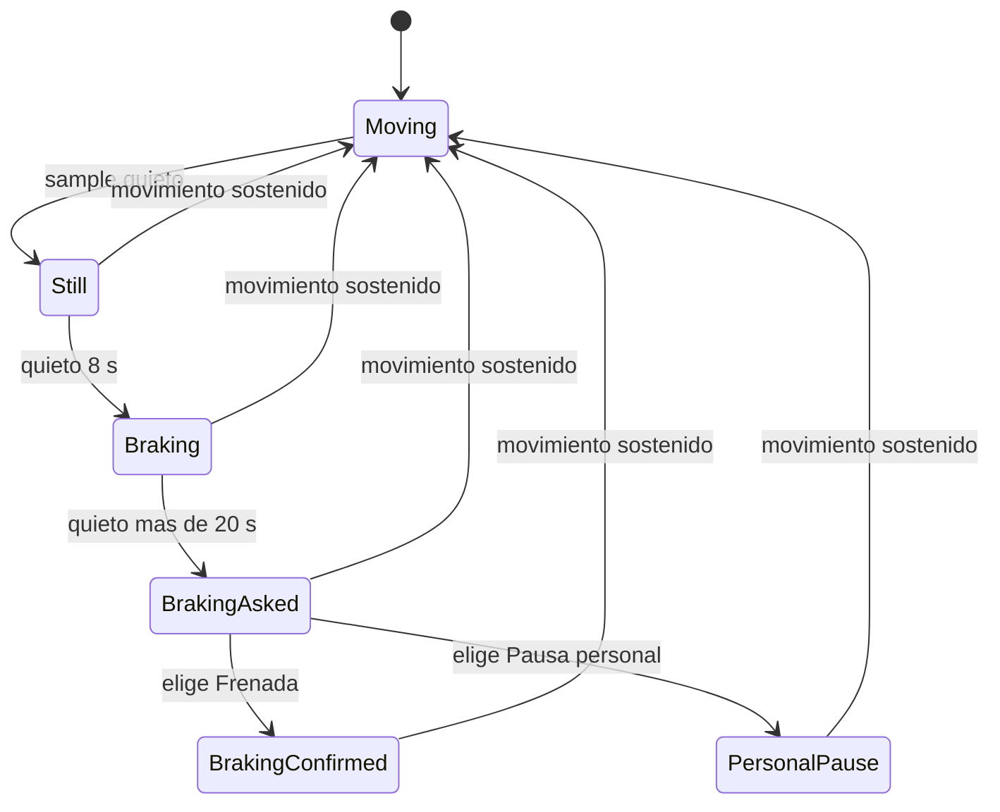

# Documento de diseño · stop-detection (HU-05.1 · Frenadas y pausas personales)

## Overview

**Propósito**: esta funcionalidad entrega al corredor la detección automática de sus detenciones
durante un recorrido en curso, distingue la frenada propia del recorrido (semáforo, esquina) de la
pausa personal y deja registrada la ubicación de cada frenada. **Usuarios**: el corredor recreativo
urbano que registra un recorrido con Trazo. Ve una alerta animada a los 8 s de quietud y, si la
detención supera los 20 s, un mensaje para clasificarla. **Impacto**: hoy `domain/` y `data/` están
vacíos y `MapScreen` es un placeholder. El diseño agrega un núcleo de dominio puro (máquina de
estados con reloj inyectado), un adaptador del acelerómetro, un repositorio que orquesta ambos y una
capa de UI (`BrakeAlert`, `StopClassificationDialog`) montada como superposición sobre `MapScreen`
(que es de Persona 3: la pieza se monta por parámetro), sin tocar el `MapViewModel` de HU-04.
**Supuesto de ejecución (decisión del equipo C8)**: no hay servicio en segundo plano; la detección
funciona con la pantalla encendida y la app visible.

### Goals

- Detectar quietud con el acelerómetro y mantener los estados «Movimiento continuo» y «Frenada»
  (1.1–1.4, 2.1).
- Registrar una única frenada por detención continua con su ubicación y conservarla al retomar el
  movimiento (2.2–2.4).
- Mostrar la alerta animada accesible y cerrarla a los 4 s (3.1–3.5).
- Consultar la clasificación ante una quietud de más de 20 s y aplicar la respuesta (4.1–4.7).
- Dejar la lógica de negocio (8 s, 20 s, histéresis) testeable con JUnit y tiempo virtual, sin
  Android.

### Non-Goals

- Pausar o reanudar el recorrido, medir la regularidad del piso y gestionar el ciclo de vida del
  sensor (HU-05.2).
- Conteo y presentación de frenadas en resultados, guardado e historial (`save-run`, HU-06).
- Pin de frenada en el mapa (queda para HU-04; esta spec solo expone la lista de frenadas con
  ubicación).
- Persistencia de las frenadas (HU-04 / `save-run`). No existe servicio en segundo plano: la
  detección con pantalla apagada queda fuera de alcance.

## Boundary Commitments

### This Spec Owns

- La regla de negocio de detención: umbral de quietud, 8 s, 20 s (estricto), confirmación de
  reanudación y exclusión de pausas personales.
- El modelo `StopDetectionState` / `BrakeEvent` y la lista de frenadas del recorrido en curso
  (autoridad única hasta el fin del recorrido).
- Los puertos `MotionSource`, `StopLocationProvider`, `RunningRunSource`, `RunStatePublisher`,
  `MonotonicClock` y el contrato de salida `StopDetectionRepository`.
- La lectura del acelerómetro mientras hay un recorrido en curso (`AccelerometerMotionSource`).
- La UI de la alerta de frenada y del mensaje de clasificación (incluido el parámetro `suppressed`).
- La utilidad compartida `ui/theme/ReduceMotion.kt` con `rememberReduceMotion()`: la crea esta spec
  y la reutilizan `finish-run-result` y la celebración de «Meta cumplida» de Persona 3.

### Out of Boundary

- La definición de `RunState`, `RunSession` y de las funciones de `RunSessionRepository`, la
  pausa manual (`PAUSED`), la ubicación y el trazado: pertenecen a HU-04 (Persona 3) y HU-05.2.
- Qué se hace con las frenadas al finalizar (contarlas, guardarlas, mostrarlas): `save-run`, HU-06.
- Permisos de ubicación. No hay servicio en segundo plano (decisión C8).
- Cuándo se debe ocultar la alerta durante el cierre: lo decide HU-06 (requisito 7); esta spec solo
  expone el parámetro `suppressed`.
- Medición de regularidad del piso (HU-05.2) aunque comparta el acelerómetro.

### Allowed Dependencies

- `domain` no importa nada de Android, de `data` ni de `ui`. `data` implementa los puertos de
  `domain`. `ui/screens` depende de `domain` (nunca de `data`), `ui/components` solo de `ui/theme`
  (steering `design-system.md`).
- **Dependencia dura con HU-04 (P0)**: los adaptadores `RunSessionRunningRunSource`,
  `RunSessionStopLocationProvider` y `RunSessionStatePublisher`, el módulo Hilt y el montaje en
  `MapScreen` requieren el contrato acordado de HU-04: `RunSession` sellada (`Idle` /
  `ActiveSession`, nunca nula), `RunSessionRepository.activeSession: StateFlow<RunSession>`,
  `RunState` (`IDLE`, `ACTIVE`, `PAUSED`, `FINISHED` + los estados nuevos de abajo), `routePoints` y
  `@ApplicationScope`. El dominio, el sensor, el repositorio y la UI con previews no dependen de
  HU-04.
- **Estados del recorrido (acordados con Persona 3, definitivos)**:

  | `RunState`        | Significado                                                   |
  |-------------------|---------------------------------------------------------------|
  | `ACTIVE`          | Recorrido en curso                                            |
  | `STOPPED`         | Frenada detectada automáticamente                             |
  | `PERSONAL_PAUSED` | Pausa personal (elegida en la consulta de 20 s)               |
  | `PAUSED`          | Pausa manual del corredor; se mantiene (esta spec no la toca) |

- **Transiciones de `RunSessionRepository` (contrato acordado con Persona 3; supuesto a confirmar)**:

  | Función             | Origen permitido                  | Destino           |
  |---------------------|-----------------------------------|-------------------|
  | `markStopped()`     | `ACTIVE`                          | `STOPPED`         |
  | `pausePersonally()` | `ACTIVE` o `STOPPED`              | `PERSONAL_PAUSED` |
  | `markMoving()`      | `STOPPED` o `PERSONAL_PAUSED`     | `ACTIVE`          |

  Cualquier otro origen devuelve `Result.failure`. `isRunInProgress` queda en `true` en los tres
  estados. Este diseño solo llama `pausePersonally()` desde `STOPPED`. La pausa manual sigue por
  `pauseSession()` / `resumeSession()` y no es parte de esta spec.
- Android framework: `SensorManager`, `Settings.Global`. Sin dependencias nuevas de producción; en
  pruebas, `kotlinx-coroutines-test`, que **ya agregó Persona 3** al catálogo (`gradle/libs.versions.toml`):
  esta spec solo lo usa.

### Revalidation Triggers

- Cambio de forma de `StopDetectionState`, `BrakeEvent` o `StopLocation` (consumen `save-run` y
  HU-06).
- Que HU-05.2 tome la propiedad del registro/baja del acelerómetro o cambie su frecuencia.
- Que HU-04 cambie `RunSession.id`, la semántica de `ACTIVE` / `STOPPED` / `PERSONAL_PAUSED` /
  `PAUSED`, la forma sellada de `RunSession` o el origen de `routePoints`.
- Que cambien los nombres, los orígenes permitidos o el `Result` de `markStopped()`,
  `pausePersonally()` y `markMoving()`, o que no se confirmen los supuestos pendientes con el líder
  (ver Riesgos).
- Que cambie la firma de `rememberReduceMotion()` (la usan tres consumidores).
- Que `save-run` lea las frenadas en un momento distinto a «antes de iniciar el siguiente
  recorrido».
- Que se pida detección con pantalla apagada o app en segundo plano (hoy fuera de alcance: no hay
  servicio; ver Riesgos).

## Architecture

### Existing Architecture Analysis

- Arquitectura por capas `ui → domain ← data` con Hilt; `HomeViewModel` + `HomeContent` con
  `@Preview` es el patrón de pantalla. Un componente nace en `screens/<pantalla>/components/`,
  recibe estado y eventos por parámetro y lleva su `@Preview` con `TrazoTheme`.
- En esta rama no existen modelos, repositorios, sensores ni módulos Hilt de dominio. El diseño
  reutiliza, sin copiarlos, los tipos del contrato acordado de HU-04 (`live-route-tracking`):
  `RunSession` sellada, `RunSessionRepository.activeSession: StateFlow<RunSession>`, `RoutePoint` y
  `@ApplicationScope`. La rama vieja `origin/HU-04-map` (con `RUNNING` y `RunSession?`) ya no es la
  referencia.
- Testing hoy: JUnit 4 sin coroutines-test, sin MockK. Se mantiene JUnit 4 con fakes escritos a
  mano.

### Architecture Pattern & Boundary Map

```mermaid
graph TB
    subgraph UI
        MapScreen --> StopDetectionOverlay
        StopDetectionOverlay --> StopDetectionViewModel
        StopDetectionOverlay --> BrakeAlert
        StopDetectionOverlay --> StopClassificationDialog
    end
    subgraph Domain
        StopDetectionRepository
        StopDetector
        StillnessEstimator
        MotionSource
        StopLocationProvider
        RunningRunSource
        RunStatePublisher
        MonotonicClock
    end
    subgraph Data
        StopDetectionRepositoryImpl
        AccelerometerMotionSource
        RunSessionRunningRunSource
        RunSessionStopLocationProvider
        RunSessionStatePublisher
    end
    StopDetectionViewModel --> StopDetectionRepository
    StopDetectionRepositoryImpl -. implements .-> StopDetectionRepository
    StopDetectionRepositoryImpl --> StopDetector
    StopDetectionRepositoryImpl --> StillnessEstimator
    StopDetectionRepositoryImpl --> MotionSource
    StopDetectionRepositoryImpl --> StopLocationProvider
    StopDetectionRepositoryImpl --> RunningRunSource
    StopDetectionRepositoryImpl --> RunStatePublisher
    StopDetectionRepositoryImpl --> MonotonicClock
    AccelerometerMotionSource -. implements .-> MotionSource
    RunSessionRunningRunSource -. implements .-> RunningRunSource
    RunSessionStopLocationProvider -. implements .-> StopLocationProvider
    RunSessionStatePublisher -. implements .-> RunStatePublisher
    RunSessionRunningRunSource --> HU04RunSessionRepository
    RunSessionStopLocationProvider --> HU04RunSessionRepository
    RunSessionStatePublisher --> HU04RunSessionRepository
```



**Architecture Integration**:

- Patrón elegido: opción C del gap analysis (híbrida). Núcleo de dominio puro con puertos mínimos y
  adaptadores diferidos hasta integrar HU-04.
- Límites: el reductor `StopDetector` no tiene tiempo ni E/S propios (recibe `nowMillis` en cada
  observación). `StopDetectionRepositoryImpl` es el único que cruza sensor, reloj, ubicación y
  estado del recorrido.
- Patrones preservados: Hilt, `StateFlow`, ViewModel + `Content` stateless con `@Preview`, textos en
  `strings.xml`.
- Componentes nuevos: ver tabla de componentes. No se crean casos de uso intermedios: el ViewModel
  consume el repositorio directamente (solo hay una lectura y una acción, un caso de uso sería
  indirección sin valor).
- Cumplimiento de steering: `BrakeAlert` y el pin siguen `design-system.md` §6.8; la UI no importa
  `data/`.

### Technology Stack

| Capa           | Elección / Versión                                                 | Rol en la funcionalidad                         | Notas                                                        |
|----------------|--------------------------------------------------------------------|-------------------------------------------------|--------------------------------------------------------------|
| UI             | Jetpack Compose (BOM 2025.04.01) + Material 3                      | `BrakeAlert`, `StopClassificationDialog`        | `AnimatedVisibility`, `AlertDialog`, sin dependencias nuevas |
| Presentación   | `androidx.lifecycle` ViewModel + Hilt 2.60.1                       | `StopDetectionViewModel`                        | `collectAsStateWithLifecycle` ya disponible                  |
| Dominio        | Kotlin 2.3.21 puro + corrutinas                                    | `StopDetector`, `StillnessEstimator`            | Sin Android                                                  |
| Datos / Sensor | `SensorManager` (`TYPE_ACCELEROMETER`)                             | `AccelerometerMotionSource` como `callbackFlow` | Sin permiso; `SENSOR_DELAY_UI` (~16 Hz)                      |
| Pruebas        | JUnit 4.13.2 + `kotlinx-coroutines-test` 1.10.2 (solo test)        | Tiempo virtual para 8 s / 20 s                  | Ya agregada al catálogo por Persona 3                        |

## File Structure Plan

### Directory Structure

```
app/src/main/java/com/trazo/app/
├── domain/
│   ├── model/stops/
│   │   ├── MovementState.kt          # enum CONTINUOUS_MOVEMENT, BRAKING
│   │   ├── StopKind.kt               # enum BRAKE, PERSONAL_PAUSE (respuesta del corredor)
│   │   ├── StopLocation.kt           # lat, lon, precisión (independiente de RoutePoint de HU-04)
│   │   ├── BrakeEvent.kt             # id, ubicación nullable, detectedAtMillis
│   │   ├── MotionSample.kt           # magnitud de aceleración + instante
│   │   ├── StopPhase.kt              # fases de la máquina de estados (sellada)
│   │   ├── StopDetectionState.kt     # fase + lista de frenadas + derivados
│   │   └── StopDetectionConfig.kt    # umbrales y tiempos (parámetros calibrables)
│   ├── repository/
│   │   ├── StopDetectionRepository.kt   # contrato de salida (state, classifyCurrentStop)
│   │   ├── MotionSource.kt              # puerto: flujo de MotionSample
│   │   ├── StopLocationProvider.kt      # puerto: última ubicación conocida
│   │   ├── RunningRunSource.kt          # puerto: id del recorrido mientras la detección aplica
│   │   ├── RunStatePublisher.kt         # puerto: publica ACTIVE / STOPPED / PERSONAL_PAUSED
│   │   └── MonotonicClock.kt            # puerto: ms monotónicos
│   └── usecases/
│       ├── StillnessEstimator.kt     # ventana deslizante -> ¿quieto?
│       └── StopDetector.kt           # reductor puro de la máquina de estados
├── data/
│   ├── sensors/AccelerometerMotionSource.kt   # SensorManager -> Flow<MotionSample>
│   ├── repository/
│   │   ├── StopDetectionRepositoryImpl.kt     # orquestación, reloj y StateFlow
│   │   ├── RunSessionRunningRunSource.kt      # adapta RunSessionRepository (requiere HU-04)
│   │   ├── RunSessionStopLocationProvider.kt  # último routePoint (requiere HU-04)
│   │   └── RunSessionStatePublisher.kt        # llama markStopped / pausePersonally / markMoving
│   └── di/StopDetectionModule.kt              # binds + CoroutineScope + MonotonicClock (requiere HU-04)
└── ui/
    ├── theme/ReduceMotion.kt                  # rememberReduceMotion(): la crea esta spec; la usan
    │                                          # stop-detection, finish-run-result y la celebración (P3)
    └── screens/map/
        ├── StopDetectionViewModel.kt          # estado de UI, cierre de alerta a los 4 s
        └── components/
            ├── BrakeAlert.kt
            ├── StopClassificationDialog.kt
            └── StopDetectionOverlay.kt        # Composable con ViewModel + Content stateless
app/src/main/res/drawable/ic_brake.xml
app/src/test/java/com/trazo/app/... (ver Testing Strategy)
```

### Modified Files

- `ui/screens/map/MapScreen.kt` — es de Persona 3. Se monta `StopDetectionOverlay` por parámetro
  (con `suppressed`) en la tarea de integración con HU-04, avisando antes para no chocar.
- `res/values/strings.xml` — textos de alerta y de diálogo, con el prefijo `map_`.
- `gradle/libs.versions.toml` y `app/build.gradle.kts` — sin cambios de esta spec:
  `kotlinx-coroutines-test` ya fue agregada por Persona 3 (tarea 1.2 hecha).

## System Flows



En el código `Braking`, `BrakingAsked` y `BrakingConfirmed` son una sola fase `StopPhase.Braking`
con `query: NotDue | Pending | Answered`; `Still` y `PersonalPause` llevan `sinceMillis`.

**Decisiones de flujo**

- **Tiempos desde el inicio de la quietud**: tanto los 8 s como los 20 s se miden desde
  `sinceMillis`, el primer instante en que el estimador dijo «quieto» (no desde que apareció la
  alerta). Frenada si `now - since >= 8000`; consulta si `now - since > 20000` (estricto, 4.1).
- **Movimiento sostenido**: salir de una fase de quietud exige `resumeConfirmMillis` (1500 ms) de
  lectura «en movimiento» continua. Un solo pico de ruido en un semáforo no parte una detención en
  dos frenadas (2.3) ni cancela la cuenta de 8 s; un tramo en movimiento menor a 8 s antes de la
  frenada vuelve a «Movimiento continuo» sin registro (1.3).
- **Pausa personal**: elimina la frenada de la lista (4.3, 4.4) y la fase pasa a `PersonalPause`,
  que impide volver a registrar la misma detención. El estado expuesto sigue siendo «Movimiento
  continuo».
- **Fases y estados del recorrido** (`RunState` de HU-04). El repositorio publica el estado
  correspondiente a la fase cada vez que esta cambia de categoría:

  | Fase (`StopPhase`)                           | `RunState` publicado |
  |----------------------------------------------|----------------------|
  | `Moving`, `Still`                            | `ACTIVE`             |
  | `Braking` (`NOT_DUE`, `PENDING`, `ANSWERED`) | `STOPPED`            |
  | `PersonalPause`                              | `PERSONAL_PAUSED`    |

  Al retomar el movimiento (movimiento sostenido) se vuelve a `ACTIVE`. La detección solo está
  activa con el recorrido en `ACTIVE`, `STOPPED` o `PERSONAL_PAUSED`: los dos últimos los produce
  esta misma spec y hay que seguir leyendo el sensor para saber cuándo el corredor retoma.
- **Pausa manual (`PAUSED`) y fin**: si el corredor pausa a mano, o el recorrido pasa a `FINISHED` o
  `Idle`, el recorrido deja de estar en los estados de detección: la fase vuelve a `Moving`, la
  consulta pendiente se cierra, se deja de leer el sensor y **la lista de frenadas se conserva**. La
  pausa manual se mantiene: esta spec **nunca** publica `ACTIVE` sobre `PAUSED` (la publicación es
  condicional al estado actual; ver supuesto a confirmar en Riesgos). La lista se vacía solo cuando
  arranca un recorrido con distinto id (no al reanudar el mismo).

## Requirements Traceability

| Req | Resumen                                                | Componentes                                                              | Interfaces                                              | Flujos                          |
|-----|--------------------------------------------------------|--------------------------------------------------------------------------|---------------------------------------------------------|---------------------------------|
| 1.1 | Mantener «Movimiento continuo» en movimiento           | StillnessEstimator, StopDetector                                         | `advance`, `StopDetectionState.movement`                | Moving                          |
| 1.2 | Sin frenada en movimiento continuo                     | StopDetector                                                             | `advance` (solo `Still`→`Braking` registra)             | Moving, Still                   |
| 1.3 | <8 s y retoma: sin frenada                             | StopDetector                                                             | `advance`, `resumeConfirmMillis`                        | Still → Moving                  |
| 1.4 | Sin recorrido en curso no detecta                      | StopDetectionRepositoryImpl, RunningRunSource, AccelerometerMotionSource | `RunningRunSource.runningRunId`, `flatMapLatest`        | `PAUSED`, fin de recorrido      |
| 2.1 | A los 8 s pasa a «Frenada»                             | StopDetector                                                             | `advance`, `brakeAfterMillis`                           | Still → Braking                 |
| 2.2 | Registrar ubicación                                    | StopDetector, StopLocationProvider                                       | `BrakeEvent.location`, `StopLocationProvider.lastKnown` | Still → Braking                 |
| 2.3 | Una frenada por detención continua                     | StopDetector                                                             | Fase `Braking`/`PersonalPause` + `resumeConfirmMillis`  | Braking, PersonalPause          |
| 2.4 | Conservar al retomar                                   | StopDetector, StopDetectionRepositoryImpl                                | `StopDetectionState.brakes`                             | Braking → Moving                |
| 3.1 | Alerta «Frenada detectada» / «Semáforo o intersección» | BrakeAlert, StopDetectionViewModel                                       | `StopDetectionUiState.alert`                            | alerta                          |
| 3.2 | Sin animación con «Quitar animaciones»                 | ReduceMotion, BrakeAlert                                                 | `rememberReduceMotion()`                                | alerta                          |
| 3.3 | Anunciar a accesibilidad                               | BrakeAlert                                                               | `liveRegion = Polite`                                   | alerta                          |
| 3.4 | Texto + ícono, no solo color                           | BrakeAlert, `ic_brake.xml`                                               | —                                                       | alerta                          |
| 3.5 | Cierre a los 4 s                                       | StopDetectionViewModel                                                   | `ALERT_DURATION_MILLIS`                                 | alerta                          |
| —   | Ocultar alerta y consulta durante el cierre (HU-06 R7) | StopDetectionOverlay, StopDetectionViewModel                             | parámetro `suppressed`                                  | alerta, consulta                |
| 4.1 | Consulta a >20 s desde la quietud                      | StopDetector, StopClassificationDialog                                   | `pendingClassificationBrakeId`, `classifyAfterMillis`   | Braking → BrakingAsked          |
| 4.2 | «Frenada» mantiene el registro                         | StopDetector, StopDetectionRepositoryImpl                                | `classifyCurrentStop(BRAKE)`                            | BrakingAsked → BrakingConfirmed |
| 4.3 | «Pausa personal» no es frenada                         | StopDetector                                                             | `classifyCurrentStop(PERSONAL_PAUSE)`                   | BrakingAsked → PersonalPause    |
| 4.4 | Excluir ubicación                                      | StopDetector                                                             | `brakes` sin la frenada descartada                      | BrakingAsked → PersonalPause    |
| 4.5 | Cerrar al elegir                                       | StopDetectionViewModel                                                   | `pendingClassificationBrakeId == null`                  | —                               |
| 4.6 | Texto legible al 200 %, 48 dp                          | StopClassificationDialog                                                 | `Sizes.minTouchTarget`                                  | —                               |
| 4.7 | Cierre si retoma sin responder                         | StopDetector                                                             | Movimiento sostenido desde `Braking(query = Pending)`   | BrakingAsked → Moving           |

## Components and Interfaces

| Componente                                                  | Capa   | Intención                                                                     | Req                            | Dependencias (criticidad)                                                 | Contratos      |
|-------------------------------------------------------------|--------|-------------------------------------------------------------------------------|--------------------------------|---------------------------------------------------------------------------|----------------|
| StopDetector                                                | Domain | Reductor puro de la máquina de estados                                        | 1.1–1.3, 2.1–2.4, 4.1–4.4, 4.7 | StopDetectionConfig (P0)                                                  | Service, State |
| StillnessEstimator                                          | Domain | Decide «quieto/en movimiento» con la desviación de la magnitud en una ventana | 1.1, 1.2                       | StopDetectionConfig (P0)                                                  | Service        |
| StopDetectionRepository                                     | Domain | Contrato de salida: estado y clasificación                                    | 2.4, 4.2–4.3                   | —                                                                         | Service, State |
| StopDetectionRepositoryImpl                                 | Data   | Orquesta sensor, reloj, ubicación y recorrido                                 | 1.4, 2.1–2.4                   | MotionSource, RunningRunSource, StopLocationProvider, RunStatePublisher, MonotonicClock (P0) | Service, State |
| AccelerometerMotionSource                                   | Data   | `callbackFlow` sobre `TYPE_ACCELEROMETER`                                     | 1.1, 1.4                       | SensorManager (P0)                                                        | Service        |
| RunSessionRunningRunSource / RunSessionStopLocationProvider / RunSessionStatePublisher | Data | Adaptan `RunSessionRepository` de HU-04 | 1.4, 2.2 | HU-04 `RunSessionRepository` (P0)                                         | Service        |
| StopDetectionViewModel                                      | UI     | Estado de UI, cierre de alerta y `suppressed`                                 | 3.1, 3.5, 4.5                  | StopDetectionRepository (P0)                                              | State          |
| BrakeAlert, StopClassificationDialog, StopDetectionOverlay  | UI     | Presentación                                                                  | 3.1–3.4, 4.1, 4.6              | `ui/theme` (P0)                                                           | —              |

### Domain

#### StopDetector

| Campo      | Detalle                                                                                    |
|------------|--------------------------------------------------------------------------------------------|
| Intención  | Transiciones puras entre fases de detención a partir de observaciones con tiempo explícito |
| Requisitos | 1.1–1.3, 2.1–2.4, 4.1–4.4, 4.7                                                             |

**Responsabilidades y restricciones**

- Sin reloj, sin E/S, sin corrutinas. Genera ids de frenada mediante `idGenerator: () -> String`
  inyectado.
- Invariantes: a lo sumo una fase activa; una fase `Braking` tiene siempre su `BrakeEvent` en
  `brakes`; `PersonalPause` nunca tiene `BrakeEvent` asociado; no hay dos frenadas con la misma
  `sinceMillis`.

**Contratos**: Service [x] / State [x]

##### Service Interface

```kotlin
data class Observation(
    val nowMillis: Long,
    val isStill: Boolean,
    val lastLocation: StopLocation?,
)

class StopDetector(
    private val config: StopDetectionConfig,
    private val idGenerator: () -> String,
) {
    fun initial(): StopDetectionState
    fun onRunStopped(state: StopDetectionState): StopDetectionState
    fun advance(state: StopDetectionState, observation: Observation): StopDetectionState
    fun classify(state: StopDetectionState, kind: StopKind): StopDetectionState
}
```

- Precondiciones: `advance` se invoca solo mientras el recorrido está en `ACTIVE`, `STOPPED` o
  `PERSONAL_PAUSED`; `nowMillis` no decrece.
- Postcondiciones: `advance` no muta `brakes` salvo en `Still → Braking` (agrega una) ; `classify`
  sin consulta pendiente devuelve el mismo estado (idempotente).
- `onRunStopped` devuelve fase `Moving` y conserva `brakes`.

##### State Management

```kotlin
sealed interface StopPhase {
    data object Moving : StopPhase
    data class Still(val sinceMillis: Long, val movingSinceMillis: Long? = null) : StopPhase
    data class Braking(
        val sinceMillis: Long,
        val brakeId: String,
        val query: QueryStatus,
        val movingSinceMillis: Long? = null,
    ) : StopPhase
    data class PersonalPause(val sinceMillis: Long, val movingSinceMillis: Long? = null) : StopPhase
}
enum class QueryStatus { NOT_DUE, PENDING, ANSWERED }

data class StopDetectionState(
    val phase: StopPhase = StopPhase.Moving,
    val brakes: List<BrakeEvent> = emptyList(),
) {
    val movement: MovementState        // BRAKING solo en StopPhase.Braking
    val pendingClassificationBrakeId: String?  // brakeId si query == PENDING
}

data class BrakeEvent(val id: String, val location: StopLocation?, val detectedAtMillis: Long)
data class StopLocation(val latitude: Double, val longitude: Double, val accuracyMeters: Float)
enum class MovementState { CONTINUOUS_MOVEMENT, BRAKING }
enum class StopKind { BRAKE, PERSONAL_PAUSE }
```

- Consistencia: `StopDetectionState` es inmutable; toda transición produce un valor nuevo.

#### StillnessEstimator

| Campo      | Detalle                                                                                          |
|------------|--------------------------------------------------------------------------------------------------|
| Intención  | Convertir `MotionSample` en «quieto / en movimiento» sin depender de la orientación del teléfono |
| Requisitos | 1.1, 1.2                                                                                         |

**Decisión de umbral (parámetro delegado por los requisitos)**: se usa la **desviación estándar de
la magnitud** `|a|` del acelerómetro en una ventana de 1000 ms. La gravedad es un offset constante y
se cancela, así que no hace falta `TYPE_LINEAR_ACCELERATION` (inexistente en algunos equipos) ni
conocer la orientación del bolsillo o brazalete. El estado es «quieto» cuando la ventana cubre al
menos 1000 ms y la desviación es menor a `stillStdDevThreshold`. Mientras la ventana no está llena,
el resultado es «en movimiento» (nunca se registra una frenada sin evidencia).

```kotlin
class StillnessEstimator(private val config: StopDetectionConfig) {
    fun accept(sample: MotionSample): Boolean // true = quieto
    fun reset()
}
data class MotionSample(val timestampMillis: Long, val magnitude: Float) // m/s²
```

```kotlin
data class StopDetectionConfig(
    val stillStdDevThreshold: Float = 0.5f,   // m/s², valor inicial a calibrar en dispositivo
    val windowMillis: Long = 1_000,
    val brakeAfterMillis: Long = 8_000,        // 2.1, 1.3
    val classifyAfterMillis: Long = 20_000,    // 4.1, estricto (>)
    val resumeConfirmMillis: Long = 1_500,
    val tickIntervalMillis: Long = 500,
    val sampleStaleMillis: Long = 2_000,       // sin muestras por más de esto = sin evidencia
)
```

Valores esperables de la desviación: parado con el teléfono en mano o bolsillo ≈ 0,05–0,3 m/s²;
caminar ≈ 1,5–3; trotar > 3. El umbral 0,5 deja margen sobre la quietud y debajo de la caminata;
**se calibra con datos reales** (ver Riesgos).

#### StopDetectionRepository

```kotlin
interface StopDetectionRepository {
    val state: StateFlow<StopDetectionState>
    fun classifyCurrentStop(kind: StopKind)   // no-op si no hay consulta pendiente
}
```

- Contrato para `save-run`: `state.value.brakes` contiene las frenadas válidas (sin pausas
  personales) del último recorrido y es estable desde que el recorrido deja de estar en los estados
  de detección (`PAUSED`, `FINISHED`, `Idle`) hasta que arranca otro recorrido con distinto id.

#### Puertos

```kotlin
interface MotionSource {
    fun samples(): Flow<MotionSample>
}       // frío: registra el sensor al colectar
interface RunningRunSource {
    val runningRunId: Flow<String?>
}      // id mientras el estado es ACTIVE, STOPPED o PERSONAL_PAUSED; null si no
interface StopLocationProvider {
    fun lastKnown(): StopLocation?
}  // null si no hay fix
interface RunStatePublisher {
    fun publish(runId: String, state: RunState): Result<Unit>
}  // solo ACTIVE, STOPPED, PERSONAL_PAUSED; Result.failure si el recorrido cambió o el origen no es válido
fun interface MonotonicClock {
    fun nowMillis(): Long
}
```

`RunStatePublisher` es el puerto de salida con el que el dominio informa el estado agregado por
esta spec. Su adaptador traduce `ACTIVE` → `markMoving()`, `STOPPED` → `markStopped()` y
`PERSONAL_PAUSED` → `pausePersonally()` de `RunSessionRepository` (contrato acordado con Persona 3,
supuesto a confirmar; ver Riesgos).

Los puertos viven en `domain/repository/` (misma convención que `LocationClient` en HU-04). Todos
son P0: sin ellos el repositorio no puede operar.

### Data

#### StopDetectionRepositoryImpl

| Campo      | Detalle                                                                                                  |
|------------|----------------------------------------------------------------------------------------------------------|
| Intención  | Convertir las muestras del sensor y un tick de 500 ms en observaciones del reductor y publicar el estado |
| Requisitos | 1.4, 2.1–2.4, 4.2–4.4                                                                                    |

**Responsabilidades y restricciones**

- Colecta `runningRunId`; con un id no nulo usa `flatMapLatest` para colectar
  `MotionSource.samples()` y un ticker (`tickIntervalMillis`), y cancela ambos cuando el id pasa a
  nulo (1.4: no se lee el sensor sin recorrido en curso ni con pausa manual).
- Tras cada transición de `StopPhase` que cambia de categoría (tabla de «Fases y estados del
  recorrido»), invoca `RunStatePublisher.publish(runId, estado)`. La publicación es condicional: no
  sobreescribe `PAUSED` ni estados finales. Si la transición devuelve `Result.failure`, el repositorio
  la ignora (no altera la fase del detector) y, como no la registra como publicada, vuelve a
  intentarla en el siguiente ciclo (tick) mientras la fase siga requiriendo ese estado.
- Cada muestra pasa por `StillnessEstimator`; el último booleano se reevalúa en cada tick para que
  los 8 s y 20 s se cumplan aunque el sensor no emita muestras nuevas, **salvo que el último dato
  sea viejo**: si pasaron más de `sampleStaleMillis` (2 000 ms) desde la última muestra, el tick
  observa `isStill = false` (sin evidencia = «en movimiento»). Así, si el sensor se corta (pantalla
  apagada o cambio de app) no se arrastra un «quieto» viejo y no se registra una frenada falsa al
  volver (1.3, 2.1). Cada observación usa
  `MonotonicClock.nowMillis()` (no el timestamp del `SensorEvent`) para unificar la base de tiempo.
- Si el id del recorrido difiere del último id visto, parte de `StopDetector.initial()`. Si es el
  mismo (reanudación), conserva `brakes`. Al pasar a nulo aplica `onRunStopped`.
- Todas las modificaciones (observaciones y `classifyCurrentStop`) usan
  `MutableStateFlow.update { }`, que es atómico, sin locks adicionales.
- Alcance de corrutinas: un `CoroutineScope` inyectado, vinculado a `@ApplicationScope` en el módulo
  Hilt.

**Contratos**: Service [x] / State [x]

**Implementation Notes**

- Integración: el módulo `StopDetectionModule` provee
  `MonotonicClock { SystemClock.elapsedRealtime() }`, el `CoroutineScope` y los `@Binds`. Se escribe
  cuando HU-04 esté integrada.
- Validación: pruebas con `runTest` y reloj falso atado a `testScheduler.currentTime`.
- Riesgos: ver «Riesgos y preguntas abiertas».

#### AccelerometerMotionSource

| Campo      | Detalle                                                |
|------------|--------------------------------------------------------|
| Intención  | Exponer el acelerómetro como `Flow<MotionSample>` frío |
| Requisitos | 1.1, 1.4                                               |

- `callbackFlow` que registra un `SensorEventListener` con `SENSOR_DELAY_UI` al colectar y lo da de
  baja en `awaitClose`; calcula `magnitude = sqrt(x² + y² + z²)`. Sin permisos.
- Sin acelerómetro (`getDefaultSensor == null`): el flujo no emite y se registra un aviso en log; la
  detección queda inactiva sin afectar el recorrido (decisión de degradación elegante).
- Propiedad del sensor: esta spec solo lo registra mientras el recorrido está en `ACTIVE`,
  `STOPPED` o `PERSONAL_PAUSED`. Si HU-05.2
  centraliza la gestión del sensor, reemplaza esta clase detrás de `MotionSource` sin tocar el
  dominio (ver Revalidation Triggers).

#### Adaptadores de HU-04

- `RunSessionRunningRunSource` (con `RunSession` sellada y nunca nula):
  `activeSession.map { s -> (s as? ActiveSession)?.takeIf { it.state in DETECTION_STATES }?.id }.distinctUntilChanged()`
  con `DETECTION_STATES = setOf(RunState.ACTIVE, RunState.STOPPED, RunState.PERSONAL_PAUSED)`.
  `Idle`, `PAUSED` (pausa manual) y `FINISHED` no cuentan como «en curso». Se incluyen `STOPPED` y
  `PERSONAL_PAUSED` y no solo `ACTIVE` porque los publica esta misma spec: si el id pasara a `null`
  al detectar la frenada, se cortaría el sensor y nunca se detectaría el movimiento.
- `RunSessionStopLocationProvider`: `(activeSession.value as? ActiveSession)?.routePoints?.lastOrNull()`
  convertido a `StopLocation`; `null` si es `Idle` o no hay puntos.
- `RunSessionStatePublisher`: implementa `RunStatePublisher` sobre `markStopped()`,
  `pausePersonally()` y `markMoving()` de `RunSessionRepository` (contrato acordado con Persona 3;
  **supuesto a confirmar**). Es condicional: solo aplica si la sesión es `ActiveSession` con ese
  `runId`; los orígenes no permitidos devuelven `Result.failure`, que el repositorio ignora.

### UI

#### StopDetectionViewModel

```kotlin
data class BrakeAlertUi(val brakeId: String)

data class StopDetectionUiState(
    val alert: BrakeAlertUi? = null,
    val classificationVisible: Boolean = false,
)

class StopDetectionViewModel @Inject constructor(
    private val repository: StopDetectionRepository,
) : ViewModel() {
    val uiState: StateFlow<StopDetectionUiState>
    fun onClassify(kind: StopKind)
    fun onSuppressedChanged(suppressed: Boolean)
}
```

- Muestra la alerta cuando aparece un `BrakeEvent` nuevo en `state.brakes` mientras la fase es
  `Braking` y la oculta a los `ALERT_DURATION_MILLIS = 4000` (3.5) o antes si la consulta pasa a
  pendiente o la frenada deja de existir.
- `classificationVisible = state.pendingClassificationBrakeId != null` (4.1, 4.5, 4.7). Cumple la
  restricción de que la alerta (8–12 s) ya no está visible cuando aparece la consulta (>20 s).

**Parámetro `suppressed` (HU-06 requisito 7)**: lo alimenta el cierre de HU-06 mientras hay un
aviso o diálogo de cierre visible. Se agrega a `StopDetectionOverlay(suppressed: Boolean, ...)` y se
reenvía al ViewModel con `onSuppressedChanged`. Con `suppressed == true`:

- `BrakeAlert` y `StopClassificationDialog` **no se muestran** (`alert = null` y
  `classificationVisible = false` en `StopDetectionUiState`). El `Content` también recibe
  `suppressed` y no dibuja nada, para que no parpadee un cuadro antes de que llegue el estado del
  ViewModel.
- La frenada **igual se registra**: el repositorio no conoce `suppressed`, así que la detección, el
  registro de ubicación y la publicación de `STOPPED` no cambian (HU-06 7.2).
- Una consulta pendiente **se resuelve como frenada**: al activarse `suppressed` (o al volverse
  pendiente mientras está activo) el ViewModel llama a `repository.classifyCurrentStop(StopKind.BRAKE)`
  (HU-06 7.3). Se hace en el ViewModel y no en el repositorio para que el dominio no dependa de
  la UI.
- Una frenada registrada durante la supresión no genera una alerta tardía al volver a `false`: el
  ViewModel solo muestra alertas de frenadas que aparecen mientras `suppressed == false`.

#### BrakeAlert (resumen)

Sigue `design-system.md` §6.8: `Surface` `inverseSurface`, círculo blanco de 36 dp con `ic_brake` en
`primary`, título «Frenada detectada» (`titleSmall`) y detalle «Semáforo o intersección»
(`bodyMedium`), `semantics { liveRegion = LiveRegionMode.Polite }` (3.3), texto + ícono (3.4).
Entrada con `slideInVertically + fadeIn`; con `rememberReduceMotion() == true` usa
`EnterTransition.None` / `ExitTransition.None` (3.2). Se ubica con `Modifier` desde `MapScreen` a 12
dp sobre el panel del temporizador.

#### StopClassificationDialog (resumen)

`AlertDialog` con título de pregunta, botones «Frenada» y «Pausa personal» (`TextButton` con
`heightIn(min = Sizes.minTouchTarget)`), en el slot de botones de M3 que se envuelve en varias
líneas al crecer la fuente (4.6). No se descarta por toque exterior ni por atrás
(`DialogProperties(dismissOnBackPress = false, dismissOnClickOutside = false)`): se cierra solo al
elegir o cuando la detención termina (4.5, 4.7).

#### ReduceMotion

`@Composable fun rememberReduceMotion(): Boolean` lee
`Settings.Global.ANIMATOR_DURATION_SCALE == 0f` desde `LocalContext.current.contentResolver`. Esta
spec **crea** `ui/theme/ReduceMotion.kt` y es la única dueña de la función; la reutilizan
`stop-detection` (`BrakeAlert`), `finish-run-result` y la celebración de «Meta cumplida» de Persona
3. Cualquier cambio de firma se avisa a las tres (ver Revalidation Triggers). Se entrega antes que la
alerta para que las otras dos puedan depender de ella.

## Data Models

### Domain Model

- Agregado: `StopDetectionState` (fase + lista de `BrakeEvent`). `BrakeEvent` es una entidad con id
  estable (UUID) y ubicación opcional.
- Reglas: una `Braking` activa ↔ un `BrakeEvent` en `brakes`; descartar por pausa personal elimina
  ese evento por id; las frenadas ya registradas nunca se modifican al retomar el movimiento.
- Sin persistencia: el estado vive en memoria mientras el proceso vive. Persistir frenadas pertenece
  a `save-run`.

## Error Handling

- **Sin acelerómetro**: flujo vacío, detección inactiva, sin interrupción del recorrido.
- **Sin ubicación al registrar** (2.2): se registra `BrakeEvent(location = null)`; la frenada cuenta
  igual y los consumidores deben tolerar `null` al dibujar pines. Ver Riesgos.
- **`classifyCurrentStop` sin consulta pendiente** (doble toque, cierre concurrente): no-op
  idempotente.
- **Recorrido que termina o se pausa a mano con consulta o alerta visibles**: la fase vuelve a
  `Moving`, ambos elementos desaparecen por derivación del estado.
- **Publicación de estado rechazada** (`Result.failure`: el recorrido cambió, está en
  `PAUSED`/`FINISHED` u origen no permitido): el detector la ignora y reevalúa en el siguiente ciclo;
  el estado del recorrido manda sobre el de esta spec.
- Errores del sensor/log: solo logging; no hay mensajes al usuario porque los requisitos no los
  definen.

## Testing Strategy

### Unit Tests (JUnit 4, sin Android)

- `StillnessEstimatorTest`: serie constante → quieto; serie con desviación > umbral → en movimiento;
  ventana incompleta (<1000 ms) → en movimiento (1.1, 1.2).
- `StopDetectorTest`: (a) quieto 7 999 ms y retoma → sin frenada, `Moving` (1.3); (b) quieto 8 000
  ms → `Braking`, un `BrakeEvent` con la ubicación (2.1, 2.2); (c) 30 observaciones seguidas
  quieto → una sola frenada (2.3); (d) pico de movimiento de 500 ms durante la quietud → no resetea
  ni duplica; movimiento ≥ 1 500 ms → `Moving` con la frenada conservada (2.3, 2.4); (e) 20 000 ms
  exactos → sin consulta; 20 001 ms → `PENDING`, medido desde el inicio de la quietud (4.1); (f)
  `classify(BRAKE)` → `ANSWERED`, lista intacta (4.2); (g) `classify(PERSONAL_PAUSE)` → frenada y
  ubicación fuera de `brakes`, sin nuevo registro mientras sigue quieto (4.3, 4.4); (h) retoma sin
  responder → consulta cerrada, frenada conservada (4.7).
- `StopDetectionStateTest`: `movement` y `pendingClassificationBrakeId` derivan de la fase.

### Integration Tests (`runTest` + fakes de `MotionSource`, `RunningRunSource`,
`StopLocationProvider`, reloj)

- `StopDetectionRepositoryImplTest`: sin id de recorrido no se colecta `MotionSource` y el estado no
  cambia (1.4); muestras quietas + tiempo virtual 8 s → una frenada con ubicación (2.1, 2.2); pausa
  y reanudación con el mismo id conservan `brakes`; un id distinto las vacía; fin del recorrido
  conserva `brakes` y cancela la colección; `classifyCurrentStop` concurrente con ticks no pierde
  actualizaciones; con el sensor sin emitir más de `sampleStaleMillis` tras un «quieto», los ticks
  observan «en movimiento» y, al reanudar el tiempo, no se registra una frenada falsa (1.3, 2.1).
  Con un `RunStatePublisher` falso: `Still → Braking` publica `STOPPED`,
  `PersonalPause` publica `PERSONAL_PAUSED`, retomar publica `ACTIVE`; con el recorrido en `PAUSED`
  (pausa manual) se deja de colectar el sensor y no se publica `ACTIVE`.
- `StopDetectionViewModelTest`: alerta aparece al registrarse la frenada y se limpia a los 4 000 ms
  virtuales (3.1, 3.5); `classificationVisible` sigue a `pendingClassificationBrakeId` (4.1, 4.5,
  4.7). Con `suppressed = true`: la alerta y la consulta no se muestran; una frenada ocurrida
  durante la supresión queda registrada y no genera alerta al volver a `false`; una consulta
  pendiente se resuelve como `BRAKE` (HU-06 7.1–7.3).
- `RunSessionRunningRunSourceTest`: `Idle`, `PAUSED` y `FINISHED` → `null`; `ACTIVE`, `STOPPED` y
  `PERSONAL_PAUSED` → el id de la sesión.

### UI Tests (Compose, `androidTest`)

- `BrakeAlertTest`: muestra «Frenada detectada» y «Semáforo o intersección», con ícono y
  `liveRegion` Polite (3.1, 3.3, 3.4).
- `StopClassificationDialogTest`: los dos botones existen, miden ≥ 48 dp de alto y no se truncan con
  `fontScale = 2f`; el clic dispara `onClassify` con `StopKind` correcto (4.1, 4.6).
- `StopDetectionOverlayTest`: con `suppressed = true` no existen ni la alerta ni el diálogo.
- Verificación manual en dispositivo: «Quitar animaciones» activo → la alerta aparece sin transición
  (3.2); TalkBack anuncia la alerta (3.3); calibración del umbral caminando, trotando y parado en un
  semáforo.

## Security & Privacy

- La ubicación de las frenadas es dato personal; esta spec no lo transmite ni lo persiste. El
  acelerómetro no requiere permisos.

## Performance & Scalability

- ~16 muestras/s y 2 ticks/s; la ventana mantiene ~16 elementos. Costo despreciable. El sensor solo
  se registra mientras hay recorrido en curso (batería).

## Riesgos y preguntas abiertas

- **Calibración del umbral (riesgo medio)**: el valor 0,5 m/s² es una hipótesis. Trotar en el lugar
  o llevar el teléfono en brazalete puede subir la desviación; mitigación: `StopDetectionConfig`
  central y una tarea de calibración en dispositivo antes de dar por cerrada la spec.
- **Sin servicio en segundo plano (decisión C8; riesgo bajo, aceptado)**: no hay servicio y la
  pantalla queda encendida, así que la detección solo funciona con la app visible. Desde Android 9
  las apps en segundo plano no reciben eventos de sensores continuos; si el corredor apaga la
  pantalla o cambia de app, la detección se interrumpe y no hay evidencia durante ese tiempo.
  Mitigación (ya parte del diseño): `sampleStaleMillis` en `StopDetectionConfig`; sin muestras
  recientes el repositorio observa «en movimiento» (ver `StopDetectionRepositoryImpl`). Pedir
  detección con pantalla apagada reabriría el tema (Revalidation Triggers).
- **Transiciones de `RunSessionRepository` (contrato acordado con Persona 3; supuesto a
  confirmar)**: `markStopped()` (`ACTIVE` → `STOPPED`), `pausePersonally()` (`ACTIVE` o `STOPPED` →
  `PERSONAL_PAUSED`; este diseño solo la llama desde `STOPPED`) y `markMoving()` (`STOPPED` o
  `PERSONAL_PAUSED` → `ACTIVE`). Cualquier otro origen devuelve `Result.failure`; el detector la
  ignora y reevalúa en el siguiente ciclo. `isRunInProgress` queda `true` en los tres estados. La
  pausa manual sigue por `pauseSession()` / `resumeSession()` y no es parte de esta spec. Mientras no
  se confirme, `RunSessionStatePublisher` depende de estos nombres.
- **Supuestos pendientes con el líder** (bloquean solo las tareas de integración; dominio, sensor y
  UI no dependen de la respuesta):
  - En `STOPPED` el temporizador y el GPS siguen corriendo.
  - En `PERSONAL_PAUSED` el temporizador y el GPS se detienen, igual que en la pausa manual.
  - Se puede finalizar el recorrido desde los cuatro estados (`ACTIVE`, `STOPPED`,
    `PERSONAL_PAUSED`, `PAUSED`).
  - Qué controles de pantalla se muestran en cada estado.
- **Simplificación conocida (aceptada)**: la pausa personal se descuenta desde que el corredor la
  elige en la consulta, no desde que empezó la quietud. Por eso el tiempo descontado difiere del real
  en ~20–30 s (la consulta aparece a los 20 s y el corredor tarda un poco en responder).
- **Caso borde conocido (aceptado)**: si el corredor reanuda a mano desde `PAUSED` y sigue sin
  moverse, la fase parte de `Moving` y se registra una segunda frenada a los 8 s para la misma
  detención física (2.3 aplica por detención continua dentro de un tramo en curso). Se acepta sin
  mitigación.
- **Frenada sin ubicación**: se registra con `location = null` si no hay fix. Alternativa
  descartada: demorar el registro, que violaría 2.1/2.2. Los consumidores (pin del mapa, `save-run`)
  deben tolerar `null`.
- **Propiedad del sensor con HU-05.2**: ambos specs leen el acelerómetro. Esta spec expone el puerto
  `MotionSource`; si HU-05.2 comparte la lectura, se reemplaza el adaptador sin tocar el dominio.
- **Lectura de `brakes` por `save-run`**: el contrato es «antes de que arranque otro recorrido». Si
  `save-run` necesita persistencia previa, debe copiar la lista al recibir el fin del recorrido.
- **Nomenclatura «Frenada» (opción y estado)**: se respetan los textos pedidos; se sugiere validar
  con UX.
